# TimeSeriesPredict 가이드 (자동 생성 합본)

# 시작하기 — 이 도구는 무엇을 하는가

> 🟢 **쉽게 말하면** — 반도체 ETF(여러 반도체 회사 주식을 한 바구니에 담은 상품)의 값이 내일 오를지 내릴지를 "맞히는 방법"을 여러 개 만들어서, **어떤 방법이 정말로 잘 맞히는지, 아니면 운이 좋았을 뿐인지**를 공정하게 겨루게 하는 심판 프로그램입니다. 심판이 하는 일은 "이긴 사람 뽑기"보다 **"반칙(미래를 훔쳐보기) 잡기"**와 **"우연을 실력으로 착각하지 않기"**입니다.

> 🔵 **정확히 말하면** — 정해진 입력변수 집합 안에서 *변수 조합 × 모델 × 예측 지평(k) × 매매 주기(D/W/M) × 매매 규칙*을 바꿔 가며, 각 조합의 **예측력**(방향정확도·RMSE·Diebold–Mariano 검정)과 **매매 성과**(샤프·CAGR·MDD, 같은 구간 Buy&Hold 대비)를 **같은 정렬·같은 검증·같은 비용 모델**로 비교하는 시뮬레이션 엔진과 그 화면입니다. 통계적 신뢰도(블록 부트스트랩, Deflated Sharpe Ratio)와 사전 등록된 성공 기준으로 다중검정(여러 번 시도해서 생기는 착시)을 통제합니다.

## 두 가지 연구 모드

왼쪽 맨 위 스위치로 고릅니다. 엔진(정렬·검증·모델·검정)은 공유하고, 질문·대상·판정·결과 저장소·실험 카운터·봉인 기록은 따로입니다.

| | 매매 시뮬레이션 | 예측 연구 |
|---|---|---|
| 질문 | 이 신호로 **돈이 벌리나?** | 이 값이 **얼마가 될까?** |
| 대상 | 거래 가능한 ETF(091160, 091230) | 마스터의 어떤 시계열이든(주택가격지수 F11, 지수·금리·가격…) |
| 타겟 | t+1 시가 → t+1+k 시가 수익률 | v[t+k]/v[t] − 1 (대상 변수의 원래 주기) |
| 기준선 | 0예측, Buy&Hold | 0예측, **naive(직전 k기간 변화율 유지)** |
| 판정 | DM·부트스트랩·Deflated 세 p값 | 0예측 대비 DM **그리고** naive 대비 DM |
| 결과 | 자산곡선·샤프·CAGR·MDD | RMSE·방향정확도·수준값 MAPE·실제/예측/naive 차트 |
| 모델 | 9개 전부 | 학습 모델 4개(규칙 모델 제외) |
| 저장소 | `results/trading/` | `results/forecast/` |

> 🟢 매매 시뮬레이션은 "사고팔기 게임", 예측 연구는 "맞히기 시험"입니다. 지수는 살 수 없으니 맞히기만 할 수 있고, ETF는 둘 다 됩니다.

## 이 도구가 하지 않는 것

- 실제 주문을 내지 않습니다(2단계 계획).
- "최적 모델"을 자동으로 찾아 주지 않습니다. 변수·모델은 **사용자가 가설을 세워** 고릅니다. 자동 탐색은 다중검정을 폭발시키기 때문에 일부러 넣지 않았습니다(→ 한계와 철학).
- 미래를 예측한다고 보증하지 않습니다. 지금까지(2026-11-04) 사전 기준을 통과한 설정은 **0건**입니다. 이 숫자가 화면 어딘가에서 1이 되는 날이 오면 그때가 이 도구가 "무언가를 찾았다"고 말할 수 있는 날입니다.

## 3단계 흐름

```
1. 실험 설정 ──▶ 2. 실행(큐) ──▶ 3. 결과(판정 · 비교 · 차트)
   무엇을·어떻게        순서대로 1개씩         믿어도 되는가?
```

| 단계 | 하는 일 | 결과물 |
|---|---|---|
| 1. 실험 설정 | 종목, 매매 주기, 타겟(k), 모델과 파라미터, 입력 변수(세트), 매매 비용, 검증 방식을 고른다 | 설정 JSON (해시로 식별) |
| 2. 실행 | 엔진이 데이터 정렬 → 워크포워드 학습·예측 → 체결·비용 → 지표·검정을 계산한다 | `results/<이름>_<해시>.json` + 일별 parquet |
| 3. 결과 | 판정 배지(퇴화/누출/유의하지 않음/기준 통과)와 지표, 실제 vs 예측 차트를 본다 | 리더보드 |

## 첫 실험 예제 (5분)

1. **1. 실험 설정**에서 모델을 `Buy&Hold`로 두고 "실험 실행" → 기준선(항상 보유)이 생깁니다. 모든 비교의 기준입니다.
2. 모델을 `Ridge`, 변수 세트를 "H1 미국 반도체 익일 (4개, lag 0)"로 바꿔 실행.
3. **3. 결과**에서 두 행을 비교합니다. Ridge 행의 **판정**이 "유의하지 않음"이면, 샤프가 Buy&Hold보다 높더라도 **우연과 구별이 안 된다**는 뜻입니다.

이 세 줄이 이 도구의 전부를 담고 있습니다: *기준선을 먼저 만들고, 가설 하나를 돌리고, 판정을 먼저 읽는다.*

## 문서 지도

| 문서 | 누구에게 | 내용 |
|---|---|---|
| 화면 안내 | 처음 쓰는 사람 | 버튼·입력칸 하나하나의 뜻과 영향 |
| 데이터와 변수 | 데이터 담당 | 출처, 변수 사전(마스터 엑셀), 발표시차, 채움, 변환, 단위 |
| 모델 | 모델을 고르는 사람 | 9개 모델의 원리·수식·파라미터·장단점·언제 쓰나 |
| 엔진 알고리즘 | 검증하는 사람·논문 | 타겟 정렬, 워크포워드, purging, 봉인, 체결·비용, 지표·검정 수식 |
| 결과 읽기 | 모두 | 판정 기준, 지표 해석, 함정, 실제 사례(H1) |
| 용어집 | 처음 보는 단어가 있을 때 | 전문용어를 비유와 정의로 |
| 한계와 철학 | 논문·검토자 | 설계 원칙, 알려진 한계, 미확인 사항, 참고문헌 |


---

# 화면 안내 — 버튼과 입력칸 하나하나

왼쪽 메뉴: **1. 실험 설정 → 2. 실행 → 3. 결과**, 그리고 참고용 **변수 사전**, **도움말**. 맨 아래에는 지금까지의 실험 횟수·봉인 평가 횟수·데이터 버전·실행 장치(cpu/cuda)가 늘 보입니다. 실험 횟수는 줄어들지 않습니다(→ 다중검정).

---

## 1. 실험 설정

### 대상과 타겟

| 항목 | 뜻 | 영향 | 기본값 |
|---|---|---|---|
| 실험 이름 | 결과 파일·리더보드에 표시되는 이름 | 식별용. 같은 이름이어도 설정이 다르면 해시가 다릅니다 | (비우면 모델명) |
| 종목 | 매매 대상 ETF | 가격·타겟·기술지표의 원천 | KODEX 반도체(091160) |
| 매매 주기 | 결정과 체결을 하는 간격: 일간(D)/주간(W)/월간(M) | 가격을 주기 마지막 거래일로 묶고, 모든 변수·지표·학습 창이 그 주기 단위가 됩니다 | 일간 |
| 타겟 종류 | 모델이 맞히려는 값. 수익률(회귀) / 로그수익률 / 방향(분류, 오르면 1) / 임계치 초과(분류) | 회귀는 "얼마나", 분류는 "오르나 내리나". 검정 방식이 달라집니다(→ 엔진) | 수익률 |
| 예측 지평 k | 몇 주기 뒤까지의 수익률을 맞히나 | 타겟 = t+1 시가 → t+1+k 시가. k가 커지면 표본 간 겹침이 커져 검정이 보수적으로 바뀝니다. **매매는 k와 무관하게 매 주기 재결정** | 1 |
| 데이터 버전 | 어떤 수집본으로 돌릴지 | 재현성. 결과에 기록됩니다 | 최신 |

> 🟢 "오늘 장이 끝난 뒤 결정하고, 내일 아침 시작 가격에 사서, k일 뒤 아침 시작 가격에 판다"가 타겟입니다. "오늘 종가에 산다"는 없습니다 — 그건 불가능하니까요.

### 모델

2026-11-15 추가: **규칙 (기준선)** 묶음에 '섀넌 재조정'(ETF 비율을 정해 두고 주기마다 다시 맞춤 — 30장), **통계** 묶음에 'HMM 시장 상태'(숨은 상태 확률로 예측, 매매·예측 연구 둘 다 — 30장). 변수 사전의 기술지표 판에는 '이 18개와 창 길이는 누가 정했나'(20장 5-9)가 있습니다.

| 항목 | 뜻 |
|---|---|
| 모델 | 9개 중 선택. 괄호의 `rule`은 학습 없는 규칙, `table`은 표 입력(행 하나 = 하루), `window`는 창 입력(과거 seq_len 일 묶음) |
| 파라미터 칸 | 모델 파일의 `PARAMS` 선언에서 자동 생성. 각 칸 옆의 설명이 그 파라미터의 뜻입니다. 기본값으로 두어도 됩니다 |

규칙 모델(Buy&Hold, MA Cross, Momentum, RSI, SOX Gap Fade)은 학습·예측값이 없고 포지션만 냅니다. SOX Gap Fade처럼 외생변수를 쓰는 규칙은 아래에서 그 변수를 골라야 합니다.

### 입력 변수

| 항목 | 뜻 | 영향 |
|---|---|---|
| 변수 세트 | 미리 묶어 둔 변수 조합(+변환·lag 재정의). ★ = 이 모델에 권장 | 세트는 모델과 독립입니다. **같은 세트로 모델을 바꿔 가며 비교**하는 것이 기본 사용법 |
| 현재 선택을 세트로 저장 | 지금 체크한 변수·변환·lag 를 이름 붙여 저장 | `data/variable_sets.json` |
| 기술지표 블록(A) | 가격·거래량에서 계산한 17~18개 지표(수익률·이동평균 비율·변동성·RSI·MACD·거래량 비율). 주기별로 창 길이가 다릅니다 | 체크 해제하면 외생변수만 사용 |
| 도메인 칩 | 전체/공통/반도체/부동산으로 목록 거르기 | 표시만 바뀜 |
| 그룹 전체 | 그 그룹의 사용 가능한 변수를 한 번에 선택/해제 | ablation 단위 |
| 변수 체크박스 | 이 변수를 입력에 넣음. 회색은 사용 불가(중복·active=N·데이터 없음, 마우스를 올리면 이유) | |
| `D/W/M…` 배지 | 변수의 원래 주기 | 매매 주기보다 느린 변수는 ffill로 펼쳐집니다 |
| 출처 배지 `■ 엑셀` `● ECOS` `● FRED` `● Yahoo` `◆ 파생` | 데이터가 어디서 왔나. **모양 = 종류**(■ 업로드한 엑셀 파일 / ● API 자동 수집 / ◆ 다른 변수로 계산), 글자·색 = 기관. 마우스를 올리면 파일·시트·열 또는 API 코드, 저장 파일과 기간 | 변수 목록 위 "출처" 칩으로 종류별로 거를 수 있음. 변수 사전에는 위치·기간 열이 따로 있음 |
| `✓ 37일` 배지 | 발표시차 = 기준일 뒤 며칠부터 그 값을 쓰는가. ✓(초록) = 공표일정으로 확인, ?(주황) = 근거 부족. 마우스를 올리면 근거(관측 공표일·출처)가 보임 | 미확인 변수를 쓰면 결과에 "lag 미확인" 표시 |
| 변환 선택(체크 후) | none / pct / pct5 / pct20 / diff / diff5 / diff20 / log / logdiff | **수준값(예: 지수 5,000)을 그대로 넣으면 모델이 추세에 끌려갑니다.** 가격·지수류는 pct, 금리류는 diff 권장 |
| 변환·발표시차 칸(체크 후) | 변수 사전의 **기본값이 미리 들어가 있음**. 바꾼 칸만 주황색, "기본값으로"로 되돌림. 기본값과 같으면 재정의로 보내지 않음 | 바꾼 값은 결과의 `lag_days_used`·`transforms_used` 에 기록 |

### 매매 규칙과 검증

| 항목 | 뜻 | 기본값 | 주의 |
|---|---|---|---|
| 저주기 채움 | 월간 값을 일간으로 펼칠 때 빈 날을 어떻게 채우나 | ffill | **bfill·interp는 아직 발표되지 않은 값을 과거로 끌어옵니다(누출).** 결과에 누출 경고가 붙고 판정이 무효가 됩니다 |
| 진입 임계치 | 회귀: 예측수익률 > 임계치면 롱. 분류: 확률 > 0.5+임계치면 롱 | 0 | 올리면 거래가 줄고 노출이 줄어듦 |
| 투자 비율 정하기 (2026-11-15) | **문턱**: 예측이 임계치를 넘으면 전부 보유, 아니면 현금. **켈리**: 과거에 오늘만큼 자신 있게 예측했을 때의 실제 수익 평균 ÷ 분산 × 분수로 비율(0~100%)을 정함 — 결정일에 결과가 나온 과거만 씀 | 문턱 | 켈리는 예측을 내는 모델만(규칙·변동성 타겟은 불가). 과거 결과가 일 250·주 52·월 24개 모일 때까지 현금(준비 기간). 결과의 '자신감 확인표'가 '맞음'이 아니면 켈리도 도움이 안 됨. 수식 32절 |
| 켈리 분수 | 켈리 비율에 곱하는 수 | 0.5(절반 켈리) | 1 = 전부 켈리 — 추정이 조금만 틀려도 크게 잃을 수 있음 |
| 수수료율 | 편도 매매 수수료 | 0.00015 (0.015%) | |
| 슬리피지(bp, 편도) | 주문가와 체결가의 차이 | 5bp | 효과가 작은 전략은 이 값 하나로 생사가 갈립니다(→ 결과 읽기, H1 사례) |
| 검증 방식 | 워크포워드(창을 밀며 반복 재학습) / 1회 분할(노트북 방식) | 워크포워드 | 1회 분할은 테스트 구간이 하나라 운이 섞이기 쉬움 |
| 학습 창 | 워크포워드에서 한 번에 학습하는 주기 수 | D 756 / W 156 / M 60 | 짧으면 과적합·불안정, 길면 옛 체제 반영 |
| 재학습 간격 | 몇 주기마다 다시 학습하나 | D 21 / W 4 / M 1 | 짧을수록 느리고 정확 |
| 데이터 사용 시작·종료 | 이 밖의 데이터는 읽지 않음. "선택 변수 공통 기간으로" 버튼 = 모든 선택 변수가 실제로 갱신되는 기간 | 비움(전체) | 끝난 변수(엑셀 2025-03)가 낡은 값으로 이어지면 노란 경고 |
| 검증 비율 (워크포워드) | 학습 창 뒤쪽 몇 %를 조기종료용 검증으로 쓰나 | 0.15 | 딥러닝·LightGBM 만. 학습과 검증 사이도 비웁니다 |
| 평가 시작·종료일 (워크포워드) | 이 기간의 폴드만 평가 | 비움 | 모델 비교 실험은 **같게** 두세요(늦게 시작하는 변수를 쓰면 평가 기간이 짧아짐) |
| 비율로 나누기 (1회 분할) | 학습 : 검증 : 테스트(%)로 날짜를 계산해 아래 칸에 채움. 채운 날짜는 고칠 수 있음 | 60 : 10 : 30 (원본 BIVA) | 규칙·맞춤은 [엔진 §3a](40_엔진알고리즘.md). 칸 아래 '실제로 쓰이는 구간' 표가 실행과 같은 규칙으로 센 개수·날짜·빈 칸 처리를 보여 줌 |
| 검증 시작일 (1회 분할) | 검증 구간 시작. 비우면 학습 뒤쪽 검증 비율 | 비움 | 검증을 쓰지 않는 모델은 이 구간도 학습에 씀 |
| 테스트 시작·종료일 (1회 분할) | 학습/테스트 경계와 테스트 끝 | 2021-01-01 / 봉인 전날 | 경계 앞 k(예측)·1+k(매매) 주기는 purging으로 버립니다 |
| 기간 막대 | 학습(파랑)·검증(황토)·테스트(초록)·봉인(회색)을 날짜 비율대로 표시 | | 실제 사용 기간은 결과 화면 "실제 사용 기간"에 |
| 창 길이 seq_len (딥러닝) | 한 번 예측할 때 보는 과거 행 수 | D 20 / W 13 / M 12 | 원본 BIVA 는 월간 6 |
| 봉인 시작일 | 이 날 이후 데이터는 개발 중 **보지 않습니다**(시험지 봉투). 최종 후보만 결과 화면의 '봉인 평가'(또는 `--sealed`)로 단 한 번 평가. 화면의 '봉인이란?'에 이유·날짜 고르는 법 | 매매 2025-01-01 · 예측 2024-01-01 | 실험 시작 전에 정하고 옮기지 않기 · 모든 실험 같은 날짜 · 비우면 봉인 없음(권장하지 않음) |
| 타겟 종류: 변동성 (2026-11-12) | 수익률 대신 '앞으로 k 기간 동안 얼마나 출렁일까'를 맞힘 | — | k 는 5 이상 권장(1 이면 하루치라 잡음이 큼). 매매는 '살까 말까'가 아니라 비중 조절(예측 변동성이 평소보다 높으면 덜 실음). 입력으로 학습하는 모델(Ridge·LightGBM·LSTM·GRU·BIVA)만. 통과 기준이 아직 없어 결과에 '통과 기준 미정'으로 표시되고 봉인 평가는 할 수 없음 |
| 연관성 높은 입력만 쓰기 (2026-11-12) | 폴드마다 학습 구간 안에서 정답과 연관성(순위상관)이 높은 입력 N개만 골라 학습 | 비움 = 전부 사용 | 미래를 보고 고르지 않도록 폴드 안에서만 고름. 비워 두어도 연관성 순위표는 결과에 나옴. 여러 N 을 돌려 좋은 것을 고르면 다중검정이 됨 |
| 종목 묶어 학습 (2026-11-12) | 다른 종목의 (입력, 정답) 행을 학습에만 보태 표본을 늘림 | 아무것도 안 고름 | 매매 모드·릿지·LightGBM 만. 예측·평가·검정은 고른 종목의 날짜에서만. 데이터 버전에 가격이 없는 종목은 고를 수 없음(데이터 가져오기 필요). 같은 지수를 따르는 ETF(KODEX·TIGER 반도체)는 거의 같은 값이라 보태도 효과가 없음(실측) |
| 시드 | 난수 시드(신경망 초기화·LightGBM 의 행·열 뽑기·부트스트랩) | 2025 | 같은 시드·같은 데이터 버전·같은 설정 = 같은 결과(GPU 연산 순서 차이로 신경망은 소수점 차이 가능). 2026-11-10 부터 폴드마다 '실험 시드 + 그 폴드의 첫 테스트 결정일'로 시드를 다시 정합니다 — 폴드 하나만 다시 계산해도(계산 따라가기) 실험 때와 같은 값이 나옵니다. 설정 파일의 `n_seeds`(기본 1)를 올리면 난수를 쓰는 모델(LSTM·GRU·BIVA·LightGBM)을 폴드마다 그만큼 시드를 바꿔 학습해 예측을 평균하고, 시드 사이 흩어짐을 결과의 '학습 진단'에 남깁니다(화면 입력 칸은 아직 없음 — 설정 파일로) |

### 실험 실행 버튼

설정을 검증(엔진 스키마)한 뒤 큐에 넣고 **2. 실행**으로 이동합니다. 실험 카운터가 1 올라갑니다. "설정 JSON 보기"에서 엔진에 넘어가는 그대로를 볼 수 있습니다 — CLI(`python cli.py run <파일>`)로 돌려도 같은 결과입니다.

---

## 2. 실행

| 항목 | 뜻 |
|---|---|
| 표 | 제출 순서대로. 상태: 대기 → 실행 중 → 완료/실패/취소/중단(서버 재시작) |
| 로그 | 폴드 진행률("폴드 37/148 완료, 예상 남은 2.1분"), 경고([변수] 치환, [lag 미확인], [경고] 퇴화), 오류 전문 |
| 취소 | 대기 중이면 큐에서 제거, 실행 중이면 프로세스 종료 |
| 결과 | 완료된 실험의 상세로 이동 |

한 번에 하나씩만 실행합니다(GPU·CPU 경합을 피하고 실행 시간을 예측 가능하게). 서버를 끄면 대기 중 작업은 "중단됨"이 됩니다.

---

## 3. 결과

### 리더보드 (표)

| 열 | 뜻 | 좋은 방향 |
|---|---|---|
| 실험 / 모델 / 주기 / k / 변수 | 설정 요약. 배지: 봉인(봉인 평가 결과), lag 미확인 n | |
| **판정** | 사전 등록 기준에 따른 자동 판정(→ 결과 읽기). **다른 어떤 숫자보다 먼저 볼 것** | 기준 통과 |
| 방향 | 방향정확도(예측 부호 = 실제 부호 비율). 분류면 확률>0.5 기준 | 높을수록. 50%가 동전 던지기 |
| DM p | Diebold–Mariano 검정 p값. 회귀: 0예측 대비, 분류: 무정보(0.5) 대비. 통계량 부호는 상세에서 | 작을수록 (DM<0 일 때) |
| 샤프 | 연율화 샤프(무위험 0 가정), 비용 차감 후 | 높을수록 |
| CAGR / B&H | 전략 연복리수익률 / **같은 구간** Buy&Hold | 비교 |
| MDD | 최대 낙폭 | 0에 가까울수록 |
| 초과 p | 블록 부트스트랩: 초과수익 평균 ≤ 0 가설의 p | 작을수록 |
| Defl p | Deflated Sharpe p: 시도 횟수를 반영해 깎은 샤프의 p | 작을수록 |
| 전환 | 포지션(보유 비중)이 바뀐 날 수(비용 발생 횟수). 변동성 타겟은 비중이 조금만 바뀌어도 1회로 세므로 거의 매일이 됩니다 — 비용은 횟수가 아니라 **바뀐 비중 크기 × 편도 비용**이라 '비용 합계'를 보세요 | 적을수록 비용 유리 |
| 시도# | 이 실험이 몇 번째 시도였나 | Deflated 계산 입력 |

머리글을 누르면 정렬, 검색창으로 이름·모델·변수 필터, "퇴화·누출 숨기기"로 무효 결과 제외.

### 상세 (행을 누르면)

| 구역 | 내용 |
|---|---|
| 판정 띠 | 판정과 사전 기준 3개, 반영된 시도 횟수 |
| 전략 vs B&H | 평가 구간의 누적수익(전략 진함, B&H 연함)과 포지션 막대(1=롱) |
| 봉인 평가 (상세 아래) | 이 후보를 봉인 구간에서 한 번 평가. 미리보기(봉인 구간·폴드·기록·확인할 점) → 사전 기록 → 확인 2개 → 실행. 봉인 결과는 '봉인' 배지로 따로 저장되고, 그 상세에 '개발 vs 봉인' 표 | 엔진 알고리즘 4-1절 |
| 봉인 기록 (목록 위) | 지금까지 연 봉인 평가 전부(시각·설정 해시·후보·사전 기록). 지울 수 없음 | |
| 실제 vs 예측 | 가격/수익률 전환. 검정=실제, 빨강=테스트 예측, 청록=학습 적합(1회 분할만). 화살표: 테스트 시작, 봉인 시작. 봉인 구간은 평가 전까지 비어 있음 |
| 변수 중요도 | 폴드 평균(LightGBM: gain, Ridge: |계수|, 신경망: 없음). 전부 0이면 퇴화 |
| 예측 지표 / 매매 성과 / 설정 | 모든 숫자는 엔진이 계산한 값 그대로(화면은 계산하지 않음) |
| 섀넌 50:50 기준 (2026-11-15) | 같은 평가 구간·같은 비용으로 ETF 절반·현금 절반, 달마다 다시 맞춘 성적. CAGR·MDD 옆과 자산곡선 점선. 모델이 이것을 못 이기면 판단이 도움이 안 된 것. 그 전 결과에는 없음 | 30장 섀넌, 수식 29절 |
| 자신감 확인표 (2026-11-15) | 예측을 크기 순 5묶음으로 나눠 묶음마다 적중률·평균 실제 수익. '맞음' = 자신 있을수록 실제로 좋았음. 진단용(매매에 안 씀) | 수식 33절, 50장 |
| 켈리 투자 비율 (2026-11-15) | 켈리를 고른 실험만: 분수·평균 비율·준비 기간(현금) 일수 | 수식 32절 |
| 모든 폴드의 기간과 개수 (2026-11-20) | 폴드마다 학습·검증·테스트가 어디부터 어디까지·몇 개였는지. 2026-11-20 이전 결과는 첫·마지막 폴드만 |
| 설정 전체와 뜻 (2026-11-20) | 설정 JSON 의 모든 칸(안쪽 칸 포함): 이 결과의 값·기본값·뜻·선택지. 굵게 = 기본값에서 바꾼 칸. 뜻은 설정 스키마의 설명 그대로(`/api/config-guide`) |
| 모델 파라미터 전체와 뜻 (2026-11-20) | 실제로 쓰인 파라미터 값·기본값·뜻·고르는 법 |
| 결과 꾸러미 내려받기 (2026-11-21) | zip 하나 + Word 보고서(보고서.docx). `1_사전_입력/` 설정 전체와 뜻·모델 파라미터와 뜻·변수 사전·실제로 들어간 입력 자료(결정일×입력 열, 정답·가격 포함)와 열 설명·데이터 버전·검증 계획, `2_사중_진행/` 실행 기록(시각·장치·라이브러리)·폴드별 기간·작업 설정·작업 출력·개발 로그·실행 기록·접속 기록, `3_사후_결과/` 결과 JSON·지표와 뜻·일별 결과와 열 설명·변수 중요도. 입력 자료는 결과의 데이터 버전으로 다시 만들어 결과의 입력 목록과 같은지 확인해 적는다(버전이 지워졌으면 README 알림). python-docx 가 없으면 보고서.html |
| 로그만 내려받기 (2026-11-20) | zip: 결과 JSON, 작업 설정, 작업 출력 전체, 개발 로그에서 이 실행의 줄, 실행 기록, 실행 시간대 접속 기록. 빠진 것은 README.txt 에 |
| 결과 삭제 | 파일만 지움. **실험 카운터는 줄지 않음**(시도한 사실은 사실) |

---

## 변수 사전

마스터 엑셀(`data/variable_master.xlsx`)을 읽기 전용으로 표시. 열 의미는 → 데이터와 변수. 고치려면 엑셀을 수정하고 서버를 재시작(또는 새로고침)합니다.

## 명령줄(CLI)과의 관계

화면은 `python cli.py run <설정.json>`을 대신 눌러 주는 것뿐입니다. 같은 설정 파일을 CLI로 돌리면 같은 결과(같은 해시)가 나오고, 봉인 평가는 결과 상세의 '봉인 평가' 칸 또는 CLI `--sealed` 로만 합니다(둘은 같은 경로).


## 예측 연구 화면의 용어 (2026-11-05)

| 화면 표시 | 뜻 | 예 (주택매매가격지수 F11, 월간) |
|---|---|---|
| 맞히는 방식: **값 예측 — 변화율로 학습** (권장) | k기간 뒤의 **값**을 맞힌다. 모델은 변화율 v[t+k]/v[t]−1 을 배우고, 결과는 값으로 되돌려 채점 | 3월 97.30 → 모델이 "+0.4%" 예측 → 4월 값 97.69 로 환산 |
| 값 예측 — 로그 변화율로 학습 | 같은 목적, 눈금만 ln(v[t+k]/v[t]). 변동이 큰 시계열에서 오르내림을 대칭으로 다룸 | 월 0.3% 수준의 변화에서는 위와 사실상 같음 |
| 방향 예측 | 오를지(1) 내릴지(0)만. 값은 나오지 않음 | "4월에 오른다: 확률 0.8" |
| 몇 개월 뒤를 맞히나 (k) | 예측 지평 | k=3 이면 3월 기준으로 6월 값 |
| 예측 오차 (모델) | k기간 뒤 값의 평균 오차율 **MAPE** | 0.26% = 평균 0.26% 빗나감 |
| 지난 변화 그대로 (naive) | "지난 k기간 변화가 한 번 더" 라고 찍은 오차. **꼭 이겨야 하는 기준** | 지난달 +0.3% 였으면 이번 달도 +0.3% |
| 변화 없음 | "지금 값에서 멈춘다" 고 찍은 오차 | 4월 값 = 3월 값 |
| naive 대비 오차 배율 | 모델 MAPE ÷ naive MAPE. **×1 미만이면 모델 승** | ×1.39 = 모델 오차가 39% 큼 |
| 판정 p값 | 모델과 naive 의 오차 차이가 우연일 확률(Diebold-Mariano, 사전 등록 기준 = 변화율 제곱오차). 0.05 미만이어야 "차이가 있다". 상세 화면에 MAPE 기준 p 도 참고로 표시 | 0.06 → 차이가 있다고 말할 수 없음 |
| 외생변수 정보 시점 | 거시변수를 언제까지 알려진 것으로 맞추나. 기준일 t(보수적) / 대상 값 공개 시점(현실적) | → 「발표시차(lag) 검증 보고서」 8절 |

## 변수 · 종목 추가 · 데이터 가져오기 (변수 사전 화면, 2026-11-12)

인터넷으로 받을 수 없는 자료(통계청·부동산원 등에서 내려받은 표)는 엑셀에 넣습니다 — **「엑셀 자료 작성 안내」** 장을 보세요.

인터넷 출처의 변수는 엑셀을 열지 않고 화면에서 넣을 수 있습니다. 변수 사전 화면 맨 위의 **'변수 추가 · 데이터 가져오기'**를 펼칩니다.

1. **출처**를 고릅니다: 야후 파이낸스(주가·지수·환율·원자재), FRED(미국 금리·물가·경기), 한국은행 ECOS(한국 금리·물가·수출입).
2. **코드**를 넣습니다. 야후는 종목 기호(`^SOX`, `005930.KS`), FRED 는 시리즈 ID(`DGS10`), 한국은행은 `통계표코드/항목코드/주기`(`722Y001/0101000/M`).
3. **[받아 보기]** — 실제로 자료가 오는지 확인합니다. 줄 수·기간·최근 값 5개가 보이면 맞는 코드입니다. 안 오면 이유가 나옵니다.
4. **변수 이름(id)**(영문·숫자·밑줄)과 설명, 모델에 넣는 꼴(가격·지수는 변화율, 금리처럼 % 단위인 값은 차이)을 정하고 **[변수 추가]**. **주기는 고르지 않습니다** — [받아 보기]로 받은 값의 날짜 간격(한국은행은 코드 끝의 주기)으로 프로그램이 정하고, 그 근거를 화면에 보여 줍니다(2026-11-13). 주기가 틀리면 발표시차 기본값이 틀려져(월 자료에 1일) 아직 발표되지 않은 값을 쓰게 되기 때문입니다. 값이 3개 미만이라 주기를 정할 수 없으면 등록하지 않으니 엑셀로 넣으세요. 발표시차를 모르면 비워 둡니다(그 주기의 기본값 — 일 1·주 14·월 45·분기 120일 — 을 쓰고 '미확인'으로 표시. 실제 발표일을 확인해 [값 보기]에서 고치세요).
5. **[데이터 가져오기]** — 모든 출처에서 자료를 받아 새 데이터 버전을 만듭니다(몇 분). 끝나면 결과가 한 줄로 나오고, 받지 못한 항목이 있으면 그 사실과 기록이 보입니다.

알아 둘 것
- FRED·한국은행은 접속 키가 필요합니다. 키는 화면에 넣지 않고 프로젝트 폴더의 `.env` 파일에만 둡니다(넣은 뒤 서버를 다시 시작).
- 지원하는 출처만 됩니다. 다른 사이트의 API 주소를 넣어 받는 것은 안 됩니다(사이트마다 형식이 달라 연결 코드가 따로 필요).
- 실험이 도는 중에는 데이터를 가져올 수 없습니다(실험 도중에 '최신 데이터'가 바뀌지 않게).
- 변수 사전을 고치기 전의 사본이 `data/master_history/` 에 남습니다.

### 종목 추가
'종목 묶어 학습'에 쓸 다른 종목은 같은 판의 **종목 추가**에서 넣습니다. 한국거래소 6자리 코드(예: 005930)와 이름을 넣고 **[종목 추가]** — 야후에서 최근 3년 가격이 실제로 받아지는지 확인한 뒤에만 넣습니다 → **[데이터 가져오기]**. ETF 인지 주식인지는 고르지 않습니다: 공식 ETF 시세(data.go.kr)에 그 코드가 있으면 ETF, 없으면 주식으로 프로그램이 정하고 근거를 보여 줍니다(2026-11-13). 코스피 종목만 됩니다(코스닥은 아직). 목록은 `data/tickers.json` 에, 고치기 전 사본은 `data/tickers_history/` 에 남습니다. 공식 출처(data.go.kr)는 ETF 시세만 주므로 주식은 야후 가격으로 받습니다.

## 외부 주소에서 쓸 때의 암호 (2026-11-12)
밖에서 `https://desktop-5i7a2nl.tail5e69ae.ts.net/` 로 열면, 결과·도움말을 보는 것은 그대로 되고 **실험 실행·데이터 가져오기·변수/종목 추가·삭제** 같은 바꾸는 동작을 처음 할 때 암호를 묻습니다. 한 번 넣으면 그 브라우저 창을 닫을 때까지 다시 묻지 않습니다.
- 암호는 노트북 프로젝트 폴더의 `.env` 파일에 `TSP_WRITE_PASSWORD=정한암호` 한 줄로 넣고 서버를 다시 시작합니다(12자 이상 권장).
- 암호를 정하지 않으면 외부 주소에서는 바꾸는 동작이 막힙니다(노트북에서 직접 열면 됩니다).

## 변수 값 보기 · 발표시차·변환 고치기 (변수 사전 화면, 2026-11-13)
변수 사전 표의 맨 앞 **[▶ 값 보기]**를 누르면 그 변수 아래에 펼쳐집니다.
- **저장된 값**: 실험이 쓰는 데이터 버전(가장 새 온전한 버전)에 들어 있는 값 그대로의 그래프. '모델에 넣는 꼴로 바꾼 값 보기'를 켜면 변화율·차이로 바꾼 값을 그립니다. 최근 30개 표, **[엑셀로 내려받기(CSV)]**로 전체를 엑셀에서 엽니다.
- **점검**(알림만 — 값을 바꾸지 않습니다):
  · 빈 기간: 주기에 비해 너무 긴 날짜 간격(일간은 12일 넘게 — 추석 연휴 같은 긴 휴장은 정상으로 봄).
  · 같은 날짜 두 번: 실험에는 마지막 값만 쓰입니다.
  · **확인해 볼 날**: 하루 크게 움직였다가 다음 날 되돌아온 날 — 자료 오류(자릿수·단위 잘못, 한 칸 밀림)의 흔한 모양입니다. 그래프에 빨간 동그라미. 2008·2020 같은 실제 급변도 걸릴 수 있으니 날짜를 보고 판단합니다.
    🔵 정확한 조건: 하루 변화 r(값이 모두 양수면 로그 변화, 아니면 차이)의 강건 z = |r − 중앙값| ÷ (1.4826 × MAD) 가 **이틀 연속 8 을 넘고**, 두 날의 방향이 반대이며, **둘째 날이 첫째 날 움직임의 2/3 이상을 되돌린** 날. 값이 10개 미만이거나 변화의 절반 이상이 0 이라 MAD 가 0 이면 이 점검을 할 수 없어 화면에 그렇게 알립니다. 값은 바꾸지 않습니다.
  · 0 이하 값: 변화율·로그로 바꾸는 변수인데 0 이하 값이 있으면 그 날은 계산되지 않습니다.
  · 참고: 하루 변화가 가장 컸던 날 5개.
- **자료 점검**(2026-11-14): 모델이 받는 꼴로 본 정상성(ADF·KPSS)·계절성(월·분기)·계절조정 표시와 신호, 권고. 변수 사전 화면 위쪽의 **[자료 점검표 보기]**는 전체 변수를 한 표로(노랑부터) 보여 줍니다. 규칙은 20장 2-6. 같은 자료를 다른 출처에서도 받은 짝은 아래 **다른 출처와 대조** 표에서 기간별 차이를 봅니다(표시만, 값은 그대로 — 20장 2-7).
- **발표시차·변환 고치기**: 발표시차(일), '공표일정으로 확인함', 모델에 넣는 꼴, 근거를 넣고 [저장]. 변수 사전 엑셀의 그 줄이 바뀌고, 고치기 전 사본이 남고, 비고에 날짜·바꾼 내용·근거가 적힙니다. 다음 실험부터 적용되고 지난 결과는 바뀌지 않습니다. 엑셀에서 사전 파일을 열어 두었으면 닫고 다시 하세요.


---

# 데이터와 변수

> 🟢 **쉽게 말하면** — 심판이 공정하려면 선수들이 **같은 공, 같은 경기장**을 써야 합니다. 여기서는 모든 모델이 같은 날짜표(거래일 달력)에 맞춘 같은 데이터를 받습니다. 그리고 "그날 아직 발표되지 않은 숫자"는 절대 선수에게 주지 않습니다.

## 1. 데이터 출처와 버전

| 종류 | 출처 | 기간 | 비고 |
|---|---|---|---|
| ETF 가격(OHLCV) | 공공데이터포털 금융위원회 증권상품시세정보 V2 (공식) | 2020-01-02~ | `prices_<티커>_datago` |
| ETF 가격(OHLCV) | Yahoo Finance 원주가 | 2007~ | 공식 데이터와 공통 1,651거래일 종가 **100% 일치** 확인(2026-11-03) → 2019년 이전 구간에 사용 |
| ETF 가격 보정 | 네이버 수정주가(pykrx) | 2014~ | 주 시리즈에 빠진 거래일만 전일 비율로 보정(091160 7일, 091230 13일). 교차검증용 |
| 미국 지수·주가 | Yahoo Finance | 2006~ | SOX, NVDA, MU, TSM, 삼성전자, SK하이닉스, KOSPI, 환율 |
| 미국 금리·VIX | FRED | 2006~ | DGS10, DGS2, VIXCLS, FEDFUNDS |
| 한국 금리 | 한국은행 ECOS | 2006~ | 기준금리(월), 국고채 3·10년(일) |
| 거시·부동산(월·분기) | 변수 사전 `variable_master.xlsx` 의 데이터 시트 `df_M`·`df_Q`(연구실 엑셀 `macro_seoul34.xlsx` 값을 2026-11-09 그대로 옮김, 원본은 `legacy/uploads_20261109/`) | ~2025 | 34개. 부동산 변수는 반도체 입력으로 근거가 약함 |
| 수급 | KRX 투자자별 거래실적 | 2006~ | 삼성전자·하이닉스 6개 수집, ETF 3개 미수집(KRX 차단) |

**데이터 버전** = 수집 1회 = `data/versions/<UTC시각>/` 폴더. 파일별 SHA-256이 manifest에 기록되고, 모든 결과에 버전 ID가 남습니다. 현재 정식 버전: `20261103T141116Z`(변수 52개 + 수급 6개).

### 가격 조립 순서(결정, 2026-11-03)
`공식(2020~)` → 그 이전은 `Yahoo` → 빠진 거래일은 `네이버 비율 보정`. 실험이 읽는 파일은 `prices_<티커>.parquet` 하나이고 출처별 원본은 따로 보존합니다. **분배금은 반영되지 않은 가격수익률**입니다(총수익 비교는 예정).

## 2. 변수 사전 — `data/variable_master.xlsx`

변수에 관한 **유일한 기준**이자, 엑셀로 직접 넣는 **데이터의 유일한 파일**입니다(2026-11-09부터). `registry.csv`는 여기서 자동 생성되는 파생물이니 고치지 않습니다.

### 2-1. 파일 구성 — 시트 9개

| 시트 | 역할 | 프로그램이 읽나 |
|---|---|---|
| `variables` | 변수 정의. **1행 = 변수 1개** | ✔ (`Registry.load_master`) |
| `설명` | 열 설명·데이터 시트 작성 규칙 | ✕ (사람용) |
| `groups` | 그룹 목록·가설 메모 | ✕ (사람용) |
| `df_D` `df_W` `df_M` `df_Q` `df_H` `df_Y` | 엑셀로 넣는 값. 일·주·월·분기·반기·연간 | ✔ (`excel_to_long`) — 이 여섯 이름만 읽음 |

### 2-2. 프로그램이 읽는 순서

```
① variable_master.xlsx ── variables 시트 ─────────────▶ 변수 정의(레지스트리)
                       └─ df_D … df_Y 시트 ─┐
② collect.py  ── source 열을 보고 출처별로 값을 모음
     XLSX    → 데이터 시트의 열(열 이름 = id)          ┐
     YF/FRED/ECOS/KRX → API 호출(source_code 로 조회)  ├─▶ ③ 데이터 버전 data/versions/<UTC>/
     DERIVED → 다른 변수로 식 계산                     ┘      variables_<출처>.parquet (롱 표: id·날짜·값)
                                                              + manifest.json(해시·수집 기록)
④ 실험(cli·화면) ── 데이터 버전 + variables 시트 ─▶ 변환(transform) → 발표시차(lag_days) → 결정일 달력에 정렬
```

**실험은 엑셀을 직접 읽지 않습니다.** 값은 ③ 데이터 버전에서만 읽습니다. 그래서 엑셀을 고쳐도 이미 낸 결과는 바뀌지 않고, 고친 값은 `collect.py`를 다시 돌려 **새 데이터 버전**을 만들어야 실험에 들어갑니다. 반면 `variables` 시트의 **변수 정의**(lag_days·transform·active·duplicate_of)는 실험할 때마다 그 시점의 엑셀에서 읽습니다. 결과 json 에 실제로 쓴 lag_days·변환이 남습니다(`lag_days_used`, `transforms_used`).

### 2-3. `variables` 시트의 열 — 필수·선택과 쓰이는 곳

| 열 | 필수 | 비어 있으면 | 프로그램이 쓰는 곳 |
|---|---|---|---|
| `id` | **필수** | 그 행을 건너뜀(열 자체가 없으면 오류) | 모든 곳. 설정의 변수 목록, 데이터 시트의 **열 이름**, 결과의 변수 이름 |
| `freq` | **필수**(실질) | `M`(월간)으로 간주 | 발표시차 기본값, 변환 주기, 오래된 값 경고. D/W/M/Q/H/Y (S=반기, A=연간도 받음). 다른 값이면 오류 |
| `source` | **필수**(실질) | `XLSX` 로 간주 | 어디서 값을 가져올지: XLSX/YF/FRED/ECOS/KRX/DERIVED. 다른 값이면 오류 |
| `source_code` | 출처별 필수 | 수집 실패 | API 조회 코드 — YF 심볼(`^SOX`), FRED 시리즈(`DGS10`), ECOS `통계/항목/주기`(`817Y002/010210000/D`), KRX `flow:티커:투자자`, DERIVED 식(`US10Y - US2Y`). **XLSX 는 `시트!열`(예 `df_M!B1`)로 적지만 지금 코드는 이 값을 읽지 않음 — 아래 2-5** |
| `lag_days` | **강력 권장** | 주기별 보수적 기본값(D 1 · W 14 · M 45 · Q 120 · H 225 · Y 455일)을 쓰고 `lag_confirmed=N`, 경고 | 공개일 = 기준일 + lag_days. 이 날부터 값을 씀. 0 이상 정수 |
| `lag_confirmed` | 선택 | **N(확인 안 됨)** — Y 라고 적은 것만 확인됨(2026-11-09부터. 전에는 빈칸 = Y) | Y/N. N 이면 결과 json `lag_unconfirmed` 와 화면에 "lag 미확인" |
| `transform` | 선택 | `none` | 기본 변환. 고를 수 있는 값과 계산·예시는 4장(none/pct/pct{n}/diff/diff{n}/log/logdiff). 실험 설정 `variable_transforms` 가 우선 |
| `duplicate_of` | 선택 | 중복 아님 | 같은 경제량의 대표 id. 값이 있으면 실험에서 대표로 치환(아래 표). 자기 자신·없는 id·연쇄는 오류 |
| `active` | 선택 | `Y`(빈칸도 Y — 2026-11-10 전에는 빈칸이 N 으로 읽혔음) | N 이면 실험에서 빼고 결과의 `run_record.variables.excluded` 에 기록(아래 표) |
| `group` | 선택 | 빈 그룹 | ablation(그룹 빼기)·"그룹 전체" 선택·화면 분류 |
| `domain` | 선택 | — | 화면 목록 거르기(공통/반도체/부동산), 예측 대상 목록 |
| `name`, `description`, `unit`, `note` | 선택 | — | 화면·도움말·중요도 표시용. 계산에는 안 씀 |
| `default_fill` | 선택 | — | **지금 엔진은 쓰지 않음.** 채움은 실험 설정의 `fill`(기본 ffill) 하나가 모든 변수에 적용 |
| `seasonal_adj` | 선택(2026-11-14) | 모름 | `SA`(계절조정된 값)·`NSA`(원계열). 자료 점검표의 '계절조정 표시'만 씁니다(계산에는 안 씀). 비우면 이름·설명의 글자로 판정하고, 없으면 '확인 필요' |
| `role`, `alt_sources` | 선택 | — | **프로그램이 읽지 않음**(사람용 기록). 교차검증 출처는 `note`에도 적어 두는 것이 안전 |

**`duplicate_of`·`active` 를 함께 볼 때 — 실험에 무엇이 들어가나**(2026-11-09 확정)

| `duplicate_of` | `active` | 실험에 들어가는 것 |
|---|---|---|
| 값 있음 | Y | 자기 대신 **대표 변수**가 들어감(자기 자신은 안 들어감) |
| 값 있음 | N | 대표 변수로 바뀌어 들어감. 자기 `active` 는 보지 않음. 대표가 N 이면 빠짐 |
| 값 없음 | Y | 그대로 들어감(보통의 변수) |
| 값 없음 | N | 빠짐 |

- 빠진 변수는 결과 json 의 `run_record.variables.excluded` 에 `{id, requested_as, reason}` 으로 남고, 실행 화면·로그에 `[변수] … 제외` 가 찍힙니다. 대표로 바뀐 것은 `substituted`, 이미 들어간 대표와 겹쳐 한 번만 쓴 것은 `merged`.
- 고른 변수가 **모두** 빠지면 오류로 멈춥니다(변수 없이 도는 것을 막음).
- 화면의 변수 고르기 목록에는 `active=Y` 이고 `duplicate_of` 가 빈 변수만 나옵니다. 위 표의 다른 줄은 설정 파일에 id 를 직접 적었을 때 생깁니다.
- 주의: 같은 설정 파일이라도 그 사이 `active` 를 바꾸면 들어가는 변수가 달라집니다. 그래서 실험마다 그때의 변수 사전 사본을 남깁니다(결과 읽기 6절 — 실행 기록).

### 2-4. 데이터 시트(`df_D` … `df_Y`) 읽는 규칙

| 항목 | 규칙 |
|---|---|
| 시트 이름 | `df_D` `df_W` `df_M` `df_Q` `df_H` `df_Y` 만 읽음. 다른 이름의 시트는 무시. `df_m` 처럼 대소문자만 다르면 멈추고 고칠 이름을 알려 줌 |
| 날짜 열 | 머리글 `date`(대소문자 무관). 읽는 꼴: 엑셀 날짜 · `2020-01-31` · `2020/1/31` · `2020.01.31` · `20200131` · `2020-01` · `202001` · `2020` · `2020년 1월` · `2020Q1` · `2020년 1분기`. **값이 있는 줄의 날짜를 읽을 수 없으면 멈추고 칸 주소를 알려 줌**(2026-11-10 전에는 그 줄을 조용히 버렸고, 숫자로 적은 2019 는 1970-01-01 로 읽혔음). `43831` 같은 엑셀 일련번호는 읽지 않음 — 칸 서식을 날짜로 바꿀 것 |
| 날짜의 뜻 | **기준일**(기간 시작일). 월간 = 그 달 1일, 분기 = 분기 마지막 달 1일(1분기 = 03-01, 지금 A1 의 규약), 반기 = 1·7월 1일, 연간 = 1월 1일. 발표일이 아님 |
| B열부터 | 머리글 = 변수 이름(`id`, 글자(한글 가능)·숫자·밑줄 — 띄어쓰기·기호 안 됨). **열 이름으로 변수를 찾음.** `variables` 에 없는 이름이면 자동 등록(주기 = 시트, 발표시차는 기본값·미확인) |
| 값 | 숫자. 빈칸·`-`·`N/A` = 결측. `1,234.5`(천단위 쉼표)는 1234.5 로 읽음. **그 밖의 글자(`3.5%`, 단위 문자 등)는 멈추고 칸 주소를 알려 줌** — 3.5 인지 0.035 인지 프로그램이 짐작하지 않음. 한 변수에 같은 날짜가 두 번이면 멈춤. 수식은 엑셀이 계산해 둔 값을 읽음. 병합 셀·소계 행 금지 |
| 수식 | 새 열을 자동 등록하려면 프로그램이 엑셀을 다시 저장해야 하고 그때 수식의 계산값이 지워짐 → 수식이 있는데 새 열이 있으면 멈추고 '값으로 붙여넣기'를 안내. 계산값이 없는 수식 칸도 멈춤 |
| 글자뿐인 새 열 | 숫자가 하나도 없는 새 열(비고·단위 등)은 변수로 등록하지 않음(알림만) |
| 저장 | 모든 데이터 시트를 합쳐 `variables_xlsx_master.parquet` 한 파일(롱 표: variable_id·date·value) |

### 2-5. 쉽게 쓰는 규칙 — 한 변수는 한 곳에서만(2026-11-09)

**엑셀에 넣는 것은 API 로 받을 수 없는 데이터뿐입니다.** 나머지는 프로그램이 알아서 처리합니다.

| 이런 경우 | 프로그램이 하는 일 |
|---|---|
| 데이터 시트에 새 열을 넣음 | 변수 사전에 자동 등록하고 읽음(알림) |
| API 로 받는 변수와 같은 이름의 열을 넣음(예: `KOSPI`) | 그 열은 **읽지 않고 API 값을 씀**(알림). 두 값이 섞이지 않음 |
| 머리글 앞뒤에 공백 | 지우고 읽음(알림) |
| 머리글은 비었고 값도 없는 열(서식만 남음) | 무시 |
| 같은 변수의 열이 두 곳에 있음 / 값이 있는데 머리글이 빈칸 / 등록된 월간 변수를 일간 시트에 넣음 / 이름에 띄어쓰기·기호 | **멈춤** — 어느 것이 맞는지 프로그램이 알 수 없어서. 고칠 곳(시트·열)과 할 일을 한 줄씩 표시. 엑셀도 고치지 않고 아무것도 받지 않음 |
| 같은 API 코드를 두 변수가 가리킴 | 멈춤 — 하나에 `duplicate_of` 를 적으면 됨(관리자 작업) |

- 화면에는 알림과 멈춤만 나옵니다. 관리자용 참고(값 없는 엑셀 변수, 같은 이름의 변수, 받은 값으로 찾은 '거의 같은 시계열' — 월간 변화 상관 0.99 이상·크기 비슷)는 데이터 버전의 `manifest.json`(`collect_runs[].checks`)에만 남습니다. `source_code` 가 실제 위치와 다르면 실제 위치로 읽고 관리자 참고에 적습니다.
- API 값까지 엑셀로 보고 싶으면 `python tools/export_version.py` → `data/exports/<버전>_보기전용.xlsx`. **보기 전용**이라 고쳐도 반영되지 않습니다.
- KRX 수급을 CSV 로 넣는 도구(`tools/krx_csv_to_upload.py`)는 그 변수들의 출처를 엑셀(XLSX)로 바꿔 둡니다 — 이후 그 변수는 CSV 값만 씁니다.
- `lag_confirmed` 빈칸은 '확인 안 됨'(N)으로 처리합니다. 남은 빈틈: `default_fill` 은 쓰이지 않습니다.

`duplicate_of`와 `active`를 두 열로 분리한 이유: 하나는 **데이터 사실**(영구), 하나는 **사용자 판단**(임시). 합치면 6개월 뒤 "왜 꺼져 있지?"를 알 수 없습니다.

### 출처 구분 — 어느 데이터가 어디에 있나
| 표시 | 종류 | 원본 위치 | 저장(데이터 버전) |
|---|---|---|---|
| ■ 엑셀 | 변수 사전 파일의 데이터 시트 | `data/variable_master.xlsx` 의 `df_D`/`df_W`/`df_M`/`df_Q`… 시트·열 (`source_code` = `시트!열`). 2026-11-09 부터 이 한 파일만 읽음(`data/uploads/` 는 읽지 않음) | `data/versions/<버전>/variables_xlsx_master.parquet` (그 전 버전은 `variables_xlsx_macro_seoul34.parquet`) |
| ● ECOS | 한국은행 ECOS API | 통계코드/항목/주기 (예: `817Y002/010210000/D`) | `variables_ecos.parquet` |
| ● FRED | 미 연준 FRED API | 시리즈 ID (예: `DGS10`) | `variables_fred.parquet` |
| ● Yahoo | Yahoo Finance | 티커 (예: `^SOX`) | `variables_yf.parquet` |
| ● KRX | 한국거래소(pykrx) | `flow:티커:투자자` | `variables_krx.parquet` |
| ◆ 파생 | 다른 변수로 계산 | 식 (예: `US10Y - US2Y`) | `variables_derived.parquet` |

엑셀 변수는 **사람이 붙여 넣은 값**이라 원 출처(통계청·한국은행 등)와 갱신 시점이 파일 밖에 기록돼 있지 않습니다. 논문에는 엑셀의 원 출처·다운로드 날짜를 따로 적어야 하고, 가능하면 같은 지표를 API 로 받아 교차 확인하는 것이 좋습니다(현재 엑셀 거시 데이터는 2025-03 까지).

### 변수 목록 (마스터에서 자동 생성)

| id | 이름 | 그룹 | 도메인 | 주기 | 변환 | lag | 확인 | 출처 | 상태 | 기본값 근거 |
|---|---|---|---|---|---|---|---|---|---|---|
| USDKRW | 원/달러 환율 | 위험선호 | 공통 | D | pct | 0 | N | YF |  | 일간을 대표로. 엑셀 L1(월말)은 대안 / [변환 기본값 2026-11-04] transform=pct / [lag 검증 2026-11-05] Yahoo KRW=X 일봉 경계(런던 자정 추정 = KST 08:00/09:00)가 미확인. 경계가 09:00 KST 이후면 누출. 엄밀히는 ECOS 731Y003(15:30 종가)로 교체 권장 |
| KOSPI | 코스피 지수 | 국내시장 | 공통 | D | pct | 0 | Y | YF |  | [변환 기본값 2026-11-04] transform=pct / [lag 검증 2026-11-05] KRX 15:30 마감 → t 마감 값 |
| SOX | 필라델피아 반도체지수 | 반도체 글로벌 | 반도체 | D | pct | 0 | Y | YF |  | [변환 기본값 2026-11-04] transform=pct / [lag 검증 2026-11-05] 미국 16:00 ET 마감 = KST 익일 05:00(서머타임)/06:00 < 09:00 개장 |
| NVDA | 엔비디아 주가 | 반도체 글로벌 | 반도체 | D | pct | 0 | Y | YF |  | [변환 기본값 2026-11-04] transform=pct / [lag 검증 2026-11-05] SOX 와 같음 |
| MU | 마이크론 주가 | 반도체 글로벌 | 반도체 | D | pct | 0 | Y | YF |  | [변환 기본값 2026-11-04] transform=pct / [lag 검증 2026-11-05] SOX 와 같음 |
| TSM | TSMC(ADR) 주가 | 반도체 글로벌 | 반도체 | D | pct | 0 | Y | YF |  | [변환 기본값 2026-11-04] transform=pct / [lag 검증 2026-11-05] SOX 와 같음(NYSE ADR) |
| SAMSUNG | 삼성전자 주가 | 반도체 국내 | 반도체 | D | pct | 0 | Y | YF |  | ETF 구성종목 — ETF와 거의 같은 정보. 넣는 의미 자체가 실험 대상 / [변환 기본값 2026-11-04] transform=pct / [lag 검증 2026-11-05] KRX 15:30 마감 |
| HYNIX | SK하이닉스 주가 | 반도체 국내 | 반도체 | D | pct | 0 | Y | YF |  | 위와 같음 / [변환 기본값 2026-11-04] transform=pct / [lag 검증 2026-11-05] KRX 15:30 마감 |
| US10Y | 미 국채 10년 금리 | 금리·유동성 | 공통 | D | diff | 0 | Y | FRED |  | [변환 기본값 2026-11-04] transform=diff / [lag 검증 2026-11-05] 미 재무부 일별 par yield(당일 장 마감 후 게시, KST 익일 오전) — 조건: 재무부 원천 기준. FRED 를 실시간 채널로 쓰면 다음 날 게시이므로 1 |
| US2Y | 미 국채 2년 금리 | 금리·유동성 | 공통 | D | diff | 0 | Y | FRED |  | [변환 기본값 2026-11-04] transform=diff / [lag 검증 2026-11-05] US10Y 와 같음 |
| VIX | VIX 변동성지수 | 위험선호 | 공통 | D | pct | 0 | Y | FRED |  | [변환 기본값 2026-11-04] transform=pct / [lag 검증 2026-11-05] CBOE 16:15 ET 마감 = KST 05:15/06:15 (FRED VIXCLS = 같은 종가) |
| FEDFUNDS | 미 연방기금금리(월평균) | 금리·유동성 | 공통 | M | diff | 35 | Y | FRED |  | [변환 기본값 2026-11-04] transform=diff / [lag 검증 2026-11-05] 월평균 EFFR. 일별 EFFR 은 다음 영업일 09:00 ET 공개(NY Fed) → 말일 값은 (m+1)월 첫 영업일, 연휴 겹치면 최대 4일째(KST 같은 날 밤). 31일 달: 31+3=34 → 35. FRED 월간 게시는 '첫째 주'(그보다 늦을 수 있으나 정보는 같음) |
| BOK_RATE | 한은 기준금리 | 금리·유동성 | 공통 | M | diff | 31 | Y | ECOS |  | [변환 기본값 2026-11-04] transform=diff / [lag 검증 2026-11-05] ECOS 월간 기준금리. 월말이든 월평균이든 그 달 말일에 확정(결정은 금통위 당일 공개) → 31일 달: 30 → 31 |
| KR10Y | 국고채 10년 금리 | 금리·유동성 | 공통 | D | diff | 0 | Y | ECOS |  | [변환 기본값 2026-11-04] transform=diff / [lag 검증 2026-11-05] 금융투자협회 최종호가수익률 당일 오후 고시(ECOS 817Y002 일별) |
| KR3Y | 국고채 3년 금리 | 금리·유동성 | 공통 | D | diff | 0 | Y | ECOS |  | [변환 기본값 2026-11-04] transform=diff / [lag 검증 2026-11-05] KR10Y 와 같음 |
| TERM_US | 미 장단기 금리차(10y-2y) | 금리·유동성 | 공통 | D | diff | 0 | Y | DERIVED |  | 파생 변수 예시 / [변환 기본값 2026-11-04] transform=diff / [lag 검증 2026-11-05] US10Y−US2Y 파생, 두 변수 중 큰 lag |
| A1 | 국내총생산(GDP) 성장률 | 국내경기 | 공통 | Q | none | 59 | Y | XLSX |  | [변환 기본값 2026-11-04] transform=none / 2026-11-04 정정: 엑셀 값이 성장률(%, −6.7~8.4)이라 pct 를 쓰면 0 성장 분기(2021-09)에서 무한대 발생 → none / [lag 검증 2026-11-05] 관측 8건 공개일−기준일 52~55일 → lag 55+4=59. 출처: 한국은행 실질 국내총생산(속보) 보도자료(KDI 경제정보센터 게재, 언론): 분기 종료 후 약 4주. 수정: 속보→잠정(약 2개월 뒤)→확정, 기준년 개편 시 전면 수정. 엑셀 2024-03-01=1.2(속보치 1.3) → 최신 vintage 확인 / [원자료 정보 2026-11-09, 연구실 엑셀 df_var_info 에서 옮김] 계절조정 o · X13 x · 비고 "(실질, 계절조정, 전기비)" · 원 LAG 2개월·원 transform Origin (참고용 — 엔진은 이 표의 lag_days·transform 을 씀) |
| B1 | 선행종합지수순환변동치 | 국내경기 | 공통 | M | diff | 66 | Y | XLSX |  | [변환 기본값 2026-11-04] transform=diff / [lag 검증 2026-11-05] 관측 18건 공개일−기준일 58~64일 → lag 64+2=66. 출처: 통계청 2025 보도계획; 국가데이터처 통계공표일정 2026 (1월분·12월분은 설 연휴로 익익월 초 발표). 수정: 순환변동치는 새 달이 추가될 때마다 과거 전체가 재계산됨 — 엑셀 값은 최신 vintage(실시간 정보와 다름, 누출 위험 큼) / [원자료 정보 2026-11-09, 연구실 엑셀 df_var_info 에서 옮김] 계절조정 o · X13 x · 비고 "2020=100" · 원 LAG 2개월·원 transform Origin (참고용 — 엔진은 이 표의 lag_days·transform 을 씀) |
| B2 | 동행종합지수순환변동치 | 국내경기 | 공통 | M | diff | 66 | Y | XLSX |  | [변환 기본값 2026-11-04] transform=diff / [lag 검증 2026-11-05] 관측 18건 공개일−기준일 58~64일 → lag 64+2=66. 출처: 통계청 2025 보도계획; 국가데이터처 통계공표일정 2026 (1월분·12월분은 설 연휴로 익익월 초 발표). 수정: 순환변동치는 새 달이 추가될 때마다 과거 전체가 재계산됨 — 엑셀 값은 최신 vintage(실시간 정보와 다름, 누출 위험 큼) / [원자료 정보 2026-11-09, 연구실 엑셀 df_var_info 에서 옮김] 계절조정 o · X13 x · 비고 "2020=100" · 원 LAG 2개월·원 transform Origin (참고용 — 엔진은 이 표의 lag_days·transform 을 씀) |
| F1 | 생산자물가지수(총지수) | 물가 | 공통 | M | pct | 56 | Y | XLSX |  | [변환 기본값 2026-11-04] transform=pct / [lag 검증 2026-11-05] 관측 9건 공개일−기준일 48~53일 → lag 53+3=56. 출처: 한국은행 생산자물가지수(잠정) 06:00 발표(언론·Trading Economics 발표시각 GMT 21시 = KST 익일 06시). 수정: 잠정치 → 다음 달 확정치로 수정 / [원자료 정보 2026-11-09, 연구실 엑셀 df_var_info 에서 옮김] 계절조정 x · 비고 "2020=100 (w:1000)" · 원 LAG 1개월·원 transform Diff-1 (참고용 — 엔진은 이 표의 lag_days·transform 을 씀) |
| F7 | 소비자물가지수(총지수) | 물가 | 공통 | M | pct | 37 | Y | XLSX |  | [변환 기본값 2026-11-04] transform=pct / [lag 검증 2026-11-05] 관측 18건 공개일−기준일 30~35일 → lag 35+2=37. 출처: 통계청 2025년 물가·고용·산업활동동향 보도계획(kostat.go.kr/ansk/file/schedule_2025.pdf); 국가데이터처 통계공표일정 2026(mods.go.kr); 2025-05 분은 6.3 대선 휴일로 6.4 발표(언론). 수정: 원계열 지수는 사후 수정 없음(기준년 개편 시 재계산되나 변화율 보존) / [원자료 정보 2026-11-09, 연구실 엑셀 df_var_info 에서 옮김] 계절조정 o · X13 x · 비고 "2020=100 (w:1000)" · 원 LAG 1개월·원 transform Diff-1 (참고용 — 엔진은 이 표의 lag_days·transform 을 씀) |
| F10 | 생활물가지수 | 물가 | 공통 | M | pct | 37 | Y | XLSX |  | F7과 상관 매우 높음 — 하나만 쓰는 것 검토 / [변환 기본값 2026-11-04] transform=pct / [lag 검증 2026-11-05] 관측 18건 공개일−기준일 30~35일 → lag 35+2=37. 출처: 통계청 2025년 물가·고용·산업활동동향 보도계획(kostat.go.kr/ansk/file/schedule_2025.pdf); 국가데이터처 통계공표일정 2026(mods.go.kr); 2025-05 분은 6.3 대선 휴일로 6.4 발표(언론). 수정: 원계열 지수는 사후 수정 없음(기준년 개편 시 재계산되나 변화율 보존) / [원자료 정보 2026-11-09, 연구실 엑셀 df_var_info 에서 옮김] 계절조정 o · X13 x · 비고 "2020=100 (w:528.4)" · 원 LAG 1개월·원 transform Diff-1 (참고용 — 엔진은 이 표의 lag_days·transform 을 씀) |
| F11 | 주택매매가격지수(KB) | 부동산 가격 | 부동산 | M | pct | 32 | Y | XLSX |  | [변환 기본값 2026-11-04] transform=pct / [lag 검증 2026-11-05] 관측 3건 공개일−기준일 23~26일 → lag 26+6=32. 출처: KB 월간 주택가격동향: 조사기준일 = 매월 15일이 포함된 주의 월요일(금융데이터활용지원플랫폼 KB 상품설명), 발표 = 같은 달 하순(언론 2020-12-27, 2025-08-24, 2025-10-26; 다른 해 8월분 '30일' 보도 사례 → 최장 29일 가정, +3). 수정: 지수 기준시점 개편(2022.01=100) 시 재계산, 변화율 보존 / [원자료 정보 2026-11-09, 연구실 엑셀 df_var_info 에서 옮김] 계절조정 o · X13 x · 비고 "2022.01=100" · 원 LAG 1개월·원 transform Diff-1 (참고용 — 엔진은 이 표의 lag_days·transform 을 씀) |
| F12 | 주택전세가격지수(KB) | 부동산 가격 | 부동산 | M | pct | 32 | Y | XLSX |  | [변환 기본값 2026-11-04] transform=pct / [lag 검증 2026-11-05] 관측 3건 공개일−기준일 23~26일 → lag 26+6=32. 출처: KB 월간 주택가격동향: 조사기준일 = 매월 15일이 포함된 주의 월요일(금융데이터활용지원플랫폼 KB 상품설명), 발표 = 같은 달 하순(언론 2020-12-27, 2025-08-24, 2025-10-26; 다른 해 8월분 '30일' 보도 사례 → 최장 29일 가정, +3). 수정: 지수 기준시점 개편(2022.01=100) 시 재계산, 변화율 보존 / [원자료 정보 2026-11-09, 연구실 엑셀 df_var_info 에서 옮김] 계절조정 o · X13 x · 비고 "2022.01=100" · 원 LAG 1개월·원 transform Diff-1 (참고용 — 엔진은 이 표의 lag_days·transform 을 씀) |
| H1 | 미분양주택현황 | 부동산 공급 | 부동산 | M | diff | 63 | Y | XLSX |  | [변환 기본값 2026-11-04] transform=diff / [lag 검증 2026-11-05] 관측 7건 공개일−기준일 59~60일 → lag 60+3=63. 출처: 국토교통부 월간 주택통계 보도자료(KDI 경제정보센터·언론): 매월 말 전월분. 수정: 인허가 등 건설실적은 잠정치 → 이듬해 9월 확정치(2025년 준공 4.2만호 차이 사례) / [원자료 정보 2026-11-09, 연구실 엑셀 df_var_info 에서 옮김] 계절조정 x · X13 o · 원 LAG 2개월·원 transform Diff-1 (참고용 — 엔진은 이 표의 lag_days·transform 을 씀) |
| H2 | 주택건설인허가실적 | 부동산 공급 | 부동산 | M | pct | 63 | Y | XLSX |  | [변환 기본값 2026-11-04] transform=pct / [lag 검증 2026-11-05] 관측 7건 공개일−기준일 59~60일 → lag 60+3=63. 출처: 국토교통부 월간 주택통계 보도자료(KDI 경제정보센터·언론): 매월 말 전월분. 수정: 인허가 등 건설실적은 잠정치 → 이듬해 9월 확정치(2025년 준공 4.2만호 차이 사례) / [원자료 정보 2026-11-09, 연구실 엑셀 df_var_info 에서 옮김] 계절조정 x · X13 o · 원 LAG 2개월·원 transform Diff-1 (참고용 — 엔진은 이 표의 lag_days·transform 을 씀) / [2026-11-09 주의] 연초 누계(YTD)라 transform=pct 를 쓰면 매년 1월 약 −90% 변화가 생김. 월별 값이 필요하면 전월 누계와의 차(1월은 그대로)로 바꿔 쓸 것 |
| H3 | 아파트 매매 실거래가격지수 | 부동산 가격 | 부동산 | M | pct | 81 | N | XLSX |  | O3 와 같은 경제량. 2026-11-05: 데이터가 있는 H3 를 대표로 변경(이전엔 데이터 없는 O3 가 대표라 둘 다 못 씀) / [변환 기본값 2026-11-04] transform=pct / [lag 검증 2026-11-05] 관측 2건 공개일−기준일 77~78일 → lag 78+3=81. 출처: 한국부동산원 실거래가격지수(언론) — 익익월 중순. 수정: 신고기한(30일) 뒤 늦게 신고된 거래 반영으로 잠정→확정 수정 / [원자료 정보 2026-11-09, 연구실 엑셀 df_var_info 에서 옮김] 계절조정 x · X13 o · 비고 "2017.11=100" · 원 LAG 2개월·원 transform Diff-1 (참고용 — 엔진은 이 표의 lag_days·transform 을 씀) |
| K1 | 취업자 | 국내경기 | 공통 | M | pct | 48 | Y | XLSX |  | [변환 기본값 2026-11-04] transform=pct / [lag 검증 2026-11-05] 관측 18건 공개일−기준일 39~46일 → lag 46+2=48. 출처: 통계청 2025 보도계획; 국가데이터처 통계공표일정 2026. 수정: 엑셀 고용 변수는 계절조정계열로 확인(2025-03 K1 28,786 vs 원계열 발표 28,589천 명) → 매월 재추정되어 과거값이 바뀜(발표 당시 값 아님) / [원자료 정보 2026-11-09, 연구실 엑셀 df_var_info 에서 옮김] 계절조정 o · X13 x · 원 LAG 1개월·원 transform Diff-1 (참고용 — 엔진은 이 표의 lag_days·transform 을 씀) |
| K2 | 실업자 | 국내경기 | 공통 | M | pct | 48 | Y | XLSX |  | [변환 기본값 2026-11-04] transform=pct / [lag 검증 2026-11-05] 관측 18건 공개일−기준일 39~46일 → lag 46+2=48. 출처: 통계청 2025 보도계획; 국가데이터처 통계공표일정 2026. 수정: 엑셀 고용 변수는 계절조정계열로 확인(2025-03 K1 28,786 vs 원계열 발표 28,589천 명) → 매월 재추정되어 과거값이 바뀜(발표 당시 값 아님) / [원자료 정보 2026-11-09, 연구실 엑셀 df_var_info 에서 옮김] 계절조정 o · X13 x · 원 LAG 1개월·원 transform Origin (참고용 — 엔진은 이 표의 lag_days·transform 을 씀) |
| K3 | 경제활동참가율 | 국내경기 | 공통 | M | diff | 48 | Y | XLSX |  | [변환 기본값 2026-11-04] transform=diff / [lag 검증 2026-11-05] 관측 18건 공개일−기준일 39~46일 → lag 46+2=48. 출처: 통계청 2025 보도계획; 국가데이터처 통계공표일정 2026. 수정: 엑셀 고용 변수는 계절조정계열로 확인(2025-03 K1 28,786 vs 원계열 발표 28,589천 명) → 매월 재추정되어 과거값이 바뀜(발표 당시 값 아님) / [원자료 정보 2026-11-09, 연구실 엑셀 df_var_info 에서 옮김] 계절조정 o · X13 x · 원 LAG 1개월·원 transform Diff-1 (참고용 — 엔진은 이 표의 lag_days·transform 을 씀) |
| K4 | 고용률 | 국내경기 | 공통 | M | diff | 48 | Y | XLSX |  | K3과 상관 높음 / [변환 기본값 2026-11-04] transform=diff / [lag 검증 2026-11-05] 관측 18건 공개일−기준일 39~46일 → lag 46+2=48. 출처: 통계청 2025 보도계획; 국가데이터처 통계공표일정 2026. 수정: 엑셀 고용 변수는 계절조정계열로 확인(2025-03 K1 28,786 vs 원계열 발표 28,589천 명) → 매월 재추정되어 과거값이 바뀜(발표 당시 값 아님) / [원자료 정보 2026-11-09, 연구실 엑셀 df_var_info 에서 옮김] 계절조정 o · X13 x · 원 LAG 1개월·원 transform Diff-1 (참고용 — 엔진은 이 표의 lag_days·transform 을 씀) |
| L1 | 원/달러(시가,말일) 환율 | 위험선호 | 공통 | M | pct | 31 | Y | XLSX | 중복→USDKRW | USDKRW 와 같은 경제량 → 실험에서 자동 제외(대안 출처로만 보관) / [변환 기본값 2026-11-04] transform=pct / [lag 검증 2026-11-05] 월말(말일) 환율 → 그 달 말일 확정. 31일 달: 30 → 31 / [원자료 정보 2026-11-09, 연구실 엑셀 df_var_info 에서 옮김] 계절조정 x · X13 o · 원 LAG 1개월·원 transform Diff-1 (참고용 — 엔진은 이 표의 lag_days·transform 을 씀) / [2026-11-09 확인 필요] 이름은 "시가", 영문 설명은 "closing price" — 원출처 확인 필요 |
| L2 | 원/위안(시가,말일) 환율 | 위험선호 | 공통 | M | pct | 31 | Y | XLSX |  | [변환 기본값 2026-11-04] transform=pct / [lag 검증 2026-11-05] L1 과 같음 / [원자료 정보 2026-11-09, 연구실 엑셀 df_var_info 에서 옮김] 계절조정 x · X13 o · 원 LAG 1개월·원 transform None (참고용 — 엔진은 이 표의 lag_days·transform 을 씀) |
| L3 | 원/100엔(하나은고시,말일) 환율 | 위험선호 | 공통 | M | pct | 31 | Y | XLSX |  | [변환 기본값 2026-11-04] transform=pct / [lag 검증 2026-11-05] L1 과 같음 / [원자료 정보 2026-11-09, 연구실 엑셀 df_var_info 에서 옮김] 계절조정 x · X13 o · 원 LAG 1개월·원 transform None (참고용 — 엔진은 이 표의 lag_days·transform 을 씀) |
| L9 | 경상수지 | 대외 | 공통 | M | diff | 72 | Y | XLSX |  | [변환 기본값 2026-11-04] transform=diff / [lag 검증 2026-11-05] 관측 5건 공개일−기준일 65~68일 → lag 68+4=72. 출처: 한국은행 국제수지(잠정) 08:00 발표(KDI 경제정보센터·언론). 수정: 잠정치, 이후 수정. 엑셀 값은 계절조정계열로 보임(재추정) / [원자료 정보 2026-11-09, 연구실 엑셀 df_var_info 에서 옮김] 계절조정 o · X13 o · 원 LAG 2개월·원 transform Diff-1 (참고용 — 엔진은 이 표의 lag_days·transform 을 씀) |
| M3 | M2(말잔) | 금리·유동성 | 공통 | M | pct | 80 | Y | XLSX |  | [변환 기본값 2026-11-04] transform=pct / [lag 검증 2026-11-05] 관측 8건 공개일−기준일 72~76일 → lag 76+4=80. 출처: 한국은행 통화 및 유동성 보도자료(KDI 경제정보센터·언론). 수정: 2026년부터 M2 정의 변경(수익증권 제외 신M2) — 과거 시계열 재편제 여부 확인 필요. 엑셀은 '말잔' / [원자료 정보 2026-11-09, 연구실 엑셀 df_var_info 에서 옮김] 계절조정 o · X13 x · 원 LAG 2개월·원 transform Diff-1 (참고용 — 엔진은 이 표의 lag_days·transform 을 씀) |
| N1 | 한국은행 기준금리 | 금리·유동성 | 공통 | M | diff | 31 | Y | XLSX | 중복→BOK_RATE | BOK_RATE 와 같은 경제량 → 실험에서 자동 제외(대안 출처로만 보관) / [변환 기본값 2026-11-04] transform=diff / [lag 검증 2026-11-05] BOK_RATE 와 같음(중복) / [원자료 정보 2026-11-09, 연구실 엑셀 df_var_info 에서 옮김] 계절조정 x · X13 o · 비고 "한국은행 기준금리" · 원 LAG 1개월·원 transform Diff-1 (참고용 — 엔진은 이 표의 lag_days·transform 을 씀) |
| N2 | (예금은행)총대출 금리(잔액기준) | 가계금융 | 부동산 | M | diff | 63 | Y | XLSX |  | [변환 기본값 2026-11-04] transform=diff / [lag 검증 2026-11-05] 관측 6건 공개일−기준일 56~60일 → lag 60+3=63. 출처: 한국은행 금융기관 가중평균금리 보도자료(KDI 경제정보센터·언론). 수정: 수정 드묾 / [원자료 정보 2026-11-09, 연구실 엑셀 df_var_info 에서 옮김] 계절조정 x · X13 o · 비고 "예금은행 (잔액기준) 금리(여신)" · 원 LAG 2개월·원 transform Diff-2 (참고용 — 엔진은 이 표의 lag_days·transform 을 씀) |
| N4 | (예금은행)가계대출 금리(잔액기준) | 가계금융 | 부동산 | M | diff | 63 | Y | XLSX |  | [변환 기본값 2026-11-04] transform=diff / [lag 검증 2026-11-05] 관측 6건 공개일−기준일 56~60일 → lag 60+3=63. 출처: 한국은행 금융기관 가중평균금리 보도자료(KDI 경제정보센터·언론). 수정: 수정 드묾 / [원자료 정보 2026-11-09, 연구실 엑셀 df_var_info 에서 옮김] 계절조정 x · X13 o · 원 LAG 2개월·원 transform None (참고용 — 엔진은 이 표의 lag_days·transform 을 씀) |
| N5 | (예금은행)주택담보대출 금리(잔액기준) | 부동산 금융 | 부동산 | M | diff | 63 | Y | XLSX |  | [변환 기본값 2026-11-04] transform=diff / [lag 검증 2026-11-05] 관측 6건 공개일−기준일 56~60일 → lag 60+3=63. 출처: 한국은행 금융기관 가중평균금리 보도자료(KDI 경제정보센터·언론). 수정: 수정 드묾 / [원자료 정보 2026-11-09, 연구실 엑셀 df_var_info 에서 옮김] 계절조정 x · X13 o · 원 LAG 2개월·원 transform Diff-1 (참고용 — 엔진은 이 표의 lag_days·transform 을 씀) |
| N6 | (예금은행)전세자금대출 금리(잔액기준) | 부동산 금융 | 부동산 | M | diff | 63 | Y | XLSX |  | [변환 기본값 2026-11-04] transform=diff / [lag 검증 2026-11-05] 관측 6건 공개일−기준일 56~60일 → lag 60+3=63. 출처: 한국은행 금융기관 가중평균금리 보도자료(KDI 경제정보센터·언론). 수정: 수정 드묾 / [원자료 정보 2026-11-09, 연구실 엑셀 df_var_info 에서 옮김] 계절조정 x · X13 o · 원 LAG 2개월·원 transform Origin (참고용 — 엔진은 이 표의 lag_days·transform 을 씀) |
| N7 | (예금은행)일반신용대출 금리(잔액기준) | 가계금융 | 부동산 | M | diff | 63 | Y | XLSX |  | [변환 기본값 2026-11-04] transform=diff / [lag 검증 2026-11-05] 관측 6건 공개일−기준일 56~60일 → lag 60+3=63. 출처: 한국은행 금융기관 가중평균금리 보도자료(KDI 경제정보센터·언론). 수정: 수정 드묾 / [원자료 정보 2026-11-09, 연구실 엑셀 df_var_info 에서 옮김] 계절조정 x · X13 o · 원 LAG 2개월·원 transform None (참고용 — 엔진은 이 표의 lag_days·transform 을 씀) |
| N8 | 무담보콜금리 전체 | 금리·유동성 | 공통 | M | diff | 35 | Y | XLSX |  | [변환 기본값 2026-11-04] transform=diff / [lag 검증 2026-11-05] 무담보콜 월평균. 일별 콜금리는 다음 영업일 공개 → 말일 값은 익월 첫 영업일(설·신정 겹치면 4일째) → 31+3=34 → 35 / [원자료 정보 2026-11-09, 연구실 엑셀 df_var_info 에서 옮김] 계절조정 x · X13 o · 비고 "시장금리" · 원 LAG 1개월·원 transform Diff-1 (참고용 — 엔진은 이 표의 lag_days·transform 을 씀) |
| N10 | CD(91일) 금리 | 금리·유동성 | 공통 | M | diff | 33 | Y | XLSX |  | [변환 기본값 2026-11-04] transform=diff / [lag 검증 2026-11-05] CD 91일 월평균. 금투협 최종호가 당일 공개 → 월말 확정, 말일이 휴일이면 마지막 영업일. 31일 달 + 여유 2 / [원자료 정보 2026-11-09, 연구실 엑셀 df_var_info 에서 옮김] 계절조정 x · X13 o · 원 LAG 1개월·원 transform Diff-1 (참고용 — 엔진은 이 표의 lag_days·transform 을 씀) |
| N11 | CP(91일) 금리 | 금리·유동성 | 공통 | M | diff | 33 | Y | XLSX |  | [변환 기본값 2026-11-04] transform=diff / [lag 검증 2026-11-05] CP 91일 월평균. N10 과 같음 / [원자료 정보 2026-11-09, 연구실 엑셀 df_var_info 에서 옮김] 계절조정 x · X13 o · 원 LAG 1개월·원 transform Diff-1 (참고용 — 엔진은 이 표의 lag_days·transform 을 씀) |
| N12 | 국고채(3년) 금리 | 금리·유동성 | 공통 | M | diff | 33 | Y | XLSX | 중복→KR3Y | KR3Y 와 같은 경제량 → 실험에서 자동 제외(대안 출처로만 보관) / [변환 기본값 2026-11-04] transform=diff / [lag 검증 2026-11-05] 국고채 3년 월평균(KR3Y 중복). N10 과 같음 / [원자료 정보 2026-11-09, 연구실 엑셀 df_var_info 에서 옮김] 계절조정 x · X13 o · 원 LAG 1개월·원 transform Origin (참고용 — 엔진은 이 표의 lag_days·transform 을 씀) |
| N19 | 가계대출(예금취급기관) | 가계금융 | 부동산 | M | pct | 82 | N | XLSX |  | [변환 기본값 2026-11-04] transform=pct / [lag 검증 2026-11-05] 관측 5건 공개일−기준일 67~80일 → lag 80+2=82. 출처: 한국은행 '예금취급기관 가계대출' 보도(언론 2011~2015). 2016년 이후 공표 방식은 미확인. 수정: 소폭 수정 있음 / [원자료 정보 2026-11-09, 연구실 엑셀 df_var_info 에서 옮김] 계절조정 x · X13 o · 비고 "가계대출 예금취급기관" · 원 LAG 2개월·원 transform Diff-2 (참고용 — 엔진은 이 표의 lag_days·transform 을 씀) |
| N20 | (가계)주택담보대출 | 부동산 금융 | 부동산 | M | pct | 82 | N | XLSX |  | [변환 기본값 2026-11-04] transform=pct / [lag 검증 2026-11-05] 관측 5건 공개일−기준일 67~80일 → lag 80+2=82. 출처: 한국은행 '예금취급기관 가계대출' 보도(언론 2011~2015). 2016년 이후 공표 방식은 미확인. 수정: 소폭 수정 있음 / [원자료 정보 2026-11-09, 연구실 엑셀 df_var_info 에서 옮김] 계절조정 x · X13 o · 원 LAG 2개월·원 transform Diff-1 (참고용 — 엔진은 이 표의 lag_days·transform 을 씀) |
| N21 | (가계)기타대출 | 가계금융 | 부동산 | M | pct | 82 | N | XLSX |  | [변환 기본값 2026-11-04] transform=pct / [lag 검증 2026-11-05] 관측 5건 공개일−기준일 67~80일 → lag 80+2=82. 출처: 한국은행 '예금취급기관 가계대출' 보도(언론 2011~2015). 2016년 이후 공표 방식은 미확인. 수정: 소폭 수정 있음 / [원자료 정보 2026-11-09, 연구실 엑셀 df_var_info 에서 옮김] 계절조정 x · X13 o · 원 LAG 2개월·원 transform Diff-1 (참고용 — 엔진은 이 표의 lag_days·transform 을 씀) |
| N24 | 가계대출_연체율 | 가계금융 | 부동산 | M | diff | 92 | Y | XLSX |  | [변환 기본값 2026-11-04] transform=diff / [lag 검증 2026-11-05] 관측 6건 공개일−기준일 82~87일 → lag 87+5=92. 출처: 금융감독원 국내은행 원화대출 연체율 현황(잠정) — 익익월 하순(KDI 경제정보센터·언론). 수정: 잠정치 / [원자료 정보 2026-11-09, 연구실 엑셀 df_var_info 에서 옮김] 계절조정 x · X13 o · 원 LAG 2개월·원 transform Diff-1 (참고용 — 엔진은 이 표의 lag_days·transform 을 씀) |
| O1 | 주택종합전세가격지수(KB) | 부동산 가격 | 부동산 | M | pct | 32 | Y | XLSX |  | F12와 유사(전세) / [변환 기본값 2026-11-04] transform=pct / [lag 검증 2026-11-05] 관측 3건 공개일−기준일 23~26일 → lag 26+6=32. 출처: KB 월간 주택가격동향: 조사기준일 = 매월 15일이 포함된 주의 월요일(금융데이터활용지원플랫폼 KB 상품설명), 발표 = 같은 달 하순(언론 2020-12-27, 2025-08-24, 2025-10-26; 다른 해 8월분 '30일' 보도 사례 → 최장 29일 가정, +3). 수정: 지수 기준시점 개편(2022.01=100) 시 재계산, 변화율 보존 / [원자료 정보 2026-11-09, 연구실 엑셀 df_var_info 에서 옮김] 계절조정 o · X13 x · 비고 "2022.01=100" · 원 LAG 1개월·원 transform Diff-1 (참고용 — 엔진은 이 표의 lag_days·transform 을 씀) |
| O2 | 주택매매건수 | 부동산 거래 | 부동산 | M | pct | 63 | Y | XLSX |  | [변환 기본값 2026-11-04] transform=pct / [lag 검증 2026-11-05] 관측 7건 공개일−기준일 59~60일 → lag 60+3=63. 출처: 국토교통부 월간 주택통계 보도자료(KDI 경제정보센터·언론): 매월 말 전월분. 수정: 인허가 등 건설실적은 잠정치 → 이듬해 9월 확정치(2025년 준공 4.2만호 차이 사례) / [원자료 정보 2026-11-09, 연구실 엑셀 df_var_info 에서 옮김] 계절조정 x · X13 o · 원 LAG 2개월·원 transform Diff-1 (참고용 — 엔진은 이 표의 lag_days·transform 을 씀) |
| O3 | 아파트 매매 실거래가격지수 | 부동산 가격 | 부동산 | M | pct | 81 | N | XLSX | 중복→H3 | [변환 기본값 2026-11-04] transform=pct / [lag 검증 2026-11-05] 관측 2건 공개일−기준일 77~78일 → lag 78+3=81. 출처: 한국부동산원 실거래가격지수(언론) — 익익월 중순. 수정: 신고기한(30일) 뒤 늦게 신고된 거래 반영으로 잠정→확정 수정 / [원자료 정보 2026-11-09, 연구실 엑셀 df_var_info 에서 옮김] 계절조정 x · X13 o · 비고 "2022.01=100" · 원 LAG 2개월·원 transform Diff-1 (참고용 — 엔진은 이 표의 lag_days·transform 을 씀) |
| O4 | (가계)주택담보대출 | 부동산 금융 | 부동산 | M | pct | 82 | N | XLSX | 중복→N20 | N20 와 같은 경제량 → 실험에서 자동 제외(대안 출처로만 보관) / [변환 기본값 2026-11-04] transform=pct / [lag 검증 2026-11-05] 관측 5건 공개일−기준일 67~80일 → lag 80+2=82. 출처: 한국은행 '예금취급기관 가계대출' 보도(언론 2011~2015). 2016년 이후 공표 방식은 미확인. 수정: 소폭 수정 있음 / [원자료 정보 2026-11-09, 연구실 엑셀 df_var_info 에서 옮김] 계절조정 x · X13 o · 원 LAG 1개월·원 transform None (참고용 — 엔진은 이 표의 lag_days·transform 을 씀) |
| US10Y_YF | 미국 10년물 금리(야후) | 금리·유동성 | 공통 | D | diff | 0 | Y | YF | 중복→US10Y | FRED DGS10 교차검증용 / [변환 기본값 2026-11-04] transform=diff / [lag 검증 2026-11-05] ^TNX(CBOE 10년 금리지수) 15:00 ET 마감 |
| VIX_YF | VIX(야후) | 위험선호 | 공통 | D | pct | 0 | Y | YF | 중복→VIX | FRED VIXCLS 교차검증용 / [변환 기본값 2026-11-04] transform=pct / [lag 검증 2026-11-05] VIX 와 같음 |
| FLOW_FOREIGN_091160 | KODEX반도체 외국인 순매수대금 | 수급 | 반도체 | D | none | 0 | N | KRX |  | KRX 계정 필요. 값이 커서 변환 pct 대신 diff 나 z-score 권장(DERIVED 로) / [변환 기본값 2026-11-04] transform=none / [lag 검증 2026-11-05] KRX 투자자별 매매(장 마감 후 당일 집계). 데이터 미수집 → 미확인 |
| FLOW_INST_091160 | KODEX반도체 기관 합계 순매수대금 | 수급 | 반도체 | D | none | 0 | N | KRX |  | KRX 계정 필요. 값이 커서 변환 pct 대신 diff 나 z-score 권장(DERIVED 로) / [변환 기본값 2026-11-04] transform=none / [lag 검증 2026-11-05] KRX 투자자별 매매(장 마감 후 당일 집계). 데이터 미수집 → 미확인 |
| FLOW_INDIV_091160 | KODEX반도체 개인 순매수대금 | 수급 | 반도체 | D | none | 0 | N | KRX |  | KRX 계정 필요. 값이 커서 변환 pct 대신 diff 나 z-score 권장(DERIVED 로) / [변환 기본값 2026-11-04] transform=none / [lag 검증 2026-11-05] KRX 투자자별 매매(장 마감 후 당일 집계). 데이터 미수집 → 미확인 |
| FLOW_FOREIGN_005930 | 삼성전자 외국인 순매수대금 | 수급 | 반도체 | D | none | 0 | N | KRX |  | KRX 계정 필요. 값이 커서 변환 pct 대신 diff 나 z-score 권장(DERIVED 로) / [변환 기본값 2026-11-04] transform=none / [lag 검증 2026-11-05] KRX 투자자별 매매(장 마감 후 당일 집계). 데이터 미수집 → 미확인 |
| FLOW_INST_005930 | 삼성전자 기관 합계 순매수대금 | 수급 | 반도체 | D | none | 0 | N | KRX |  | KRX 계정 필요. 값이 커서 변환 pct 대신 diff 나 z-score 권장(DERIVED 로) / [변환 기본값 2026-11-04] transform=none / [lag 검증 2026-11-05] KRX 투자자별 매매(장 마감 후 당일 집계). 데이터 미수집 → 미확인 |
| FLOW_INDIV_005930 | 삼성전자 개인 순매수대금 | 수급 | 반도체 | D | none | 0 | N | KRX |  | KRX 계정 필요. 값이 커서 변환 pct 대신 diff 나 z-score 권장(DERIVED 로) / [변환 기본값 2026-11-04] transform=none / [lag 검증 2026-11-05] KRX 투자자별 매매(장 마감 후 당일 집계). 데이터 미수집 → 미확인 |
| FLOW_FOREIGN_000660 | SK하이닉스 외국인 순매수대금 | 수급 | 반도체 | D | none | 0 | N | KRX |  | KRX 계정 필요. 값이 커서 변환 pct 대신 diff 나 z-score 권장(DERIVED 로) / [변환 기본값 2026-11-04] transform=none / [lag 검증 2026-11-05] KRX 투자자별 매매(장 마감 후 당일 집계). 데이터 미수집 → 미확인 |
| FLOW_INST_000660 | SK하이닉스 기관 합계 순매수대금 | 수급 | 반도체 | D | none | 0 | N | KRX |  | KRX 계정 필요. 값이 커서 변환 pct 대신 diff 나 z-score 권장(DERIVED 로) / [변환 기본값 2026-11-04] transform=none / [lag 검증 2026-11-05] KRX 투자자별 매매(장 마감 후 당일 집계). 데이터 미수집 → 미확인 |
| FLOW_INDIV_000660 | SK하이닉스 개인 순매수대금 | 수급 | 반도체 | D | none | 0 | N | KRX |  | KRX 계정 필요. 값이 커서 변환 pct 대신 diff 나 z-score 권장(DERIVED 로) / [변환 기본값 2026-11-04] transform=none / [lag 검증 2026-11-05] KRX 투자자별 매매(장 마감 후 당일 집계). 데이터 미수집 → 미확인 |

### 2-6. 자료 점검표 (2026-11-14, 변수 사전 화면 · [값 보기] · 실험 결과)
변수마다 추세·계절성·계절조정 표시·빈 기간·확인해 볼 날을 검사해 신호(초록·노랑·회색)로 보여 줍니다. **값과 설정은 바꾸지 않습니다** — 알림과 기록만 합니다. 규칙은 `engine/datacheck.py` 머리말과 같은 말입니다.

| 검사 | 무엇으로 | 판정 |
|---|---|---|
| 정상성(추세) | 모델이 받는 꼴(변수의 변환을 원래 주기에서 적용한 값). ADF(귀무 = 추세·단위근 있음, 차수 AIC) + KPSS(귀무 = 정상), 둘 다 상수항만 | ADF p<0.05 이고 KPSS p>0.05 → **정상** · ADF p≥0.05 이고 KPSS p≤0.05 → **추세 남음** · 그 밖 → **판단 어려움** · 값 30개 미만 → 자료 부족 |
| 계절성 | 같은 값, 월·분기 자료만. 달(분기) 더미 회귀의 F 검정 | p<0.01 **계절성 남음** · p<0.05 약한 계절성 · 그 밖 없음 · 3년치 미만 자료 부족 · 일·주 자료 해당 없음 |
| 계절조정 표시 | `seasonal_adj` 칸 → 없으면 이름·설명의 글자('계절조정'·낱말 SA → 조정됨, '원계열'·'계절조정 전'·낱말 NSA → 조정 안 됨) | 둘 다 있거나 없으면 **확인 필요**. 비고(note)는 읽지 않습니다 — 발표시차 근거 등 다른 이야기가 섞여 있어 글자로 짐작하면 틀립니다(실제로 33개가 잘못 판정됐었음). 언급이 있다는 사실만 알립니다 |
| 빈 기간 · 확인해 볼 날 | 저장된 원래 값 | [값 보기]의 점검과 같은 규칙 |

- **신호**: 노랑 = 추세 남음·판단 어려움·계절성(약한 것 포함)·빈 기간·확인해 볼 날 중 하나 이상(이유가 적힘). 회색 = 값이 없거나 정상성을 판단할 수 없음. 초록 = 걸린 것 없음. 노랑은 '그래프를 보고 판단할 것'이지 '쓰면 안 됨'이 아닙니다.
- **권고**: 추세가 남으면 차이·변화율, 계절성이 남으면 월 `pct12`·분기 `pct4`(전년 같은 때 대비)를 권합니다. 권고만 하고 바꾸지 않습니다 — 바꾸려면 [값 보기]의 '고치기'.
- **한계**: 계절성 F 검정은 근사입니다(이웃한 값끼리 닮으면 p 가 작게 나올 수 있음). 일간 주가 수익률은 변동성이 시기마다 달라 KPSS 가 정상을 기각하기 쉬워 '판단 어려움'이 흔합니다(수익률이 원래 그런 성질 — 지우지 않습니다). 검정은 통계적 판단 보조일 뿐 증명이 아닙니다.
- **실험 결과에 남는 것**: 결과 json 의 `data_checks` = 그 실험이 쓴 변수(실험의 변환 덮어쓰기 반영, 예측 모드는 대상 변수 포함)의 점검 줄. 봉인 시작일이 있으면 **그 앞의 값만으로** 검사합니다(봉인 구간 값이 섞이지 않게). 점검은 예측·성과 계산에 쓰지 않습니다.
- 화면: 변수 사전 화면 '자료 점검표' 판(전체, 노랑부터), 각 변수 [값 보기]의 '자료 점검', 실험 결과의 '쓴 변수의 자료 점검'. 같은 데이터 버전·같은 사전이면 서버가 다시 계산하지 않습니다(58개 변수 약 3초).

### 2-7. 다른 출처와 대조 (2026-11-14, 표시만 — 값을 바꾸지 않음)
변수 사전에서 같은 자료로 묶인 짝(`duplicate_of` 칸, 예: 엑셀 `L1` 원/달러 ↔ 야후 `USDKRW`)을 같은 기간끼리 맞춰 차이를 봅니다. 사용자 결정(2026-11-14): **오류로 보이는 값을 고치지 않고 표시와 기록만** 합니다. 규칙은 `engine/datacheck.py` 의 '다른 출처와 대조'와 같은 말입니다.

| 단계 | 하는 일 |
|---|---|
| ① 기간 맞추기 | 느린 쪽 주기로 묶습니다(월이 있으면 월). 일간 자료는 **월말·월평균·월초** 세 가지로 묶어 보고, 차이가 가장 고른(흩어짐이 가장 작은) 정의를 씁니다 — 출처마다 '월 값'의 뜻이 다르기 때문입니다. 쓴 정의는 표에 적힙니다 |
| ② 차이 | 두 값이 모두 양수면 로그 차(≈ 상대 차이, 0.01 ≈ 1%), 아니면 그냥 차 |
| ③ 확인해 볼 기간 | 차이가 평소 차이(중앙값)에서 크게 벗어난 기간: 강건 z > 8(되돌림 검사와 같은 기준), 다만 최소 약 1%(두 출처가 거의 같을 때 아주 작은 차이까지 걸리지 않게) |
| ④ 변화 상관 | 두 출처의 기간별 변화의 상관이 0.9 미만이면 '정의·단위가 다를 수 있음' |

- **신호**: 노랑 = 확인해 볼 기간이 있거나 변화 상관 < 0.9 · 회색 = 한쪽에 값이 없거나 겹친 기간이 12개 미만 · 초록 = 걸린 것 없음.
- **어느 쪽이 맞나**: 두 출처만으로는 알 수 없습니다. 표에 두 값을 함께 보여 주고, 그 기간에 한쪽 출처 자신의 '확인해 볼 날'(하루 튀었다 되돌아온 날)이 있으면 단서로 적습니다. 판단은 원 발표처(한국은행·FRED 등)를 보고 합니다.
- **처음 대조한 결과(클라우드 데이터 버전 20261103T141116Z, 7짝)**: 국고채 3년 `N12`(엑셀)는 ECOS `KR3Y` 의 **월평균**과 정확히 맞습니다(변화 상관 1.00) — 엑셀 금리가 월말이 아니라 월평균 자료라는 뜻입니다. `L1` 원/달러는 야후 월말과 대체로 맞지만 2009~2012년 5개월이 1.4% 넘게 다릅니다(엑셀은 '시가, 말일', 야후는 종가). `VIX_YF`·`VIX` 는 2026-02-06 에 크게 다릅니다(20.37 vs 17.76). `O3`·`O4` 는 값이 없어 회색. `L1` 은 2009년부터라 야후 원/달러의 2008년 빈 기간은 이 짝으로 확인할 수 없습니다.
- 화면: 변수 사전 '자료 점검표' 판 아래 '다른 출처와 대조', 짝에 든 변수의 [값 보기]. 짝을 늘리려면 엑셀 `duplicate_of` 칸에 대표 변수 id 를 적습니다(그 변수는 실험에서 대표로 바뀝니다 — 2-3).

## 3. 발표시차(lag_days) — 가장 중요한 숫자

> 🟢 1월 물가는 1월이 끝나도 바로 알 수 없습니다. 2월 초에 발표됩니다. 그 전에 그 숫자를 모델에 주면 "미래를 훔쳐본" 것입니다. lag_days는 "기준일로부터 며칠 뒤에야 쓸 수 있나"입니다.

**규칙**: 우리 테이블은 값을 **기간 시작일**에 찍습니다(10월 CPI → 10-01). 그래서 lag_days = 공개일 − 기간 시작일이며 **기간 길이가 포함**됩니다.

| 주기 | 예 | 계산 | 빈칸일 때 기본값 |
|---|---|---|---|
| D | 미국 금리(FRED, 다음날 아침 게시) | 1 | 1 |
| W | 주간 지표, 다음 주 목요일 발표 | 7+5 | 14 |
| M | 한국 CPI(익월 초) ≈34, 산업활동동향(익월 말) ≈60 | 30+지연 | 45 |
| Q | GDP 속보(분기 후 ≈25일) | 90+25 | 120 |
| H | 반기 | 180+45 | 225 |
| Y | 연간 | 365+90 | 455 |

- 빈칸이면 위 기본값을 쓰고 `lag_confirmed=N`으로 둡니다. **0은 가장 낙관적인 값이라 기본값으로 쓰지 않습니다.**
- **현재 상태(2026-11-05 검증)**: 65개 중 49개를 기관 공표일정·발표 보도로 확인해 `lag_confirmed=Y`, 16개는 근거 부족으로 N. 변수별 근거·관측 표본·바뀐 값·누출 크기·남은 한계는 **「발표시차(lag) 검증 보고서」** 장에 있습니다. 분기 변수(A1)는 날짜가 분기 **마지막 달** 1일로 찍혀 있다는 점에 주의(1분기 = 03-01).
- 산정 규칙: lag = 관측된 최장(공개일 − 기준일) + 여유 2~6일. 공표일은 연휴·선거일로 달마다 바뀌므로 평균이 아니라 최장값이어야 누출이 없습니다.
- 작은 lag일수록 성과가 좋아 보입니다. 확신 없으면 큰 쪽. 검증법: 모든 변수 lag를 +30/+60/+90일로 늘려 재실행했을 때 성과가 무너지면 어딘가의 lag가 너무 작은 것입니다(lag-shift 테스트, 예정).
**검산 예제** — 월간 변수(1월값 100, 2월값 110, 3월값 120, 날짜는 월초)를 거래일 달력에 맞출 때, 각 값을 쓰기 시작하는 날(엔진 실행 결과):

| lag_days | 1월값(100) 시작 | 2월값(110) 시작 | 3월값(120) 시작 | 해석 |
|---|---|---|---|---|
| 0 | 2024-01-01 | 02-01 | 03-01 | 월초부터 그 달 값을 씀 — 아직 발표 전이므로 **누출** |
| 30 | 2024-01-31 | 03-04 (03-02 토요일 → 다음 거래일) | 04-01 | 월말 공개 가정 |
| 45 | 2024-02-15 | 03-18 | 04-15 | 익월 중순 공개 가정(월간 기본값) |

lag는 **달력일**(주말·공휴일 포함)이고, 공개일이 비거래일이면 다음 거래일부터 씁니다. 화면의 `lag n` 입력칸(변수 체크 후)은 이 값을 실험 하나에서만 바꾸는 것이고, 드롭다운(none/pct/…)은 lag가 아니라 **변환**입니다.

- **결정 시점 규약**: 결정은 "t+1 개장 직전"으로 봅니다. 체결이 t+1 시가이기 때문에, t일 밤에 끝난 미국 시장(05:00 KST 마감)의 값은 lag 0으로 써도 누출이 아닙니다. 반대로 한국 장중 변수는 t 마감 값만 씁니다.

### 화면에서 lag 넣는 법
변수를 체크하면 그 줄이 한 줄로 넓어지고 오른쪽에 **"변환·lag →" [변환 드롭다운] [lag 입력칸]** 이 생깁니다. lag 칸은 비워 두면 변수 사전 값(배지의 "lag n")을 쓰고, 숫자를 넣으면 **이 실험에서만** 그 일수로 바꿉니다(단위: 달력일). 실제 사용된 값은 결과 json 의 `lag_days_used` 에 변수별로 남습니다. 변수 사전 값을 영구히 바꾸려면 엑셀 `lag_days` 를 고치고 서버를 재시작합니다.

### lag 민감도 진단(lag-shift) — `python tools/lag_shift.py configs/<설정>.json --shifts=0,1,5,30`
모든 변수의 lag 를 한꺼번에 +Δ일 늘려 같은 실험을 다시 돌립니다(저장·카운터 없음). lag 가 맞으면 Δ를 늘려도 **서서히** 나빠지고, 어떤 변수의 lag 가 너무 작았다면(발표 전 값을 쓰고 있었다면) 작은 Δ에서 **급락**합니다. `--only SOX,NVDA` 로 변수 하나씩 범인을 찾습니다.

2026-11-04 실측:

| 실험 | Δ=0 | Δ=+1 | Δ=+5 | Δ=+30 | 해석 |
|---|---|---|---|---|---|
| H1 미국 반도체 익일 역추세(Ridge, 1회 분할 2021~24) | 방향 54.8%, DM p 0.003, 샤프 1.05 | 49.9%, p 0.87, 샤프 −0.12 | 51.6%, p 0.13 | 48.8% | **하루만 늦어도 전부 사라짐.** 신호가 "전날 밤 미국 마감 → 오늘 시가" 하나뿐이라는 뜻. lag 0 자체는 결정 시점 규약(미국 06:00 KST 마감 < 한국 09:00 개장)으로 정당하지만, 실전에서 개장 직전에 데이터를 받지 못하면 성과가 0이 됩니다. 논문에는 이 민감도를 그대로 적어야 합니다. |
| F11 주택가격지수 + 거시 5개(Ridge, 월간) | RMSE 0.00405, DM naive p 0.10 | (+15) 0.00396, p 0.05 | (+60) 0.00436 | (+90) 0.00419, p 0.04 | lag 를 3개월 늦춰도 거의 안 변함 = 거시 변수가 주는 정보가 원래 거의 없다(naive 에 지는 것과 같은 결론). 누출 걱정은 없음. |

### 적용 방식(엔진 `align_to_calendar`)
1. 기준일 + lag_days = 공개일. 공개일이 비거래일이면 다음 거래일부터 사용.
2. 공개일 사이의 빈 거래일을 `fill`로 채움: **ffill**(마지막 공개값 유지, 미래 정보 없음) / bfill(다음 값을 끌어옴, 누출) / interp(선형보간, 누출).
3. 첫 공개 전은 NaN → 그 변수가 있는 설정은 그 날부터 예측 가능.

## 4. 변환(transform) — 모델에 넣기 전에 값을 어떤 꼴로 바꾸나

**한 줄 요약**: 데이터는 발표된 값 그대로 저장하고, **실험을 돌릴 때** 변수마다 정한 변환을 적용해 모델에 넣습니다. 변환은 받을 때 하지 않습니다 — 실험마다 바꿔 볼 수 있고, 두 번 변환되는 실수를 막고, 원래 값과 변환 방법이 따로 기록되어 누구나 다시 계산할 수 있게 하려는 것입니다.

**왜 바꾸나**: 지수·가격·잔액 같은 수준값은 시간이 갈수록 계속 커집니다(추세). 그대로 넣으면 모델이 '최근일수록 값이 크다'는 것만 배우고, 지난 기간과 앞으로의 기간을 같은 잣대로 볼 수 없습니다. 그래서 '얼마나 변했나'(변화율·차이)로 바꿔 넣습니다. 바꾼 뒤에도 추세·계절성이 남았는지는 **자료 점검표**(2-6)가 검사합니다.

### 4-1. 고를 수 있는 변환 (화면 세 곳과 같은 목록)
실험 설정 화면, [값 보기]의 '고치기', 변수 추가 화면의 목록은 모두 아래 표 하나(`engine/experiment.py` 의 `TRANSFORM_OPTIONS`)에서 나옵니다. 이 표도 같은 곳에서 자동으로 만듭니다. 숫자 n 은 **그 변수 자신의 관측 n개 전**입니다(월간 `pct12` = 12개월 전, 일간 `pct5` = 5거래일 전). 엔진은 표에 없는 `pct3`·`diff7` 같은 값도 계산하며, 변수 사전에 그런 값이 있으면 화면 목록 맨 위에 함께 보입니다.

| 변환 | 이름 | 계산식 | 뜻 | 맞는 자료 | 주의 |
|---|---|---|---|---|---|
| `none` | 그대로 | x_t | 받은 값을 바꾸지 않는다 | 이미 비율·성장률·흐름인 값(GDP 성장률, 순매수대금) | 가격·지수 같은 수준값에 쓰면 추세가 그대로 남는다 |
| `pct` | 변화율 | x_t ÷ x_(t−1) − 1 | 직전 관측 대비 몇 % 변했나 | 가격·지수·환율·잔액·통화량(보통 이것) | 0 이하 값이 있으면 그날은 계산되지 않음. % 단위 값(금리)에 쓰면 왜곡 |
| `pct4` | 4개 전 대비 변화율 | x_t ÷ x_(t−4) − 1 | 분기 자료면 전년 같은 분기 대비 | 계절성이 남은 분기 수준값 | 처음 4개 관측은 값이 없다 |
| `pct5` | 5개 전 대비 변화율 | x_t ÷ x_(t−5) − 1 | 일간 자료면 한 주(5거래일) 변화 | 일간 가격의 주간 흐름 | 이웃한 날의 값이 겹쳐 서로 닮는다 |
| `pct12` | 12개 전 대비 변화율 | x_t ÷ x_(t−12) − 1 | 월 자료면 전년 같은 달 대비 | 계절성이 남은 월 수준값(소비자물가·고용 원계열 등) — 자료 점검표가 권함 | 처음 12개월은 값이 없다. 이웃한 달끼리 겹쳐 닮는다 |
| `pct20` | 20개 전 대비 변화율 | x_t ÷ x_(t−20) − 1 | 일간 자료면 약 한 달(20거래일) 변화 | 일간 가격의 한 달 흐름 | 이웃한 날의 값이 많이 겹친다 |
| `diff` | 차이 | x_t − x_(t−1) | 직전 관측보다 얼마나 올랐나(단위 그대로) | 금리·비율(%)·확산지수·재고량 | 단위가 큰 값(지수 수천)은 크기가 시기마다 달라진다 — 그런 값은 pct |
| `diff4` | 4개 전과의 차이 | x_t − x_(t−4) | 분기 자료면 전년 같은 분기와의 차이 | 계절성이 남은 분기 비율값 | 처음 4개 관측은 값이 없다 |
| `diff5` | 5개 전과의 차이 | x_t − x_(t−5) | 일간 자료면 한 주 동안의 변화 | 일간 금리의 주간 흐름 | 이웃한 날의 값이 겹친다 |
| `diff12` | 12개 전과의 차이 | x_t − x_(t−12) | 월 자료면 전년 같은 달과의 차이 | 계절성이 남은 월 비율값(연체율·고용률 원계열 등) | 처음 12개월은 값이 없다 |
| `diff20` | 20개 전과의 차이 | x_t − x_(t−20) | 일간 자료면 약 한 달 동안의 변화 | 일간 금리의 한 달 흐름 | 이웃한 날의 값이 많이 겹친다 |
| `log` | 로그 | ln x_t | 수준을 로그 눈금으로(곱셈 변화를 덧셈으로) | 수준 자체를 넣고 싶을 때만 | 추세가 남아 정상성 검사에 걸리기 쉽다. 0 이하 값은 계산 안 됨 |
| `logdiff` | 로그 차이 | ln x_t − ln x_(t−1) | 로그 수익률 — 작은 변화에서는 변화율과 거의 같다 | 가격·지수(변화율 대신) | 0 이하 값은 계산 안 됨 |

### 4-2. 예시 — 같은 값에 변환을 하나씩 적용하면

**예 1 — 월간 지수(가격·물가지수 같은 수준값).** 마지막 달 x_t = 180, 1개월 전 175, 4개월 전 165, 5개월 전 160, 12개월 전 120, 20개월 전 100. 아래 결과는 엔진(`apply_transform`)이 실제로 계산한 값입니다.

| 변환 | 계산 | 결과 | 읽는 법 |
|---|---|---|---|
| `none` | 180 | 180.0000 | 받은 값 그대로 |
| `pct` | 180 ÷ 175 − 1 | 0.0286 | 2.86% 올랐다 |
| `pct4` | 180 ÷ 165 − 1 | 0.0909 | 9.09% 올랐다 |
| `pct5` | 180 ÷ 160 − 1 | 0.1250 | 12.50% 올랐다 |
| `pct12` | 180 ÷ 120 − 1 | 0.5000 | 50.00% 올랐다 |
| `pct20` | 180 ÷ 100 − 1 | 0.8000 | 80.00% 올랐다 |
| `diff` | 180 − 175 | 5.0000 | 5 올랐다(지수 단위) |
| `diff4` | 180 − 165 | 15.0000 | 15 올랐다(지수 단위) |
| `diff5` | 180 − 160 | 20.0000 | 20 올랐다(지수 단위) |
| `diff12` | 180 − 120 | 60.0000 | 60 올랐다(지수 단위) |
| `diff20` | 180 − 100 | 80.0000 | 80 올랐다(지수 단위) |
| `log` | ln 180 | 5.1930 | 수준의 로그 — 변화가 아니다 |
| `logdiff` | ln 180 − ln 175 | 0.0282 | 로그 수익률 0.0282 ≈ 변화율 2.86% |

**예 2 — 금리(% 단위).** 기준금리 3.25% → 3.50%: `diff` = 0.25 (0.25%포인트 올랐다 — 맞음). `pct` = 0.0769 = 7.69% (금리가 '7.69% 올랐다'는 뜻이 되어 크기가 금리 수준에 따라 달라짐 — 금리에는 쓰지 않음).

**예 3 — 이미 성장률인 값(GDP 전기 대비 %).** 1.2% → 0.0% → 0.8%: `none` 으로 그대로 씁니다. `pct` 를 쓰면 '성장률의 변화율'이 되어 뜻이 없고, 0% 다음 분기에서 inf (나눗셈 0 → 무한대)가 나옵니다 — 실제로 A1 이 그래서 `none` 으로 바뀌었습니다(2026-11-04).

### 4-3. 무엇을 고르나 (변수 사전 기본값을 정한 규칙, 2026-11-04)

| 자료의 성격 | 고를 것 | 이유 |
|---|---|---|
| 가격·지수·환율·잔액·통화량·물가지수·고용자 수(수준값) | `pct` | 크기가 커지는 값이라 '몇 % 변했나'가 시기와 상관없이 비교됨 |
| 금리·비율(%)·확산지수·재고량(미분양) | `diff` | 이미 % 단위라 변화율로 나누면 금리 수준에 따라 크기가 달라짐(예 2) |
| 이미 비율·성장률·흐름인 값(GDP 성장률, 순매수대금) | `none` | 다시 바꾸면 '변화율의 변화율'이 되어 뜻이 없음. 음수가 있어 `pct`·`log` 불가(예 3) |
| 위 수준값인데 자료 점검표가 '계절성 남음'이라고 할 때 | 월 `pct12`·분기 `pct4` (비율값은 `diff12`·`diff4`) | 전년 같은 때와 비교하면 달마다 되풀이되는 패턴이 빠짐 |

지금 변수 사전에는 `pct`·`diff`·`none` 세 가지만 쓰여 있습니다(2026-11-14 기준). 나머지는 실험에서 바꿔 보거나 [값 보기]의 '고치기'로 사전 기본값을 바꿀 때 씁니다.

### 4-4. 계산 순서와 예외 하나
1. **변환** — 변수의 원래 주기에서(월간 변수는 월 값끼리).
2. **발표시차(lag)** — 그 값이 실제로 발표된 날까지 미룸(3장).
3. **결정일에 맞추기** — 모델 주기(일·주·월)의 결정일마다 그때까지 나온 가장 최근 값.
4. **표준화** — 폴드마다 학습 구간의 평균·표준편차로(미래 값을 쓰지 않음).

**예외(2026-11-10)**: 변수가 모델보다 촘촘하고(예: 일간 변수를 월간 모델에) 변환이 숫자 없는 `pct`·`diff`·`logdiff` 이면, 1단계를 3단계 **뒤로** 옮겨 '결정일과 결정일 사이(모델 한 칸)의 변화'를 계산합니다. 하루 변화 하나만 쓰면 한 달 중 마지막 날의 잡음만 남기 때문입니다. 숫자 있는 변환(`pct20` 등)은 예외 없이 원래 주기에서 계산합니다. 어느 쪽으로 계산했는지는 결과 json 의 `transform_basis` 에 변수별로(`native`·`model_period`·`level`) 남습니다.

### 4-5. 어디서 바꾸면 무엇이 바뀌나 (헷갈리기 쉬운 곳)

변환과 발표시차는 **같은 방식**입니다: 변수 사전 엑셀에 변수마다 **기본값**이 하나씩 적혀 있고, 실험마다 그것을 **덮어쓸** 수 있습니다.

| 어디서 바꾸나 | 엑셀 변수 사전(`data/variable_master.xlsx`) | 받아 둔 데이터(데이터 버전 폴더의 parquet) | 지난 실험 결과(json) | 앞으로의 실험 |
|---|---|---|---|---|
| 변수 사전 화면 → [값 보기] → **'고치기'** | **바뀜** — 고치기 전 사전 사본이 `data/master_history/` 에 남고, 비고에 날짜·근거가 적힘 | 그대로 | 그대로 | 새 기본값으로 시작 |
| 실험 설정 화면의 변수 옆 **'변환'·'발표시차' 칸** | 그대로 | 그대로 | 그대로 | **그 실험에만** 적용(칸이 주황색), [기본값으로]로 되돌림 |

- **받아 둔 데이터는 어느 쪽으로도 바뀌지 않습니다.** 발표된 원래 값 그대로 저장되어 있고, 변환은 실험을 돌리는 순간에만 계산합니다.
- **실험에서 바꾸면 그 결과 json 에 기록이 남습니다**: `variable_transforms`(이 실험에서 덮어쓴 변환) · `transforms_used`(실제로 쓴 변환, 변수별) · `transform_basis`(원래 주기·모델 주기 중 어느 쪽으로 계산했나) · `lag_days_used`(실제로 쓴 발표시차). 결과·중요도 표의 변수 이름에는 `SOX_pct`, `TERM_US_diff20` 처럼 변환이 붙어 나옵니다.
- **코드가 고르는 순서**(`engine/experiment.py` build_dataset): 그 실험에서 덮어쓴 값이 있으면 그것, 없으면 엑셀 `transform` 칸의 값, 칸이 비었으면 `none`. 화면이 처음 보여 주는 값도 같은 순서입니다.

**'고를 수 있는 13가지'와 '엑셀에 쓰인 3가지'는 다른 것입니다.** 4-1 표의 13가지는 고를 수 있는 선택지(메뉴판)이고, 엑셀 `transform` 칸에는 변수마다 그중 하나가 적혀 있습니다(주문). 지금 엑셀에서는 변수 성격에 맞춰 `pct`(가격·지수)·`diff`(금리·비율)·`none`(이미 비율인 값) 세 가지만 쓰고 있습니다. 나머지 열 가지는 필요할 때 실험에서 바꿔 보거나 '고치기'로 기본값을 바꿀 때 씁니다.

**지난 기록**: 2026-11-04 전(1차 실험 01~14)은 사전이 전부 `none` 이라 수준값이 그대로 들어갔습니다 — 그래서 1차 결과는 참고용입니다. 변환을 넣은 2차 실험에서도 결론(신호 없음)은 바뀌지 않았습니다(→ `docs/results_round2.md`).

## 5. 기술지표 블록(A) — 변수 사전에 없는 입력 18개

**한 줄 요약**: `A_` 로 시작하는 입력은 **예측 대상 종목(091160) 자신의 종가·거래량으로, 실험을 돌릴 때 계산하는 값**입니다. 밖에서 받아 오는 자료가 아니어서 변수 사전(엑셀)에 없고, 발표시차·변환도 없습니다. 모델 입장에서는 변수 사전의 변수와 똑같은 입력 한 칸입니다. 변수 사전 화면 아래쪽 **'기술지표(자동 계산)'** 판에서도 같은 설명을 볼 수 있습니다.

**왜 넣나**: 변수 사전의 변수는 금리·환율·경기 같은 **바깥 정보**입니다. 기술지표는 **그 종목 가격이 스스로 가진 정보**(최근 흐름, 평균 대비 위치, 출렁임, 거래 활기)입니다. 두 가지를 함께 넣거나 따로 넣어 보면 "바깥 정보가 가격 자신의 정보보다 나은가?"를 같은 잣대로 비교할 수 있습니다. 그래서 기술지표는 비교의 **기준선** 역할도 합니다. 기술지표가 미래를 맞힌다는 보장은 없습니다 — 그것은 전제가 아니라 실험으로 확인할 대상입니다.

| | 변수 사전의 변수 | 기술지표(`A_…`) |
|---|---|---|
| 어디서 오나 | 밖에서 받은 자료(FRED·한국은행·야후·엑셀 등) | 예측 대상 종목 자신의 종가·거래량 |
| 언제 만드나 | [데이터 가져오기] 때 받아 저장 | 실험을 돌리는 순간 계산(저장하지 않음) |
| 발표시차 | 변수마다 다름(엑셀) | 없음 — 그날 장 마감 가격까지만 씀 |
| 변환 | 엑셀 `transform` 칸 | 필요 없음 — 처음부터 비율·수익률 꼴로 계산 |
| 고르는 곳 | 실험 설정의 변수 목록 | 실험 설정의 '기술지표 블록'(6묶음) |

**미래를 보지 않습니다**: 모든 지표는 t일 장 마감까지의 값만 씁니다(평균·표준편차는 과거 방향으로만 계산). 그날 마감 뒤에 다음 거래일 결정을 내립니다.

### 5-0. 18개 한눈에 보기 (일간 기준 이름)

| 열 이름 | 묶음 | 계산 |
|---|---|---|
| `A_ret_1` | 수익률 | 1주기 수익률 = 종가_t ÷ 종가_(t−1) − 1 |
| `A_ret_2` | 수익률 | 2주기 수익률 = 종가_t ÷ 종가_(t−2) − 1 |
| `A_ret_3` | 수익률 | 3주기 수익률 = 종가_t ÷ 종가_(t−3) − 1 |
| `A_ret_5` | 수익률 | 5주기 수익률 = 종가_t ÷ 종가_(t−5) − 1 |
| `A_ret_10` | 수익률 | 10주기 수익률 = 종가_t ÷ 종가_(t−10) − 1 |
| `A_ret_20` | 수익률 | 20주기 수익률 = 종가_t ÷ 종가_(t−20) − 1 |
| `A_ma_ratio_5` | 이동평균 비율 | 종가 ÷ 5주기 단순이동평균 − 1 (추세 위치) |
| `A_ma_ratio_20` | 이동평균 비율 | 종가 ÷ 20주기 단순이동평균 − 1 (추세 위치) |
| `A_ma_ratio_60` | 이동평균 비율 | 종가 ÷ 60주기 단순이동평균 − 1 (추세 위치) |
| `A_ma_ratio_120` | 이동평균 비율 | 종가 ÷ 120주기 단순이동평균 − 1 (추세 위치) |
| `A_vol_20` | 변동성 | 20주기 로그수익률 표본표준편차(n−1) × √(연간 주기 수) (연율 변동성) |
| `A_vol_60` | 변동성 | 60주기 로그수익률 표본표준편차(n−1) × √(연간 주기 수) (연율 변동성) |
| `A_rsi_14` | RSI | RSI(14) = 100 − 100 ÷ (1 + 상승 평균 ÷ 하락 평균), Wilder 평활, 0~100 |
| `A_macd` | MACD | MACD = (단기 EMA − 장기 EMA) ÷ 종가 |
| `A_macd_signal` | MACD | MACD 시그널 = (MACD 의 EMA) ÷ 종가 |
| `A_macd_hist` | MACD | MACD 히스토그램 = (MACD − 시그널) ÷ 종가 |
| `A_vol_ratio_5` | 거래량 | 거래량 ÷ 5주기 평균거래량 − 1 (거래 활기) |
| `A_vol_ratio_20` | 거래량 | 거래량 ÷ 20주기 평균거래량 − 1 (거래 활기) |

이름 끝의 숫자는 창 길이(몇 개 관측을 보나)입니다. 주간·월간 모델은 다른 창을 씁니다(아래 표, 예: 일간 `A_rsi_14` ↔ 월간 `A_rsi_6`). 같은 달력 길이로 맞춘 것은 아닙니다 — 5-9절. 월간은 수익률이 5개라 17개, 예측 연구 모드는 거래량 2개가 빠집니다.

| 주기 | 수익률 lag | 이동평균 창 | 변동성 창 | RSI | MACD(fast, slow, signal) | 거래량 창 |
|---|---|---|---|---|---|---|
| D | (1, 2, 3, 5, 10, 20) | (5, 20, 60, 120) | (20, 60) | 14 | (12, 26, 9) | (5, 20) |
| W | (1, 2, 4, 8, 13, 26) | (4, 13, 26, 52) | (13, 26) | 8 | (6, 13, 5) | (4, 13) |
| M | (1, 2, 3, 6, 12) | (3, 6, 12, 24) | (6, 12) | 6 | (3, 6, 3) | (3, 12) |

### 묶음별 설명 — 왜 있나 · 쉽게 말하면 · 읽는 법 · 계산 · 주의

#### 5-1. 수익률 (`A_ret_…`)

- **왜 있나**: 최근 며칠 동안 얼마나 올랐고 내렸는지를 모델에게 알려 줍니다. 시장에는 '오르던 것이 조금 더 오르는' 경향(모멘텀)과 '많이 오른 것이 되돌아오는' 경향(평균회귀)이 있다는 가설이 있어, 모델이 어느 쪽인지 자료에서 확인해 보게 하려는 것입니다.
- **쉽게 말하면**: 달리기 선수가 최근 1초·5초·20초 동안 얼마나 빨리 달렸나. 짧은 기간과 긴 기간을 같이 보면 막 출발했는지, 계속 달리고 있는지 알 수 있습니다.
- **읽는 법**: +0.05 = 그 기간에 5% 올랐다, −0.02 = 2% 내렸다. 숫자(n)가 다른 여러 개를 함께 넣어 짧은 흐름과 긴 흐름을 함께 봅니다.
- **계산**: 종가_t ÷ 종가_(t−n) − 1
- **주의**: 긴 기간끼리는 같은 날들이 겹쳐 값이 서로 닮습니다(예: 10일과 20일 수익률). 과거 수익률이 미래를 맞힌다는 보장은 없고, 그것을 확인하는 것이 실험입니다.
- **누가 만들었나·기간은 어디서**: 특정 창안자 없음 — 가격 변화율이라는 기본 계산입니다. 기간 1·2·3·5·10·20일은 Claude 가 정했습니다(1·5·20 = 하루·약 1주·약 1달, 나머지는 그 사이를 채움).

#### 5-2. 이동평균 비율 (`A_ma_ratio_…`)

- **왜 있나**: 지금 가격이 최근 평균보다 위에 있는지 아래에 있는지(추세 속 위치)를 알려 줍니다. 가격 자체(예: 3만 원)는 시기마다 크기가 달라 비교가 안 되므로, 평균 대비 몇 %인지 비율로 바꿔 넣습니다.
- **쉽게 말하면**: 내 키가 우리 반 평균 키보다 얼마나 큰가. 반 평균(5일)과 학년 평균(120일)을 함께 보면 '요즘만 큰지, 원래 큰지'를 알 수 있습니다.
- **읽는 법**: +0.03 = 평균보다 3% 위(오름세 쪽), −0.05 = 평균보다 5% 아래. 5는 약 1주, 20은 약 1달, 60은 약 3달, 120은 약 반년(일간 기준).
- **계산**: 종가_t ÷ (최근 n일 종가의 단순평균) − 1
- **주의**: 평균은 과거로만 계산합니다(오늘까지). 처음 n−1일은 값이 없습니다.
- **누가 만들었나·기간은 어디서**: 특정 창안자 없음 — 이동평균은 오래된 기본 기법입니다. 기간 5·20·60·120일은 한국 증권사 차트(HTS·MTS)의 기본 이동평균선(약 1주·1달·분기·반년)을 따랐고, 평균 대비 비율로 바꾼 것은 이 솔루션이 정한 형태입니다.

#### 5-3. 거래량 (`A_vol_ratio_…`)

- **왜 있나**: 오늘 거래가 평소보다 많았는지를 알려 줍니다. 거래량이 크게 늘면 새 정보나 관심이 몰렸다는 뜻일 수 있고, 같은 가격 변화라도 거래가 많은 날의 변화가 더 의미 있다는 관점이 있습니다.
- **쉽게 말하면**: 가게에 오늘 손님이 평소보다 얼마나 많이 왔나.
- **읽는 법**: +1.0 = 평소(최근 n일 평균)의 2배, 0 = 평소와 같음, −0.5 = 평소의 절반.
- **계산**: 거래량_t ÷ (최근 n일 거래량의 평균) − 1
- **주의**: 예측 연구 모드(지수·경제지표 예측)는 거래량이 없어 이 묶음이 빠집니다. 분배금·정기 변경일처럼 일정 때문에 거래가 늘어난 날도 있습니다.
- **누가 만들었나·기간은 어디서**: 특정 창안자 없음. 기간 5·20일은 이동평균선의 관례 기간을 따라 Claude 가 정했습니다.

#### 5-4. 변동성 (`A_vol_…`)

- **왜 있나**: 요즘 가격이 얼마나 출렁이는지(위험의 크기)를 알려 줍니다. 크게 출렁인 뒤에는 크게 출렁이는 날이 이어지는 경향(변동성 군집)이 잘 알려져 있어, 위험이 커진 시기를 모델이 구분하게 하려는 것입니다.
- **쉽게 말하면**: 바다의 파도 높이. 최근 20일과 60일의 파도를 비교하면 바다가 거칠어지는 중인지 잔잔해지는 중인지 알 수 있습니다.
- **읽는 법**: 0.30 = 1년으로 환산하면 약 30% 출렁이는 정도. 숫자가 클수록 위험이 큽니다. 일간은 √252, 주간은 √52, 월간은 √12 를 곱해 1년 기준으로 맞춥니다.
- **계산**: 최근 n일 로그수익률(ln 종가_t − ln 종가_(t−1))의 표준편차 × √(1년의 거래 주기 수)
- **주의**: 방향(오를지 내릴지)은 알려 주지 않고 크기만 알려 줍니다. 이름이 비슷한 'A_vol_ratio'(거래량)와 다릅니다.
- **누가 만들었나·기간은 어디서**: 특정 창안자 없음 — 표준편차라는 기본 통계입니다. 기간 20·60일(약 1달·분기)은 흔히 쓰는 길이로 Claude 가 정했습니다.

#### 5-5. RSI (`A_rsi_…`)

- **왜 있나**: 최근 오른 날의 힘과 내린 날의 힘을 비교해, 너무 많이 오른(과열) 상태인지 너무 많이 내린(침체) 상태인지를 0~100 점수로 알려 줍니다.
- **쉽게 말하면**: 줄다리기. 사려는 쪽(오른 날들)과 팔려는 쪽(내린 날들) 중 누가 얼마나 세게 당기고 있나.
- **읽는 법**: 50 = 오른 힘과 내린 힘이 같음. 관례상 70 이상은 과열(과매수), 30 이하는 침체(과매도)로 봅니다 — 관례일 뿐 규칙은 아닙니다.
- **계산**: RSI = 100 − 100 ÷ (1 + 상승폭 평균 ÷ 하락폭 평균). 평균은 Wilder 방식(최근 값에 1/n 무게를 주는 지수평활)
- **주의**: 내린 날이 한 번도 없으면 나눗셈이 안 되어 값이 비고, 오른 날만 있으면 100입니다. 과열 뒤에도 더 오를 수 있습니다.
- **누가 만들었나·기간은 어디서**: J. Welles Wilder 가 1978년 책 『New Concepts in Technical Trading Systems』에서 만들었습니다. 14일과 70·30 기준은 Wilder 가 제안한 기본값이고, 지금도 대부분의 차트 프로그램 기본값입니다.

#### 5-6. MACD (`A_macd…`)

- **왜 있나**: 짧은 기간 평균과 긴 기간 평균 사이의 간격으로 추세의 방향과, 그 추세가 강해지는지 약해지는지(전환점)를 알려 줍니다. 세 값을 함께 넣습니다: MACD(간격), 시그널(간격의 평균), 히스토그램(둘의 차이).
- **쉽게 말하면**: 두 대의 자동차(빠르게 반응하는 차 = 12일 평균, 느긋한 차 = 26일 평균) 사이의 거리. 거리가 벌어지면 추세가 세지는 중, 좁혀지면 약해지는 중입니다.
- **읽는 법**: MACD > 0 = 짧은 평균이 긴 평균보다 위(오름세). 히스토그램 > 0 = 오름세가 강해지는 중, < 0 = 약해지는 중. 종가로 나눠 비율로 만들어 가격 크기와 상관없이 비교됩니다.
- **계산**: MACD = (12일 지수평균 − 26일 지수평균) ÷ 종가, 시그널 = (MACD의 9일 지수평균) ÷ 종가, 히스토그램 = MACD − 시그널 (일간 기준 창)
- **주의**: 지수평균은 첫날부터 계산이 시작되어, 자료 앞부분 수십 일은 값이 덜 안정적입니다. 이동평균 비율과 비슷한 정보를 담아 서로 닮습니다.
- **누가 만들었나·기간은 어디서**: Gerald Appel 이 1970년대 후반에 만들었습니다. 12·26·9는 Appel 의 기본값으로 차트 프로그램의 기본값이 되었습니다(예전 주 6일 거래 기준 약 2주·1달·1주 반). Appel 자신도 시장에 맞게 바꾸라고 했습니다.

### 5-7. 예시 — 열흘 치 가격으로 직접 계산해 보면

10거래일 종가와 거래량에 엔진 함수를 그대로 적용한 **마지막 날(10일째)** 값입니다. 창 길이: 수익률 1·5일, 이동평균·변동성·거래량 5일, RSI 5일, MACD (3, 6, 3) — 예시라 실제(일간: 수익률 1~20일, 이동평균 5~120일 등)보다 줄임.

| 날 | 1 | 2 | 3 | 4 | 5 | 6 | 7 | 8 | 9 | 10 |
|---|---|---|---|---|---|---|---|---|---|---|
| 종가 | 100 | 102 | 101 | 105 | 107 | 106 | 110 | 108 | 112 | 115 |
| 거래량 | 1000 | 1100 | 900 | 1500 | 1200 | 1000 | 1800 | 1300 | 1600 | 2500 |

| 지표 | 계산 | 결과 | 읽는 법 |
|---|---|---|---|
| `A_ret_1` | 115 ÷ 112 − 1 | 0.0268 | 하루에 2.68% 올랐다 |
| `A_ret_5` | 115 ÷ 107 − 1 | 0.0748 | 5일 동안 7.48% 올랐다 |
| `A_ma_ratio_5` | 115 ÷ 평균(106, 110, 108, 112, 115 = 110.2) − 1 | 0.0436 | 최근 5일 평균보다 4.36% 위 |
| `A_vol_ratio_5` | 2500 ÷ 평균(1000, 1800, 1300, 1600, 2500 = 1640) − 1 | 0.5244 | 거래가 평소의 1.52배 |
| `A_vol_5` | 최근 5일 로그수익률의 표준편차 × √252 | 0.4184 | 1년으로 환산하면 약 42% 출렁이는 정도 |
| `A_rsi_5` | 100 − 100 ÷ (1 + 상승폭 평균 ÷ 하락폭 평균) | 86.0 | 70 이상 — 관례상 과열 쪽 |
| `A_macd` | (3일 지수평균 − 6일 지수평균) ÷ 종가 | 0.0213 | 짧은 평균이 긴 평균보다 위 — 오름세 |
| `A_macd_hist` | MACD − 시그널 | 0.0032 | 오름세가 강해지는 중 |

### 5-8. 계산의 세부(재현용)
- 수익률 = 종가_t ÷ 종가_(t−n) − 1. 이동평균 비율 = 종가 ÷ 단순이동평균(n) − 1.
- 변동성 = 로그수익률의 n주기 표본표준편차(n−1로 나눔) × √(연간 주기 수: 일 252, 주 52, 월 12).
- RSI = Wilder 평활(지수평활, 무게 1/n): RS = 상승폭 평균 ÷ 하락폭 평균, RSI = 100 − 100 ÷ (1 + RS).
- MACD = (EMA_fast − EMA_slow) ÷ 종가, 시그널 = EMA_signal(MACD) ÷ 종가, 히스토그램 = (MACD − 시그널) ÷ 종가. EMA 는 span 방식(무게 2/(span+1)).
- 거래량 비율 = 거래량 ÷ n주기 평균거래량 − 1.
- 코드: `engine/features.py`(함수마다 같은 식이 적혀 있음).

EMA 계열(RSI·MACD)은 시리즈 시작일(`start`, 기본 2009-01-01)에 따라 초기값이 조금 달라지므로 `start`도 재현 정보입니다.

**고르기(2026-11-09)**: 실행 설정 화면의 "기술지표 고르기"에서 하나씩 또는 묶음(수익률·이동평균 비율·변동성·RSI·MACD·거래량)으로 뺄 수 있습니다. 처음에는 전부 켜져 있습니다.
- 고른 목록은 설정의 `technical_features` 에 이름으로 저장되고, 결과의 `feature_names` 에 실제로 들어간 열이 남습니다. 전부 쓰면 `technical_features` 는 비어 있고(null) 결과 파일 이름(설정 해시)도 그 전과 같습니다.
- 이름에 창 길이가 들어가 주기마다 다릅니다(일간 `A_rsi_14`, 월간 `A_rsi_6`). 주기를 바꾸면 화면은 전부 선택으로 돌아가고, 설정 파일에 그 주기에 없는 이름을 적으면 실행이 오류로 멈춥니다(조용히 빼지 않음).
- 모두 빼면 블록 자체가 꺼집니다(`use_technical=false`). 빈 목록을 직접 적으면 오류입니다.
- 주의: 입력 열 수에 비해 학습 표본이 적으면(예: 월간 학습 창 60개월에 기술지표 17개 + 변수 20개) 과적합되기 쉽습니다. 비교 실험에서는 입력 구성을 가설마다 정해 두고 같은 구성으로 모델만 바꾸세요.

### 5-9. 이 18개와 창 길이는 누가 정했나 (2026-11-14 기록)

- 이 18개 묶음은 Claude 가 엔진을 처음 만들 때(2026-11-02~03) 정했습니다. 원래 연구 코드에는 기술지표 계산이 없었습니다. RSI·MACD 는 만든 사람의 기본값, 이동평균은 한국 증권사 차트의 기본값을 따랐고, 나머지 기간은 Claude 가 흔히 쓰는 길이로 골랐습니다. 어느 값도 이 데이터의 결과를 보고 고르지 않았습니다(결과를 보고 고르면 우연히 맞은 값을 고르게 됩니다).
- '이 18개'가 학계 표준 묶음인 것은 아닙니다. 연구마다 쓰는 지표와 개수가 다릅니다(예: 14개, 27개를 쓴 논문도 있음). 관례값은 '많이 쓰는 값'이지 '가장 잘 맞는 값'이라는 뜻이 아닙니다.
- 주간·월간 창은 관례가 아니라 Claude 가 정한 값입니다(2026-11-03, 월간 자료에서 지표가 처음 계산되기까지 너무 오래 기다리지 않도록). 예전 설명의 '같은 달력 길이로 환산'은 사실과 달랐습니다 — 아래 표처럼 긴 창은 주간·월간이 훨씬 긴 기간을 봅니다.

창 길이를 대략의 주(週) 수로 바꾸면(일 ÷ 5, 월 × 52/12):

| 묶음 | 일간(D) 창 | 주간(W) 창 | 월간(M) 창 |
|---|---|---|---|
| 수익률 | 1(≈0.2주) · 2(≈0.4주) · 3(≈0.6주) · 5(≈1주) · 10(≈2주) · 20(≈4주) | 1(≈1주) · 2(≈2주) · 4(≈4주) · 8(≈8주) · 13(≈13주) · 26(≈26주) | 1(≈4.3주) · 2(≈8.7주) · 3(≈13주) · 6(≈26주) · 12(≈52주) |
| 이동평균 | 5(≈1주) · 20(≈4주) · 60(≈12주) · 120(≈24주) | 4(≈4주) · 13(≈13주) · 26(≈26주) · 52(≈52주) | 3(≈13주) · 6(≈26주) · 12(≈52주) · 24(≈104주) |
| 변동성 | 20(≈4주) · 60(≈12주) | 13(≈13주) · 26(≈26주) | 6(≈26주) · 12(≈52주) |
| RSI | 14(≈2.8주) | 8(≈8주) | 6(≈26주) |
| MACD | 12(≈2.4주) · 26(≈5.2주) · 9(≈1.8주) | 6(≈6주) · 13(≈13주) · 5(≈5주) | 3(≈13주) · 6(≈26주) · 3(≈13주) |
| 거래량 | 5(≈1주) · 20(≈4주) | 4(≈4주) · 13(≈13주) | 3(≈13주) · 12(≈52주) |

묶음마다의 출처는 위 5-1~5-6 의 '누가 만들었나·기간은 어디서'에 있습니다. 기간을 바꾼 세트를 직접 만들어 비교하는 기능은 아직 없습니다(계획: 세트 2~4개를 결과를 보기 전에 정해 두고 비교).

## 6. 변수 세트

`data/variable_sets.json`. 세트 = 변수 id + 변환 + lag 재정의. 모델과 독립이며 ★는 권장 표시일 뿐 제한이 아닙니다. 처음 들어 있는 세트: 반도체 기본(14), H1 미국 반도체 익일(4, lag 0), BIVA 원본 서울 엑셀(30), 월간 거시 3개, 금리·위험선호(7), 그리고 사용자가 저장한 것.

## 7. 단위

| 값 | 단위 |
|---|---|
| 가격 | 원(ETF 1주) |
| 수익률·타겟·예측·CAGR·MDD·노출 | 비율(0.01 = 1%). 화면은 % 표시 |
| 수수료율 | 비율(0.00015 = 0.015%) |
| 슬리피지 | bp(1bp = 0.01%) |
| 샤프·소르티노 | 무차원, 연율화 |
| lag_days | 달력일 |
| 학습 창·재학습 간격·k·seq_len | 주기 수(일간이면 거래일, 월간이면 개월) |
| 금리 | %(FRED·ECOS 원값) |
| 수급 | 원(순매수 거래대금) — 수준값이 크므로 diff 권장 |

## 8. 새 변수 추가하는 법

> 엑셀에 자료를 직접 넣는 사람을 위한 순서·점검표는 **「엑셀 자료 작성 안내」** 장에 따로 있습니다.

1. 인터넷 출처(YF/FRED/ECOS/KRX): 마스터에 행 추가(id, group, freq, lag_days, source, source_code) → `python collect.py`. 받은 원본은 `data/raw/<출처>/*.json`, 받은 이력은 `data/raw/fetch_log.jsonl`(한 줄 = 한 번, 추가만), 데이터 버전 manifest 의 `collect_runs` 에 실행마다 변수별 줄 수·첫날·마지막 날이 남음.
2. 직접 가진 데이터: **변수 사전 `data/variable_master.xlsx` 의 데이터 시트**(df_D/df_W/df_M/df_Q/df_H/df_Y, 첫 열 date = 기준일, 열 이름 = id)에 열을 넣고 variables 시트에 행 추가(설명·단위·lag_days) → `collect.py --sources xlsx`(엑셀만 다시 읽어 새 데이터 버전을 만든다. 받지 않는 출처 — 가격·API 변수 — 는 직전 버전에서 그대로 이어받고 manifest 의 `carried_from` 에 남긴다. 2026-11-10 전에는 엑셀 변수만 든 버전이 '최신'이 되어 실험이 돌지 않았음). variables 에 행이 없으면 자동 등록(lag_days 빈칸 → 기본값·미확인). 규칙은 엑셀 '설명' 시트 아래쪽. 별도 업로드 파일은 쓰지 않음(2026-11-09).
   **받지 못한 항목이 있을 때(2026-11-10)**: 새 데이터 버전은 늘 **직전 버전의 전부에서 시작**하고, 이번에 받는 데 성공한 것만 새 값으로 바꿉니다. 접속 실패·접속 키(.env) 없음·받은 자료가 직전보다 짧음(줄 수 감소, 시작일이 늦어짐)이면 그 항목은 **직전 값을 그대로 두고** '받지 못함'으로 기록합니다(manifest 의 `failed_items`·`kept_previous`). 그런 버전은 `incomplete`(일부 받지 못함)로 표시되어 **데이터 버전을 적지 않은 실험이 자동으로 고르는 '최신'에서 빠지고**(화면 목록에는 '(일부 받지 못함)'), collect 는 종료 코드 2 로 끝나며 무엇을 못 받았는지 알려 줍니다(시작하기 전에 멈춘 경우 — 변수 사전 없음·엑셀 고칠 곳·없는 버전 id — 는 3, 2026-11-13). 원인을 고친 뒤 `python collect.py --version <그 id>` 로 이어 받으면 온전한 버전이 됩니다. 전에는 실패한 출처의 자료가 통째로 빠진 버전이 조용히 '최신'이 됐습니다(가격이 2007년이 아니라 2020년부터인 버전으로 실험이 돌아 폴드 149개 → 23개). 일부러 기간을 줄인 것이면 `--allow-shrink`.
   **엑셀 칸 읽기(2026-11-10 엄격하게)**: 날짜는 `2020-01-31`·`2020/1/31`·`2020.01.31`·`20200131`·`2020-01`·`202001`·`2020`·`2020년 1월`·`2020Q1`·`2020년 1분기`·엑셀 날짜 서식만 읽습니다. 뜻이 둘인 글자(`20-01-31`, `1/2/2020`, `1Q20`)와 시각·`today` 는 읽지 않고 '고칠 곳'으로 알립니다. 값의 쉼표는 천 단위 구분(`1,234.5`)일 때만 받고 `1,5`·`1.234,5`·`inf` 는 문제로 알립니다. 시트에 적힌 크기 표시가 낡아 있어도 마지막 줄까지 읽습니다.
3. 파생 변수: source=DERIVED, source_code에 식(`US10Y - US2Y`, `pct(SOX)` 등). 허용 함수: log, exp, abs, sqrt, diff, pct, shift, roll_mean, roll_std.


---

# 엑셀 자료 작성 안내 — 받은 엑셀에 자료를 넣는 사람을 위한 순서

> 이 장은 **인터넷으로 자동으로 받을 수 없는 자료**(통계청·부동산원·논문 부록 등에서 내려받은 표)를 변수 사전 엑셀에 넣는 방법입니다.
> 야후·FRED·한국은행(ECOS)·KRX·공공데이터포털에서 받는 변수는 엑셀에 값을 넣지 않습니다(변수 사전 화면의 '변수 추가'로 등록).
> 더 자세한 규칙 표는 「데이터와 변수」 2-4·2-5·8절에 있습니다. 이 장과 그 표가 다르면 그 표(=프로그램의 실제 동작)가 맞습니다.

## 1. 한눈에 보기

| 할 일 | 어디에 | 예 |
|---|---|---|
| ① 값 넣기 | 주기에 맞는 **데이터 시트**에 열 하나 | `df_M` 시트에 열 `KOSIS_UNEMP` |
| ② 변수 설명 넣기 | **`variables` 시트**에 줄 하나 | 이름·단위·출처·발표시차·변환 |
| ③ 반영 | 엑셀을 **닫고** 화면에서 **[데이터 가져오기]** | 새 데이터 버전이 생김 |
| ④ 점검 | 변수 사전 화면에서 그 변수 **[▶ 값 보기]** | 빈 기간·튀는 날·0 이하 확인 |

파일은 하나뿐입니다: 프로젝트 폴더의 **`data/variable_master.xlsx`**. 다른 이름의 엑셀이나 따로 올린 파일은 읽지 않습니다.

## 2. 데이터 시트 고르기 — 시트 이름이 곧 주기

| 시트 | 주기 | 날짜(첫 열 `date`)에 적는 날 |
|---|---|---|
| `df_D` | 일간 | 그날 |
| `df_W` | 주간 | 그 주의 첫날 |
| `df_M` | 월간 | **그 달 1일** (2024년 3월 → 2024-03-01) |
| `df_Q` | 분기 | **분기 마지막 달의 1일** (1분기 → 03-01, 2분기 → 06-01, 3분기 → 09-01, 4분기 → 12-01) |
| `df_H` | 반기 | 1월 1일 · 7월 1일 |
| `df_Y` | 연간 | 1월 1일 |

- 날짜는 **기준일**(그 값이 가리키는 기간)입니다. **발표한 날이 아닙니다.** 발표가 늦는 만큼은 ②의 발표시차로 따로 넣습니다.
- **분기는 '분기 마지막 달의 1일'입니다**(지금 들어 있는 GDP 자료 A1 의 규약). 분기 첫날(1분기 → 01-01)로 적으면 프로그램은 그 날짜를 그대로 믿기 때문에, 그 값을 **두 달 일찍 알 수 있었던 것**으로 계산해 미래 정보가 섞입니다. 글자로 `2024Q1` 또는 `2024년 1분기`라고 적으면 프로그램이 03-01 로 바꿔 읽으므로 이 실수가 생기지 않습니다.
- 월간에 그 달 말일(2024-03-31)을 적어도 읽히지만, 그러면 그 값을 한 달 가까이 늦게 쓰게 됩니다(누출은 아니지만 규약과 다름). 1일로 적으세요.
- 한 시트에는 한 주기의 자료만 넣습니다. 월간 변수를 일간 시트에 넣으면 프로그램이 멈추고 고칠 곳을 알려 줍니다.

## 3. ① 값 넣기

1. 고른 시트의 **첫 줄(머리글)** 오른쪽 빈칸에 변수 이름(`id`)을 적습니다.
   - 영문·숫자·밑줄(`_`)만 쓰세요(예: `KOSIS_UNEMP`, `RONE_APT_IDX`). 띄어쓰기·기호가 있으면 멈춥니다.
   - 이미 있는 이름과 겹치지 않게 합니다. 인터넷으로 받는 변수와 같은 이름(예: `KOSPI`)이면 엑셀 열은 **읽지 않고** 인터넷 값을 씁니다.
2. 그 아래 줄에 날짜에 맞춰 값을 넣습니다. 시트에 없는 날짜는 맨 아래 `date` 열에 새 줄로 추가합니다(날짜 순서는 섞여도 됩니다).
3. 값 칸에 넣는 것

| 넣어도 되는 것 | 안 되는 것(프로그램이 멈추고 칸 주소를 알려 줌) |
|---|---|
| 숫자 `1234.5`, `-0.8` | `3.5%` — 3.5 인지 0.035 인지 알 수 없음. **숫자만** 넣고 단위는 ②의 `unit` 에 |
| 천 단위 쉼표 `1,234.5` (1234.5 로 읽음) | `1,5`·`1.234,5` 처럼 소수점 쉼표 |
| 빈칸, `-`, `N/A` (= 값 없음) | 단위 글자(`12조`, `3.2배`), 메모 글자 |
| 엑셀 수식(엑셀이 계산해 둔 값을 읽음) | 계산값이 없는 수식, 병합 셀, 소계·합계 줄 |

4. 날짜 칸에 넣는 것: 엑셀 날짜 서식, `2020-01-31`, `2020/1/31`, `2020.01.31`, `20200131`, `2020-01`, `202001`, `2020`, `2020년 1월`, `2020Q1`, `2020년 1분기`.
   **안 되는 것**: `43831` 같은 엑셀 일련번호(칸 서식을 '날짜'로 바꾸면 읽힘), `20-01-31`·`1/2/2020`·`1Q20` 처럼 뜻이 둘인 글자, 시각만 있는 칸.
5. 같은 변수에 같은 날짜가 두 번 있으면 멈춥니다.

## 4. ② `variables` 시트에 설명 넣기

데이터 시트에 열만 넣고 이 줄을 빠뜨려도 프로그램이 **자동으로 줄을 만들어** 읽습니다(주기 = 시트, 발표시차 = 주기별 기본값, '미확인' 표시). 그래도 아래를 직접 적는 것이 맞습니다 — 자동 줄에는 이름·단위·출처가 비어 있어 논문에 근거를 적을 수 없습니다.

| 열 | 적을 것 | 예 |
|---|---|---|
| `id` | ①에서 쓴 이름과 **똑같이** | `KOSIS_UNEMP` |
| `name` | 한글 이름 | 실업률(계절조정) |
| `description` | 무엇을 재는지 한두 줄 | 15세 이상 경제활동인구 대비 실업자 비율 |
| `group` | 묶음(실험 화면에서 묶음째 고를 때 씀) | 고용 |
| `domain` | 공통 / 반도체 / 부동산 | 공통 |
| `freq` | 시트의 주기와 같게 | `M` |
| `source` | **`XLSX`** | `XLSX` |
| `source_code` | **`시트!열이름`** | `df_M!KOSIS_UNEMP` |
| `unit` | 단위 | % |
| `transform` | 모델에 넣는 꼴(아래 표) | `diff` |
| `lag_days` | 발표시차(일) — 5절 | `15` |
| `lag_confirmed` | 공표일정으로 확인했으면 `Y`, 아니면 `N` | `N` |
| `active` | 쓸 거면 `Y` | `Y` |
| `seasonal_adj` | (선택) 계절조정된 값이면 `SA`, 원계열이면 `NSA` — 모르면 비움. 자료 점검표의 표시에만 쓰임 | `SA` |
| `note` | **자료 출처 주소, 내려받은 날짜, 표 이름·표 번호, 주의할 점** | (예) 통계청 KOSIS ○○조사 '△△' 표(주소), 2026-11-13 내려받음, 계절조정 |

**`transform`(모델에 넣는 꼴) 고르는 법**

| 자료의 성격 | 넣을 값 | 이유 |
|---|---|---|
| 가격·지수·잔액·통화량·GDP 같은 수준값 | `pct` (변화율) | 수준은 계속 커져서 그대로 넣으면 뜻이 없음 |
| 금리·비율(%)·확산지수·재고량 | `diff` (차이) | 이미 비율이라 변화율의 변화율이 되면 안 됨 |
| 이미 흐름인 값(순매수대금 등) | `none` (그대로) | |
| 그 밖 | `pct3`(3기간 변화율), `diff12`(12기간 차이), `log`, `logdiff` | |

## 5. 발표시차(`lag_days`) — 가장 중요한 숫자

- 뜻: **기준일부터 그 값이 세상에 공개되는 날까지의 일수.** 예를 들어 3월 자료(기준일 03-01)가 4월 15일에 발표된다면 약 45일.
- 왜 중요한가: 모델은 '그날 실제로 알 수 있었던 값'만 써야 합니다. 발표시차를 짧게 적으면 **아직 발표되지 않은 값을 쓴 것**이 되어 결과가 부풀려집니다(누출). 모르면 길게 적는 편이 안전합니다.
- 정하는 법: 그 기관의 **공표 일정표**나 보도자료 날짜를 보고, 여러 달 중 **가장 늦게 나온 날** 기준으로 정합니다. 근거를 `note` 에 적고, 확인했으면 `lag_confirmed = Y`.
- 모르면: 비워 두세요. 주기별 기본값(일 1 · 주 14 · 월 45 · 분기 120 · 반기 225 · 연 455일)이 들어가고 결과에 '발표시차 미확인'이 표시됩니다.
- 넣은 뒤 고치기: 변수 사전 화면 → 그 변수 [값 보기] → '발표시차·변환 고치기'(엑셀을 열지 않고 고침, 고치기 전 사본이 남음). 자세한 검증 방법은 「발표시차 검증」 장.

## 6. ③ 반영과 ④ 점검

1. 엑셀을 **저장하고 닫습니다**(열어 두면 프로그램이 파일을 쓰지 못할 수 있음).
2. 화면 → 변수 사전 → '변수 · 종목 추가 · 데이터 가져오기' → **[데이터 가져오기]**. 엑셀에 문제가 있으면 **멈추고 고칠 시트·칸**을 알려 줍니다(결과 문구와 기록 끝부분에 나옴). 고치고 다시 누르세요.
3. "완료"가 나오면 그 변수의 **[▶ 값 보기]**:
   - 처음·마지막 날짜와 개수가 넣은 것과 같은가
   - **빈 기간**(넣다가 빠뜨린 달), **확인해 볼 날**(하루 크게 튀었다 돌아온 값 — 자릿수·단위 실수), **0 이하**(변화율로 넣는 변수인데 0 이하)가 없는가
   - 그래프 모양이 원래 표와 같은가
4. 엑셀로 다시 보고 싶으면 [엑셀로 내려받기(CSV)].

## 7. 고쳐도 지난 결과는 바뀌지 않습니다

[데이터 가져오기]를 할 때마다 **새 데이터 버전**(`data/versions/<날짜시각>/`)이 생기고 엑셀 값이 그 안에 복사됩니다. 이미 낸 실험 결과는 자기가 쓴 데이터 버전을 가리키므로, 엑셀을 고쳐도 바뀌지 않습니다. 고치기 전 변수 사전 사본은 `data/master_history/` 에 남습니다.

## 8. 제출 전 점검표

- [ ] 시트 주기와 `freq` 가 같다
- [ ] 날짜가 규약대로다(월간 1일, **분기는 마지막 달 1일**, 또는 `2024Q1` 글자)
- [ ] 값 칸에 숫자만 있다(%, 단위 글자 없음)
- [ ] `id` 가 데이터 시트 머리글과 `variables` 시트에서 똑같다
- [ ] `source = XLSX`, `source_code = 시트!열이름`
- [ ] `unit`, `transform`, `lag_days`, `note`(출처 주소·내려받은 날짜) 를 적었다
- [ ] 엑셀을 닫고 [데이터 가져오기] → "완료" → [값 보기] 점검을 했다

## 9. 알려진 빈틈 (2026-11-13 확인)

- **날짜 규약은 프로그램이 검사하지 않습니다.** 월간 시트에 1일이 아닌 날짜, 분기 시트에 3·6·9·12월이 아닌 날짜를 적어도 그대로 읽습니다. 특히 분기를 분기 첫날로 적으면 두 달 치 누출이 생깁니다. 지금 들어 있는 자료(`df_M` 6,275칸, `df_Q` 260칸)는 모두 규약대로임을 확인했습니다. 검사 기능을 넣는 것을 제안해 두었습니다.
- 엑셀 안의 `설명` 시트에는 "천단위 쉼표 금지"라고 적혀 있지만, 프로그램은 2026-11-10 부터 `1,234.5` 같은 천 단위 쉼표를 받습니다. 헷갈리지 않게 쉼표 없이 숫자만 넣기를 권합니다.


---

# 발표시차(lag) 검증 보고서 — 2026-11-05

> 🟢 **쉽게 말하면** — "그날 아침에 정말 그 숫자를 알 수 있었나?"를 변수 65개 전부에 대해 기관 공표일정으로 확인했습니다. 데이터가 있는 변수 중 13개는 **발표 전 숫자를 쓰고 있었고(누출, 최대 35일)**, FEDFUNDS 는 연휴가 겹친 달에 최대 2일, GDP 는 반대로 두 달 가까이 늦게 쓰고 있었습니다. 지금은 49개가 근거로 확인됐고 16개는 근거가 부족해 "미확인"으로 남겼습니다.

이 장은 논문의 "데이터와 실시간 정보 집합(real-time information set)" 절에 그대로 옮길 수 있게 썼습니다. 모든 숫자는 `tools/lag_evidence.py`(근거 표), `data/variable_master.xlsx`(적용 값), `tests/test_engine.py::test_alignment_on_real_data_respects_lag`(검산)에서 나옵니다.

## 1. 정의와 수식

변수 하나의 관측값을 xᵢ, 그 **기준일**(데이터에 찍힌 날짜)을 bᵢ, 실제 **공개일**을 Pᵢ 라 하자. 고정 발표시차 L(달력일)을 쓰면 거래일 d 에 모델이 보는 값은

```
X[d] = x[i*],   i* = argmax_i { b_i : b_i + L ≤ d }
```

즉 "기준일 + L 이 지난 관측 중 가장 최근 것"이다(엔진 `calendar.align_to_calendar`, 저주기 빈 날은 ffill).

- **결정 시점 규약**: X[d] 로 d 장 마감 후 결정 → d 다음 거래일 **시가**에 체결. 타겟은 open[d+1+k] / open[d+1] − 1.
- **누출이 없을 조건**: 모든 i 에 대해 bᵢ + L ≥ Pᵢ (공개일 당일 장 마감 기준). 따라서

```
L ≥ max_i (P_i − b_i)
```

공표일은 달마다 다르므로(연휴·선거일 등) **평균이 아니라 최장값**이어야 한다. 본 검증은 L = (관측된 최장 Pᵢ − bᵢ) + 여유 로 정했다.
- 08:00 KST 발표는 그날 09:00 개장 체결에도 쓸 수 있지만, 엔진은 공개일 **장 마감**부터 쓰므로 하루 더 보수적이다(누출 쪽 오차는 없음).

## 2. 기준일 표기 — 실데이터로 확인한 사실

| 자료 | 기준일 표기 | 확인 근거 |
|---|---|---|
| 월간(엑셀 df_M, ECOS, FRED) | 그 달 **1일** | CPI 2025-03-01 = 116.29 (통계청 3월 CPI 116.29와 일치), 2025-01-01 = 115.71 |
| 분기(엑셀 df_Q, A1 GDP) | 분기 **마지막 달 1일**(1분기 = 03-01) | 2025-03-01 = −0.2 = 2025년 1분기 속보치 −0.2%. **이전에 "분기 시작일"로 가정해 lag 115 를 줬던 것은 틀렸음 → 59** |
| 일간 | 그 거래일(미국 변수는 미국 날짜) | 요일 분포: 미국 변수 월요일 수가 적음(미국 휴일), KRW=X 는 한국 휴일에도 값 있음 |

추가로 확인된 사실(PIT 주의):
- A1 2024-03-01 = 1.2 인데 속보치는 1.3% → 엑셀은 **수정 후(최신 vintage)** 값.
- K1 2025-03-01 = 28,786천 명인데 통계청 발표 원계열은 2,858만 9천 명 → 엑셀 고용 변수는 **계절조정계열**(매달 과거값이 재추정됨).

## 3. 계산 예제

**예 1 — 2025년 1월 소비자물가(F7)**: b=2025-01-01, 실제 발표 P=2025-02-05(수) 08:00, P−b=35일. 적용 L=37 → 2025-02-07(금)부터 보임, 2025-02-10(월) 시가 체결. 엔진 출력(실데이터): 02-03~02-06 은 12월 값 114.91, 02-07 부터 115.71. 발표보다 2일 늦게 쓰므로 누출 없음.

**예 2 — 이전 값이 누출이던 사례: 2025년 9월 고용동향(K1~K4)**: b=2025-09-01, 추석 연휴로 P=2025-10-17(금), P−b=46일. 이전 L=45 → 10-16 부터 보였음 = **발표 하루 전**. 검증 후 L=48 → 10-19(일) → 10-20(월)부터.

**예 3 — 2024년 12월 산업활동동향(B1·B2 경기종합지수)**: 설 연휴로 P=2025-02-03, P−b=64일. 이전 L=60 → 01-30 부터 보였음 = **발표 4일 전**. 검증 후 66.

**예 4 — 예금취급기관 가계대출(N19~N21)**: 은행만 보는 '금융시장 동향'(익월 둘째 주)과 달리 비은행을 포함한 이 통계는 **익익월** 초·중순 발표(관측 67~80일). 이전 L=45 는 최대 35일 누출이었다. 검증 후 82.

**예 5 — 2025년 1분기 GDP(A1)**: b=03-01(분기 마지막 달), P=04-24, 54일. L=59 → 04-29 부터. 이전 115 는 6월 하순까지 안 써서 정보를 두 달 버리고 있었다(누출은 아님).

## 4. 근거 표 (자동 생성 — `tools/lag_evidence.py`)

- **확인 Y** = 공식 공표일정표 또는 서로 다른 달 3건 이상의 공개일을 확인했고, 적용 lag ≥ 관측 최장값.
- **N** = 표본 부족(H3·O3 2건), 최근 연도 표본 없음(N19~N21·O4: 2011~2015 만 확인), 시각 경계 미확인(USDKRW), 데이터 없음(수급).
- 2025·2026 은 통계청(국가데이터처) 공식 일정 전체, 나머지는 발표 보도로 확인. **2009~2024 년의 개별 공표일은 전수 확인하지 않았다** — 여유(buffer) 2~6일이 그 변동을 덮는다는 가정이며, 이것이 본 검증의 가장 큰 남은 한계다(7절).

| id | 이름 | 주기 | 공표 자료 | 관측 표본 | 공개일−기준일(일) | lag = 최장+여유 | 확인 | 수정(revision) |
|---|---|---|---|---|---|---|---|---|
| F7 | 소비자물가지수(총지수) | M | CPI | 18건 | 30~35 | 35+2=37 | Y | 원계열 지수는 사후 수정 없음(기준년 개편 시 재계산되나 변화율 보존) |
| F10 | 생활물가지수 | M | CPI | 18건 | 30~35 | 35+2=37 | Y | 원계열 지수는 사후 수정 없음(기준년 개편 시 재계산되나 변화율 보존) |
| K1 | 취업자 | M | EMP | 18건 | 39~46 | 46+2=48 | Y | 엑셀 고용 변수는 계절조정계열로 확인(2025-03 K1 28,786 vs 원계열 발표 28,589천 명) → 매월 재추정되어 과거값이 바뀜(발표 당시 값 아님) |
| K2 | 실업자 | M | EMP | 18건 | 39~46 | 46+2=48 | Y | 엑셀 고용 변수는 계절조정계열로 확인(2025-03 K1 28,786 vs 원계열 발표 28,589천 명) → 매월 재추정되어 과거값이 바뀜(발표 당시 값 아님) |
| K3 | 경제활동참가율 | M | EMP | 18건 | 39~46 | 46+2=48 | Y | 엑셀 고용 변수는 계절조정계열로 확인(2025-03 K1 28,786 vs 원계열 발표 28,589천 명) → 매월 재추정되어 과거값이 바뀜(발표 당시 값 아님) |
| K4 | 고용률 | M | EMP | 18건 | 39~46 | 46+2=48 | Y | 엑셀 고용 변수는 계절조정계열로 확인(2025-03 K1 28,786 vs 원계열 발표 28,589천 명) → 매월 재추정되어 과거값이 바뀜(발표 당시 값 아님) |
| B1 | 선행종합지수순환변동치 | M | IND | 18건 | 58~64 | 64+2=66 | Y | 순환변동치는 새 달이 추가될 때마다 과거 전체가 재계산됨 — 엑셀 값은 최신 vintage(실시간 정보와 다름, 누출 위험 큼) |
| B2 | 동행종합지수순환변동치 | M | IND | 18건 | 58~64 | 64+2=66 | Y | 순환변동치는 새 달이 추가될 때마다 과거 전체가 재계산됨 — 엑셀 값은 최신 vintage(실시간 정보와 다름, 누출 위험 큼) |
| A1 | 국내총생산(GDP) 성장률 | Q | GDP | 8건 | 52~55 | 55+4=59 | Y | 속보→잠정(약 2개월 뒤)→확정, 기준년 개편 시 전면 수정. 엑셀 2024-03-01=1.2(속보치 1.3) → 최신 vintage 확인 |
| F1 | 생산자물가지수(총지수) | M | PPI | 9건 | 48~53 | 53+3=56 | Y | 잠정치 → 다음 달 확정치로 수정 |
| L9 | 경상수지 | M | BOP | 5건 | 65~68 | 68+4=72 | Y | 잠정치, 이후 수정. 엑셀 값은 계절조정계열로 보임(재추정) |
| M3 | M2(말잔) | M | M2 | 8건 | 72~76 | 76+4=80 | Y | 2026년부터 M2 정의 변경(수익증권 제외 신M2) — 과거 시계열 재편제 여부 확인 필요. 엑셀은 '말잔' |
| N2 | (예금은행)총대출 금리(잔액기준) | M | WAR | 6건 | 56~60 | 60+3=63 | Y | 수정 드묾 |
| N4 | (예금은행)가계대출 금리(잔액기준) | M | WAR | 6건 | 56~60 | 60+3=63 | Y | 수정 드묾 |
| N5 | (예금은행)주택담보대출 금리(잔액기준) | M | WAR | 6건 | 56~60 | 60+3=63 | Y | 수정 드묾 |
| N6 | (예금은행)전세자금대출 금리(잔액기준) | M | WAR | 6건 | 56~60 | 60+3=63 | Y | 수정 드묾 |
| N7 | (예금은행)일반신용대출 금리(잔액기준) | M | WAR | 6건 | 56~60 | 60+3=63 | Y | 수정 드묾 |
| N19 | 가계대출(예금취급기관) | M | HHL | 5건 | 67~80 | 80+2=82 | N | 소폭 수정 있음 |
| N20 | (가계)주택담보대출 | M | HHL | 5건 | 67~80 | 80+2=82 | N | 소폭 수정 있음 |
| N21 | (가계)기타대출 | M | HHL | 5건 | 67~80 | 80+2=82 | N | 소폭 수정 있음 |
| O4 | (가계)주택담보대출 | M | HHL | 5건 | 67~80 | 80+2=82 | N | 소폭 수정 있음 |
| H1 | 미분양주택현황 | M | MOLIT | 7건 | 59~60 | 60+3=63 | Y | 인허가 등 건설실적은 잠정치 → 이듬해 9월 확정치(2025년 준공 4.2만호 차이 사례) |
| H2 | 주택건설인허가실적 | M | MOLIT | 7건 | 59~60 | 60+3=63 | Y | 인허가 등 건설실적은 잠정치 → 이듬해 9월 확정치(2025년 준공 4.2만호 차이 사례) |
| O2 | 주택매매건수 | M | MOLIT | 7건 | 59~60 | 60+3=63 | Y | 인허가 등 건설실적은 잠정치 → 이듬해 9월 확정치(2025년 준공 4.2만호 차이 사례) |
| N24 | 가계대출_연체율 | M | FSS | 6건 | 82~87 | 87+5=92 | Y | 잠정치 |
| F11 | 주택매매가격지수(KB) | M | KB | 3건 | 23~26 | 26+6=32 | Y | 지수 기준시점 개편(2022.01=100) 시 재계산, 변화율 보존 |
| F12 | 주택전세가격지수(KB) | M | KB | 3건 | 23~26 | 26+6=32 | Y | 지수 기준시점 개편(2022.01=100) 시 재계산, 변화율 보존 |
| O1 | 주택종합전세가격지수(KB) | M | KB | 3건 | 23~26 | 26+6=32 | Y | 지수 기준시점 개편(2022.01=100) 시 재계산, 변화율 보존 |
| H3 | 아파트 매매 실거래가격지수 | M | REB | 2건 | 77~78 | 78+3=81 | N | 신고기한(30일) 뒤 늦게 신고된 거래 반영으로 잠정→확정 수정 |
| O3 | 아파트 매매 실거래가격지수 | M | REB | 2건 | 77~78 | 78+3=81 | N | 신고기한(30일) 뒤 늦게 신고된 거래 반영으로 잠정→확정 수정 |
| FEDFUNDS | 미 연방기금금리(월평균) | M | (정의상) | – | – | 35 | Y | 월평균 EFFR. 일별 EFFR 은 다음 영업일 09:00 ET 공개(NY Fed) → 말일 값은 (m+1)월 첫 영업일, 연휴 겹치면 최대 4일째(KST 같은 날 밤). 31일 달: 31+3=34 → 35. FRED 월간 게시는 '첫째 주'(그보다 늦을 수 있으나 정보는 같음) |
| BOK_RATE | 한은 기준금리 | M | (정의상) | – | – | 31 | Y | ECOS 월간 기준금리. 월말이든 월평균이든 그 달 말일에 확정(결정은 금통위 당일 공개) → 31일 달: 30 → 31 |
| N1 | 한국은행 기준금리 | M | (정의상) | – | – | 31 | Y | BOK_RATE 와 같음(중복) |
| N8 | 무담보콜금리 전체 | M | (정의상) | – | – | 35 | Y | 무담보콜 월평균. 일별 콜금리는 다음 영업일 공개 → 말일 값은 익월 첫 영업일(설·신정 겹치면 4일째) → 31+3=34 → 35 |
| N10 | CD(91일) 금리 | M | (정의상) | – | – | 33 | Y | CD 91일 월평균. 금투협 최종호가 당일 공개 → 월말 확정, 말일이 휴일이면 마지막 영업일. 31일 달 + 여유 2 |
| N11 | CP(91일) 금리 | M | (정의상) | – | – | 33 | Y | CP 91일 월평균. N10 과 같음 |
| N12 | 국고채(3년) 금리 | M | (정의상) | – | – | 33 | Y | 국고채 3년 월평균(KR3Y 중복). N10 과 같음 |
| L1 | 원/달러(시가,말일) 환율 | M | (정의상) | – | – | 31 | Y | 월말(말일) 환율 → 그 달 말일 확정. 31일 달: 30 → 31 |
| L2 | 원/위안(시가,말일) 환율 | M | (정의상) | – | – | 31 | Y | L1 과 같음 |
| L3 | 원/100엔(하나은고시,말일) 환율 | M | (정의상) | – | – | 31 | Y | L1 과 같음 |
| KOSPI | 코스피 지수 | D | (정의상) | – | – | 0 | Y | KRX 15:30 마감 → t 마감 값 |
| SAMSUNG | 삼성전자 주가 | D | (정의상) | – | – | 0 | Y | KRX 15:30 마감 |
| HYNIX | SK하이닉스 주가 | D | (정의상) | – | – | 0 | Y | KRX 15:30 마감 |
| KR10Y | 국고채 10년 금리 | D | (정의상) | – | – | 0 | Y | 금융투자협회 최종호가수익률 당일 오후 고시(ECOS 817Y002 일별) |
| KR3Y | 국고채 3년 금리 | D | (정의상) | – | – | 0 | Y | KR10Y 와 같음 |
| SOX | 필라델피아 반도체지수 | D | (정의상) | – | – | 0 | Y | 미국 16:00 ET 마감 = KST 익일 05:00(서머타임)/06:00 < 09:00 개장 |
| NVDA | 엔비디아 주가 | D | (정의상) | – | – | 0 | Y | SOX 와 같음 |
| MU | 마이크론 주가 | D | (정의상) | – | – | 0 | Y | SOX 와 같음 |
| TSM | TSMC(ADR) 주가 | D | (정의상) | – | – | 0 | Y | SOX 와 같음(NYSE ADR) |
| VIX | VIX 변동성지수 | D | (정의상) | – | – | 0 | Y | CBOE 16:15 ET 마감 = KST 05:15/06:15 (FRED VIXCLS = 같은 종가) |
| VIX_YF | VIX(야후) | D | (정의상) | – | – | 0 | Y | VIX 와 같음 |
| US10Y | 미 국채 10년 금리 | D | (정의상) | – | – | 0 | Y | 미 재무부 일별 par yield(당일 장 마감 후 게시, KST 익일 오전) — 조건: 재무부 원천 기준. FRED 를 실시간 채널로 쓰면 다음 날 게시이므로 1 |
| US2Y | 미 국채 2년 금리 | D | (정의상) | – | – | 0 | Y | US10Y 와 같음 |
| TERM_US | 미 장단기 금리차(10y-2y) | D | (정의상) | – | – | 0 | Y | US10Y−US2Y 파생, 두 변수 중 큰 lag |
| US10Y_YF | 미국 10년물 금리(야후) | D | (정의상) | – | – | 0 | Y | ^TNX(CBOE 10년 금리지수) 15:00 ET 마감 |
| USDKRW | 원/달러 환율 | D | (정의상) | – | – | 0 | N | Yahoo KRW=X 일봉 경계(런던 자정 추정 = KST 08:00/09:00)가 미확인. 경계가 09:00 KST 이후면 누출. 엄밀히는 ECOS 731Y003(15:30 종가)로 교체 권장 |
| FLOW_FOREIGN_091160 | KODEX반도체 외국인 순매수대금 | D | (정의상) | – | – | 0 | N | KRX 투자자별 매매(장 마감 후 당일 집계). 데이터 미수집 → 미확인 |
| FLOW_INST_091160 | KODEX반도체 기관 합계 순매수대금 | D | (정의상) | – | – | 0 | N | KRX 투자자별 매매(장 마감 후 당일 집계). 데이터 미수집 → 미확인 |
| FLOW_INDIV_091160 | KODEX반도체 개인 순매수대금 | D | (정의상) | – | – | 0 | N | KRX 투자자별 매매(장 마감 후 당일 집계). 데이터 미수집 → 미확인 |
| FLOW_FOREIGN_005930 | 삼성전자 외국인 순매수대금 | D | (정의상) | – | – | 0 | N | KRX 투자자별 매매(장 마감 후 당일 집계). 데이터 미수집 → 미확인 |
| FLOW_INST_005930 | 삼성전자 기관 합계 순매수대금 | D | (정의상) | – | – | 0 | N | KRX 투자자별 매매(장 마감 후 당일 집계). 데이터 미수집 → 미확인 |
| FLOW_INDIV_005930 | 삼성전자 개인 순매수대금 | D | (정의상) | – | – | 0 | N | KRX 투자자별 매매(장 마감 후 당일 집계). 데이터 미수집 → 미확인 |
| FLOW_FOREIGN_000660 | SK하이닉스 외국인 순매수대금 | D | (정의상) | – | – | 0 | N | KRX 투자자별 매매(장 마감 후 당일 집계). 데이터 미수집 → 미확인 |
| FLOW_INST_000660 | SK하이닉스 기관 합계 순매수대금 | D | (정의상) | – | – | 0 | N | KRX 투자자별 매매(장 마감 후 당일 집계). 데이터 미수집 → 미확인 |
| FLOW_INDIV_000660 | SK하이닉스 개인 순매수대금 | D | (정의상) | – | – | 0 | N | KRX 투자자별 매매(장 마감 후 당일 집계). 데이터 미수집 → 미확인 |

공표 자료 그룹별 관측 표본(기준일 → 공개일):

- **CPI** — 2025-01→02-05(35), 2025-02→03-06(33), 2025-03→04-02(32), 2025-04→05-02(31), 2025-05→06-04(34), 2025-06→07-02(31), 2025-07→08-05(35), 2025-08→09-02(32), 2025-09→10-02(31), 2025-10→11-04(34), 2025-11→12-02(31), 2025-12→12-31(30), 2026-01→02-03(33), 2026-02→03-06(33), 2026-03→04-02(32), 2026-04→05-06(35), 2026-09→10-02(31), 2026-10→11-03(33). 출처: 통계청 2025년 물가·고용·산업활동동향 보도계획(kostat.go.kr/ansk/file/schedule_2025.pdf); 국가데이터처 통계공표일정 2026(mods.go.kr); 2025-05 분은 6.3 대선 휴일로 6.4 발표(언론)
- **EMP** — 2024-12→01-15(45), 2025-01→02-14(44), 2025-02→03-12(39), 2025-03→04-09(39), 2025-04→05-14(43), 2025-05→06-11(41), 2025-06→07-16(45), 2025-07→08-13(43), 2025-08→09-10(40), 2025-09→10-17(46), 2025-10→11-12(42), 2025-11→12-10(39), 2025-12→01-14(44), 2026-01→02-11(41), 2026-02→03-18(45), 2026-03→04-15(45), 2026-09→10-16(45), 2026-11→12-16(45). 출처: 통계청 2025 보도계획; 국가데이터처 통계공표일정 2026
- **IND** — 2024-12→02-03(64), 2025-01→03-04(62), 2025-02→03-31(58), 2025-03→04-30(60), 2025-04→05-30(59), 2025-05→06-30(60), 2025-06→07-31(60), 2025-07→08-29(59), 2025-08→09-30(60), 2025-09→10-31(60), 2025-10→11-28(58), 2025-11→12-30(59), 2025-12→01-30(60), 2026-01→03-04(62), 2026-02→03-31(58), 2026-03→04-30(60), 2026-07→08-31(61), 2026-10→11-30(60). 출처: 통계청 2025 보도계획; 국가데이터처 통계공표일정 2026 (1월분·12월분은 설 연휴로 익익월 초 발표)
- **GDP** — 2024-03→04-25(55), 2024-09→10-24(53), 2024-12→01-23(53), 2025-03→04-24(54), 2025-06→07-24(53), 2025-12→01-22(52), 2026-03→04-23(53), 2026-06→07-23(52). 출처: 한국은행 실질 국내총생산(속보) 보도자료(KDI 경제정보센터 게재, 언론): 분기 종료 후 약 4주
- **PPI** — 2025-02→03-21(48), 2025-04→05-23(52), 2025-05→06-20(50), 2025-06→07-22(51), 2025-07→08-21(51), 2025-08→09-23(53), 2025-09→10-22(51), 2025-10→11-21(51), 2025-11→12-19(48). 출처: 한국은행 생산자물가지수(잠정) 06:00 발표(언론·Trading Economics 발표시각 GMT 21시 = KST 익일 06시)
- **BOP** — 2021-01→03-09(67), 2025-07→09-04(65), 2025-09→11-06(66), 2026-03→05-08(68), 2026-07→09-04(65). 출처: 한국은행 국제수지(잠정) 08:00 발표(KDI 경제정보센터·언론)
- **M2** — 2025-02→04-15(73), 2025-04→06-16(76), 2025-08→10-15(75), 2025-09→11-12(72), 2025-10→12-16(76), 2025-11→01-14(74), 2025-12→02-13(74), 2026-08→10-15(75). 출처: 한국은행 통화 및 유동성 보도자료(KDI 경제정보센터·언론)
- **WAR** — 2015-09→10-29(58), 2024-09→10-31(60), 2025-09→10-31(60), 2025-10→11-26(56), 2026-01→02-27(57), 2026-08→09-30(60). 출처: 한국은행 금융기관 가중평균금리 보도자료(KDI 경제정보센터·언론)
- **HHL** — 2011-07→09-19(80), 2013-07→09-10(71), 2014-11→01-13(73), 2015-05→07-07(67), 2015-07→09-09(70). 출처: 한국은행 '예금취급기관 가계대출' 보도(언론 2011~2015). 2016년 이후 공표 방식은 미확인
- **MOLIT** — 2025-03→04-29(59), 2025-04→05-30(59), 2025-05→06-30(60), 2025-07→08-29(59), 2025-09→10-31(60), 2025-12→01-30(60), 2026-08→09-30(60). 출처: 국토교통부 월간 주택통계 보도자료(KDI 경제정보센터·언론): 매월 말 전월분
- **FSS** — 2025-05→07-27(87), 2025-07→09-26(87), 2025-10→12-26(86), 2025-12→02-24(85), 2026-05→07-22(82), 2026-08→10-23(83). 출처: 금융감독원 국내은행 원화대출 연체율 현황(잠정) — 익익월 하순(KDI 경제정보센터·언론)
- **KB** — 2020-12→12-27(26), 2025-08→08-24(23), 2025-10→10-26(25). 출처: KB 월간 주택가격동향: 조사기준일 = 매월 15일이 포함된 주의 월요일(금융데이터활용지원플랫폼 KB 상품설명), 발표 = 같은 달 하순(언론 2020-12-27, 2025-08-24, 2025-10-26; 다른 해 8월분 '30일' 보도 사례 → 최장 29일 가정, +3)
- **REB** — 2022-08→10-18(78), 2025-04→06-17(77). 출처: 한국부동산원 실거래가격지수(언론) — 익익월 중순

## 5. 바뀐 값과 누출 크기

| 변수 | 이전 | 검증 | 최장 관측 | 이전 값의 누출(일) |
|---|---|---|---|---|
| N19·N20·N21·O4 예금취급기관 가계대출 | 45 | 82 | 80 | **최대 35** |
| N24 가계대출 연체율(금감원) | 75 | 92 | 87 | **최대 12** |
| B1·B2 경기종합지수 | 60 | 66 | 64 | **최대 4** |
| F1 생산자물가 | 50 | 56 | 53 | **최대 3** |
| H3·O3 실거래가격지수 | 75 | 81 | 78 | **최대 3** |
| K1~K4 고용 | 45 | 48 | 46 | **최대 1** |
| M3 M2 | 75 | 80 | 76 | **최대 1** |
| FEDFUNDS | 32 | 35 | (정의상 34) | 연휴 겹친 달 최대 2 |
| F7·F10, H1·H2·O2, N2~N7, L9, N8·N10~N12 | 30~70 | +2~4 | ≤ 이전 값 | 없음(여유만 추가) |
| A1 GDP | 115 | 59 | 55 | 없음(이전엔 56일 과잉 보수) |
| F11·F12·O1 KB | 32 | 32 | 26(보도상 최장 29) | 없음 |

다른 수정: `H3` 이 데이터 없는 `O3` 의 중복으로 묶여 있어 **실거래가격지수를 실험에서 쓸 수 없던 버그** — 대표를 H3 로 바꿈.

## 6. 검증 방법과 결과

1. **독립 구현 대조(전 변수·전 기간)** — `test_alignment_on_real_data_respects_lag`: 엔진 결과를 `pandas.merge_asof`(공개일 ≤ d 인 마지막 관측)로 따로 계산한 값과 거래일마다 비교. 데이터가 있는 52개 변수, 2006~2026 전 거래일에서 **완전히 일치**.
2. **변이 검사(테스트가 실제로 잡는지)** — lag 를 1일 줄이면 A1 44일, F7 120일, K1 135일의 거래일에서 불일치가 생겨 테스트가 실패함을 확인. 일간 lag 0 변수는 줄일 수 없어 해당 없음.
3. **수기 예제** — 3절의 CPI·GDP 사례를 엔진 출력으로 확인.

## 7. 결과에 미친 영향 (같은 설정, lag 만 교체 — 저장·카운터 없음)

| 설정 | lag | RMSE | 방향 | DM p(0예측) | DM p(naive) | 샤프 | 초과수익 p |
|---|---|---|---|---|---|---|---|
| h5 월간 거시(B1·F7·BOK_RATE) Ridge | 이전 | 0.07575 | 50.4% | 0.967 | – | 0.32 | 0.611 |
| 〃 | 검증 | 0.07563 | 48.1% | 0.955 | – | 0.26 | 0.713 |
| 13 월간 20변수 Ridge | 이전 | 0.07764 | 52.7% | 0.359 | – | 0.27 | 0.701 |
| 〃 | 검증 | 0.07760 | 51.2% | 0.374 | – | 0.31 | 0.647 |
| 14 월간 일간변수 6개 Ridge | 이전 = 검증 | 0.07762 | 51.9% | 0.261 | – | 0.35 | 0.548 |
| F11 주택지수 + 거시 5개 Ridge | 이전 | 0.00405 | 90.0% | 0.000 | 0.100 | – | – |
| 〃 | 검증 | 0.00413 | 90.0% | 0.000 | 0.108 | – | – |
| 〃 | 검증 + 정보시점 release | 0.00446 | 87.5% | 0.001 | 0.029 (naive 가 유의하게 나음) | – | – |

해석: 고친 누출은 결론을 바꾸지 않았다 — 이전에도 신호가 없었고 지금도 없다. 누출이 결과를 부풀리지 않았다는 것 자체가 보고할 만한 결과다(누출이 있는데 성과가 좋았다면 그 성과는 무효). 반대로 앞으로 이 변수들로 "유의한" 결과가 나오면 그건 누출 때문이 아니라는 근거가 생겼다.

## 8. 예측 연구 모드의 정보 시점 (새 옵션 `forecast_info_time`)

예측 모드의 행 t 는 대상 값 v[t] 의 기준일이다(예: 2024-10-01 = 10월 KB 지수). 그런데 v[t] 자체는 10월 하순에야 공개되므로, 실제로 "11월 값을 예측하는 날"은 10월 하순이다.

| 옵션 | 외생변수를 맞추는 날 | 2024-10-01 행에 들어간 값(실데이터) |
|---|---|---|
| `stamp`(기본, 이전과 동일) | t = 10-01 | CPI 8월분(+0.36%), 기준금리 변화 0 |
| `release` | t + L(대상) = 11-02 | CPI 9월분(+0.10%), 기준금리 −0.25(10-11 인하) |

둘 다 누출은 없다(v[t+k] 는 더 뒤에 공개). `stamp` 는 정보를 덜 쓰는 보수적 설계, `release` 는 실제 예측 시점과 같은 정보 집합이다. F11 실측은 `release` 가 오히려 나빴다(RMSE 0.00446, naive 대비 유의하게 열위) — 거시 변수에 F11 다음 달 변화를 맞힐 정보가 없다는 이전 결론과 일치한다. 논문에는 한 쪽을 사전에 정하고 다른 쪽을 강건성 점검으로 보고할 것을 권한다(사후에 좋은 쪽을 고르면 다중검정).

## 9. 남은 한계 (논문에 반드시 적을 것)

1. **수정치(vintage) 문제 — lag 로 해결되지 않음.** 엑셀·ECOS 값은 지금 시점의 최신 값이다. 경기종합지수 순환변동치(B1·B2)는 새 달이 붙을 때마다 과거 전체가 다시 계산되고, 계절조정 고용(K*)·경상수지(L9)도 재추정되며, GDP 는 속보→잠정→확정, 주택 인허가(H2)는 이듬해 확정치로 바뀐다(2025년 준공 잠정·확정 차이 4.2만 호 사례). 그때 실제로 알 수 있던 숫자가 아니므로, 이 변수로 얻은 성과는 **상한(낙관치)**으로 해석해야 한다. 해결책은 발표 당시 값(실시간 데이터, ALFRED·KOSIS 시점별 자료)을 쓰는 것뿐이다.
2. **2009~2024 년 개별 공표일 미전수 확인** — 고정 lag + 여유로 덮었다. 엄밀하게는 관측별 실제 공개일 표(release calendar)를 엔진에 넣는 것이 정답이며, 다음 단계로 제안한다.
3. **M2 정의 변경(2026, 수익증권 제외 신M2)** — 과거 시계열이 재편제됐는지 확인 필요.
4. **USDKRW(Yahoo KRW=X)** — 일봉 경계 시각 미확인. 경계가 09:00 KST 이후면 누출. ECOS 15:30 종가(731Y003)로 교체 권장.
5. **US10Y·US2Y(FRED)** — 재무부 원천 기준 lag 0. FRED 를 실시간 채널로 쓰는 실전 시스템이라면 FRED 게시가 다음 날이므로 1 이 맞다.
6. **N19~N21·O4** — 2016년 이후 공표 방식 미확인(확인 N). **H3·O3** — 표본 2건(N).
7. 시각 단위(08:00 발표 vs 09:00 개장)는 활용하지 않는다 — 항상 하루 보수적.

## 10. 재현 방법

```
python tools/lag_evidence.py                 # 근거 표와 계산된 lag
python -m pytest tests -q -k alignment       # 전 변수 정렬 검산
python tools/lag_shift.py configs/x.json --shifts=0,15,30,60   # lag 민감도
python tools/build_guide.py                  # 이 문서의 표 재생성
```


---

# 모델 — 9개의 원리·수식·파라미터·장단점

> 🟢 **쉽게 말하면** — "맞히는 방법"들입니다. 규칙 모델은 사람이 정한 간단한 규칙(예: 20일 평균이 60일 평균 위면 산다), 학습 모델은 과거 데이터에서 규칙을 스스로 찾습니다. 어느 쪽이 낫다는 보장은 없습니다 — 지금까지는 "항상 들고 있기"를 통계적으로 확실히 이긴 모델이 없습니다.

공통 규약(절대규칙 3·4): 모델 파일은 **숫자 행렬만** 받고 숫자만 돌려줍니다. 날짜·변수 이름·가격·경로를 모릅니다. 파라미터는 파일 안 `PARAMS` 선언으로만 받습니다(화면 입력칸은 여기서 자동 생성). 기본값은 **주기별**(`default_by_freq`: D/W/M)로 다릅니다 — 월간은 표본이 60~200개뿐이라 일간 기본값(예: LightGBM `min_child_samples` 40)을 그대로 쓰면 트리가 하나도 갈라지지 않는 퇴화가 생기기 때문입니다(1차 실험에서 실제로 발생, `docs/results_round1.md` 정정). 화면에서 비워 두면 선택한 주기(예측 모드는 대상 변수의 주기)의 기본값이 쓰이고, 실제 사용값은 결과 json `model.params` 에 기록됩니다. 기본값은 "그 주기에서 과적합하지 않을 보수적 시작점"이지 최적값이 아닙니다 — 논문용 비교는 같은 주기 안에서 같은 기본값으로 모델만 바꾸는 것이 공정합니다. 새 모델은 합성 데이터 테스트 2개(심은 신호 찾기 / 랜덤워크에서 무능)를 통과해야 등록됩니다.

| 모델 | 종류 | 입력 | 타겟 | 학습 | 예측값 |
|---|---|---|---|---|---|
| Buy&Hold | rule | 가격 | – | 없음 | 포지션 |
| 섀넌 재조정 | rule | 가격 | – | 없음 | 비율(기본 0.5) |
| MA Cross | rule | 가격 | – | 없음 | 포지션 |
| Momentum | rule | 가격 | – | 없음 | 포지션 |
| RSI | rule | 가격 | – | 없음 | 포지션 |
| SOX Gap Fade | rule | 가격 + 외생변수 | – | 없음(롤링 분위수) | 포지션 |
| Ridge | table | 변수 행 | 회귀·분류 | 닫힌 해(회귀) · 반복 최적화(분류) | 수익률/확률 |
| LightGBM | table | 변수 행 | 회귀·분류 | 부스팅 트리 | 수익률/확률 |
| LSTM | window | 과거 seq_len 행 | 회귀·분류 | 역전파 | 수익률/확률 |
| GRU | window | 과거 seq_len 행 | 회귀·분류 | 역전파 | 수익률/확률 |
| ARIMA | series | 대상 변화율 자체 | 회귀 | 최우추정 | 수익률 |
| VECM | levels | 대상+변수 수준값 | 회귀 | Johansen 최우추정 | 수준값 경로 → 수익률 |
| SARIMA | series | 대상 변화율 자체 | 회귀 | 최우추정 | 수익률 |
| HMM 시장 상태 | series | 대상 변화율 자체 | 회귀 | Baum–Welch(EM) | 수익률 |
| BIVA | window | 과거 seq_len 행 | 회귀 | 역전파 | 수익률 |

> 🎞 **코드 따라가기 — 모델별 실제 실행 기록**(2026-11-07): 각 모델이 실데이터로 실제로 계산되는 순서를 코드 줄·실제 값·손 계산 검증으로 따라가는 단계별 화면과 영상(소리 없음; 화면은 '음성 설명'을 켜면 브라우저 한국어 음성). 검증이 하나라도 맞지 않으면 화면을 만들지 않습니다. 화면의 예측은 결과 폴더의 같은 실험 결과와 맞춰 봅니다(일치하면 '결과 화면의 숫자와 같은 계산').

| 모델 | 기록한 설정 | 단계 | 손 계산 검증 | 열기 |
|---|---|---|---|---|
| BIVA | configs/repro_biva_orig.json(결과 repro_biva_orig_9d68fbbfb7e3) · 1회 분할 · 500 epoch | 63 | 34/34 | [화면](guide_build/walk/biva.html) · [영상](guide_build/walk/biva.mp4) |
| LSTM | f11_lstm_macro_k1 · 마지막 폴드(앞 119폴드 재생) | 26 | 15/15 | [화면](guide_build/walk/lstm.html) · [영상](guide_build/walk/lstm.mp4) |
| GRU | f11_lstm_macro_k1 을 GRU 로 · 마지막 폴드 | 26 | 14/14 | [화면](guide_build/walk/gru.html) · [영상](guide_build/walk/gru.mp4) |
| ARIMA | f11_arima_k1 · 배율 100 · 120 폴드 | 24 | 22/22 | [화면](guide_build/walk/arima.html) · [영상](guide_build/walk/arima.mp4) |
| SARIMA | f11_sarima_k1 · 배율 100 · 120 폴드 | 24 | 21/21 | [화면](guide_build/walk/sarima.html) · [영상](guide_build/walk/sarima.mp4) |
| Ridge | f11_ridge_macro_k1 · 120 폴드 | 16 | 12/12 | [화면](guide_build/walk/ridge.html) · [영상](guide_build/walk/ridge.mp4) |
| LightGBM | 12_lgbm_ABCD_M_v1107(월간 매매) · 129 폴드 | 20 | 14/14 | [화면](guide_build/walk/lgbm.html) · [영상](guide_build/walk/lgbm.mp4) |
| VECM | f11_vecm_k1 · r=1 · 120 폴드 | 13 | 9/9 | [화면](guide_build/walk/vecm.html) · [영상](guide_build/walk/vecm.mp4) |
| 규칙·백테스트 | 02_ma_cross_v1107 + B&H·모멘텀·RSI·SOX 급등 회피 | 14 | 11/11 | [화면](guide_build/walk/rule.html) · [영상](guide_build/walk/rule.mp4) |

---

## 규칙 모델 (기준선)

규칙 모델은 "학습 모델이 이것조차 못 이기면 의미 없다"는 **잣대**입니다. 예측값이 없으므로 방향정확도·DM은 비어 있고 매매 성과만 비교합니다.

### Buy&Hold — 항상 보유

<!--flow:buy_and_hold-->
*(그림: 웹 화면 도움말에서 보입니다 — 실험 화면의 흐름도와 같은 그림)*

포지션 = 1. 모든 비교의 기준. 같은 구간의 CAGR·MDD가 리더보드 "B&H" 열입니다.
- 장점: 비용 0, 설명 불필요. 단점: 하락장을 그대로 맞음.
- 2009-04~2024-12 개발 구간: 샤프 0.367, CAGR 6.7%, MDD −46.5%.

### 섀넌 재조정 — ETF 절반·현금 절반, 정한 때 다시 맞춤 (2026-11-15)

<!--flow:shannon-->
*(그림: 웹 화면 도움말에서 보입니다 — 실험 화면의 흐름도와 같은 그림)*

| 파라미터 | 뜻 | 기본값 | 범위/선택 |
|---|---|---|---|
| `weight` | ETF 에 넣어 두는 비율(나머지는 현금). 0.5 = 절반 | 0.5 | 0.05 ~ 0.95 |
| `every` | 다시 맞추는 주기 — D 매 기간, W 주마다, M 달마다(기본), Q 분기마다. 그 주기의 마지막 결정일에 정하고 다음 시가에 체결 | M | D, W, M, Q |

ETF 비율을 정해 두고(기본 50%) 나머지는 현금으로 둡니다. 가격을 보지 않고, 예측도 지표도 쓰지 않습니다. 비율은 가격을 따라 흘러가다가(오르면 늘고, 내리면 줄고) **정한 주기의 마지막 결정일에 다시 맞춥니다**(다음 날 시가에 체결). 다시 맞출 때만 비용을 냅니다.
- **왜 있나**: Buy&Hold 는 늘 100% 투자입니다. 모델은 보통 일부 기간 현금으로 쉬므로, Buy&Hold 와만 비교하면 "판단을 잘해서"인지 "덜 투자해서"인지 구분이 안 됩니다. 섀넌 50:50 은 "판단 없이 늘 절반만 투자하면 이만큼"을 보여 줍니다. 모델이 이것을 못 이기면 판단이 도움이 안 된 것입니다.
- **결과마다 함께 나옵니다**: 매매 모드의 모든 결과에 같은 평가 구간·같은 비용의 '섀넌 50:50(달마다)' 성적이 붙습니다(결과 화면 CAGR·MDD 옆, 자산곡선의 점선). 이 기준은 50%·달마다로 고정입니다 — 모델로 고를 때만 비율·주기를 바꿀 수 있습니다.
- **계산(흘러가는 비율)**: 그 기간 들고 간 비율 h, 보유 수익률 r 이면 다음 비율 w' = h·(1+r) ÷ (1 + h·r). 다시 맞추는 날 거래량 = |목표 − w|, 비용 = 거래량 × 편도 비용. 그 밖의 날은 거래 0. 비용으로 줄어든 금액은 비율 계산에 넣지 않습니다(단순화 — 한 번에 0.065% 수준).
- 장점: 하락장에서 덜 잃고, 오르면 일부 팔고 내리면 일부 사는 일이 저절로 됩니다. 단점: 오래 오르는 장에서는 Buy&Hold 보다 덜 법니다(반만 투자). 출처는 Claude Shannon 의 강의 아이디어('섀넌의 악마')로 정식 논문은 없습니다.
- 클라우드 데이터(20261103T141116Z) 평가 구간 2012-05-02~2024-12-26, 기본 비용: 섀넌 50:50 총수익 46.1%·샤프 0.293·MDD −25.6%·재조정 152회·비용 합계 0.17% / Buy&Hold 76.8%·0.305·−46.5% / 같은 섀넌을 매일 맞추면 48.7%·0.302(재조정 3087회, 비용 0.68%). 탐색용 숫자(저장 안 함).

### MA Cross — 이동평균 교차

<!--flow:ma_cross-->
*(그림: 웹 화면 도움말에서 보입니다 — 실험 화면의 흐름도와 같은 그림)*

포지션 = 1 if SMA_fast > SMA_slow else 0. 워밍업(slow 주기 전)은 결정 불가.
🎞 [규칙·백테스트 코드 따라가기](guide_build/walk/rule.html) · [영상](guide_build/walk/rule.mp4) — MA 교차 신호 → 평가 구간 맞춤 → 다음 날 시가 체결·비용 → 자산곡선 → 성적표 → 부트스트랩·Deflated Sharpe 를 손 계산으로 결과 파일과 끝자리까지 맞춤(`02_ma_cross_v1107`: 샤프 0.262, B&H 0.310, 부트스트랩 p 0.745). 모멘텀·RSI·SOX 급등 회피·B&H 의 포지션도 같은 화면에서 확인.

| 파라미터 | 뜻 | 기본값 일(D) | 주(W) | 월(M) | 범위/선택 |
|---|---|---|---|---|---|
| `fast` | 단기 이동평균 기간 | 20 | 4 | 3 | 2 ~ 250 |
| `slow` | 장기 이동평균 기간 | 60 | 13 | 6 | 3 ~ 500 |

기본값은 주기(일/주/월)에 따라 다릅니다. 표본 수가 적은 월간에는 더 작고 보수적인 값을 씁니다. 설정에서 값을 주면 그 값이 우선하고, 실제 사용값은 결과 json 의 `model.params` 에 남습니다.
- 장점: 추세 추종의 가장 단순한 형태. 단점: 횡보장에서 잦은 전환 → 비용.
- 개발 구간 결과: 샤프 0.286(B&H 미만).

### Momentum — 시계열 모멘텀

<!--flow:momentum-->
*(그림: 웹 화면 도움말에서 보입니다 — 실험 화면의 흐름도와 같은 그림)*

포지션 = 1 if close_t / close_{t−lookback} − 1 > 0 else 0 (Moskowitz, Ooi & Pedersen 2012의 단순형).
| 파라미터 | 뜻 | 기본값 일(D) | 주(W) | 월(M) | 범위/선택 |
|---|---|---|---|---|---|
| `lookback` | 수익률 계산 기간 | 120 | 26 | 12 | 2 ~ 500 |

기본값은 주기(일/주/월)에 따라 다릅니다. 표본 수가 적은 월간에는 더 작고 보수적인 값을 씁니다. 설정에서 값을 주면 그 값이 우선하고, 실제 사용값은 결과 json 의 `model.params` 에 남습니다.

### RSI — 과매도 매수·과매수 매도

<!--flow:rsi_rule-->
*(그림: 웹 화면 도움말에서 보입니다 — 실험 화면의 흐름도와 같은 그림)*

RSI < lower → 롱 진입, RSI > upper → 현금, 그 사이는 **직전 유지**. RSI 정의는 기술지표 블록과 동일(Wilder).
| 파라미터 | 뜻 | 기본값 일(D) | 주(W) | 월(M) | 범위/선택 |
|---|---|---|---|---|---|
| `window` | RSI 계산 창(주기 수) | 14 | 8 | 6 | 2 ~ 100 |
| `lower` | 이 값 아래로 내려가면 매수(과매도) | 30.0 | 30.0 | 30.0 | 0 ~ 100 |
| `upper` | 이 값 위로 올라가면 매도(과매수) | 70.0 | 70.0 | 70.0 | 0 ~ 100 |

기본값은 주기(일/주/월)에 따라 다릅니다. 표본 수가 적은 월간에는 더 작고 보수적인 값을 씁니다. 설정에서 값을 주면 그 값이 우선하고, 실제 사용값은 결과 json 의 `model.params` 에 남습니다.

### SOX Gap Fade — 미국 반도체 급등 다음날 회피 (2차 실험 H1에서 나온 역추세)

<!--flow:sox_gap_fade-->
*(그림: 웹 화면 도움말에서 보입니다 — 실험 화면의 흐름도와 같은 그림)*

입력: 설정 변수 `SOX`(변환 pct, lag 0). 임계치 = **t−1까지의 과거 window일 분위수**(당일 제외, 롤링). 전체 표본 분위수(미래 포함)를 쓰면 안 됩니다 — 그렇게 계산한 "비용 후 샤프 0.49"는 착시였고 롤링으로 바꾸자 B&H와 같아졌습니다(→ 결과 읽기).
- `avoid_top`: 기본 롱, SOX_pct(t) > 상위 (1−q) 분위면 다음날 현금.
- `long_bottom`: SOX_pct(t) < 하위 (1−q) 분위일 때만 롱.
| 파라미터 | 뜻 | 기본값 일(D) | 주(W) | 월(M) | 범위/선택 |
|---|---|---|---|---|---|
| `q` | 회피 임계 분위 (0.9 = 상위 10% 급등일 회피) | 0.9 | 0.9 | 0.9 | 0.5 ~ 0.99 |
| `window` | 분위수 계산 창(기간 수: 일간 거래일·주간 주·월간 월). 처음에는 창의 절반만 차도 계산(min_periods = window/2) | 252 | 104 | 60 | 60 ~ 1260 |
| `mode` | avoid_top: 기본 롱·급등일 회피 / long_bottom: 급락일만 롱 | avoid_top | avoid_top | avoid_top | avoid_top, long_bottom |
| `column` | X 에서 쓸 열 이름 | SOX_pct | SOX_pct | SOX_pct |  |

기본값은 주기(일/주/월)에 따라 다릅니다. 표본 수가 적은 월간에는 더 작고 보수적인 값을 씁니다. 설정에서 값을 주면 그 값이 우선하고, 실제 사용값은 결과 json 의 `model.params` 에 남습니다.

---

## 학습 모델

공통 전처리(엔진이 함): 변수를 **학습 창 통계로만** 표준화(StandardScaler fit 은 학습 구간, 테스트는 transform 만. BIVA 는 기본 MinMax, 역시 학습 구간으로만). **표 입력 모델(Ridge·LightGBM)**: 결측 행은 학습에서 제외, 테스트에서 결측이면 그날 예측 없음(직전 포지션 유지). **창 입력 모델(LSTM·GRU·BIVA)**: 창 안의 빈 칸(아직 시작 전인 변수)은 학습 구간 평균으로 채우거나(BIVA `use_brits=예` 면 BRITS 가 보간) 예측을 냅니다. 검증을 쓰는 모델은 학습 창 뒤쪽 `val_frac`(기본 15%)를 떼지만 **검증이 10개 미만(LightGBM 11개 미만)이거나 남는 학습이 10개 미만이면 검증 없이 전부 학습**합니다 — 월간 기본(학습 창 60)은 검증이 7~8개라 조기종료가 없습니다(LSTM·GRU 는 마지막 epoch, BIVA 는 학습 손실 최저 epoch, LightGBM 은 나무 전부). 실험 화면 흐름도에 그 설정의 실제 학습·검증 개수가 나옵니다.

### Ridge — L2 규제 선형회귀 / 로지스틱회귀
> 🟢 변수들을 적당한 비율로 섞어 더하는 가장 단순한 예측. "너무 큰 비율"은 벌점(규제)으로 억제.

<!--flow:ridge-->
*(그림: 웹 화면 도움말에서 보입니다 — 실험 화면의 흐름도와 같은 그림)*


회귀: β̂ = argmin ‖y − Xβ‖² + α‖β‖². 분류: 로지스틱회귀(C = 1/α).
🎞 [코드 따라가기](guide_build/walk/ridge.html) · [영상](guide_build/walk/ridge.mp4) — 데이터셋 만들기(기술지표 15개 손 계산·외부 변수 발표시차 정렬) → 폴드 → 눈금 → 닫힌 해(sklearn 과 1e-18 일치) → 기여 → 120 폴드. 모델 안의 두 번째 StandardScaler 는 항등. F11(`f11_ridge_macro_k1`): 학습 R² 0.855 인데 테스트 RMSE 0.413% 로 naive 0.328% 미달, 폴드 간 계수 부호가 자주 바뀜.

| 파라미터 | 뜻 | 기본값 일(D) | 주(W) | 월(M) | 범위/선택 |
|---|---|---|---|---|---|
| `alpha` | L2 규제 강도 | 1.0 | 10.0 | 100.0 | 1e-06 ~ 1000000.0 |

기본값은 주기(일/주/월)에 따라 다릅니다. 표본 수가 적은 월간에는 더 작고 보수적인 값을 씁니다. 설정에서 값을 주면 그 값이 우선하고, 실제 사용값은 결과 json 의 `model.params` 에 남습니다.
- 장점: 빠름, 안정, 계수로 해석 가능(중요도 = |β|), 표본이 적어도 동작. **검증 분할을 쓰지 않아 학습 창 전체를 학습에 씁니다**(`USES_VALIDATION=False`).
- 단점: 비선형 관계·상호작용을 못 잡음. α가 작으면 과적합(월간 실험: α=1에서 0예측보다 유의하게 나쁨, α=1000에서 0예측에 수렴).
- 언제: 가설이 "변수 몇 개의 선형 효과"일 때. 첫 실험은 항상 Ridge로.

### LightGBM — 그래디언트 부스팅 결정트리
> 🟢 "만약 A가 크고 B가 작으면 오른다" 같은 질문을 수백 개 쌓아 만든 예측. 질문 하나하나는 약하지만 모아서 강해짐.

<!--flow:lightgbm_model-->
*(그림: 웹 화면 도움말에서 보입니다 — 실험 화면의 흐름도와 같은 그림)*


손실의 음의 기울기에 트리를 차례로 적합(Ke et al. 2017). 중요도 = 분할 gain 합.
🎞 [코드 따라가기](guide_build/walk/lgbm.html) · [영상](guide_build/walk/lgbm.mp4) — 월간 리샘플·매매 정답 → 기술지표 17개·외부 변수 18개 → 나무 1그루 구조 → 잎 값 공식(학습률 × 잔차 합 ÷ (n + λ)) 확인 → 150그루 경로의 합 → TreeSHAP → 이득 중요도 → 129 폴드(`12_lgbm_ABCD_M_v1107`, 결과 파일과 0.0 차이). 학습 58행 × 35열이라 검증 없이 150그루를 모두 쓰고(학습 R² 0.83), 방향 적중 51.2% 로 '항상 오름'(55.0%)보다 낮음.

| 파라미터 | 뜻 | 기본값 일(D) | 주(W) | 월(M) | 범위/선택 |
|---|---|---|---|---|---|
| `n_estimators` | 트리 개수(부스팅 라운드 상한) | 300 | 200 | 150 | 10 ~ 5000 |
| `learning_rate` | 학습률 — 작을수록 트리를 많이 필요 | 0.03 | 0.03 | 0.03 | 0.0001 ~ 1.0 |
| `num_leaves` | 트리당 최대 잎 수(복잡도) | 15 | 7 | 4 | 2 ~ 512 |
| `max_depth` | 트리 최대 깊이(-1 = 제한 없음) | 4 | 3 | 2 | -1 ~ 64 |
| `min_child_samples` | 잎 하나의 최소 표본 수 — 학습 표본이 적으면(월간 60개) 반드시 줄일 것, 아니면 분할이 안 되어 상수 예측(퇴화) | 40 | 15 | 6 | 1 ~ 1000 |
| `subsample` | 트리마다 쓰는 행 비율(배깅) | 0.8 | 0.8 | 0.8 | 0.1 ~ 1.0 |
| `colsample_bytree` | 트리마다 쓰는 변수 비율 | 0.8 | 0.8 | 0.8 | 0.1 ~ 1.0 |
| `reg_lambda` | L2 규제 강도 | 1.0 | 1.0 | 1.0 | 0.0 ~ 100.0 |

기본값은 주기(일/주/월)에 따라 다릅니다. 표본 수가 적은 월간에는 더 작고 보수적인 값을 씁니다. 설정에서 값을 주면 그 값이 우선하고, 실제 사용값은 결과 json 의 `model.params` 에 남습니다.
- 장점: 비선형·상호작용, 변수 스케일 무관, 중요도 제공, 조기종료(학습 창 뒤 15% 검증, 50그루 연속 개선이 없으면 멈추고 가장 좋았던 개수 사용 — 검증 11개 미만이면 조기종료 없이 `n_estimators` 그루 전부).
- 단점: **표본이 적으면 분할이 안 됩니다.** `min_child_samples` 가 학습 표본에 비해 크면 트리가 한 번도 나뉘지 않아 **상수 예측(퇴화)** — 1차 실험의 월간 "후보"가 이 함정이었습니다(→ 결과 읽기). 그래서 기본값이 주기별로 다릅니다(일간 40·주간 15·월간 6). 흐름도가 '나눌 수 없음' 경고를 띄우면 줄이세요.
- 언제: 일간 이상 표본에서 비선형 가설.

### LSTM — 장단기 기억 순환신경망
> 🟢 지난 20일을 순서대로 읽고 "다음"을 말하는 모델. 순서(시간의 흐름)를 기억합니다.

<!--flow:lstm-->
*(그림: 웹 화면 도움말에서 보입니다 — 실험 화면의 흐름도와 같은 그림)*


구조: LSTM(k→hidden, layers) → 마지막 시점 은닉 → Linear(hidden→1). 학습: Adam, MSE(회귀)/BCE(분류), 기울기 크기 1.0 으로 자르기, 검증 손실 최저 epoch 가중치(조기종료) — 검증이 없으면(위 공통 전처리) 마지막 epoch 가중치. 드롭아웃은 층이 1개여도 마지막 은닉 → Linear 앞에 항상 적용(층이 2개 이상이면 층 사이에도). 입력 창 길이는 설정 `seq_len`(기본 20).
🎞 [코드 따라가기](guide_build/walk/lstm.html) · [영상](guide_build/walk/lstm.mp4) — 창 만들기 → 셀 식 12시점(PyTorch 출력과 손 계산 일치) → 드롭아웃·Linear → MSE·기울기 잘라내기·Adam → 예측. F11(`f11_lstm_macro_k1`)은 폴드 창 48개라 검증 없이 60 epoch 마지막 가중치(학습 창 R² 0.895). 엔진은 시드를 실험 시작에 한 번 고정하므로 마지막 폴드를 결과 파일과 같게 보려면 앞 폴드를 먼저 돌려야 하며(영상은 그렇게 기록), 그러면 결과 파일과 0.0 차이로 같습니다.

| 파라미터 | 뜻 | 기본값 일(D) | 주(W) | 월(M) | 범위/선택 |
|---|---|---|---|---|---|
| `hidden` | LSTM 은닉 크기 | 32 | 16 | 8 | 4 ~ 512 |
| `layers` | LSTM 층 수 | 1 | 1 | 1 | 1 ~ 4 |
| `dropout` | 드롭아웃 비율 — 마지막 은닉 → Linear 앞에 항상, 층이 2개 이상이면 층 사이에도 | 0.1 | 0.1 | 0.1 | 0.0 ~ 0.9 |
| `epochs` | 학습 반복 횟수(상한) | 100 | 150 | 200 | 1 ~ 5000 |
| `lr` | 학습률(Adam) | 0.001 | 0.001 | 0.001 | 1e-06 ~ 1.0 |
| `batch_size` | 미니배치 크기 | 64 | 32 | 16 | 1 ~ 4096 |
| `patience` | 검증 손실 개선 없을 때 조기종료 에폭 수 | 15 | 15 | 15 | 1 ~ 1000 |
| `weight_decay` | L2 규제(가중치 감쇠) | 0.0001 | 0.0001 | 0.0001 | 0.0 ~ 1.0 |

기본값은 주기(일/주/월)에 따라 다릅니다. 표본 수가 적은 월간에는 더 작고 보수적인 값을 씁니다. 설정에서 값을 주면 그 값이 우선하고, 실제 사용값은 결과 json 의 `model.params` 에 남습니다.

### GRU — 게이트 순환 유닛

> 🟢 LSTM의 동생. 문(gate)이 3개 대신 2개라 파라미터가 적고 빠릅니다. 표본이 적을 때 LSTM보다 덜 과적합하는 경우가 있습니다.

<!--flow:gru-->
*(그림: 웹 화면 도움말에서 보입니다 — 실험 화면의 흐름도와 같은 그림)*


구조·학습·파라미터는 LSTM과 같고 셀만 다릅니다(원 노트북 3의 GRU(1→32)에 대응). 같은 변수 세트로 LSTM과 짝지어 돌리는 것이 기본 용도입니다.

🎞 [코드 따라가기](guide_build/walk/gru.html) · [영상](guide_build/walk/gru.mp4) — LSTM 과 같은 설정(f11_lstm_macro_k1 을 GRU 로). 되돌림 문 r 이 n 의 Whh 항 안에 곱해지는 것까지 손 계산으로 확인. 이 설정의 GRU 결과 파일은 아직 없음.

| 파라미터 | 뜻 | 기본값 일(D) | 주(W) | 월(M) | 범위/선택 |
|---|---|---|---|---|---|
| `hidden` | GRU 은닉 크기 | 32 | 16 | 8 | 4 ~ 512 |
| `layers` | GRU 층 수 | 1 | 1 | 1 | 1 ~ 4 |
| `dropout` | 드롭아웃 비율 — 마지막 은닉 → Linear 앞에 항상, 층이 2개 이상이면 층 사이에도 | 0.1 | 0.1 | 0.1 | 0.0 ~ 0.9 |
| `epochs` | 학습 반복 횟수(상한) | 100 | 150 | 200 | 1 ~ 5000 |
| `lr` | 학습률(Adam) | 0.001 | 0.001 | 0.001 | 1e-06 ~ 1.0 |
| `batch_size` | 미니배치 크기 | 64 | 32 | 16 | 1 ~ 4096 |
| `patience` | 검증 손실 개선 없을 때 조기종료 에폭 수 | 15 | 15 | 15 | 1 ~ 1000 |
| `weight_decay` | L2 규제(가중치 감쇠) | 0.0001 | 0.0001 | 0.0001 | 0.0 ~ 1.0 |

기본값은 주기(일/주/월)에 따라 다릅니다. 표본 수가 적은 월간에는 더 작고 보수적인 값을 씁니다. 설정에서 값을 주면 그 값이 우선하고, 실제 사용값은 결과 json 의 `model.params` 에 남습니다.

## 통계 모델 (단변량, series)

> 🟢 "이 시계열은 과거의 자기 자신을 얼마나 닮는가"만으로 다음 값을 맞힙니다. 다른 변수는 전혀 안 씁니다. 그래서 **외생변수를 넣은 학습 모델이 이것을 못 이기면 변수가 쓸모없다**는 잣대가 됩니다 — naive 다음으로 강한 기준선.

공통 규약: 엔진은 대상 시계열의 **1기간 변화율** r_t = v_t/v_{t−1} − 1 만 넘깁니다(스케일링·외생변수 없음). 결정일 t까지의 r 로 k기간 앞까지 예측하고 복리 ∏(1+r̂)−1 로 묶어 다른 모델과 같은 타겟(k기간 수익률)으로 비교합니다. 폴드마다 학습 창에서 재적합하고, 테스트 창 안에서는 재적합 없이 새 관측만 반영합니다(statsmodels `apply`). 매매 모드의 타겟은 시가→시가인데 이 모델은 종가 변화율로 예측하므로 반 기간의 정의 차이가 있습니다(문서화된 한계).

### ARIMA(p,d,q)

<!--flow:arima-->
*(그림: 웹 화면 도움말에서 보입니다 — 실험 화면의 흐름도와 같은 그림)*


변화율 입력에 d=0 은 수준값에 d=1(한 번 차분)과 **역할이 비슷하지만 같은 모델은 아닙니다** — 수준 차분 Δv 와 변화율 Δv/v 는 다르고, 기본값은 상수항 c 를 넣습니다(수준값 d=1 ARIMA 는 상수 없음이 기본). 원 노트북 2의 ARIMA(2,1,2) 에 대응시킨 기본값이 (2,0,2) 입니다. c 는 절편이라 평균 변화율은 c ÷ (1 − Σφ) 입니다. 예측 연구 1차(F11, 2026-11-04): RMSE 0.00405 로 Ridge(0.00414)보다 약간 낫지만 naive(0.00328)에는 집니다(DM vs naive p 0.06).

**추정 제약(2026-11-06 추가)**: '정상성 제약'(`enforce_stationarity`)과 '가역성 제약'(`enforce_invertibility`)을 켜고 끌 수 있습니다. 기본은 둘 다 **예** — statsmodels 와 원 노트북 2의 기본과 같습니다. 그 전에는 둘 다 **아니오**로 고정이었고, 위 F11 1차 결과(RMSE 0.00405)와 지금까지의 ARIMA·SARIMA 결과는 모두 **아니오**로 낸 것입니다. 같은 결과를 재현하려면 두 칸을 아니오로 두고, 비교하려면 두 설정으로 각각 실험합니다. 091160 일간 실데이터에서는 제약을 끄면 가역이 아닌 MA(근 0.677)가 나오고, 켜면 계수가 거의 0 이 됩니다 — 자세한 숫자와 뜻은 '수식 읽는 법' 9-2절. F11 을 기본(예)으로 다시 돌리면 RMSE 0.003699 로 나아지지만 naive(0.003279)는 여전히 못 이깁니다(DM vs naive p 0.141). 두 칸을 아니오로 두면 저장된 0.004050560049175064 가 그대로 재현됩니다.

**추정용 배율(2026-11-07 추가)**: 변화율의 분산이 1e−5 수준이라 그대로 최우추정하면 L-BFGS 가 잘 수렴하지 않습니다(F11 120 폴드: 수렴 105개, 같은 자료를 ×100 하면 118개이고 로그우도가 120 폴드 모두 더 높음 — 배율 1 의 계수는 최댓값에 닿지 못한 값). 그래서 `scale`(기본 100)을 곱해 추정하고 예측을 다시 나눕니다. ARMA 는 배율에 대해 같은 모형(φ·θ 그대로, 상수 ×scale, σ² ×scale²)이라 바뀌는 것은 수치 조건뿐입니다. scale 기록이 없는 옛 결과를 다시 돌리면 1 로 채워 그대로 재현합니다. 다시 돌린 F11 결과: `f11_arima_k1_v1107` RMSE 0.00356(naive 0.00328, DM p 0.28). 🎞 [코드 따라가기](guide_build/walk/arima.html) · [영상](guide_build/walk/arima.mp4)

| 파라미터 | 뜻 | 기본값 | 범위/선택 |
|---|---|---|---|
| `p` | 자기회귀 차수 — 과거 몇 기간의 변화율을 쓰나 | 2 | 0 ~ 12 |
| `d` | 차분 횟수 — 입력이 이미 변화율이므로 보통 0 (수준값 ARIMA(2,1,2) 에 대응. 같은 모델은 아님: Δv 와 Δv/v 는 다르다) | 0 | 0 ~ 2 |
| `q` | 이동평균 차수 — 과거 몇 기간의 예측오차를 쓰나 | 2 | 0 ~ 12 |
| `trend` | 상수항 — c: 절편 포함(기본, 평균 변화율 = c/(1−Σφ)), n: 없음 | c | n, c |
| `enforce_stationarity` | 정상성 제약 — 예(기본): AR 계수를 '충격이 시간이 지나면 사라지는' 범위(AR 다항식 근의 크기 > 1)로만 찾는다(statsmodels·원 노트북 기본). 아니오: 제약 없이 찾는다(2026-11-06 전 이 도구의 기본) | True |  |
| `enforce_invertibility` | 가역성 제약 — 예(기본): MA 계수를 '과거 오차가 갈수록 덜 남는' 범위(MA 다항식의 근 > 1)로만 찾는다(statsmodels·원 노트북 기본). 아니오: 제약 없이 찾는다 — 가역이 아닌 θ 가 나올 수 있고 그때 θ 는 해석할 수 없다(예측값은 계산됨) | True |  |
| `scale` | 추정용 배율 — 변화율에 이 수를 곱해 추정하고 예측을 다시 나눈다. 모형·예측식은 같고(φ·θ 는 배율과 무관) 최우추정의 수치 조건만 좋아진다(변화율 분산이 1e−5 수준이면 잘 수렴하지 않음). 1 = 배율 없음(2026-11-07 전) | 100.0 | 1.0 ~ 1000000.0 |
| `starts` | 최우추정의 출발점 — multi(기본): 정해진 출발점 7개에서 추정해 로그우도가 가장 높은 해를 쓴다(가능도에 극대점이 여러 개일 수 있어서. 폴드마다 어느 출발점이 뽑혔는지·기본 출발점보다 얼마나 높은지 결과의 학습 진단에 남는다). default: 기본 출발점 하나(2026-11-10 전) | multi | multi, default |

### SARIMA(p,d,q)(P,D,Q,s)

<!--flow:sarima-->
*(그림: 웹 화면 도움말에서 보입니다 — 실험 화면의 흐름도와 같은 그림)*


계절 항을 더한 ARIMA. 원 노트북 2의 (1,1,1)(1,1,1,12) 를 변화율 입력으로 옮긴 (1,0,1)(1,1,1,12) 가 월간 기본값. F11 1차: RMSE 0.00559 로 ARIMA·Ridge보다 나쁨 — 주택가격지수 월 변화율에 12개월 계절성이 약하다는 뜻.

추정 제약·추정용 배율은 ARIMA 와 같습니다(배율 1 이면 F11 120 폴드 중 수렴 37개, 배율 100 이면 120개). 다시 돌린 결과 `f11_sarima_k1_v1107` RMSE 0.00385(DM vs naive p 0.055). 월간 F11 에서 계절 MA Θ 가 120 폴드 중 88 폴드에서 −1 에 붙습니다(근 |z| < 1.01) — 12개월 계절 차분이 과하다는 신호이고, 이때 칼만 필터가 수렴하지 않아 교과서 재귀식과 예측이 다릅니다(코드 따라가기 8장). 🎞 [코드 따라가기](guide_build/walk/sarima.html) · [영상](guide_build/walk/sarima.mp4)

일간(s=5)에서는 계절 MA Θ 가 −0.97 로 근이 1 에 매우 가까워(1.006) 5일 계절 차분이 과잉이라는 신호가 보입니다(9-2절).

| 파라미터 | 뜻 | 기본값 일(D) | 주(W) | 월(M) | 범위/선택 |
|---|---|---|---|---|---|
| `p` | 비계절 자기회귀 차수 | 1 | 1 | 1 | 0 ~ 6 |
| `d` | 비계절 차분 — 입력이 변화율이므로 보통 0 | 0 | 0 | 0 | 0 ~ 2 |
| `q` | 비계절 이동평균 차수 | 1 | 1 | 1 | 0 ~ 6 |
| `P` | 계절 자기회귀 차수 | 1 | 1 | 1 | 0 ~ 3 |
| `D` | 계절 차분 — 기본 0(하지 않음). 입력이 이미 변화율이라 계절 차분을 또 하면 과차분이 된다(2026-11-10 전 기본은 1 — F11 120 폴드 중 87개에서 계절 MA 계수가 −1 근처에 붙었다). 1 이면 s기간 전 대비 | 0 | 0 | 0 | 0 ~ 1 |
| `Q` | 계절 이동평균 차수 | 1 | 1 | 1 | 0 ~ 3 |
| `s` | 계절 주기(기간 수) — 월간 12, 주간 52, 일간 5 | 5 | 52 | 12 | 2 ~ 365 |
| `enforce_stationarity` | 정상성 제약 — 예(기본): AR 계수를 '충격이 시간이 지나면 사라지는' 범위(AR 다항식 근의 크기 > 1)로만 찾는다(statsmodels·원 노트북 기본). 아니오: 제약 없이 찾는다(2026-11-06 전 이 도구의 기본) | True | True | True |  |
| `enforce_invertibility` | 가역성 제약 — 예(기본): MA 계수를 '과거 오차가 갈수록 덜 남는' 범위(MA 다항식의 근 > 1)로만 찾는다(statsmodels·원 노트북 기본). 아니오: 제약 없이 찾는다 — 가역이 아닌 θ 가 나올 수 있고 그때 θ 는 해석할 수 없다(예측값은 계산됨) | True | True | True |  |
| `scale` | 추정용 배율 — 변화율에 이 수를 곱해 추정하고 예측을 다시 나눈다. 모형·예측식은 같고(φ·θ 는 배율과 무관) 최우추정의 수치 조건만 좋아진다(변화율 분산이 1e−5 수준이면 잘 수렴하지 않음). 1 = 배율 없음(2026-11-07 전) | 100.0 | 100.0 | 100.0 | 1.0 ~ 1000000.0 |
| `trend` | 상수항 — auto(기본): 차분을 하지 않으면(d=0, D=0) 상수항을 넣고(변화율의 평균이 0 이 아니므로), 차분을 하면 넣지 않는다. c: 항상 넣음. n: 넣지 않음(2026-11-10 전의 동작) | auto | auto | auto | auto, c, n |
| `starts` | 최우추정의 출발점 — multi(기본): 정해진 출발점 7개에서 추정해 로그우도가 가장 높은 해를 쓴다(가능도에 극대점이 여러 개일 수 있어서. 폴드마다 어느 출발점이 뽑혔는지·기본 출발점보다 얼마나 높은지 결과의 학습 진단에 남는다). default: 기본 출발점 하나(2026-11-10 전) | multi | multi | multi | multi, default |

기본값은 주기(일/주/월)에 따라 다릅니다. 표본 수가 적은 월간에는 더 작고 보수적인 값을 씁니다. 설정에서 값을 주면 그 값이 우선하고, 실제 사용값은 결과 json 의 `model.params` 에 남습니다.

### HMM 시장 상태 — 숨은 마르코프 모형 (2026-11-15)

<!--flow:hmm-->
*(그림: 웹 화면 도움말에서 보입니다 — 실험 화면의 흐름도와 같은 그림)*

| 파라미터 | 뜻 | 기본값 | 범위/선택 |
|---|---|---|---|
| `n_states` | 숨은 상태 수 — 2: 잔잔한 때/출렁이는 때, 3: 상승·횡보·하락처럼 셋으로 | 2 | 2 ~ 3 |
| `max_iter` | Baum–Welch 반복 최대 횟수 | 200 | 10 ~ 2000 |
| `tol` | 멈춤 기준 — 한 번 반복에서 로그우도가 이것보다 덜 늘면 멈춤 | 1e-06 | 1e-10 ~ 0.01 |
| `scale` | 추정용 배율 — 변화율에 곱해 추정하고 예측을 다시 나눔(모형은 같고 수치 조건만 좋아짐) | 100.0 | 1.0 ~ 1000000.0 |

시장에 눈에 보이지 않는 '상태'(예: 잔잔한 상승기 / 출렁이는 하락기)가 있고, 상태마다 하루 변화율의 평균·흩어짐이 다르며, 상태는 '오늘 상태만 보고 내일 바뀔 확률이 정해지는' 방식(마르코프 연쇄)으로 바뀐다고 봅니다. 관찰되는 것은 변화율뿐이라 상태는 확률로만 추정합니다. 레너드 바움(르네상스 초기 동료)이 만든 Baum–Welch 방법으로 학습합니다. ARIMA 와 같은 자리(단변량 통계 모델)라 **매매 시뮬레이션과 모델 비교(예측 연구) 모두**에서 고를 수 있습니다.
- **식**: 상태 s_t, P(s_t = j | s_(t−1) = i) = A[i,j], r_t | s_t = j ~ 정규(μ_j, σ_j²).
- **학습(폴드마다, 학습 창만)**: E 단계 — 앞방향·뒷방향 확률로 날마다 상태 확률 γ 와 이웃 두 날의 상태 쌍 확률 ξ. M 단계 — A = Σξ ÷ Σγ, μ_j·σ_j² = γ 로 가중한 평균·분산. 로그우도가 거의 늘지 않으면 멈춤(EM 은 로그우도를 줄이지 않음 — 시험).
- **예측(누출 없음)**: 결정일까지의 변화율로 **앞방향만** 계산한 상태 확률 p_t → h 기간 앞 상태 확률 p_t·A^h → 예측 = 그 확률로 가중한 상태 평균. 결정일 뒤 자료를 쓰는 뒷방향 계산·비터비는 예측에 쓰지 않습니다. 날짜 T 뒤 가격만 흔들어도 T 앞 예측이 소수 10자리까지 같음을 시험으로 확인합니다.
- **결정적**: 난수를 쓰지 않습니다. 출발점 2개(평균을 분위수로 나눔 / 흩어짐을 작게·크게 나눔) 중 로그우도가 높은 해. 상태 번호는 평균이 작은 순. 폴드마다 고른 출발점·로그우도·상태별 평균·흩어짐·머무를 확률이 결과의 학습 진단에 남습니다.
- **수치**: 변화율 × 100(ARIMA 와 같은 이유)으로 추정, 분산 바닥 = 학습 분산 × 1e−4. 외생변수는 쓰지 않음(골라도 무시).
- **시험**: 앞방향 필터를 '모든 상태 경로를 다 세는' 손 계산과 맞춤, 심은 두 상태(평균 −0.3%/+0.2%, 흩어짐 3%/1%, 머무를 확률 0.98)의 모수를 되찾고 상태를 92% 맞힘, 랜덤워크에서 방향 정확도 우연 수준, 계산 따라가기(앞방향 표·앞 기간 예측·복리)가 엔진 예측과 같음.
- **실데이터 리허설(클라우드 20261103T141116Z, /tmp 사본, 저장 안 함, 기술지표 끔)**: 091160 매매 2012-05~2024-12 — HMM 2상태 방향 50.2%·총수익 −33.5%·샤프 −0.03, 3상태 50.0%·−29.9%·−0.01 (같은 구간 Buy&Hold 76.9%·0.305, 섀넌 50:50 샤프 0.293, ARIMA 50.7%·−27.6%). F11 예측(f11_arima_k1 설정) — RMSE HMM 2상태 0.0054·3상태 0.0050, ARIMA 0.0036, '지난 값 그대로' 0.0033 → HMM 은 지난 값보다 **유의하게 나쁨**(DM p 0.0008·0.0037). **단독 예측 모델로는 효과가 없었습니다.** 상태 확률을 다른 모델의 입력으로 쓰는 방식은 아직 해 보지 않았습니다.

### VECM — 벡터 오차수정모형 (다변량 수준값, `levels`)

> 🟢 "집값과 물가처럼 오래 보면 함께 가는 시계열이, 잠깐 벌어지면 다시 붙는다"는 성질(공적분)을 이용합니다. 벌어진 만큼 되돌아오는 속도를 배워 다음 값을 맞힙니다.

<!--flow:vecm-->
*(그림: 웹 화면 도움말에서 보입니다 — 실험 화면의 흐름도와 같은 그림)*


🔵 Δy_t = α(β′y_{t−1} + c_in) + Σ_{i=1..p} Γ_i Δy_{t−i} + c_out + Σ_s δ_s·계절_s,t + ε_t,  y = [대상, 선택 변수…] 의 수준값. β′y = 장기 균형식, α = 되돌아오는 속도, Γ = 단기 동학(Johansen 1988·1991).

- **기본값 = 노트북 2** `VECM(훈련, k_ar_diff=2, coint_rank=1)`: statsmodels 기본이라 **상수항 없음(`n`)·원래 수준값**. (2026-11-06 전에는 "노트북 2 대응"이라 적고 기본이 상수 `ci`·로그였음 — 정정)
- 입력: 선택한 변수의 **수준값**(변환 칸 무시, 발표시차 적용). 2~5개 권장. 변수 0개면 실행 버튼이 꺼짐.
- 절차: 폴드마다 학습 창으로 적합 → 테스트 시점 t 마다 t 까지의 값으로 k 기간 재귀 예측(재적합 없음). 재귀식은 statsmodels `predict` 와 **상수(n/ci/co) × 계절(0/12) 6가지 모두 1e-9 이내**(테스트).
- 2026-11-06 점검에서 고친 것:

| 문제 | 전 | 후 |
|---|---|---|
| 학습 창에서 값이 한 번도 안 바뀐 변수 | `Singular matrix` 로 **실험 전체 중단** | 그 폴드에서 그 열만 빼고 적합, 로그·결과에 기록 |
| 계수가 표본보다 많음(예: 40행·변수 11·p 4) | 그대로 적합해 엉뚱한 예측(77 근처여야 할 값이 67·132) | 자유도 < 10 이면 이유와 함께 오류 |
| 로그 열의 이력에 0 이하 | 조용히 NaN | 경고 로그 + NaN(그 시점 예측 없음) |
| 자동 차수의 Johansen 결정항 | `co` 에 선형추세 검정(det_order 1)을 씀 — 모형과 불일치 | `co`·`ci` → 상수(0), `n` → 없음(−1). `ci`(제약 상수)는 statsmodels 검정에 없어 상수로 근사 |
| 공적분 0 → 차분 VAR 대체 시 `ci` | 상수 있음 | 균형식이 없으니 상수도 없음 |
| 없던 설정 | — | `lag_select`(aic·bic·hqic 로 p 자동), `rank_test`(trace/maxeig), `rank_signif`(1·5·10%), `seasons`(계절 더미 4·12·52) |
| 진단 | 차수 분포만 | 폴드별 차수·시차·뺀 열·수준값 ADF p(이미 정상(I(0))인 변수는 차수를 부풀림) |

- 조용히 바뀌는 것 두 가지: ① `coint_rank` 를 변수 수−1 보다 크게 주면 변수 수−1 로 줄입니다(공적분 차수의 최댓값). ② 공적분 0 으로 차분 VAR 로 대체될 때 `seasons`(계절 더미)는 쓰지 않습니다(로그 경고).
- 남은 한계: 일간 실험에 월간 변수를 넣으면 수준값이 계단 모양(대부분 Δ=0)이라 VECM 가정과 맞지 않는다 — 월간으로 돌리는 것이 맞다. 추세 결정항(li·lo)은 넣지 않았다.
- F11 월간(2026-11-06, F7·K1, 평가 2016-01~2023-12, 96개월): 노트북 기본 MAPE 0.273%, co+계절 0.285%, 자동 차수·BIC 0.279%, 로그·co 0.283% — **모두 naive 0.207% 보다 나쁨.** 자동 차수는 96폴드 중 34개에서 0(공적분 없음) → 장기 균형 관계가 기간마다 불안정.

🎞 [코드 따라가기](guide_build/walk/vecm.html) · [영상](guide_build/walk/vecm.mp4) — 수준값 정렬 → ADF → Johansen(R₀·R₁·S 행렬·고유값, Lütkepohl 2005 식으로 β·α·Γ 를 다시 계산해 statsmodels 와 일치) → 재귀 예측. F11(`f11_vecm_k1`, r=1 고정, 아직 결과 파일 없음): 마지막 폴드의 대각합 검정은 r=3 을 고르고, 120 폴드에서 검정이 고르는 r 은 2~5 로 흔들림(변수 5개·59개월의 작은 표본). 균형식 β 가 폴드마다 크게 바뀜(F12 계수 부호가 중앙값과 다른 폴드 59/120). 영상 계산 RMSE 0.394% 로 naive 0.328% 미달.

| 파라미터 | 뜻 | 기본값 일(D) | 주(W) | 월(M) | 범위/선택 |
|---|---|---|---|---|---|
| `k_ar_diff` | 차분 시차 수 p — 지난 몇 기간의 변화(Δy)를 볼지. lag_select 가 fixed 가 아니면 최대값. 노트북 2 = 2 | 5 | 4 | 2 | 0 ~ 24 |
| `lag_select` | p 를 고르는 방법. fixed: k_ar_diff 그대로(노트북). aic·bic·hqic: 학습 창마다 정보기준으로 0..k_ar_diff 중 선택(bic 가 가장 보수적) | fixed | fixed | fixed | fixed, aic, bic, hqic |
| `coint_rank` | 공적분 관계(장기 균형식) 개수 r. 0 이면 학습 창마다 Johansen 검정으로 자동 선택. 노트북 2 = 1 | 1 | 1 | 1 | 0 ~ 10 |
| `rank_test` | coint_rank=0 일 때 Johansen 검정 종류. trace(대각합, 일반적) / maxeig(최대고유값) | trace | trace | trace | trace, maxeig |
| `rank_signif` | coint_rank=0 일 때 검정 유의수준(statsmodels 는 1·5·10% 만 지원) | 0.05 | 0.05 | 0.05 | 0.01, 0.05, 0.1 |
| `deterministic` | 상수항. n: 없음(노트북 2 = statsmodels 기본). ci: 장기 균형식 안(수준이 일정한 값 주위로 균형). co: 균형식 밖(수준에 꾸준한 추세 = 집값처럼 늘 오르는 시계열에 흔히 씀) | n | n | n | n, ci, co |
| `seasons` | 계절 더미 주기. 0: 없음(노트북). 12: 월간 데이터의 달마다 다른 평균 변화(이사철 등). 4: 분기, 52: 주간 | 0 | 0 | 0 | 0, 4, 12, 52 |
| `log_levels` | 양수 열을 로그 수준값으로 적합(비율 관계를 선형으로). 노트북 2 = 아니오(원래 수준값) | False | False | False |  |

기본값은 주기(일/주/월)에 따라 다릅니다. 표본 수가 적은 월간에는 더 작고 보수적인 값을 씁니다. 설정에서 값을 주면 그 값이 우선하고, 실제 사용값은 결과 json 의 `model.params` 에 남습니다.

### 앙상블 — 저장된 결과의 예측을 결합

> 🟢 여러 모델의 예측을 평균내면 각자의 실수가 일부 상쇄됩니다. 원 노트북 4 의 "ARIMA 와 LSTM 평균".

🔵 결과 화면에서 2개 이상을 고르고 "평균으로 결합" / "중앙값으로 결합"(또는 `python cli.py ensemble 결과1 결과2 [--median]`).
- 결합하는 것은 각 모델의 **표본 외 예측**뿐이고, 모든 모델이 예측을 낸 공통 시점만 쓴다. 같은 대상·k·맞히는 방식·정보 시점이어야 한다.
- **가중치는 데이터로 정하지 않는다(동일 가중)**. 평가 구간 성적을 보고 가중치를 고르면 그 자체가 평가 구간을 엿본 것이다. 성적 기반 가중이 필요하면 학습 구간 안에서 롤링으로 정해야 하며 미구현.
- 구성 모델도 같은 공통 시점에서 다시 채점해 함께 보여 준다(공정 비교). 앙상블도 새 비교 대상이므로 실험 카운터 +1.
- F11 사례: ARIMA(0.254%) + Ridge(0.255%) 평균 → 0.223%. 둘보다 낫지만 naive(0.184%)에는 못 미침(판정 p 0.24).
- 현재 예측 연구 결과만 결합 가능(매매 결과는 체결·비용을 다시 계산해야 함 — 다음 단계).

### BRITS 건너뛰기 — 폐기 (2026-11-06)

2026-11-03 에 넣었던 "결측 없는 배치는 BRITS 를 건너뛰기"는 2026-11-06 **원본 복원과 함께 없앴다.** 이유: (1) 순전파는 같아도 BRITS 재구성 손실이 원본의 검증 손실(최적 epoch 선택)에 들어가므로 학습이 원본과 달라진다. (2) 원본 데이터에서는 분기 GDP(A1)의 분기 사이 빈 칸 때문에 **모든 창에 결측이 있어** 건너뛰기가 한 번도 일어나지 않는다 — 속도 이득이 없었다.
대신 원본 시간의 주원인이던 `delta_calc` 의 3중 파이썬 반복을 **값이 같은 계산**으로 바꿨다(PATCHES.md #6, 무작위 결측 패턴에서 비트 단위 동일 시험). CPU 측정: delta 계산 11배, 재현 설정 3 epoch 전체 7.0s → 4.4s(예측 동일). GPU 는 원소별 연산마다 동기화가 일어나 차이가 더 클 것으로 보이나 직접 측정 전이다.

### BIVA 원본 설정 재현 (2026-11-05 준비)

`configs/repro_biva_orig.json` / `repro_biva_verified.json` — 원본 수정본(`legacy/biva_fixed`, `docs/biva_review.md`)과 같은 조건을 플랫폼에서 그대로 돌린다.

| 항목 | 원본 노트북 | 플랫폼 재현(orig) | 플랫폼 검증(verified) |
|---|---|---|---|
| 데이터 | macro_seoul34(지금은 변수 사전 df_M·df_Q): 월간 33 + 분기 A1 = **34채널**, 2009-01~2025-03 | 34채널(A1 포함, 2026-11-05 추가). L1·N1·N12 는 중복 대표 USDKRW·BOK_RATE·KR3Y | 같음 |
| 입력 | 수준값(F11 포함) | 수준값(변환 none), 발표시차 **적용 안 함** | 기본 변환 + **검증된 발표시차** |
| 스케일 | MinMax, **전체 기간으로 다시 fit**(테스트의 최소·최대가 섞임) | MinMax, 학습 구간으로만 fit(`input_scaler=minmax`) | 같음 |
| 결측 | BRITS 보간. A1 은 분기 사이 2개월도 빈 칸으로 BRITS 가 채움 | BRITS 보간(`use_brits=예`). A1 분기 사이는 ffill | 같음 |
| 분할 | 앞 60% 학습 / 10% 검증 / 30% 테스트 | 학습 ~2018-08 · 검증 2018-10~2020-03 · 테스트 2020-05~2025-03(58개월), 사이 1개월 비움 | 같음 |
| 타겟 | F11 수준값(입력 마지막 행 = 정답, 누출) | 1개월 뒤 변화율 | 같음 |
| 구조 | hidden 128, latent 4, MA 6, conv1d, combination | 같음 | 같음 |
| 학습 | Adam lr 0.01, `lradj=3`(10에폭 학습 뒤, 11번째부터 ×0.1), 배치 3, 500에폭, patience 500, 손실 = VAE+보간+예측(가중치 1:1:1), 기울기 자르기 없음 | **같음**(`lradj=3`, 가중치 없는 합, 기울기 자르기 없음) | 같음 |
| 시작 가중치 | 이전 실행의 best 체크포인트에서 이어 학습(`last_chkpt`, lr 0.1 실행분) | 무작위 초기화. `init_checkpoint` 로 원본 .pth 를 불러올 수 있음(34채널 모양 일치 확인) | 같음 |

**남은 차이(고칠 수 없거나 고치면 안 되는 것)**: ① 원본의 전체기간 스케일러 재-fit 과 타겟 누출은 재현하지 않는다(누출). ② 원본 체크포인트는 F11 **수준값**을 내도록 학습돼 있어 플랫폼의 변화율 타겟과 출력의 뜻이 다르다 — `init_checkpoint` 는 "같은 가중치에서 출발" 확인용이지 원본 점수 재현용이 아니다. ③ A1 분기 사이 처리(ffill vs BRITS). ④ (2026-11-06 원본 복원 뒤로는 없음) 검증 손실은 원본처럼 배치 평균(섞기·나머지 버림).

**정렬 검증(이미 확인)**: 같은 58개 시점에서 플랫폼의 '변화 없음' 오차 RMSE = **0.6575978672721633**, 원본 기준선 = **0.6575978672721633** — 소수점 16자리까지 같다. 데이터·평가 시점이 원본과 정확히 같다는 뜻이다.
**ARIMA 대조**: 원본 ARIMA(2,1,2) 수준값·누적 창 0.259, 플랫폼 ARIMA(2,0,2) 변화율·136개월 이동 창 0.312(상수 포함) / 0.268(상수 없음). 그리고 둘 다 플랫폼의 '지난 변화 그대로' 0.243 에 진다 — 원본 연구에는 없던 기준선이다.
BIVA 두 설정은 GPU 로 실행 후 결과를 이 표에 채운다(원본 수정본 fixed-diff RMSE 0.706). 2026-11-05 설정 갱신(A1·lr 일정·손실 가중치·자르기·MinMax·검증 날짜) 이전에 돌린 재현 결과는 다시 돌려야 한다.
- 시드 민감도: 합성 신호 시험에서 BIVA(30에폭)의 방향정확도가 시드에 따라 0.46~0.73 으로 흔들렸다(60에폭 0.65~0.83). 논문 표는 **여러 시드의 평균±표준편차**로 보고해야 한다.
- 장점: 시간 패턴. 단점: 표본 대비 파라미터가 많아 과적합·불안정, 시드에 민감, 느림(GPU 권장), 중요도 없음.
- 1차 실험(일간 A+B+C): 방향 48~49%, 신호 없음.

### BIVA — BRITS + LSTM-VAE (연구실 모델, 원본 소스 그대로)
> 🟢 ① 빠진 값을 앞뒤로 읽어 채우고(BRITS), ② 흐름을 "큰 추세"와 "잔물결"로 나눈 뒤, ③ 추세는 합성곱으로, 잔물결은 압축-복원 신경망(VAE)으로 각각 예측해 합칩니다.

<!--flow:biva-->
*(그림: 웹 화면 도움말에서 보입니다 — 실험 화면의 흐름도와 같은 그림)*


논문: 김의철(2023) 박사학위논문 — 구조는 4 Stage(결측값 삽입 BRITS → 추세·주기 분해 → 주기정보 차원감소 LSTM-VAE → 예측). 논문과 코드의 차이는 `docs/biva_paper_vs_code.md`(구조는 같고 과제·공표시차 처리·하이퍼파라미터·평가는 다름).

**원본 소스를 그대로 쓴다(2026-11-06).** `models/biva_src/` = 원본 4파일(BIVA.py·BIVA_BRITS.py·BIVA_RITS.py·BIVA_LSTM_VAE.py) 사본. 고친 곳은 6가지뿐이고 모두 `[TSP 수정 #n]` 표시와 원래 줄(`# 원본:`)이 남아 있다(`models/biva_src/PATCHES.md`). 원본과의 차이는 `python tools/biva_src_diff.py`, 표시 없는 수정은 시험(`tests/test_biva_src.py`)이 막는다. 같은 시드에서 **원본 모듈과 초기 가중치·출력 6개가 비트 단위로 같음**(빈 칸 있는 입력 포함)을 시험으로 확인.

| # | 고친 곳 | 왜 | 결과값 영향 |
|---|---|---|---|
| 1 | `os.chdir('D:\...')` 제거 | 다른 컴퓨터에서 오류 | 없음 |
| 2 | 불러오기 경로 | 패키지 안에서 불러오기 | 없음 |
| 3 | `.cuda()` 고정·은닉상태 CPU 고정 | 원본은 CPU·GPU 어느 쪽에서도 장치 불일치 오류 | 없음 |
| 4 | RIN 되돌리기의 정의 안 된 변수 | RIN=예 면 항상 오류 | RIN=아니오(원본) 영향 없음 |
| 5 | 중간 채널 `max(1,·)` | 변수 16개 미만이면 생성 오류 | 16개 이상 영향 없음 |
| 6 | `delta_calc` 속도 | 학습 시간의 주원인 | **없음**(비트 동일) |

학습은 원본 `exp_main.train`·`vali` 와 같은 순서(`models/biva.py`): Adam(learning_rate) · MSELoss · 손실 = VAE + 보간 + 예측 MSE(가중치 없는 합) · 매 epoch 학습(섞기·나머지 버림) → 검증 손실(배치 평균) → EarlyStopping(patience) → `adjust_learning_rate(epoch+1)` · 끝나면 최저 검증 손실 가중치. 기본값은 원본 노트북 `(BASE)BIVA_SEOUL_After_4_Local_1027.ipynb`(창 6 — 월간 기본, 일간 20·주간 13 · 학습률 0.01·lradj 3·배치 3·500 epoch·patience 500·은닉 128·잠재 4·이동평균 6·imputed_weight 0.05).

원본과 다른 점(플랫폼에서 돌기 위해 필요한 것만):
- **데이터**: 엔진의 공통 창을 받는다. 정답은 k 기간 뒤 값(원본은 입력 마지막 행 = 정답 누출). 입력 스케일러는 학습 구간으로만 맞춘다(원본은 전체 기간으로 다시 맞춤 = 누출). 기본 0~1(MinMax, 원본 방식).
- **대상 스케일(`target_scale`)**: 기본 standard. 원본은 대상(지수 수준값)을 그대로 맞혔지만 플랫폼 대상은 변화율(≈0.003)이라 그대로 두면 예측 손실이 VAE·보간 손실의 1만분의 1이 되어 학습되지 않는다. `none` 으로 원본처럼 둘 수 있다 — **유일하게 원본과 다른 기본값.**
- 체크포인트는 파일 대신 메모리. epoch 마다 test 손실 계산(출력용)은 하지 않음 — 이 때문에 원본과 난수 소비 순서가 달라 같은 시드라도 원본 실행과 숫자가 똑같지는 않다.
- `use_brits=아니오`: BRITS 를 '입력 그대로 넘기는' 모듈로 바꿔 끼운다(빈 칸은 엔진이 평균으로 채움). 생성은 원본과 같이 한 뒤 바꾸므로 나머지 층 초기값은 같다.
- 원본에서 동작하지 않는 설정은 실행 전에 막는다: `conv1d=아니오`(원본 forward 가 Conv1d 를 항상 호출), `conv_kernal≠1`(패딩 없는 Conv1d → 길이 불일치), `vae_latent_size<2`.
- 예측(test)에서도 원본처럼 VAE 표본추출이 일어난다(z = μ + ε·σ) — 같은 시드여야 같은 값.

원본 코드에서 확인한 성질(바꾸지 않음, 논문 해석 때 알아 둘 것 — 2026-11-06 점검):
- **μ·log σ² 에 ReLU**(`BIVA_LSTM_VAE.forward`): 둘 다 0 이상이 되어 **σ = e^(½·log σ²) ≥ 1**. 학습·예측 모두 z 에 표준편차 1 이상의 잡음이 들어간다. KLD 는 σ=1, μ=0 에서 최소라 학습이 그쪽으로 끌린다. (이전 점검에서 'ReLU 는 주석 처리됨'이라고 본 것은 다른 줄(`self.relu`)을 본 착오였다 — 정정.)
- **VAE 손실**: `0.5·MSE + 0.5·KLD` 에서 KLD 가 잠재 차원별 벡터로 남은 채 `torch.sum` 되므로 실제 값 = **0.5·(잠재 크기)·MSE + 0.5·Σ_잠재 KLD_j**(KLD_j 는 시간축 합·배치 평균). 잠재 4 면 재구성 항이 2·MSE.
- **BRITS 손실** = (앞·뒤 RITS 의 관측 칸 L1 오차) × `imputed_weight` + **앞뒤 일관성 0.1·평균|f−b|**(가중 없음). `imputed_weight=0` 이어도 일관성 항은 남는다.
- **디코더 입력 = [인코더 출력, z]** 이어 복원이 z 만으로 이뤄지지 않는다. 예측 쪽 Conv1d 도 [인코더 출력, z] 를 받는다.
- **합치기 α** 는 범위 제한이 없는 학습 스칼라이고 **처음 값 1**(시작 때는 계절 가지만 쓰임).

실행에서 확인한 사실(2026-11-07, `configs/repro_biva_orig.json` · 1회 분할(학습 ~2020-03, 테스트 2020-05~) · 시드 2025 · 500 epoch, 코드 따라가기 기록 `docs/guide_build/walk/biva_capture_e500.pkl`):
- **μ·log σ² 가 ReLU 로 전부 0(죽은 ReLU)** — 고른 가중치로 학습·검증 창 130개를 넣으면 ReLU 앞 값 3,120칸(창 130 × 시점 6 × 요인 4)이 **모두 음수**. 그래서 μ = 0, σ = 1, **z = ε(입력과 무관한 표준정규 잡음)**, KLD = 0. 학습 중에도 epoch 1 에서만 양수가 많았고(μ 14%, log σ² 21%) epoch 2 부터 0. 189~401 epoch 사이 92번 몇 칸이 잠시 양수가 됐지만(가장 많을 때 2.2%) 다시 0. 원인: KLD 의 기울기(∂/∂μ = μ ≥ 0, ∂/∂log σ² = ½(σ² − 1) ≥ 0)가 ReLU 앞 값을 늘 음수 쪽으로 밀고, 모든 입력에서 음수가 되면 ReLU 기울기 0 이라 돌아오지 못함. **뜻**: 이 실행의 '공통요인 z'는 정보가 없고, 주기 경로 8채널 중 4채널은 잡음, 같은 창 예측의 흔들림(표준편차 3.7e−5)은 전부 이 잡음에서 옴. 디코더 재구성도 '전부 0' 보다 나쁨(설명 비율 −0.02).
- **검증 손실은 epoch 1 이 최저**(0.569 → 마지막 40.4, 학습 손실 1.31 → 0.081) → 500 epoch 중 **epoch 1 가중치**가 예측에 쓰임. 검증 창 18개(배치 6개)뿐이라 이 선택은 흔들릴 수 있음.
- 첫 갱신 때 α = 1 이라 추세 경로(Conv1d_Trend·Linear_Trend)의 기울기는 0.
- 다른 폴드·시드에서도 같은지는 `python -m tools.codewalk.biva_capture --epochs 500` 의 `vae_all`·`vae_pos` 로 확인한다(이 사실은 이 기록 하나에서 확인한 것).
- 단계별로 보기: 🎞 [BIVA 코드 따라가기](guide_build/walk/biva.html) (원본 코드가 실행되는 줄, 텐서 값, 손 계산 검증 34개).
- RIN(기본 꺼짐): 창·변수마다 평균을 빼고 표준편차로 나눈 뒤 학습되는 배율·이동을 적용, 출력은 마지막 입력 열의 통계로 되돌림.

| 파라미터 | 뜻 | 기본값 | 범위/선택 |
|---|---|---|---|
| `use_brits` | 결측 보간 BRITS 사용. 원본은 항상 사용(빈 칸을 양방향 RNN 으로 채우고 보간 손실을 학습에 더함). 끄면 빈 칸은 학습 구간 평균으로 채워 BRITS 없이 학습 | True |  |
| `rnn_hid_size` | BRITS 안 RNN(LSTMCell) 은닉 크기. 시점마다 지난 정보를 담는 기억의 크기. 원본 128 | 128 | 1 ~ 1024 |
| `imputed_weight` | 보간 손실에 곱하는 계수. 클수록 '관측된 칸을 잘 복원하는 것'을 더 중시. 원본 0.05 | 0.05 | 0.0 ~ 10.0 |
| `moving_avg` | 추세/계절 분해 이동평균 창(개월 수). 정수 하나(예 6) 또는 쉼표로 여러 개(예 3,6,12 → 원본 series_decomp_multi 로 여러 창을 학습 가중 평균). 원본 6 | 6 |  |
| `vae_latent_size` | 계절 성분을 압축하는 잠재 변수 z 의 차원. 작을수록 강하게 요약. 2 미만이면 원본 Conv1d 채널이 0 이 되어 오류. 원본 4 | 4 | 2 ~ 256 |
| `conv1d` | 추세·계절 출력에 Conv1d 3단 사용. 원본은 항상 예 — '아니오'는 원본 forward 가 Conv1d 를 항상 호출해 오류(그래서 막음) | True |  |
| `conv_kernal` | Conv1d 커널 크기. 원본은 패딩이 없어 1 이 아니면 길이가 줄어 뒤의 Linear(seq_len) 와 맞지 않아 오류 → 1 만 가능. 원본 1 | 1 | 1 ~ 1 |
| `combination` | 예측 = α·계절 + (1−α)·추세 에서 α 를 학습. 아니오면 단순 합(계절 + 추세). 원본 예 | True |  |
| `RIN` | 창마다 평균·표준편차를 빼고 마지막 입력 열의 통계로 되돌리는 정규화(RevIN). 빈 칸(NaN)이 있으면 통계가 NaN 이 되므로 BRITS 와 함께 쓰기 어렵다. 원본 아니오 | False |  |
| `learning_rate` | Adam 학습률(한 번에 가중치를 얼마나 크게 고치나). 원본 0.01 | 0.01 | 1e-07 ~ 1.0 |
| `lradj` | 학습률 일정(원본 adjust_learning_rate). 3: 10 epoch 학습 뒤(11번째부터) ×0.1(원본) · 4/5/6: 15/25/5 epoch 뒤부터 ×0.1 · 1: 매 epoch ×0.98 · dtype1: 매 epoch ×0.5 · 2·dtype2: 정해진 표 · type-e: 원본 실험용 · none: 고정(플랫폼 추가) | 3 | 3, none, 1, 2, 4, 5, 6, dtype1, dtype2, type-e |
| `batch_size` | 한 번에 학습하는 창 수. 남는 창은 원본처럼 버리되(drop_last) 섞기 때문에 epoch 마다 다른 창이 빠진다. 원본 3 | 3 | 1 ~ 4096 |
| `train_epochs` | 학습 반복 횟수 상한. 원본 500 | 500 | 1 ~ 100000 |
| `patience` | 검증 손실이 이 횟수만큼 연속으로 나아지지 않으면 멈춤. 원본 500(= 사실상 끝까지 학습 후 최저 검증 손실 시점 선택) | 500 | 1 ~ 100000 |
| `input_scaler` | 입력 스케일. minmax: 학습 구간 최소0·최대1(원본 방식 — BRITS 보간값이 sigmoid 0~1 출력이라 맞춰야 함). standard: 평균0·표준편차1 | minmax | minmax, standard |
| `target_scale` | 대상 값 스케일. standard: 학습 구간 평균·표준편차로 맞춰 학습 후 되돌림(기본). none: 원본처럼 그대로 — 변화율 대상은 값이 매우 작아 예측 손실이 다른 손실에 묻힘 | standard | standard, none |
| `init_checkpoint` | 시작 가중치 파일(.pth, 원본 last_chkpt). 비우면 무작위 초기화. 모양(변수 수·은닉 크기)이 같아야 함 |  |  |
- 누출을 고친 뒤 원본 과제(서울 부동산 월간)에서 RMSE 3.08 vs naive 0.66 — 원본 보고 성능은 누출의 산물이었다(이전 래퍼 기준, 원본 복원 후 재실행 필요).
- 언제: 결측이 많고 변수 간 상관이 큰 월간 패널. 일간 반도체 ETF에서는 근거가 약하고, 원본 기본값(배치 3·500 epoch)은 일간에서 매우 느리다.

---

## 모델 선택 지침

1. **Buy&Hold → 규칙 1개 → Ridge → 그다음**. 복잡한 모델은 단순한 모델이 못 찾은 것을 찾을 때만 정당화됩니다.
2. 표본 수 ÷ 변수 수가 50 미만이면 LightGBM·신경망을 쓰지 마세요(월간 129개월 × 35변수 = 3.7).
3. 신경망 결과는 시드 3개 이상으로 재현해야 믿을 수 있습니다. 2026-11-10 부터 설정의 `n_seeds`(기본 1)로 엔진이 폴드마다 시드를 바꿔 여러 번 학습해 예측을 평균하고, 시드 사이 흩어짐을 결과의 '학습 진단'에 남깁니다. LightGBM 도 대상입니다(행·열 표본추출이 시드를 탐 — 전에는 시드가 0 으로 고정돼 있어 흔들림을 볼 수 없었음).
4. 통계 모델(ARIMA·SARIMA)은 2026-11-10 부터 **정해진 출발점 7개에서 추정해 로그우도가 가장 높은 해**를 씁니다(`starts=multi`. 가능도에 극대점이 여러 개일 수 있어서 — F11 ARIMA 119개 폴드 중 28개에서 기본 출발점보다 높은 해). SARIMA 기본은 계절 차분 없음(D=0) + 상수항(전에는 D=1 — 변화율에 계절 차분을 한 번 더 하는 과차분). 어느 출발점이 뽑혔는지·미수렴 폴드 수는 결과의 '학습 진단'에 있습니다.
4. 중요도가 전부 0(퇴화) 또는 누출 경고가 있으면 수치와 무관하게 무효입니다.

## 새 모델 추가

`models/<이름>.py` 하나에 `NAME, INPUT_SHAPE(table|window|rule), TARGET_TYPES, PARAMS, class Model(fit/predict/feature_importance)`를 선언합니다. `python -m pytest tests -k planted`로 합성 테스트 2개를 통과하면 화면에 자동으로 나타납니다.


---

# 수식 읽는 법 — 기호·읽기·작은 예로 직접 풀기

> 🟢 **쉽게 말하면** — 이 플랫폼의 모든 식을 "기호 뜻 → 문장으로 읽기 → 아주 작은 숫자로 손으로 풀어 보기 → 화면·코드와 연결" 순서로 적었습니다. 예시 숫자는 계산기로 그대로 따라 할 수 있게 일부러 작게 골랐고, 모두 코드로 다시 계산해 맞는지 확인했습니다(`tests/test_formula_guide.py`). 실제 데이터의 값은 실험 화면의 **실제 데이터로 계산 따라가기**에서 같은 순서로 볼 수 있습니다.

각 절의 순서는 같습니다: **식 → 기호 → 문장으로 읽기 → 작은 예로 직접 풀기 → 화면·코드와 연결.**

> 🎬 **움직이는 그림** — 모델마다 계산이 진행되는 순서를 단계별로 보여 주는 그림이 들어 있습니다(아래쪽 '단계 i/n' 설명이 바뀌며 반복). 그림 속 숫자는 **실제 코드로 계산**한 값입니다: sklearn Ridge, LightGBM, statsmodels(칼만 필터·SARIMAX·ArmaProcess), PyTorch(GRUCell·Conv1d), 원본 BIVA 모듈(moving_avg·BRITS), `models/*.py` 의 규칙(positions)과 LSTM 학습 기록. 문서의 작은 예와 같은 숫자는 `tests/test_formula_guide.py` 가 같은 코드로 다시 확인합니다. 인쇄·PDF 처럼 움직이지 않는 보기에서는 마지막 단계가 보입니다.

> 🎞 **코드 따라가기 — 모델별 실제 실행 기록**(2026-11-07): 각 모델이 실데이터로 실제로 계산되는 순서를 코드 줄·실제 값·손 계산 검증으로 따라가는 단계별 화면과 영상(소리 없음; 화면은 '음성 설명'을 켜면 브라우저 한국어 음성). 검증이 하나라도 맞지 않으면 화면을 만들지 않습니다. 화면의 예측은 결과 폴더의 같은 실험 결과와 맞춰 봅니다(일치하면 '결과 화면의 숫자와 같은 계산').

| 모델 | 기록한 설정 | 단계 | 손 계산 검증 | 열기 |
|---|---|---|---|---|
| BIVA | configs/repro_biva_orig.json(결과 repro_biva_orig_9d68fbbfb7e3) · 1회 분할 · 500 epoch | 63 | 34/34 | [화면](guide_build/walk/biva.html) · [영상](guide_build/walk/biva.mp4) |
| LSTM | f11_lstm_macro_k1 · 마지막 폴드(앞 119폴드 재생) | 26 | 15/15 | [화면](guide_build/walk/lstm.html) · [영상](guide_build/walk/lstm.mp4) |
| GRU | f11_lstm_macro_k1 을 GRU 로 · 마지막 폴드 | 26 | 14/14 | [화면](guide_build/walk/gru.html) · [영상](guide_build/walk/gru.mp4) |
| ARIMA | f11_arima_k1 · 배율 100 · 120 폴드 | 24 | 22/22 | [화면](guide_build/walk/arima.html) · [영상](guide_build/walk/arima.mp4) |
| SARIMA | f11_sarima_k1 · 배율 100 · 120 폴드 | 24 | 21/21 | [화면](guide_build/walk/sarima.html) · [영상](guide_build/walk/sarima.mp4) |
| Ridge | f11_ridge_macro_k1 · 120 폴드 | 16 | 12/12 | [화면](guide_build/walk/ridge.html) · [영상](guide_build/walk/ridge.mp4) |
| LightGBM | 12_lgbm_ABCD_M_v1107(월간 매매) · 129 폴드 | 20 | 14/14 | [화면](guide_build/walk/lgbm.html) · [영상](guide_build/walk/lgbm.mp4) |
| VECM | f11_vecm_k1 · r=1 · 120 폴드 | 13 | 9/9 | [화면](guide_build/walk/vecm.html) · [영상](guide_build/walk/vecm.mp4) |
| 규칙·백테스트 | 02_ma_cross_v1107 + B&H·모멘텀·RSI·SOX 급등 회피 | 14 | 11/11 | [화면](guide_build/walk/rule.html) · [영상](guide_build/walk/rule.mp4) |

<!--f:symbols-->
## 0. 먼저 알아 둘 기호

| 기호 | 읽는 법 | 뜻 | 예 |
|---|---|---|---|
| x_i, y_t | "엑스 아이", "와이 티" | 아래 작은 글자 = **몇 번째**. i 는 보통 '몇 번째 날(행)', j 는 '몇 번째 재료(열)', t 는 '결정일', τ(타우) 는 '창 안의 시점' | y₃ = 세 번째 날의 정답 |
| x_ij | "엑스 아이 제이" | i번째 날의 j번째 재료 | x₂₅ = 2번째 날의 5번째 재료 |
| Σ | "시그마" | **다 더해라.** 아래 글자가 무엇에 대해 더하는지 | Σ_i y_i = y₁ + y₂ + y₃ + … |
| Π | "파이" | **다 곱해라** | Π(1+r) = (1+r₁)(1+r₂)… |
| ( )² | "제곱" | 자기 자신을 곱하기. 음수도 양수가 됨 | (−3)² = 9 |
| √ | "루트" | 제곱하면 그 수가 되는 수 | √9 = 3 |
| \|a\| | "절댓값" | 부호를 떼어 낸 크기 | \|−3\| = 3 |
| e^a, exp(a) | "이의 a승" | e ≈ 2.71828 을 a 번 곱한 수. 계산기의 eˣ 버튼 | e⁰ = 1, e¹ ≈ 2.718 |
| ln(a) | "자연로그" | e 를 몇 번 곱하면 a 가 되나(e^a 의 반대). 계산기의 ln 버튼 | ln(1.03) ≈ 0.02956 |
| argmin | "아그민" | **이 식을 가장 작게 만드는 값을 찾아라** | argmin_w (w−2)² = 2 |
| ŷ | "와이 햇" | 모자(^) = **추정·예측한 값** | ŷ = 예측, y = 정답 |
| ȳ, mean(y) | "와이 바" | 평균 | ȳ = (1+2+6)/3 = 3 |
| ⊙ | "원 안의 점" | 같은 자리끼리 곱하기 | (1,2)⊙(3,4) = (3,8) |
| W·x, Wx | "행렬 곱" | 가중치 표 W 의 각 줄과 x 를 자리끼리 곱해 더하기 | (2,3)·(1,4) = 2×1+3×4 = 14 |
| Aᵀ | "에이 트랜스포즈" | 표의 행과 열을 바꾼 것 | |
| A⁻¹ | "에이 인버스" | 행렬의 '나누기'. A⁻¹b 는 "A 로 b 를 나눈 것" | 숫자 하나면 3⁻¹·6 = 2 |
| σ( ) | "시그모이드" | 1 ÷ (1 + e^(−a)). 어떤 수든 0~1 사이로 바꿈 | σ(0) = 0.5 |
| tanh( ) | "하이퍼볼릭 탄젠트" | 어떤 수든 −1~1 사이로 바꿈. 계산기 tanh | tanh(0.5) ≈ 0.4621 |
| ReLU( ) | "렐루" | 0보다 작으면 0, 아니면 그대로 | ReLU(−0.3) = 0, ReLU(0.5) = 0.5 |
| ~ N(0,1) | "표준정규분포를 따름" | 평균 0, 표준편차 1 인 무작위 수 | |

<!--f:standardize-->
## 1. 표준화 (눈금 맞추기) — Ridge·LightGBM·LSTM·GRU

**식** `z = (x − 평균) ÷ 표준편차`

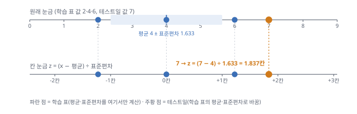


**기호** x = 그날 재료의 값 · 평균 = 학습 표에서 그 재료의 평균 · 표준편차 = 학습 표에서 그 재료가 평균에서 평균적으로 얼마나 떨어져 있나 · z = '평소보다 몇 칸 큰가'

**문장으로 읽기** "그날 값에서 평소 값(평균)을 빼고, 평소 흔들림(표준편차)으로 나눠라."

**작은 예로 직접 풀기** 학습 표에 이 재료가 3일 있다: 2, 4, 6.
1. 평균 = (2 + 4 + 6) ÷ 3 = **4**
2. 각 값 − 평균 = −2, 0, 2 → 제곱 = 4, 0, 4 → 평균 = 8 ÷ 3 = 2.667 → 루트 = **표준편차 1.633** (이 플랫폼은 n 으로 나눔 — sklearn StandardScaler, ddof=0)
3. 테스트일 값 x = 7 → z = (7 − 4) ÷ 1.633 = **1.837** → "평소보다 1.84칸 큼"

**왜 하나** 수익률(0.01 단위)과 RSI(0~100 단위)를 그대로 섞으면 숫자가 큰 RSI 가 이깁니다. 같은 눈금(칸)으로 바꿔야 비율(가중치)을 비교할 수 있습니다.

**화면·코드와 연결** 계산 따라가기 '눈금 맞추기' 단계의 평균·표준편차·z 열. `engine/experiment.py` 에서 `StandardScaler().fit(학습 표)` — **학습 표로만** 계산하고 테스트에는 그 값을 그대로 씁니다(미래 정보 차단).

<!--f:minmax-->
## 2. 최소·최대 눈금 (MinMax) — BIVA

**식** `x′ = (x − 최소) ÷ (최대 − 최소)`

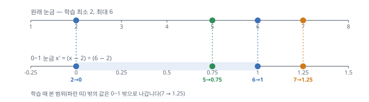


**문장으로 읽기** "학습 표의 가장 작은 값을 0, 가장 큰 값을 1 로 놓고 그 사이 어디쯤인지."

**작은 예로 직접 풀기** 학습 표 값 2, 4, 6 → 최소 2, 최대 6.
- x = 5 → (5 − 2) ÷ (6 − 2) = **0.75**
- x = 7 (학습 때 본 적 없는 큰 값) → (7 − 2) ÷ 4 = **1.25** — 테스트 값은 0~1 밖으로 나갈 수 있습니다.

**화면·코드와 연결** BIVA 계산 따라가기 '입력 창'·'최소·최대' 단계. BIVA 의 BRITS 추정값이 0~1 사이(σ)라 원본처럼 0~1 눈금을 씁니다(`input_scaler=minmax`).

<!--f:target-->
## 3. 정답(타겟) — 모든 매매 모델

**식** `r = P[t+1+k] ÷ P[t+1] − 1` (P = 시가)

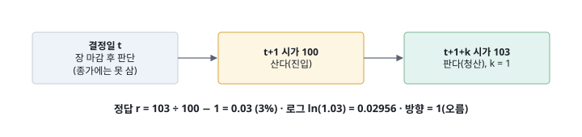


**기호** t = 결정일(장 마감 후 판단) · t+1 = 다음 거래일(진입) · k = 몇 기간 들고 있나 · P = 그날 시가

**문장으로 읽기** "결정일 다음 날 시가에 사서, 그로부터 k 기간 뒤 시가에 팔았을 때의 수익률."

**작은 예로 직접 풀기** k = 1, 다음 날 시가 100, 그다음 날 시가 103 → r = 103 ÷ 100 − 1 = **0.03 (3%)**
- 로그수익률이면 ln(103 ÷ 100) = **0.02956**
- 방향이면 r > 0 이라 **1**(오름)

**왜 다음 날 시가인가** 결정은 장이 끝난 뒤에 하므로 그날 종가에는 살 수 없습니다. 종가로 사는 것처럼 계산하면 결과가 실제보다 좋아 보입니다(미래 엿보기).

**화면·코드와 연결** 계산 따라가기 '정답(타겟)' 단계(진입일·진입 시가·청산일·청산 시가·수익률). `engine/calendar.py make_target`.

<!--f:decision-->
## 4. 결정(신호) — 학습 모델 공통

**식** `신호 = 1 if 예측 ŷ > 진입 임계치 else 0` · 확률이면 `1 if 확률 > 0.5 + 진입 임계치 else 0`

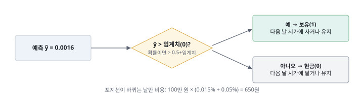


**문장으로 읽기** "예측이 문턱보다 크면 다음 날 시가에 보유(1), 아니면 현금(0)."

**작은 예로 직접 풀기** 예측 0.0016(0.16%), 임계치 0 → 0.0016 > 0 → **보유**. 확률 0.53, 임계치 0.02 → 0.53 > 0.52 → **보유**.

**비용** 포지션이 바뀌는 날 `바뀐 양 × (수수료 0.015% + 슬리피지 0.05%)`. 100만 원어치를 사면 1,000,000 × 0.00065 = **650원**.

**화면·코드와 연결** 계산 따라가기 '결정' 단계. `engine/experiment.py`(신호 변환), `engine/backtest.py`(체결·비용).

<!--f:folds-->
## 3-2. 워크포워드 폴드 — 학습 창을 밀며 반복 (움직이는 그림)

**식** `학습 = [i − 학습창, i − 비움)`, `테스트 = [i, i + 간격)`, 다음 폴드 `i ← i + 간격` (마지막 폴드는 남은 날만큼)


**기호** 학습창 = 학습에 쓰는 과거 날 수(일간 756) · 간격 = 재학습 간격·테스트 날 수(일간 21) · 비움 = 1+k(매매)

**문장으로 읽기** "과거 756일로 배우고, 그 뒤 21일을 예측해 채점하고, 21일 밀어 다시 배운다. 학습 창 끝 1+k일은 비운다."

**작은 예로 직접 풀기** 날 10개(1~10), 학습창 4, 간격 2, 비움 1
- 폴드 1: 학습 1·2·3 (4는 비움) → 테스트 5·6
- 폴드 2: 학습 3·4·5 (6은 비움) → 테스트 7·8
- 폴드 3: 학습 5·6·7 (8은 비움) → 테스트 9·10
- 날이 11개였다면 폴드 4: 학습 7·8·9 (10은 비움) → 테스트 11 (남은 하루만큼)
- 비우는 이유: 4일에 결정했다면 정답은 5·6일 가격으로 계산되는데, 5일은 테스트 구간이라 학습에 넣으면 미래를 엿봅니다.

**화면·코드와 연결** 계산 따라가기 '기간 — 폴드 N / M' 단계. `engine/calendar.py walkforward_folds`.

<!--f:ridge_sum-->
## 5. Ridge — 비율대로 더하기 (가중합)

**식** `ŷ = b + Σ_j w_j · z_j`

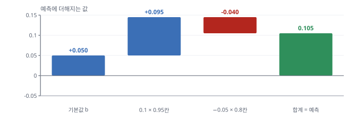


**기호** b = 기본값(절편) · w_j = j번째 재료의 비율(가중치) · z_j = j번째 재료의 칸 수(표준화 값)

**문장으로 읽기** "기본값에, 재료마다 (비율 × 칸 수)를 다 더한 것이 예측."

**작은 예로 직접 풀기** 재료 2개: b = 0.05, 비율 w = (0.1, −0.05), 칸 수 z = (0.95, 0.8)
- 0.05 + 0.1 × 0.95 + (−0.05) × 0.8 = 0.05 + 0.095 − 0.04 = **0.105**
- 각 곱(0.095, −0.04)이 그 재료의 **기여**입니다. 비율이 + 면 그 재료가 클수록 예측이 오르고, − 면 내려갑니다.

**화면·코드와 연결** 계산 따라가기 '비율대로 더하기' 표(z′·비율 w·기여). 손으로 더한 값 = `pipe.predict` 출력인지 검증 줄에서 확인.

<!--f:ridge_fit-->
## 6. Ridge — 비율을 정하는 식 (학습)

**식** `(w, b) = argmin Σ_i (y_i − b − Σ_j w_j z_ij)² + α Σ_j w_j²` → 답: `w = (Z̃ᵀZ̃ + αI)⁻¹ Z̃ᵀỹ`, `b = ȳ − z̄ᵀw`

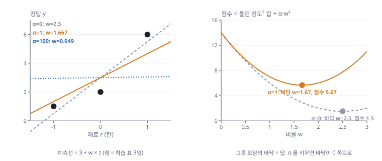


**기호** i = 학습 표의 날 · j = 재료 · y_i = i번째 날 정답 · α = alpha(벌점 세기) · Z̃, ỹ = 평균을 뺀 재료·정답 · I = 단위행렬(대각선이 1)

**문장으로 읽기 (안쪽부터)**
1. `b + Σ_j w_j z_ij` = i번째 날의 예측
2. `y_i − 예측` = 그날 틀린 정도
3. `( )²` = 제곱 — 크게 틀린 날을 더 무겁게, +·− 가 지워지지 않게
4. `Σ_i` = 모든 날 더함 → **틀린 정도의 합**
5. `+ α Σ_j w_j²` = 비율이 클수록 커지는 **벌점**
6. `argmin` = 이 합계가 **가장 작아지는** w, b 를 찾아라

**작은 예로 직접 풀기** 재료 1개(이미 표준화, 평균 0), 날 3개, α = 1

| 날 | 재료 z | 정답 y |
|---|---|---|
| 1 | −1 | 1 |
| 2 | 0 | 2 |
| 3 | 1 | 6 |

*방법 ① 넣어 보기* — b 는 정답 평균 3 (재료 평균이 0 이면 b = 정답 평균)

| w | 예측 3 + w·z | 틀린 정도² 합 | 벌점 1·w² | 점수 |
|---|---|---|---|---|
| 1.5 | 1.5, 3, 4.5 | 0.25 + 1 + 2.25 = 3.5 | 2.25 | 5.75 |
| **1.667** | 1.333, 3, 4.667 | 0.111 + 1 + 1.778 = 2.889 | 2.778 | **5.667 ← 가장 작음** |
| 2 | 1, 3, 5 | 0 + 1 + 1 = 2 | 4 | 6 |

*방법 ② 공식* — 점수를 w 에 대해 그리면 그릇(U자) 모양이고, 바닥(기울기 0)에서 정리하면
`w = Σ(z × (y − ȳ)) ÷ (Σ z² + α)`
- 평균을 뺀 정답 = −2, −1, 3
- 분자 = (−1)(−2) + 0(−1) + (1)(3) = **5** · 분모 = (1 + 0 + 1) + 1 = **3** → w = **1.667** (방법 ①과 같음)
- α = 0 → 5 ÷ 2 = 2.5 · α = 100 → 5 ÷ 102 = 0.049 → **alpha 가 크면 비율이 0 쪽으로 줄어든다.**

화면의 `(Z̃ᵀZ̃ + αI)⁻¹ Z̃ᵀỹ` 는 이 공식을 재료 18개로 넓힌 것입니다: Z̃ᵀỹ = 분자, Z̃ᵀZ̃ + αI = 분모(재료끼리의 관계까지 담은 표), ( )⁻¹ = 나누기의 행렬 버전.

**화면·코드와 연결** 계산 따라가기 '비율(w)과 기본값(b)을 정한 방법' 단계의 틀린 정도의 합·벌점·최소화한 점수, 검증 줄 "닫힌 해 공식으로 다시 구한 w·b = sklearn 이 학습한 w·b". `models/ridge.py` (sklearn Ridge).

<!--f:logistic-->
## 7. 로지스틱 — 점수를 확률로 (방향·사건 타겟)

**식** `확률 = σ(점수) = 1 ÷ (1 + e^(−점수))` · 학습: `argmin −Σ[y ln p + (1−y) ln(1−p)] + (α/2) Σ w²`

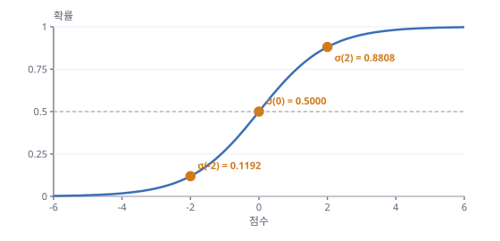


**문장으로 읽기** "점수가 0 이면 반반(50%), 클수록 100% 에, 작을수록 0% 에 가깝게." 학습은 "정답에 낮은 확률을 준 정도(로그손실)의 합 + 벌점"을 가장 작게.

**작은 예로 직접 풀기**
- 점수 0 → 1 ÷ (1 + e⁰) = 1 ÷ 2 = **0.5** · 점수 2 → 1 ÷ (1 + e^(−2)) = 1 ÷ 1.1353 = **0.8808** · 점수 −2 → **0.1192**
- 로그손실: 오를 확률 0.88 이라 했는데 실제로 올랐다(y=1) → −ln(0.88) = **0.128** (작음, 잘 맞힘). 실제로 내렸다(y=0) → −ln(1 − 0.88) = −ln(0.12) = **2.120** (큼, 자신 있게 틀림).

**화면·코드와 연결** 계산 따라가기(방향 타겟)의 '확률' 값. `models/ridge.py` LogisticRegression(C = 1/α, 반복 계산 lbfgs).

<!--f:lgbm-->
## 8. LightGBM — 질문 나무를 차례로 더하기

**식** `F₀ = 평균(y)`, `F_m(x) = F_{m−1}(x) + η × 나무_m(x)`, 잎 값 `= −G ÷ (H + λ)`, 나누기 이득 `= G_L²/(H_L+λ) + G_R²/(H_R+λ) − G²/(H+λ)`

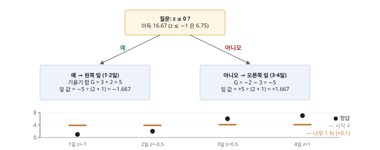


**기호** F = 지금까지의 예측 · η(에타) = 학습률 · G = 그 칸에 든 날들의 기울기 합 · H = 헤시안 합(제곱오차에서는 날 수) · λ = reg_lambda · L, R = 왼쪽·오른쪽

**문장으로 읽기** "처음엔 모두 평균으로 예측. 지금 예측이 틀린 만큼(기울기 g = 예측 − 정답)을 가장 잘 나누는 질문을 골라 둘로 나누고, 칸마다 '−기울기 합 ÷ (날 수 + λ)' 만큼 고친다. 그 고침에 학습률을 곱해 더하고 반복."

**작은 예로 직접 풀기** 날 4개, 재료 z = (−1, −0.5, 0.5, 1), 정답 y = (1, 2, 6, 7), λ = 1, η = 0.1
1. 시작 F₀ = (1+2+6+7) ÷ 4 = **4**
2. 기울기 g = 예측 − 정답 = (3, 2, −2, −3)
3. 질문 후보 비교 — "z ≤ 0?": 왼쪽 G = 3+2 = 5 (2일), 오른쪽 G = −5 (2일) → 이득 = 25/3 + 25/3 − 0/5 = **16.67**. "z ≤ −1?": 왼쪽 G = 3 (1일), 오른쪽 G = −3 (3일) → 9/2 + 9/4 − 0 = **6.75** → **"z ≤ 0?" 을 고름**
4. 잎 값: 왼쪽 −5 ÷ (2+1) = **−1.667**, 오른쪽 +5 ÷ 3 = **+1.667**
5. 학습률을 곱해 더함: 왼쪽 날들 4 + 0.1 × (−1.667) = **3.833**, 오른쪽 **4.167** (정답 1·2 쪽으로 내려가고 6·7 쪽으로 올라감)
6. 새 기울기로 다음 나무를 만들고 반복. 예측할 날 z = 0.3 → "z ≤ 0? 아니오" → 4 + 0.1667 = **4.167**
(실제 LightGBM 은 나무마다 날짜·재료를 일부만 무작위로 뽑고, 잎 수·깊이·잎의 최소 날 수를 지킵니다. 잎 값에는 학습률이 이미 곱해져 저장됩니다.)

**화면·코드와 연결** 계산 따라가기 '나무 N그루를 따라 내려가기' 표(질문과 답·잎 값·누적 합), 검증 "잎 값을 손으로 더한 점수 = LightGBM raw_score". `models/lightgbm_model.py`.

<!--f:arima-->
## 9. ARIMA — 지난 변화와 지난 충격으로 다음 변화를

**식** `r_t = c + Σ_i φ_i r_{t−i} + ε_t + Σ_j θ_j ε_{t−j}`, 예측 `r̂_{t+1} = c + Σ φ_i r_{t+1−i} + Σ θ_j ε_{t+1−j}` (미래 ε = 0)

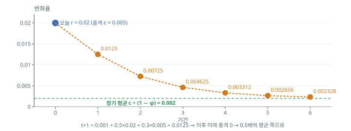


**기호** r = 1기간 변화율 · c = 상수(절편) · φ(파이) = AR 계수 '지난 변화가 이어지는 정도' · θ(세타) = MA 계수 '지난 충격이 남는 정도' · ε(엡실론) = 충격(예측과 실제의 차이)

**문장으로 읽기** "다음 변화율 = 상수 + (계수 × 지난 변화율들) + (계수 × 지난 충격들). 모르는 미래 충격은 0."

**작은 예로 직접 풀기** ARMA(1,1): c = 0.001, φ = 0.5, θ = 0.3. 오늘 변화율 r_t = 0.02, 오늘의 충격 ε_t = 0.005
- t+1: 0.001 + 0.5 × 0.02 + 0.3 × 0.005 = 0.001 + 0.01 + 0.0015 = **0.0125**
- t+2: 0.001 + 0.5 × 0.0125 + 0.3 × 0(미래 충격) = **0.00725**
- t+3: 0.001 + 0.5 × 0.00725 = **0.004625** → 점점 장기 평균 c ÷ (1 − φ) = 0.001 ÷ 0.5 = **0.002** 로 다가감
- c 는 '평균 변화율'이 아니라 절편입니다. 평균은 c ÷ (1 − Σφ).

**계수는 어떻게 정하나** 학습 창 변화율이 이 식에서 '가장 그럴듯하게' 나오는 φ·θ·c·σ² 를 반복 계산(최대우도)으로 찾습니다. **충격 ε 는 어떻게 아나** 데이터 처음부터 결정일까지 한 기간씩 '예측 → 실제와 비교 → 차이 = 충격'을 이어 계산합니다(칼만 필터, 다음 절).

**화면·코드와 연결** 계산 따라가기 '계수 정하기'(계수표), '앞으로 N기간을 한 기간씩 이어 예측' 표(항마다 계수 × 값). `models/arima.py`(statsmodels SARIMAX).

<!--f:roots-->
## 9-2. 근의 크기 — 정상성·가역성 점검 (ARIMA·SARIMA 의 '추정 제약')

**식** AR 쪽 `1 − φ₁z − φ₂z² − … = 0`, MA 쪽 `1 + θ₁z + θ₂z² + … = 0` 의 근 z 를 구해 **모든 |z| > 1** 인지 본다



**기호** z = 식을 0 으로 만드는 수(근, 복소수일 수 있음) · |z| = 근의 크기(원점에서의 거리) · 정상성(stationarity) = 한 번의 충격이 시간이 지나면 사라짐 · 가역성(invertibility) = 지난 충격 ε 를 지난 관측 r 로 되짚어 알아낼 수 있고, 먼 과거일수록 덜 남음

**문장으로 읽기** "AR 계수로 만든 식의 근이 모두 1 보다 멀리 있으면 충격이 사그라들고(정상), MA 계수로 만든 식의 근이 모두 1 보다 멀리 있으면 먼 과거의 오차일수록 덜 남는다(가역)."

**작은 예로 직접 풀기 ① AR(1)** 식 1 − φz = 0 → z = 1 ÷ φ
- φ = 0.5 → z = 2 (|z| > 1, 정상). 오늘 충격 1 의 영향이 1, 0.5, 0.25, 0.125 … 로 **줄어듦**
- φ = 1.2 → z = 0.833 (|z| < 1, 비정상). 영향이 1, 1.2, 1.44, 1.728 … 로 **커짐** — 변화율이 끝없이 불어나는 모델이라 현실적이지 않음

**작은 예로 직접 풀기 ② MA(1)** 식 1 + θz = 0 → z = −1 ÷ θ. 오늘의 충격을 관측으로 되짚으면 `ε_t = r_t − θ r_(t−1) + θ² r_(t−2) − θ³ r_(t−3) + …`
- θ = 0.5 → z = −2 (|z| = 2 > 1, 가역). 되짚는 무게 1, −0.5, 0.25, −0.125 … **줄어듦** → 최근 관측만으로 충격을 알 수 있음
- θ = 2 → z = −0.5 (|z| = 0.5 < 1, 가역 아님). 무게 1, −2, 4, −8 … **커짐** → 먼 과거일수록 더 크게 남아 충격을 되짚을 수 없음
- 왜 해석할 수 없나: 데이터가 보여 주는 것은 '오늘과 어제 변화율의 상관'인데, MA(1) 에서 그 값은 θ ÷ (1 + θ²) 입니다. θ = 0.5 → 0.5 ÷ 1.25 = **0.4**, θ = 2 → 2 ÷ 5 = **0.4**. 두 θ 가 데이터에서 똑같이 보이므로 숫자 θ 자체에는 뜻이 없고, 관례상 가역인 쪽(0.5)을 고릅니다. 가역성 제약을 켜면 추정이 처음부터 그쪽에서만 이뤄집니다.

**제약을 켜고 끄면** 설정의 '추정 제약' 묶음: `enforce_stationarity`(정상성 제약), `enforce_invertibility`(가역성 제약). 기본은 둘 다 **예** — statsmodels 와 원 노트북 2(`ARIMA(훈련, order=(2,1,2)).fit()`, `SARIMAX(…).fit(disp=False)`)의 기본과 같습니다. 2026-11-06 전 이 도구는 둘 다 **아니오**로 고정이었습니다(옛 결과를 그대로 재현하려면 둘 다 아니오). 켜든 끄든 예측값은 같은 칼만 필터로 계산되고, 달라지는 것은 '어떤 계수를 찾느냐'입니다.

**실제 데이터 예 (091160 일간, ARIMA(2,0,2), 학습 창 756일 − 비움 2일 = 754개, 봉인 시작 2025-01-01 직전 마지막 개발 폴드의 결정일 2024-12-30)**
- 제약 끔: φ₁ = 0.584, φ₂ = 0.042, θ₁ = −1.372, θ₂ = −0.154. MA 근 0.677(**가역 아님**), AR 근 1.542 — 1 ÷ 0.677 = 1.476 이 AR 근 1.542 와 가까워 AR 과 MA 가 거의 서로 지우는 모양(차수가 데이터에 비해 많다는 신호)
- 제약 켬: φ₁ = 0.008, φ₂ = −0.005, θ₁ = 0.008, θ₂ = −0.005, 근은 모두 13 이상(정상·가역). 계수가 거의 0 — '지난 변화율로 다음 변화율을 거의 못 맞힌다'는 결론
- SARIMA(1,0,1)(1,1,1,5) 는 두 설정의 계수가 거의 같습니다(Θ = −0.970 / −0.971). 다만 계절 MA 근의 크기가 1.006 으로 1 에 매우 가깝습니다 — 계절 차분(D=1)을 한 뒤 Θ ≈ −1 이 그 차분을 되돌리는 모양이라, 일간 변화율에는 5일 계절 차분이 필요 없다(과잉 차분)는 신호입니다.

**화면·코드와 연결** 계산 따라가기 '계수 점검 — 다항식의 근 크기' 표(근·크기·판정)와 검사 줄. `models/arima.py`, `models/sarima.py`, `engine/explain.py`(`_series`).

<!--f:kalman-->
## 10. 칼만 필터 — 지난 충격을 알아내고 정확한 예측을 내는 방법

**식** `a ← T·a + c` (다음 상태 예측), `예측 = Z·a + d`, 관측이 들어오면 `a ← a + K·(실제 − 예측)`

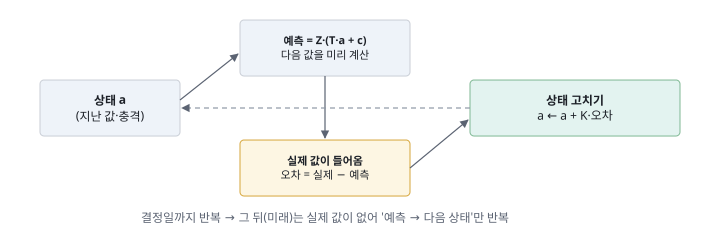


**기호** a = 상태(모델이 기억하는 숫자 묶음 — 지난 값·지난 충격 등) · T = 상태가 다음 기간으로 넘어가는 규칙(계수로 만든 표) · Z = 상태에서 관측값을 꺼내는 규칙 · K = 고치는 비율

**문장으로 읽기** "기억(상태)으로 다음 값을 예측하고, 실제 값이 들어오면 틀린 만큼 기억을 고친다. 결정일까지 반복한 뒤, 고칠 실제 값이 없는 미래는 '예측 → 다음 상태'만 반복한다."

**작은 예로 직접 풀기** 가장 단순한 AR(1)(θ 없음): c = 0.001, φ = 0.5. 상태 a = 오늘 변화율 0.02
- 다음 상태 = 0.001 + 0.5 × 0.02 = 0.011 → 예측 r̂ = **0.011**
- 그다음 = 0.001 + 0.5 × 0.011 = **0.0065** …
MA 항(θ)이 있으면 상태에 '지난 충격'이 들어가고, K 로 고치는 단계에서 충격이 추정됩니다.

**왜 화면에 두 가지 계산이 있나** '펼친 재귀식'(9절)은 이해용입니다. MA 다항식이 **가역이 아니면**(추정된 θ 로 만든 다항식의 근 크기가 1 이하) 필터가 추정한 충격이 실제 충격과 같아지지 않아 재귀식이 근사가 됩니다. **정확한 값은 상태공간 식**이고, 화면 검증 "상태공간 식으로 손 계산 = statsmodels forecast" 가 그것입니다(차이 0).

**화면·코드와 연결** '결정일까지의 변화율 전부를 필터에 통과' 표(한 기간 앞 예측·오차), 검증 줄. statsmodels `res.apply(…, refit=False)` → `forecast`.

<!--f:sarima-->
## 11. SARIMA — 계절(s 기간 전)과 계절 차분을 펼치는 법

**식** `φ(L)Φ(L^s)(1−L)^d(1−L^s)^D r_t = θ(L)Θ(L^s) ε_t`

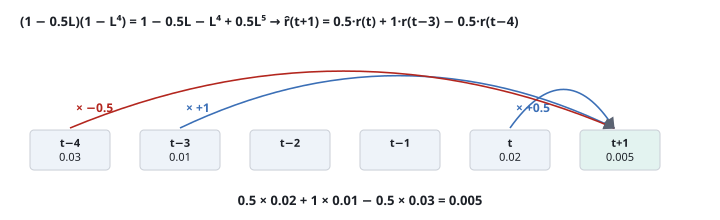


**기호** L = '한 기간 전으로' (L·r_t = r_{t−1}, L⁴·r_t = r_{t−4}) · Φ, Θ = 계절 AR·MA 계수 · D = 1 이면 s 기간 전과의 차이를 먼저 취함

**문장으로 읽기** "괄호들을 곱해 펼치면 '지난 몇 기간 전 값에 얼마를 곱해 더하나'의 목록이 나온다."

**작은 예로 직접 풀기** φ = 0.5, s = 4, D = 1 (MA 없음): `(1 − 0.5L)(1 − L⁴)` 를 곱해 펼치면 `1 − 0.5L − L⁴ + 0.5L⁵`
→ r_t = 0.5·r_{t−1} + r_{t−4} − 0.5·r_{t−5} + ε_t
다음 기간 예측에 r_t = 0.02(1기간 전), r_{t−3} = 0.01(4기간 전), r_{t−4} = 0.03(5기간 전)을 넣으면
0.5 × 0.02 + 0.01 − 0.5 × 0.03 = 0.01 + 0.01 − 0.015 = **0.005**

**화면·코드와 연결** 계산 따라가기 '한 기간씩 이어 예측' 표의 계수가 이 펼친 계수(A_i, M_j)입니다. `models/sarima.py`.

<!--f:compound-->
## 12. 여러 기간 예측을 k기간 수익률로 묶기 (복리)

**식** `ŷ = (1 + r̂₁) × (1 + r̂₂) × … × (1 + r̂_k) − 1` · 로그면 `ŷ = Σ ln(1 + r̂)`

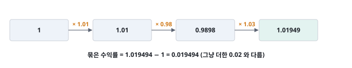


**문장으로 읽기** "기간마다의 변화율을 이어 곱해 전체 변화율로."

**작은 예로 직접 풀기** r̂ = 0.01, −0.02, 0.03 → 1.01 × 0.98 × 1.03 − 1 = 1.019494 − 1 = **0.019494** (그냥 더한 0.02 와 다름). 로그: ln 1.01 + ln 0.98 + ln 1.03 = 0.00995 − 0.02020 + 0.02956 = **0.01931**

**매매 모드에서 첫 기간을 버리는 이유** 정답이 '다음 날 시가에 사서'부터라, 결정일 → 다음 날 사이의 예측(r̂₁)은 들고 있지 않은 구간입니다.

**화면·코드와 연결** ARIMA·SARIMA '묶기' 단계. `engine/experiment.py _agg`.

<!--f:vecm-->
## 13. VECM — 벌어진 만큼 되돌아오기

**식** `e = β′·Y_{t−1}`, `ΔŶ_t = α·e + Σ Γ_i ΔY_{t−i} + 상수·계절`, `Ŷ_t = Y_{t−1} + ΔŶ_t`

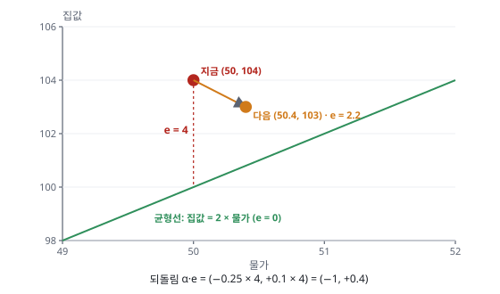


**기호** Y = 대상·변수의 원래 값 묶음 · β′ = 장기 균형식(오래 보면 일정한 조합) · e = 균형에서 벗어난 정도 · α = 되돌아오는 속도 · Γ = 지난 변화의 영향 · Δ = 변화(이번 − 지난)

**문장으로 읽기** "지금이 균형에서 얼마나 벗어났는지 보고(e), 벗어난 만큼 반대로 당기는 변화(α·e)와 지난 변화의 영향(Γ·ΔY)을 더해 다음 값을 만든다."

**작은 예로 직접 풀기** 변수 2개(집값, 물가), β′ = (1, −2) → 균형: 집값 − 2 × 물가 = 0. α = (−0.25, 0.1), Γ 없음.
- 지금 집값 104, 물가 50 → e = 104 − 2 × 50 = **4** (집값이 균형보다 4 높음)
- 되돌림 α·e = (−0.25 × 4, 0.1 × 4) = (**−1, +0.4**)
- 다음 값 = (104 − 1, 50 + 0.4) = (**103, 50.4**) → 이탈 e = 103 − 100.8 = 2.2 로 줄어듦. 집값은 내려오고 물가는 올라 다시 균형 쪽으로.

**화면·코드와 연결** 계산 따라가기 '장기 균형식·되돌아오는 속도·단기 동학' 표(β·α·Γ), '한 기간씩 계산' 표(균형 이탈·되돌림·단기·상수·계절·변화·다음 값). `models/vecm.py`.

<!--f:nn_train-->
## 14. 신경망 학습 — 가중치를 조금씩 고치기 (LSTM·GRU·BIVA 공통)

**식** `손실 = 평균((ŷ − y)²)`, `w ← w − 학습률 × (손실의 기울기)`

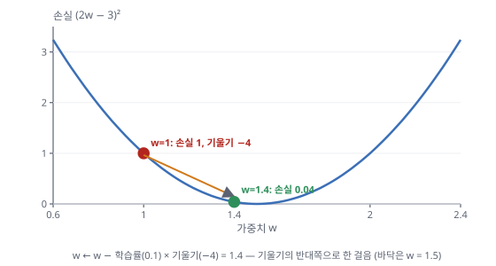


**문장으로 읽기** "예측과 정답의 차이를 줄이는 방향(기울기의 반대)으로 가중치를 조금 옮긴다. 이것을 묶음(배치)마다, 전체를 여러 바퀴(epoch) 반복."

**작은 예로 직접 풀기** 가중치 1개: ŷ = w × x, x = 2, 정답 y = 3, 처음 w = 1, 학습률 0.1
- ŷ = 2, 손실 = (2 − 3)² = **1**
- 기울기 = 2 × (ŷ − y) × x = 2 × (−1) × 2 = **−4** → w = 1 − 0.1 × (−4) = **1.4**
- 다시: ŷ = 2.8, 손실 = (2.8 − 3)² = **0.04** — 줄었다
- **Adam** 은 이 '옮기는 크기'를 가중치마다 지난 기울기들로 자동 조절하는 방법입니다. **기울기 자르기 1.0** = 기울기 묶음의 크기가 1 보다 크면 1 로 줄여 한 번에 너무 멀리 가지 않게.
- **조기종료**: 학습에 쓰지 않은 검증 데이터의 손실이 정한 횟수 동안 나아지지 않으면 멈추고, 가장 좋았던 때의 가중치로 되돌림.

**화면·코드와 연결** LSTM·GRU·BIVA 계산 따라가기 '학습' 단계의 epoch 별 손실 표. `models/lstm.py`·`gru.py`·`biva.py`.

<!--f:lstm_cell-->
## 15. LSTM 셀 — 문 세 개로 기억을 갱신

**식** `i = σ(…), f = σ(…), g = tanh(…), o = σ(…)`, `c′ = f ⊙ c + i ⊙ g`, `h′ = o ⊙ tanh(c′)`. 각 (…) = `W·x + U·h + b` (그 문의 가중치 × 이번 입력 + 그 문의 가중치 × 지난 은닉 + 편향)

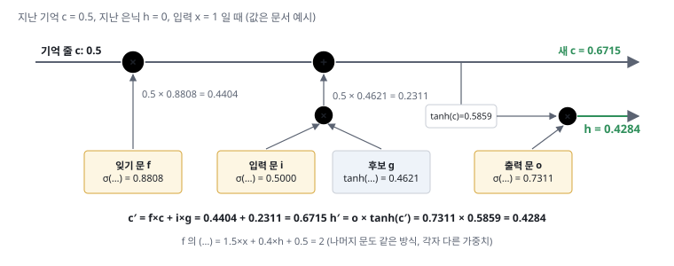
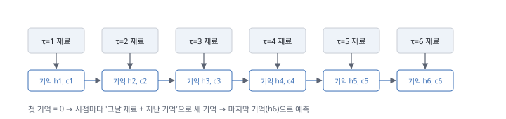


**기호** i = 입력 문(새 정보를 얼마나 쓸지) · f = 잊기 문(지난 기억을 얼마나 남길지) · g = 새 정보 후보 · o = 출력 문 · c = 기억 · h = 내보내는 값(은닉)

**문장으로 읽기** "지난 기억 중 f 만큼 남기고, 새 정보 g 중 i 만큼 더해 새 기억 c 를 만들고, 그중 o 만큼 바깥으로 내보낸다."

**작은 예로 직접 풀기** 은닉 1개, 지난 기억 c = 0.5, 지난 은닉 h = 0
- 잊기 문의 (…) = W_f·x + U_f·h + b_f = 1.5 × 1 + 0.4 × 0 + 0.5 = **2** → f = σ(2) = **0.8808**
- 나머지 (…)가 입력 문 0, 후보 0.5, 출력 문 1 이라면 → i = σ(0) = **0.5**, g = tanh(0.5) = **0.4621**, o = σ(1) = **0.7311**
- 새 기억 c′ = 0.8808 × 0.5 + 0.5 × 0.4621 = 0.4404 + 0.2311 = **0.6715**
- 내보내는 값 h′ = 0.7311 × tanh(0.6715) = 0.7311 × 0.5859 = **0.4284**
이것을 창의 시점마다(처음 h = 0, c = 0) 반복하고, 마지막 시점의 h 로 예측합니다(16절).

**화면·코드와 연결** LSTM 계산 따라가기 '셀 계산' 표(층·시점·은닉 단위마다 i·f·g·o·c·h). PyTorch nn.LSTM 과 같은 식.

<!--f:gru_cell-->
## 15-2. GRU 셀 — 문 두 개

**식** `r = σ(…), z = σ(…)`, `n = tanh(W_n·x + b + r ⊙ (U_n·h + b))`, `h′ = (1 − z) ⊙ n + z ⊙ h`

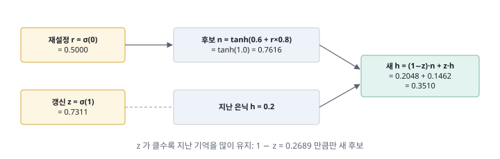


**문장으로 읽기** "지난 기억을 r 만큼 보고 새 후보 n 을 만든 뒤, 새 후보와 지난 기억을 (1 − z) : z 로 섞는다."

**작은 예로 직접 풀기** 지난 은닉 h = 0.2. r 의 (…) = 0 → r = **0.5**, z 의 (…) = 1 → z = **0.7311**. 후보의 입력 부분 0.6, 기억 부분 0.8 → n = tanh(0.6 + 0.5 × 0.8) = tanh(1.0) = **0.7616**
→ h′ = (1 − 0.7311) × 0.7616 + 0.7311 × 0.2 = 0.2048 + 0.1462 = **0.3510**

**화면·코드와 연결** GRU '셀 계산' 표(r·z·n·h).

<!--f:rnn_head-->
## 16. 마지막 은닉으로 예측 (LSTM·GRU)

**식** `점수 = b + Σ_u w_u · h_u`, `ŷ = 점수 × σ_y + μ_y`

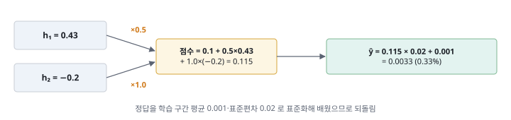


**기호** h_u = 마지막 시점 은닉 u번째 값 · μ_y, σ_y = 학습 구간 정답의 평균·표준편차(정답을 표준화해 학습했으므로 되돌림)

**작은 예로 직접 풀기** h = (0.43, −0.2), w = (0.5, 1.0), b = 0.1 → 점수 = 0.1 + 0.215 − 0.2 = **0.115**. μ_y = 0.001, σ_y = 0.02 → ŷ = 0.115 × 0.02 + 0.001 = **0.0033** (0.33%)

**화면·코드와 연결** '마지막 시점의 은닉으로 예측' 표. 검증 "손으로 계산한 셀·Linear = PyTorch 출력".

<!--f:brits-->
## 17. BIVA Stage 1 — 빈 칸 채우기 (BRITS)

> 🎞 **BIVA 코드 따라가기** — 17~22절의 계산이 원본 코드에서 실제로 어떤 순서로 실행되는지(어느 변수가 어디서 잘리고·합쳐지고·몇 번 반복되는지)를 실데이터 실행 기록으로 한 줄씩 보여 주는 화면: [단계별 화면 열기](guide_build/walk/biva.html) (63단계, 화면의 숫자는 실제 실행값이며 결과 파일 repro_biva_orig_9d68fbbfb7e3 의 예측과 같음, 손으로 다시 계산한 검증 34개). 같은 내용의 영상(약 25분, 소리 없음): [MP4](guide_build/walk/biva.mp4). 화면 오른쪽 아래 '음성 설명'을 켜면 브라우저의 한국어 음성으로 읽어 줍니다.

**식** `x̂ = σ(W·(γ⊙h) + b)` (기억으로 추정), `ẑ = σ((W_f⊙(1−I))·x_c + b_f)` (다른 변수로 추정, 자기 자신은 0), `ĉ = |0.5·ẑ + 0.5·x̂|`, `채운 값 = m·x + (1 − m)·ĉ`, `γ = exp(−max(0, W·δ + b))`

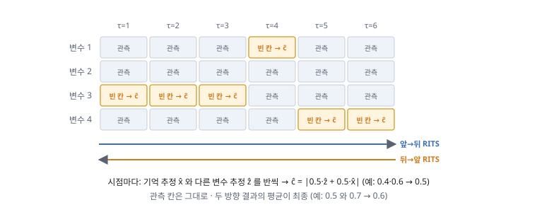


**기호** m = 관측이면 1, 빈 칸이면 0 · δ = 얼마나 오래 비었나(원본 코드 규칙) · γ = 기억을 줄이는 비율(0~1)

**문장으로 읽기** "시점마다 ① 지금까지의 기억으로 추정 ② 같은 시점의 다른 변수들로 추정 ③ 반씩 섞음 ④ 관측된 칸은 원래 값 그대로, 빈 칸만 섞은 값으로. 오래 비었을수록 기억을 줄인다. 앞→뒤, 뒤→앞 두 번 하고 평균."

**작은 예로 직접 풀기**
- 빈 칸 하나: 기억 추정 x̂ = 0.6, 다른 변수 추정 ẑ = 0.4 → ĉ = |0.5 × 0.4 + 0.5 × 0.6| = **0.5** → 채운 값 0.5
- 같은 시점의 관측 칸(값 0.8, 추정 0.7)은 0.8 그대로 두고, 차이 |0.8 − 0.7| = 0.1 이 보간 손실에 들어감
- W·δ + b = 0.7 이면 γ = e^(−0.7) = **0.4966** → 기억 h 를 절반쯤으로 줄여 씀
- 앞→뒤 결과 0.5, 뒤→앞 결과 0.7 이면 최종 = (0.5 + 0.7) ÷ 2 = **0.6**, 일관성 손실에 0.1 × |0.5 − 0.7| 이 들어감

**화면·코드와 연결** BIVA 'Stage 1' 표(두 방향 × 시점 × 변수의 δ·x̂·ẑ·ĉ·채운 값)와 '채운 칸만 모은 표'. `models/biva_src/BIVA_RITS.py`, `BIVA_BRITS.py`(원본).

<!--f:moving_avg-->
## 18. BIVA Stage 2 — 추세·주기 나누기 (이동평균, 끝값 복사)

**식** `추세_τ = 평균(붙인 열[τ … τ+k−1])`, `주기_τ = x_τ − 추세_τ`

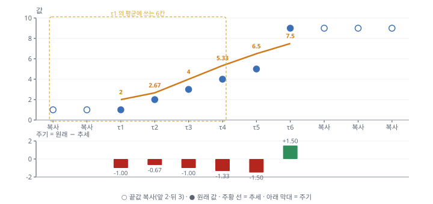


**문장으로 읽기** "창 양끝에 끝값을 복사해 붙인 뒤, k 개씩 평균을 내 추세로. 원래 값에서 추세를 뺀 나머지가 주기."

**작은 예로 직접 풀기** 창 6개 값 1, 2, 3, 4, 5, 9, k = 6(짝수 → 앞에 (6−1)÷2 = 2개, 뒤에 6÷2 = 3개 복사)
- 붙인 열: 1, 1, **1, 2, 3, 4, 5, 9**, 9, 9, 9
- 추세: τ1 = (1+1+1+2+3+4)/6 = **2**, τ2 = (1+1+2+3+4+5)/6 = **2.667**, τ3 = (1+2+3+4+5+9)/6 = **4**, τ4 = (2+3+4+5+9+9)/6 = **5.333**, τ5 = (3+4+5+9+9+9)/6 = **6.5**, τ6 = (4+5+9+9+9+9)/6 = **7.5**
- 주기 = 원래 − 추세: **−1, −0.667, −1, −1.333, −1.5, +1.5** (마지막 날의 급등 9 가 주기 +1.5 로 드러남)

**화면·코드와 연결** BIVA 'Stage 2' 표(시점·변수마다 채운 값·추세·주기). 원본 `moving_avg`(AvgPool1d).

<!--f:conv1d-->
## 19. BIVA 추세·주기 경로 — 변수 섞기(Conv1d, 커널 1)와 시간 가중합

**식** `a_τ = W·x_τ + b` (시점마다 따로), `예측 = Σ_τ w_τ · a_τ + b`

**문장으로 읽기** "같은 시점의 변수들을 가중합해 개수를 줄이고(시점끼리는 섞지 않음), 마지막에 시점들을 가중합해 값 하나."

{{FIG:conv1d_anim}}

**작은 예로 직접 풀기** 변수 3개 → 1개: W = (0.5, −1, 2), b = 0.1
- τ1 x = (0.2, 0.1, 0.3) → 0.1 + 0.5×0.2 − 1×0.1 + 2×0.3 = **0.7**
- τ2 x = (0.4, 0.2, 0.2) → 0.1 + 0.2 − 0.2 + 0.4 = **0.5** · τ3 x = (0.2, 0.1, 0.4) → 0.1 + 0.1 − 0.1 + 0.8 = **0.9** (같은 W 를 시점마다 그대로 씀)
- 시간 가중치가 처음 값 1/3 씩이면 → (0.7 + 0.5 + 0.9) ÷ 3 = **0.7** (평균). 원본은 이 1/3 을 시작값으로 두고 학습하며 바꿉니다.
- 원본 구조: 추세 경로는 Conv1d 3단(변수 V → V/4 → V/16 → 1), 주기 경로는 [인코더 출력, z] 2×잠재 크기 → 잠재 → 잠재/2 → 1. 모두 커널 1, 단 사이에 활성화가 없습니다(그래서 3단을 곱하면 결국 한 번의 가중합과 같은 모양).

**화면·코드와 연결** BIVA '추세 → 예측값'·'주기 → 예측값' 표(단계·채널·시점별 값, 시간 가중치).

<!--f:vae-->
## 20. BIVA Stage 3 — 공통요인 z (LSTM-VAE)

**식** `μ = ReLU(W_μ·e + b)`, `log σ² = ReLU(W_v·e + b)`, `σ = exp(½·log σ²)`, `z = μ + ε·σ`, `ε ~ N(0,1)`, `KLD = −½ Σ_τ (1 + log σ² − μ² − σ²)`

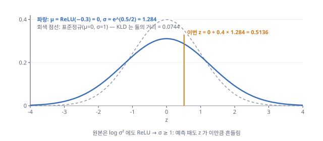


**기호** e = 인코더(LSTM 4층) 출력 · μ = 평균 · σ = 흩어짐 · ε = 매번 새로 뽑는 무작위 수

**문장으로 읽기** "주기 성분을 줄인 값에서 평균과 흩어짐을 만들고, 평균에 '무작위 × 흩어짐'을 더해 요인 z 를 뽑는다." KLD 는 "μ, σ 가 평균 0·흩어짐 1 에서 얼마나 먼지"의 벌점.

**작은 예로 직접 풀기** Linear 결과가 μ 쪽 −0.3, log σ² 쪽 0.5 → μ = ReLU(−0.3) = **0**, log σ² = **0.5** → σ = e^0.25 = **1.284**. 이번에 뽑힌 ε = 0.4 → z = 0 + 0.4 × 1.284 = **0.5136**. KLD(한 칸) = −½ × (1 + 0.5 − 0 − e^0.5) = −½ × (1.5 − 1.6487) = **0.0744**

**실행에서 확인한 사실** `repro_biva_orig`(500 epoch, 마지막 폴드)의 고른 가중치에서는 ReLU 앞 값이 **모든 창에서 음수**라 μ = 0, log σ² = 0 → σ = 1, **z = ε**(입력과 무관한 잡음), KLD = 0 입니다. KLD 가 μ·log σ² 를 늘 아래로 밀고, ReLU 가 0 아래를 막아 기울기가 사라지기 때문입니다(죽은 ReLU). 자세한 수치는 모델 문서 BIVA 절과 코드 따라가기 13장.

**원본의 특징** ReLU 때문에 log σ² ≥ 0 → **σ ≥ 1**. 예측할 때도 z 를 뽑아 같은 창도 계산할 때마다 값이 흔들립니다(계산 따라가기 '같은 창 100번 예측'). VAE 손실 = Σ_요인(0.5·MSE + 0.5·KLD_요인) — 원본 계산 방식.

**화면·코드와 연결** BIVA 'Stage 3' 표(인코더 층별 출력, μ·log σ²·σ·ε·z), '디코더 → VAE 손실'. `models/biva_src/BIVA_LSTM_VAE.py`.

<!--f:biva_combine-->
## 21. BIVA Stage 4 — 합치기

**식** `점수 = α·주기 예측 + (1 − α)·추세 예측`, `ŷ = 점수 × σ_y + μ_y`

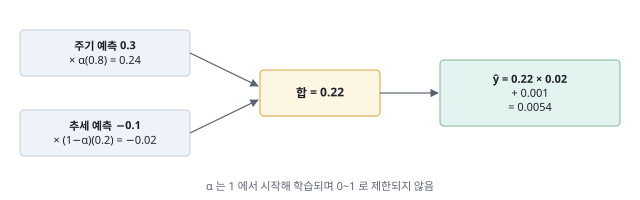


**작은 예로 직접 풀기** α = 0.8, 주기 예측 0.3, 추세 예측 −0.1 → 0.8 × 0.3 + 0.2 × (−0.1) = 0.24 − 0.02 = **0.22**. μ_y = 0.001, σ_y = 0.02 → ŷ = 0.22 × 0.02 + 0.001 = **0.0054**. (α 는 1 에서 시작해 학습되며 0~1 로 제한되지 않습니다.)

**화면·코드와 연결** BIVA 'Stage 4' 값.

<!--f:noise-->
## 22. 같은 창을 여러 번 예측했을 때의 흔들림

**식** `평균 = Σ ŷ_r ÷ n`, `표준편차 = √(Σ (ŷ_r − 평균)² ÷ n)`

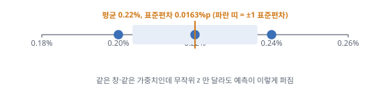


**작은 예로 직접 풀기** 세 번 예측 0.20%, 0.22%, 0.24% → 평균 **0.22%**, 표준편차 √((0.02² + 0 + 0.02²) ÷ 3) = **0.0163%p**. 표준편차가 예측 자체에 비해 크면 '오를지 내릴지' 판단이 무작위에 좌우됩니다.

**화면·코드와 연결** BIVA '같은 창을 100번 예측하면' 단계.

<!--f:rule_ma-->
## 23. 규칙 — 이동평균 교차

**식** `MA_n = 최근 n개 종가의 평균`, `포지션 = 1 if MA_짧은 > MA_긴 else 0`

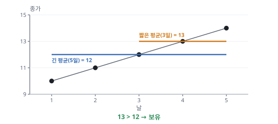


**작은 예로 직접 풀기** 종가 10, 11, 12, 13, 14, 짧은 3·긴 5 → 짧은 평균 (12+13+14)/3 = **13**, 긴 평균 (10+…+14)/5 = **12** → 13 > 12 → **보유**

<!--f:rule_momentum-->
## 24. 규칙 — 모멘텀

**식** `r = 종가_t ÷ 종가_(t−L) − 1`, `포지션 = 1 if r > 0 else 0`

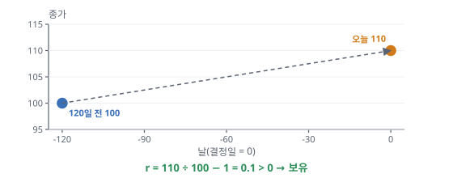


**작은 예로 직접 풀기** 120일 전 100, 오늘 110 → 110 ÷ 100 − 1 = **0.1 > 0** → **보유**

<!--f:rule_rsi-->
## 25. 규칙 — RSI (Wilder 평활)

**식** `상승 평균_t = (1 − 1/n)·상승 평균_(t−1) + (1/n)·max(Δ, 0)` (하락도 같은 방식, max(−Δ, 0)), `RSI = 100 − 100 ÷ (1 + 상승 평균 ÷ 하락 평균)`

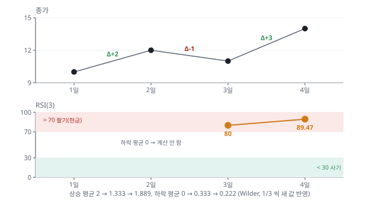


**문장으로 읽기** "최근 오른 폭과 내린 폭을 오래된 날일수록 가볍게 평균 내고, 오른 쪽이 얼마나 우세한지 0~100 으로."

**작은 예로 직접 풀기** n = 3, 종가 10, 12, 11, 14 → 변화 Δ = +2, −1, +3
- 상승 평균: 첫 값 **2** → (2/3)×2 + (1/3)×0 = **1.333** → (2/3)×1.333 + (1/3)×3 = **1.889**
- 하락 평균: 첫 값 **0** → (2/3)×0 + (1/3)×1 = **0.333** → (2/3)×0.333 + (1/3)×0 = **0.222**
- 둘째 날 RSI = 100 − 100 ÷ (1 + 1.333 ÷ 0.333) = 100 − 100 ÷ 5 = **80** · 셋째 날 = 100 − 100 ÷ (1 + 8.5) = **89.47** (첫날은 하락 평균이 0 이라 계산하지 않음)
- 규칙: RSI < 아래 문턱(30) → 사고, > 위 문턱(70) → 팔고, 사이 → 어제 상태 유지 → 89.47 > 70 → **현금**

<!--f:rule_quantile-->
## 26. 규칙 — 분위수(SOX 급등 회피)

**식** `기준 = 과거 값들의 q 분위(선형 보간)`, `포지션 = 0 if 오늘 값 > 기준 else 1`

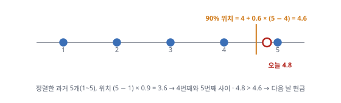


**문장으로 읽기** "과거 값들을 작은 순서로 늘어놓았을 때 q(예: 90%) 위치의 값을 기준으로, 오늘이 그보다 크면 다음 날은 쉰다."

**작은 예로 직접 풀기** 과거 5개 1, 3, 2, 5, 4 → 정렬 1, 2, 3, 4, 5 · q = 0.9 → 위치 (5 − 1) × 0.9 = 3.6 → 4번째(4)와 5번째(5) 사이 0.6 지점 → 4 + 0.6 × (5 − 4) = **4.6**. 오늘 4.8 > 4.6 → **현금**

<!--f:metrics-->
## 27. 성적표 — 총수익·연복리·변동성·샤프·최대낙폭

**식** `총수익 = Π(1 + r) − 1`, `연복리 = (1 + 총수익)^(1 ÷ 년수) − 1`, `연 변동성 = 표준편차 × √252`, `샤프 = 평균 ÷ 표준편차 × √252`, `최대낙폭 = min(자산 ÷ 그때까지 최고 − 1)`

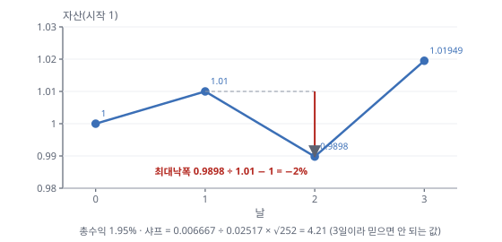


**작은 예로 직접 풀기** 하루 수익률 1%, −2%, 3%
- 자산: 1.01 → 1.01 × 0.98 = 0.9898 → 0.9898 × 1.03 = 1.019494 → 총수익 **1.95%**
- 평균 = (0.01 − 0.02 + 0.03) ÷ 3 = **0.006667** · 표준편차(n−1 로 나눔) = √(((0.01−0.006667)² + (−0.02−0.006667)² + (0.03−0.006667)²) ÷ 2) = **0.02517**
- 샤프 = 0.006667 ÷ 0.02517 × √252 = 0.2649 × 15.87 = **4.21** (3일짜리라 의미 없는 큰 값 — 기간이 짧으면 믿으면 안 됨)
- 최대낙폭: 최고 1.01 → 0.9898 ÷ 1.01 − 1 = **−2%**
- 연복리: 2년 동안 총수익 1.95% 였다면 (1.019494)^(1/2) − 1 = **0.97%/년**

**화면·코드와 연결** 결과 화면 성적표. `engine/backtest.py performance`.

<!--f:dm-->
## 28. Diebold–Mariano — 두 예측 중 어느 쪽 오차가 정말 작은가

**식** `d_t = 오차1_t² − 오차2_t²`, `DM = 평균(d) ÷ √(분산(d) ÷ n)`, `p = 2 × (1 − Φ(|DM|))`

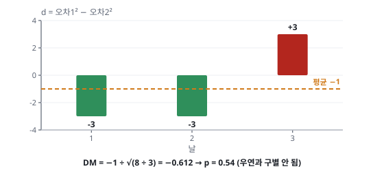


**문장으로 읽기** "날마다 두 모델의 제곱오차 차이를 구해, 그 평균이 0 에서 우연이라 보기 어려울 만큼 떨어졌는지."

**작은 예로 직접 풀기** 모델 오차 (1, −1, 2), 비교 기준 오차 (2, −2, 1)
- d = 1 − 4, 1 − 4, 4 − 1 = **−3, −3, 3** → 평균 **−1** (모델이 덜 틀림)
- 분산 = ((−3+1)² + (−3+1)² + (3+1)²) ÷ 3 = (4 + 4 + 16) ÷ 3 = **8**
- DM = −1 ÷ √(8 ÷ 3) = −1 ÷ 1.633 = **−0.612** → p = 2 × (1 − Φ(0.612)) = **0.54** → "우연일 수 있다"(보통 p < 0.05 여야 차이가 있다고 봄). 실제 코드는 날이 10개 미만이면 계산하지 않습니다(이 예는 설명용).

**화면·코드와 연결** 결과 화면 'DM vs 0예측·naive'. `engine/backtest.py diebold_mariano`.

<!--f:rule_shannon-->
## 29. 규칙 — 섀넌 재조정 (흘러가는 비율) (2026-11-15)

**식** `흘러간 비율 w' = h·(1 + r) ÷ (1 + h·r)`, 다시 맞추는 날: `거래량 = |목표 − w|`, `비용 = 거래량 × 편도 비용`

**문장으로 읽기** "ETF 를 목표 비율만큼 들고 나머지는 현금. ETF 가 오르면 ETF 몫이 커지고 내리면 작아진다. 정한 날에만 목표로 되돌리고 그때만 비용을 낸다."

**작은 예로 직접 풀기** 목표 50%, 첫 기간 ETF +10%
- ETF 몫 0.5 × 1.1 = 0.55, 현금 0.5 → 전체 1.05 → 비율 0.55 ÷ 1.05 = **0.5238** (52.4%)
- (내렸다면 −10%: 0.45 ÷ 0.95 = **0.4737**)
- 다시 맞추는 날: 0.5238 → 0.5 로 **0.0238 만큼 팜** → 비용 0.0238 × 0.065% = **0.0015%** (편도 비용 = 수수료 0.015% + 슬리피지 5bp)

**화면·코드와 연결** 모델 '섀넌 재조정', 결과 화면 '섀넌 50:50 기준'. `engine/backtest.py _drift_positions`·`shannon_benchmark`, `models/shannon.py`.

<!--f:hmm_filter-->
## 30. HMM — 지금 어느 상태일까 (앞방향 갱신) (2026-11-15)

**식** `p_t(j) ∝ [Σ_i p_(t−1)(i)·A[i,j]] × 정규밀도(r_t; μ_j, σ_j²)`, 앞날: `q = p_t·A^h`, `예측 r̂ = Σ_j q(j)·μ_j`

**문장으로 읽기** "어제 상태 확률에 '바뀔 확률'을 곱해 오늘을 짐작하고, 오늘 실제 변화율이 각 상태에서 얼마나 그럴듯한지 곱해 다시 맞춘다. 앞날은 바뀔 확률만 곱해 나간다."

**작은 예로 직접 풀기** 상태 2개: 하락(μ = −1, σ² = 1)·상승(μ = +1, σ² = 1), 머무를 확률 0.9, 처음 확률 (0.5, 0.5), 오늘 변화율 r = 0.5
- 밀도: 하락 쪽 정규(0.5; −1, 1) = e^(−1.5²/2) ÷ √(2π) = **0.1295**, 상승 쪽 e^(−0.5²/2) ÷ √(2π) = **0.3521**
- 곱하고 합이 1 이 되게: (0.5×0.1295, 0.5×0.3521) → **(0.269, 0.731)** — 상승 상태일 확률 73%
- 내일 상태 확률 q = (0.269×0.9 + 0.731×0.1, 0.269×0.1 + 0.731×0.9) = **(0.315, 0.685)** → 예측 = −1×0.315 + 1×0.685 = **0.370**

**화면·코드와 연결** 모델 'HMM 시장 상태'의 계산 따라가기(앞방향 표·앞 기간 예측). `models/hmm.py forward`·`Model.forecast`.

<!--f:hmm_fit-->
## 31. HMM — 상태 찾기 (Baum–Welch) (2026-11-15)

**식** E 단계: `γ_t(j) = P(s_t = j | 학습 창 전부)`, `ξ_t(i,j) = P(s_t = i, s_(t+1) = j | 학습 창 전부)` · M 단계: `A[i,j] = Σξ_t(i,j) ÷ Σγ_t(i)`, `μ_j = Σγ_t(j)·r_t ÷ Σγ_t(j)`, `σ_j² = Σγ_t(j)·(r_t − μ_j)² ÷ Σγ_t(j)`

**문장으로 읽기** "지금 모수로 날마다 '이 날 어느 상태였을까'의 확률을 구하고(학습 창 앞뒤를 다 봄 — 학습 안에서만), 그 확률로 가중한 평균·분산·바뀐 횟수로 모수를 다시 정한다. 그럴듯함(로그우도)이 거의 늘지 않을 때까지 되풀이."

**작은 예로 직접 풀기** 어떤 날의 상태 확률이 (0.2, 0.8) 이고 그날 변화율이 +2% 면, 그날은 상승 상태 평균 계산에 0.8 만큼, 하락 상태에 0.2 만큼 들어간다. 이 날 하나뿐이면 상승 평균 = 0.8 × 2% ÷ 0.8 = **2%**. 뒷방향 확률은 **학습할 때만** 쓰고 예측(30절)에는 쓰지 않는다 — 결정일 뒤 자료를 보게 되므로.

**화면·코드와 연결** 결과의 학습 진단(출발점·로그우도·상태별 평균·흩어짐·머무를 확률). `models/hmm.py baum_welch`.

<!--f:kelly-->
## 32. 켈리 투자 비율 (2026-11-15)

**식** `비율 = 분수 × μ_b ÷ σ²_b` 를 0~1 로 자름. μ_b·σ²_b = 결정일에 **이미 결과가 나온** 과거 예측 중, 오늘 예측과 같은 자신감 묶음(5묶음)의 실제 수익 평균·분산

**문장으로 읽기** "예전에 이만큼 자신 있게 예측했을 때 실제로 평균 얼마를 벌었고 얼마나 출렁였나를 보고, 벌이가 출렁임에 비해 클수록 많이 싣는다. 추정이 틀릴 수 있어 그 절반만."

**작은 예로 직접 풀기** 같은 묶음의 과거 실제 수익: 평균 μ = 0.05%(하루), 표준편차 σ = 2% → σ² = 0.0004
- 전부 켈리 μ ÷ σ² = 0.0005 ÷ 0.0004 = 1.25 → 0~1 로 자르면 100%
- **절반 켈리** = 0.5 × 1.25 = **0.625 → 62.5%** 투자, 나머지 현금
- 평균이 음수인 묶음이면 비율은 **0**(현금). 과거 결과가 정한 개수(일간 250개)가 모일 때까지도 현금(준비 기간)

**화면·코드와 연결** 실험 화면 '투자 비율 정하기 → 켈리', 결과 화면 '켈리 투자 비율'. `engine/sizing.py kelly_positions`.

<!--f:confidence-->
## 33. 자신감 확인표 (2026-11-15)

**식** 예측을 크기 순으로 같은 개수의 5묶음 → 묶음마다 `적중률 = 실제 수익 > 0 인 비율`, `평균 실제 수익`. 판정 '맞음' = 묶음 번호와 평균 실제 수익의 순위상관 ≥ 0.9 그리고 맨 위 − 맨 아래 > 0

**문장으로 읽기** "모델이 자신 있을수록(예측이 클수록) 실제로도 더 잘 맞았는가."

**작은 예로 직접 풀기** 묶음 1~5 의 평균 실제 수익 −0.10%, 0.00%, +0.05%, +0.10%, +0.20% → 작은 순서 그대로 커짐 → 순위상관 **1.0**, 맨 위 − 맨 아래 = 0.20 − (−0.10) = **+0.30%p** → **맞음**. 순서가 뒤섞이면(예: 0.03, 0.10, −0.01, 0.08, −0.04) 순위상관 **−0.5** → **맞지 않음** — 이때는 '확실할 때만 매매'나 켈리가 도움이 되지 않는다.

**화면·코드와 연결** 결과 화면 예측 성능 아래 '자신감 확인표'. `engine/sizing.py confidence_table`. 평가 구간 전체를 본 진단이라 매매 결정에는 쓰지 않는다.

<!--f:cross_source-->
## 34. 다른 출처와 대조 (2026-11-14)

**식** `d = ln a − ln b` (두 값 모두 양수), `확인해 볼 기간 = |d − 중앙값(d)| > max(8 × 1.4826 × MAD(d), 0.01)`

**문장으로 읽기** "같은 자료를 두 곳에서 받았을 때, 평소 차이에서 크게 벗어난 기간만 골라 보여 준다. 어느 쪽이 맞는지는 판정하지 않는다."

**작은 예로 직접 풀기** 2009-04 엑셀 원/달러 1323.0, 야후 1278.1 → d = ln(1323.0 ÷ 1278.1) = **0.0345**(약 3.45%). 평소 차이 중앙값 0.002, 흩어짐(1.4826×MAD) 0.003 이면 기준 = max(8 × 0.003, 0.01) = **0.024** → |0.0345 − 0.002| = 0.0325 > 0.024 → **확인해 볼 기간**

**화면·코드와 연결** 변수 사전 '자료 점검표'의 '다른 출처와 대조', [값 보기]. `engine/datacheck.py cross_pair`. 20장 2-7.


---

# 엔진 알고리즘 — 정렬·검증·체결·지표·검정

> 🟢 **쉽게 말하면** — 심판의 규칙서입니다. ① 선수는 "오늘까지 알 수 있는 것"만 보고 "내일 이후"를 맞혀야 하고, ② 시험 문제는 공부한 범위 밖에서 내며, ③ 점수는 거래 비용을 뺀 실제 돈으로 매기고, ④ "여러 번 시도하면 한 번쯤 운 좋게 좋은 점수가 나온다"는 사실을 점수에서 깎습니다.

모든 날짜·시프트·채움 연산은 `engine/calendar.py` 한 곳에만 있습니다(절대규칙 1). 다른 파일은 날짜를 만지지 않습니다.

## 1. 시간 규약과 타겟 정렬

결정일 t = 매매 주기의 마지막 거래일. 결정은 "t+1 개장 직전"(t 마감 정보 + 그 밤에 끝난 해외 시장까지).

```
타겟  r_t = P_open[t+1+k] / P_open[t+1] − 1
```
- `return`: r_t  `logreturn`: ln(1+r_t)  `direction`: 1[r_t>0]  `event`: 1[r_t>threshold]
- 마지막 1+k 행은 미래가 없어 NaN. 종가 체결은 제공하지 않습니다(불가능한 체결).
- 주간/월간: 가격을 주기 마지막 **실제 거래일**로 묶음(시가 = 첫날 시가, 종가 = 마지막 날 종가, 고·저 = 극값, 거래량 = 합).

**입력 X의 행 t는 t까지의 정보만** 담습니다. 자동검사 `assert_no_target_in_inputs`는 X의 어떤 열이 타겟과 상관 0.999 이상이면 중단합니다(보조 장치일 뿐, 주 방어선은 아래 테스트).

## 2. 워크포워드 검증 (기본)

```
[──────── 학습 창 train_len ────────][테스트 test_len] → test_len 만큼 이동 → 반복
[실제 학습 train_len − (1+k)][비움 1+k]      ← 비움은 학습 창 '안'에서 뺀다
```
- 일간 기본: 학습 756(3년) / 재학습 21(1개월) / embargo 1+k. 주간 156/4, 월간 60/1.
- 마지막 폴드는 test_len 보다 짧을 수 있다(남은 날만큼 평가 — 2026-11-06 부터, 그 전에는 버렸음).
- **purging/embargo**: 학습 창 마지막 결정일 t_L의 타겟은 t_L+1+k까지의 가격을 씁니다. 테스트 첫날 t_F = t_L+1의 특징이 그 안에 들어가면 학습 라벨이 테스트 정보를 담게 되므로, 학습 창 끝에서 1+k행을 버립니다(López de Prado 2018, 7장).
- 폴드마다 스케일러·모델을 **새로** 적합. 예측은 모두 "모델이 보지 않은 날"의 값입니다. 일간 2009~2024에서 148폴드.
- 검증 분할: 학습 창 뒤 `val_frac`(15%)를 조기종료용으로 떼어 넘김(LightGBM·LSTM·GRU·BIVA). 단 **검증이 10개 미만(LightGBM 은 11개 미만)이거나 남는 학습이 10개 미만이면 검증 없이 전부 학습**(`_split_fit`) — 월간 기본(학습 창 60)은 검증 7~8개라 조기종료가 없다. **학습 부분과 검증 부분 사이에도 embargo 만큼 비웁니다**(2026-11-05 추가 — 그 전에는 학습 마지막 정답이 검증 첫 입력 기간과 겹쳐 조기종료 판단에 아주 약간 미래가 섞였다). 검증을 쓰지 않는 모델(Ridge·ARIMA·SARIMA·VECM)은 학습 창 전체를 쓰므로 **모든 모델의 정보 마감일이 같습니다**.

### 2a. 한 폴드의 학습 창을 자르는 순서와 '밀려가는 창' (2026-11-20, `engine/splitplan.py fold_counts`)

- **밀려가는 창(rolling)**: 학습 창은 길이 `train_len` 그대로 `test_len` 씩 밀립니다 — **시작점도 함께 이동**해 창 밖으로 밀려난 오래된 자료는 쓰지 않습니다(`calendar.walkforward_folds`: `train = cal[i−train_len : i−emb]`, `test = cal[i : i+test_len]`, `i += test_len`). 처음부터 계속 쌓는 '늘어나는 창'(expanding)은 지금 없습니다.
- **자르는 순서**(창 모델, 빈 칸·정답 없는 행이 없을 때; 숫자는 일간 기본 756/21, k=1, 창 20, 검증 15%):

| 순서 | 무엇을 빼나 | 빼는 수 | 남는 수 |
|---|---|---|---|
| 1 | 학습 창 | | 756 |
| 2 | 끝의 비움 1+k — 학습 정답이 테스트 값을 쓰지 않게 | −2 | 754 |
| 3 | 앞 (창 길이 − 1)행 — 창을 채울 과거가 없어 정답으로 못 씀(입력으로는 쓰임) | −19 | 735 |
| 4 | 정답(타겟)이 없는 행 (있을 때만) | | |
| 5 | 검증 = 뒤 int(735 × 0.15) — 언제 멈출지에만 씀 | −110 | 625 |
| 6 | 학습과 검증 사이 비움 1+k | −2 | **623 = 학습** |

  표 입력 모델(Ridge·LightGBM)은 3 대신 '입력에 빈 칸이 있는 행'을 빼고, 검증을 쓰지 않는 모델은 5·6이 없습니다(Ridge: 754 전부 학습).
  실험 화면의 '실제로 쓰이는 구간' 표가 지금 설정·데이터로 첫·마지막 폴드의 이 순서를 그대로 보여 주고, 실행 결과의 `periods.first_fold`·`last_fold` 와 같은지 `tests/test_splitplan.py` 가 확인합니다.
- 검증 도식(화면의 막대 그림)의 '학습 N' 숫자도 이 순서로 계산합니다(2026-11-20 전에는 비움을 빼지 않아 Ridge 756, LSTM 641 처럼 2~21 크게 표시했음 — 계산이 아니라 그림 이름만 틀렸음).

### 2b. 기간 지정 (2026-11-05)

| 설정 | 뜻 | 쓰는 모델 |
|---|---|---|
| `start` / `end` | 데이터 사용 기간. 밖의 데이터는 읽지 않음 | 전부 |
| `validation.val_start` | (1회 분할) 검증 시작일. 검증 = [val_start, 테스트 시작 − embargo) | 검증을 쓰는 모델만. 나머지는 학습에 포함 |
| `validation.test_start` | 1회 분할: 이 날부터 테스트. 워크포워드: 첫 테스트 폴드가 이 날 시작 | 전부 |
| `validation.test_end` | 테스트(평가) 마지막 결정일(포함) | 전부 |
| `validation.sealed_from` | 봉인 시작. 테스트 종료는 반드시 이 전 | 전부 |

```
1회 분할:   [학습 ........][비움][검증 ....][비움][테스트 ..........] ... [봉인]
워크포워드: [학습 창 train_len →→ 밀며 재학습][비움][테스트 test_len] ... (test_start ~ test_end 만 평가)
```
- 순서 검사(`_check_periods`): 데이터 시작 < 검증 시작 < 테스트 시작 ≤ 테스트 종료 < 봉인 시작. 어기면 실행 전에 오류.
- **왜 워크포워드에도 평가 시작일이 필요한가**: 늦게 시작하는 변수(L2·N6 2015~)를 쓰면 학습 창이 차는 날이 늦어져 그 모델만 평가 기간이 짧아진다(예: VECM F11 월간, F7+B1 120개월 vs L2+F7 74개월). 모델 비교는 **같은 평가 기간**에서만 공정하므로 비교할 실험은 `test_start`·`test_end` 를 같게 둔다.
- 결과 json 의 `periods`: 실제로 쓴 데이터 기간, embargo, 검증 규칙, 첫·마지막 폴드의 학습/검증/테스트 날짜와 개수. 논문 표에 그대로 옮긴다.
- 화면의 **"선택 변수 공통 기간으로"**: 시작 = 가장 늦게 시작하는 변수의 첫 기준일+발표시차, 끝 = 가장 먼저 끝나는 변수의 마지막 기준일+1주기+발표시차(그 뒤는 마지막 값이 그대로 이어지는 낡은 입력). 엑셀 거시 데이터는 2025-03 에 끝나므로 일간 실험을 2026 까지 돌리면 F7·B1 등이 1년 넘게 같은 값으로 들어간다 — 이 버튼으로 끝을 맞춘다.

### 2c. 창(window) 모델의 창 만들기와 빈 칸

- 창은 **실제 있는 행으로만** 만든다. 각 학습 구간의 맨 앞 seq_len−1 행은 과거가 모자라 창을 만들지 않는다(0·가짜 값으로 채워 넣지 않음 — 그건 없던 과거를 지어내는 것). 예: 월간 2009-01 시작, seq_len 6 → 첫 학습 창의 결정일은 2009-06.
- 테스트 첫 창은 테스트 시작 직전의 **실제 행 seq_len−1 개**를 앞에 붙여 완성한다(과거 입력이므로 누출 아님. 정답은 붙이지 않는다).
- 창 안의 빈 칸 = 그 날 아직 존재하지 않던 변수(앞쪽 결측). 중간 결측·주기 차이는 그 전에 ffill 로 이미 채워져 있다. 처리: 기본은 학습 구간 평균, BIVA `use_brits=예`(기본) 이면 NaN 그대로 넘겨 **BRITS 가 그 창 안의 값(6칸)만으로 보간**. 창 밖·결정일 이후 값은 쓰지 않는다(BRITS 의 '뒤→앞' 방향도 창 안의 결정일 이전 값만 읽음). 창 전체가 빈 변수는 다른 변수와의 관계(feature regression)로만 추정된다 — 테스트로 확인(`test_brits_fills_empty_cells_inside_window_only`).
- 주의: BRITS 의 보간 추정치는 sigmoid 출력(0~1)이다. 원본처럼 입력을 0~1(MinMax)로 맞춰야 보간값이 제 범위에 든다 → BIVA `input_scaler=minmax`. 표준화 입력에 BRITS 를 켜면 엔진이 경고한다.

## 3. 1회 분할 (노트북 방식, `validation.mode=split`)

split_date 이전(embargo 1+k 제외)으로 **한 번** 학습, 이후 전부 테스트. 학습 적합값(in-sample)도 저장하지만 **성과·검정에는 쓰지 않습니다**(차트 표시용). 테스트 구간이 하나라 운이 섞이기 쉽고, "어디서 자르나"가 결과를 본 뒤의 선택이 되기 쉽습니다. 같은 설정을 워크포워드로도 돌려 비교하세요.

### 3a. 비율로 나누기와 실제로 쓰이는 구간 (2026-11-18, `engine/splitplan.py`)

화면의 **비율로 나누기**(기본 60 : 10 : 30 = 원본 BIVA)는 날짜를 계산해 칸에 채울 뿐이고, 실험 설정에는 날짜가 저장됩니다(결과·해시는 날짜 기준 — 같은 날짜면 같은 실험).

1. **바탕 N** = 봉인 전, 데이터 사용 기간 안에서 **정답(타겟)이 있는 결정일** 수. 입력 변수의 빈 칸 여부와 상관없이 셉니다(원본도 전체 행 수로 나눔).
2. **개수** = 학습 `int(N×학습%)`, 테스트 `int(N×테스트%)`, 검증 = 나머지 — 원본 `data_loader.py` 78~80줄과 같습니다(내림이라 나머지 0~2개는 검증으로). 검증 0% 면 나머지는 학습으로. 검증을 쓰지 않는 모델(Ridge·ARIMA·VECM 등)은 검증 몫도 학습에 쓰고, 테스트 시작일은 같게 둡니다(다른 모델과 같은 테스트로 비교).
3. **날짜** = 검증 시작 `바탕[학습 개수]`, 테스트 시작 `바탕[학습+검증]`, 테스트 종료 = 바탕의 마지막 결정일.
4. **날짜를 직접 넣으면**: 시작일은 그 날짜 **이후 첫 결정일**, 종료일은 **이전 마지막 결정일**로 맞춰집니다(주말·월 중간 날짜도 됨). 계획 표에 "날짜 맞춤"으로 표시합니다.
5. **비율과 실제가 다른 이유**(계획 표의 '실제 사용 비율'):
   - 학습↔검증, 검증↔테스트 사이를 각각 **비움(embargo) 1+k(매매) / k(예측)** 개 뺍니다. 결정일의 정답이 그만큼 뒤의 값을 쓰므로, 비우지 않으면 학습 정답이 다음 구간의 값을 미리 봅니다.
   - 창 모델은 학습 구간 맨 앞 **seq_len−1** 개 결정일이 정답으로 쓰이지 않습니다(창을 채울 과거가 없음 — 입력으로는 쓰임).
   - 정답이 없는 결정일(데이터 끝의 k 기간 등)은 빠집니다.
   - 표 입력 모델(Ridge·LightGBM)은 **입력에 빈 칸이 있는 행**을 학습에서 빼고, 테스트에서는 그날 예측하지 않습니다.
   - 검증이 10개 미만이거나 검증을 떼고 남는 학습이 10개 미만이면 검증 없이 학습 구간 전체로 학습합니다(조기 종료 없음). BIVA 는 검증 창이 batch_size 보다 적어도 학습 손실로 최적 시점을 고릅니다.
6. **빈 칸 채우기**(변수가 늦게 시작하거나 중간이 빈 경우) — 계획 표의 '빈 칸 처리'에 변수별로 표시:
   - 창 모델: 직전 값으로 채움(ffill) → 시작 전 앞쪽 빈 칸은 학습 구간 평균. BIVA `use_brits=예` 는 앞쪽 빈 칸을 그대로 BRITS 에 넘김(§2c).
   - 표 모델: 채우지 않고 그 행을 뺌.
7. **막히는 경우**: 학습 구간에 **입력·정답이 모두 있는 행이 30개 미만**이면 엔진이 그 분할을 건너뛰어 결과가 나오지 않습니다("신호가 하나도 없습니다"). 창 모델·BRITS 처럼 빈 칸을 채울 수 있는 모델도 이 검사는 같습니다 — 계획 표가 실행 전에 알려 줍니다. 워크포워드에서 앞쪽 폴드가 건너뛰어지는 것도 같은 이유입니다.

계획의 숫자는 실행 결과의 `periods.first_fold`(학습·검증·테스트 날짜와 개수)와 같아야 합니다 — `tests/test_splitplan.py` 가 표·창 모델, 검증 있음·없음, 날짜 맞춤, 막히는 경우로 확인합니다.

## 4. 봉인 구간 (`sealed_from`, 기본 2025-01-01)

> 🟢 **쉽게 말하면** — 마지막 기간을 '시험지 봉투'에 넣어 두고, 공부(개발)가 끝난 뒤 **딱 한 번** 열어 채점하는 것입니다. 여러 번 고쳐 가며 같은 기간 성적을 보면 그 기간에만 맞는 설정을 고르게 되기 때문입니다. 날짜는 실험 화면 **매매 규칙과 검증 → 기간 → 봉인 시작일**에서 정합니다(매매 2025-01-01, 예측 연구 2024-01-01 기본, 비우면 봉인 없음).

- **날짜 고르는 법(권장)**: 실험 시작 전에 정하고 옮기지 않는다 · 모든 실험이 같은 날짜 · 봉인 구간은 일간 1년(≈250거래일)·월간 24개월 이상.
- **빠짐·겹침 없음(2026-11-06)**: 개발 평가는 봉인 **전날까지**(마지막 폴드는 남은 날만큼), 봉인 평가는 봉인 **첫날부터** 폴드를 만든다. 그 전에는 개발의 마지막 짧은 구간(최대 test_len−1 일)과 봉인 첫 폴드 앞의 며칠이 어디서도 평가되지 않았다(시험 `test_dev_and_sealed_folds_cover_every_day_without_gap_or_overlap`).

- **경계는 '쓰이는 가격' 기준(2026-11-10)**: 결정일 t 의 정답·수익에는 t 뒤의 가격이 쓰입니다(매매: t+1 시가 ~ t+1+k 시가 → h = 1+k 행 뒤까지, 예측 연구: t+k 의 값 → h = k 행 뒤까지). 그래서 개발 평가는 **봉인 시작일보다 h 행 앞의 결정일에서 끝나고**, 그 뒤의 결정일(정답에 봉인 시작일 이후 값이 처음 들어가는 날)부터가 봉인 평가입니다. 그 전에는 '결정일' 기준으로 잘라, 개발 평가의 마지막 h 개 결정일이 봉인 구간의 가격으로 채점됐습니다(시험 `test_dev_results_do_not_depend_on_sealed_prices`: 봉인 시작일 이후 가격을 바꿔도 개발 결과가 한 글자도 변하지 않음). 결과 파일의 `seal_boundary` 에 봉인 시작일·첫 봉인 결정일·h 가 남습니다.
- **봉인 정책(2026-11-10)**: 대상마다의 봉인 시작일을 한 곳(`seal_policy.json`, 프로젝트 폴더 바로 아래)에 정해 두고 **모든 실행이 지킵니다**(`engine/sealpolicy.py`). 설정의 봉인 시작일이 비어 있으면 그 날짜를 채워 돌리고(결과의 `seal_policy.status = applied`), 더 늦은 날짜면 멈춥니다. 그 전에는 봉인 시작일이 설정마다의 칸이라, 그 칸을 비운 보통 실험이 봉인 구간까지 채점해도 아무 기록이 남지 않았습니다(원 논문 분할 재현 실험 repro_* 가 F11 의 봉인 구간 2024~2025-02 를 채점). 봉인 구간을 일부러 봐야 하는 재현 실험은 `python cli.py run 설정.json --past-seal "이유"` — 이유가 결과와 시도 원장(`seal_override`)에 남고, 봉인 평가 미리보기가 "이 대상의 봉인 구간을 이미 채점한 개발 결과 N건"을 경고로 보여 줍니다.

개발 중에는 이 날 이후 데이터를 **전혀 보지 않습니다**(폴드도 안 만들고, 규칙 모델의 신호도 지움, 성과 구간에서도 제외). **사전 등록 기준을 개발 구간에서 통과한 후보에만 씁니다.** 봉인을 쓰는 순간 그 가설은 종결(통과 또는 폐기)입니다.

### 4-1. 봉인 평가 버튼 (2026-11-06)

**어디서**: 결과 화면 → 결과(후보) 하나 선택 → 상세 아래 **'봉인 평가'** 칸. 명령줄 `python cli.py run 설정.json --sealed` 와 같은 경로입니다(서버가 같은 명령을 작업 큐에 넣음).

**순서**
1. **미리보기**(학습·저장 없음): 실행과 **같은 함수**(`engine.experiment.sealed_folds`)로 봉인 폴드를 계산해 봉인 구간(첫 거래일 ~ 데이터 끝), 폴드 수, 첫·마지막 폴드의 학습·테스트 날짜를 보여 줍니다. 후보의 개발 구간 성적, 사전 등록 기준, 봉인 기록(같은 설정·같은 봉인 시작일로 몇 번 열었나), 확인할 점(코드 버전 미기록, lag 미확인 변수, 파라미터 기본값 변경 등), 실행을 막는 이유를 함께 보여 줍니다.
2. **사전 기록**: 열기 전에 '무엇이 나오면 통과·실패인지'를 적습니다(선택, 2000자). 기록·결과 파일에 그대로 남아 '결과를 본 뒤 기준을 바꾸지 않았다'는 증거가 됩니다. 사전 등록 기준의 '봉인 구간에서 방향 일치'는 어떤 지표의 부호인지 정해져 있지 않으므로 여기에 적어 두기를 권합니다.
3. **확인 2개**(결과와 상관없이 최종 결과로 보고 · 결과를 보고 고쳐 다시 열지 않음) → **봉인 열기**. 같은 설정을 이미 열었으면 '재개봉' 확인을 하나 더 받습니다(서버도 확인 없이는 거절).

**실행 내용**
- 설정은 후보 결과 파일의 것을 **그대로** 씁니다(데이터 버전 포함). 그 뒤에 기본값이 바뀐 파라미터만 그 결과를 낼 때의 값으로 고정합니다(`pinned_model_params` — 예: ARIMA 추정 제약은 2026-11-06 전 결과면 아니오).
- 학습 규칙은 개발 때와 같고, 테스트 시작만 봉인 시작일로 바뀝니다. 워크포워드: 봉인 첫날부터 '학습 창 → 비움 → 테스트'를 재학습 주기마다 밀어 데이터 끝까지(마지막 폴드는 남은 날만큼). 1회 분할: '봉인 시작 전 전부 − 비움'으로 한 번 학습해 봉인 구간 전체를 예측(검증 시작일이 있으면 검증 = [검증 시작, 봉인 − 비움)). 규칙 모델: 학습 없이 봉인 구간의 포지션만 채점.
- 개발 구간은 다시 계산하지 않습니다(2026-11-06 전에는 개발 구간을 한 번 다 돌린 뒤 버렸음 — 결과는 같고 시간만 두 배).
- 결과는 `<이름>_<해시>_sealed.json` 으로 **따로** 저장됩니다(재개봉이면 `_sealed2` …). 2026-11-06 전에는 개발 결과와 이름이 같아 **덮어썼습니다**(그 전 봉인 평가는 0회라 잃은 결과는 없음).
- 기록 `results/{trading|forecast}/sealed_log.json`: 연 시각, 설정 이름·해시, 결과·후보 파일, 사전 기록, 작업 ID, 모델, 봉인 시작일, 실제 봉인 구간, 폴드 수, 데이터·코드 버전, 지표 요약. 화면에서 지울 수 없고, 결과 화면 위 '봉인 기록'에 모두 보입니다.
- **실험 카운터는 올리지 않습니다.** 봉인 평가는 새 시도가 아니라 확인이므로 Deflated Sharpe 의 시도 수에는 지금까지의 개발 시도 수를 쓰고, 시도들의 샤프 분산 V 에서도 봉인 결과를 뺍니다.
- 봉인 결과 상세에는 '개발 구간 vs 봉인 구간' 표가 나란히 나옵니다. 봉인 구간은 짧아 p값이 커지기 쉽습니다 — 짧은 기간의 '유의하지 않음'은 '효과 없음'과 같지 않으니 기간 길이를 함께 보고합니다.

현재 봉인 구간(2025~26)은 반도체 초강세장(2026-07 말 −25%→+29% 급변 포함)이라, 롱/현금 전략이 B&H를 이기기 구조적으로 어렵다는 점을 결론에 명시해야 합니다.

## 5. 신호 → 포지션 → 체결 → 손익

```
회귀:  signal_t = 1[pred_t > threshold]      분류: signal_t = 1[prob_t > 0.5 + threshold]
포지션 pos_t = signal_t (NaN이면 직전 유지, 시작은 0), 롱/현금만 (0~1)
보유수익  hold_t = P_open[t+2]/P_open[t+1] − 1
총수익    gross_t = pos_t · hold_t
비용      cost_t = |pos_t − pos_{t−1}| · (fee + slippage)      (편도 0.015% + 5bp = 6.5bp)
순수익    net_t = gross_t − cost_t
자산곡선  E_t = Π(1 + net_t),   B&H = Π(1 + hold_t)
```
- **k>1이어도 포지션은 매 주기 재결정**합니다(연속 신호면 사실상 보유). "k기간 보유 후 청산" 규칙은 없습니다(추가 가능).
- 분배금·세금은 반영하지 않습니다(국내주식형 ETF 매매차익 비과세, 분배금 15.4%는 미반영).
- **흘러가는 비율 회계 (2026-11-15, 섀넌 재조정만)**: 위 회계는 '정한 비율을 매일 그대로 들고 간다'(0/1 이 아닌 비율이면 매일 공짜로 다시 맞추는 셈). 섀넌 재조정은 `run_backtest(..., rebalance=…)` 로 다른 회계를 씁니다 — 들고 간 비율 h, 그 기간 보유수익 r 이면 다음 비율 w' = h(1+r)/(1+hr); 목표가 바뀐 날이나 재조정 날에만 목표로 맞추고 거래량 |목표 − w| 에만 비용. 다른 모델은 모두 위 회계 그대로(시험으로 확인). 0/1 신호는 두 회계가 같습니다.
- **비교 기준 '섀넌 50:50' (2026-11-15)**: 모든 매매 결과에 같은 평가 구간·같은 비용으로 ETF 50%·현금 50%·달마다 재조정한 성적(`performance.shannon`, daily `shannon_return`). B&H 는 비용 없음, 섀넌은 비용 포함.
- **켈리 투자 비율 (2026-11-15, `trade.sizing=kelly`)**: 신호 대신 비율 w_t = 분수 × μ_b/σ²_b (0~1). μ_b·σ²_b = 위치 ≤ t−1−k 인 과거 결정일(그 실현 보유수익 = t+1 시가 매수 ~ t+1+k 시가 매도가 t 이전에 확정) 중, 과거 예측의 5분위로 나눈 묶음에서 오늘 예측이 든 묶음의 실현 수익 평균·분산. 과거가 min_history(일 250·주 52·월 24) 미만이면 0. 예측 자체는 바뀌지 않고 비율만 바뀝니다. 비율 회계는 위 기본 회계(매일 그 비율)와 같습니다 — 변동성 타겟과 같은 근사.
- **자신감 확인표 (2026-11-15)**: 예측을 내는 모든 매매 결과에 `confidence_table`(평가 구간 예측의 5분위별 개수·적중률·평균 실현 보유수익, 순위상관, 판정). 진단용 — 매매 결정에 쓰지 않습니다.
- 성과는 **신호가 있는 구간**(첫 신호 ~ 마지막 신호, 봉인 이전)에서만 계산하고 B&H도 같은 구간입니다. 2026-11-03 이전 결과는 전체 기간으로 계산돼 봉인 구간이 섞여 있었으므로 폐기했습니다.

## 6. 성과 지표 (`engine/backtest.performance`, 화면은 계산하지 않음)

| 지표 | 정의 (r = 순수익률, n = 기간 수, P = 연간 주기 수: D 252/W 52/M 12) |
|---|---|
| 총수익 | Π(1+r) − 1 |
| CAGR | (Π(1+r))^{P/n} − 1 |
| 연변동성 | sd(r)·√P |
| 샤프 | mean(r)/sd(r)·√P (무위험수익률 0 가정) |
| 소르티노 | mean(r)/sd(r<0)·√P |
| MDD | min(E_t / max_{s≤t} E_s − 1) |
| 승률 | (r>0인 기간 수)/(r≠0인 기간 수) — **기간 단위**, 거래 단위 아님 |
| 전환 횟수 | pos가 바뀐 횟수. 노출 = mean(pos) |
| B&H 지표 | 같은 구간의 hold_t로 동일 계산 |

## 7. 예측 지표

| 지표 | 정의 |
|---|---|
| RMSE, MAE | 예측 − 타겟 |
| 방향정확도 | mean(1[pred>0] = 1[target>0]) (분류: prob>0.5) |
| AUC, Brier | 분류만 |
| **DM vs 0예측** (회귀) | Diebold–Mariano(1995): d_t = e_model² − e_zero², e_zero = 0 − target. 통계량 = mean(d)/√(Var_NW(d)/n), h=k Newey–West. **DM<0이면 모델이 0예측보다 낫다.** 0예측은 수익률 예측의 가장 강한 기준선입니다 |
| **변동성 타겟** (2026-11-12) | 정답 RV_t = √((1/k)·Σ_{j=1..k} (ln(C[t+j]/C[t+j−1]))²) (C = 종가, 연율화하지 않음). 기준 둘: 학습 창 평균(아래 CW)과 naive = 결정일까지의 최근 k 기간 RV. 지표: RMSE·MAE·상관·`dm_vs_naive`(음수 = naive 보다 정확). 포지션 = min(1, 학습 창 평균 RV ÷ 예측 RV) — 방향이 아니라 비중 |
| **입력의 연관성**(`fold_relevance`, 2026-11-12) | 폴드의 학습 행만으로 입력 열마다 정답과의 \|스피어만 순위상관\|. `select_top=N` 이면 그 폴드에서 상위 N 열만으로 눈금 맞춤·학습·예측(고르지 않은 열의 중요도는 0). 요약 = 폴드 평균·평균 등수·상위 N 안에 든 폴드 비율 |
| **종목 묶어 학습**(`pool_tickers`, 2026-11-12) | 폴드마다 다른 종목 j 의 행 중 결정일 ≥ 학습 시작이고 정답이 쓰는 마지막 가격의 날짜(j 의 달력으로 1+k 행 뒤) < 경계(검증 시작 또는 테스트 시작)인 행만 학습 앞쪽에 보탠다. 눈금은 보탠 행 포함, 검증·예측·평가는 대상 종목만. 표 입력 모델만 |
| **CW vs 학습 창 평균** (2026-11-10) | Clark–West(2007), 기준 = 그 결정일을 예측한 폴드의 **학습 창 타겟 평균** ȳ(분류면 학습 창의 양(+) 비율): adj_t = (y−ȳ)² − [(y−ŷ)² − (ȳ−ŷ)²]. 통계량 = mean(adj)/√(Var(adj)/n), 한쪽 검정(클수록 모델 쪽). **"평균을 아는 것 말고 예측 정보가 더 있는가"** — 변수(와 모델)의 정보를 말할 때는 이 검정을 씁니다. 기준이 모델에 '내포'되므로(계수가 모두 0 이면 평균 예측) 정보가 없어도 추정 잡음만큼 모델의 제곱오차가 커지는데, CW 는 그 잡음(Σ(ȳ−ŷ)²)을 빼고 비교합니다. 함께 저장: `dm_vs_mean`(이 방법이 평균 예측보다 정확한가, 양측), `r2_oos_vs_mean` = 1 − Σ(y−ŷ)²/Σ(y−ȳ)² (Campbell–Thompson 의 표본 밖 R²), 일별 자료의 `bench_mean` 열 |
| **CW vs 0예측** | 같은 식에 기준 0(분류 0.5): adj_t = 2·target·ŷ. **읽는 법 주의(2026-11-10 독립 검토)** — H0 이 E[y·ŷ] = 0 이라 타겟 평균이 0 이 아니면 '평균만 맞히는' 예측도 기각합니다. 정보 없는 변수 + 절편 모델의 기각률(명목 5%): 평균 0 근처(일간 수익률) 7%, 월간 ETF 수준 8%, 평균이 뚜렷한 F11(월간 증가율) 100%; 분류는 양(+) 비율 0.53 에서 30%, 0.55 에서 87%. 그래서 '예측이 실제와 같은 쪽으로 움직이는가(평균 포함)'로만 읽고 **변수 정보의 증거로 쓰지 않습니다**. DM 은 추정 잡음을 포함해 '이 방법·이 학습 창이 기준보다 정확한가'(Giacomini–White 2006 의 해석)를 봅니다 |
| 겹치는 타겟(k>1)의 분산 | DM·CW 모두 lag 1…k−1 의 자기공분산을 **가중치 1**로 더합니다(절단 핵, Diebold–Mariano 1995 원 방식 — k 기간 앞 예측의 오차는 이론상 MA(k−1)). DM 은 여기에 Harvey–Leybourne–Newbold(1997) 소표본 보정(통계량 × √((n+1−2k+k(k−1)/n)/n), t(n−1) 분포)을 더합니다. 2026-11-10 전의 Bartlett 가중치(1−lag/k)는 겹치는 타겟·지속적인 설명변수에서 명목 5% 검정이 7~8% 를 기각했습니다(독립 검토 모의실험, 절단 핵 3.9~4.6%). k=1 의 값은 전과 같습니다. 절단 핵이 음수가 되면 그때만 Bartlett 로 계산 |
| **DM vs 무정보** (분류) | 같은 검정을 Brier 손실로: e_model = prob − y, e_base = 0.5 − y |

## 8. 신뢰도 — 우연을 깎는 세 장치

### (a) 블록 부트스트랩 p (초과수익)
d_t = net_t − hold_t. H0: E[d] ≤ 0. d를 평균 0으로 중심화한 뒤 길이 block(=max(5, 2k))의 블록을 무작위로 이어 붙여(자기상관 보존) 2,000회 표본 평균을 만들고, 관측 평균 이상인 비율 = p. 한쪽 검정.

### (b) Deflated Sharpe Ratio (Bailey & López de Prado 2014)
N번 시도했으면 그중 최댓값은 우연히도 커집니다. 기대 최대치를 빼고 봅니다.
```
SR0 = √V · [(1−γ)·Φ⁻¹(1−1/N) + γ·Φ⁻¹(1−1/(N·e))],  γ = 0.5772(오일러)
z   = (SR − SR0)·√(n−1) / √(1 − γ3·SR + (γ4−1)/4·SR²)        p = 1 − Φ(z)
```
SR = 기간 샤프(연율/√P), V = **지금까지 같은 주기로 저장된 모든 실험의 기간 샤프 분산**(실측; 2개 미만이면 1/(n−1)로 대체), γ3·γ4 = 전략 수익률의 왜도·첨도(실측), N = 전역 실험 카운터(규칙 기준선·실패 실험 포함 → 보수적). 결과에 V·γ3·γ4·N이 기록됩니다.

### (c) 퇴화 검사
변수 중요도의 합이 0이면 모델이 입력을 전혀 쓰지 않은 것(상수 예측). 그때의 방향정확도는 "항상 롱"의 적중률일 뿐이므로 `degenerate_model=true`로 표시하고 판정을 무효로 합니다. 1차 월간 LightGBM(55.8%)이 이 경우였습니다.

## 9. 사전 등록 성공 기준 (DECISIONS 2026-11-03)

개발 구간에서 **세 가지를 모두** 만족해야 "신호 있음":
1. DM p < 0.05 (회귀: 0예측 대비, 분류: 무정보 대비, 통계량 < 0)
2. 초과수익 부트스트랩 p < 0.05
3. Deflated Sharpe p < 0.05

그리고 봉인 구간에서 방향 일치. 기준을 바꾸면 날짜와 이유를 DECISIONS에 남깁니다. 퇴화·누출이 있으면 수치와 무관하게 무효.

## 10. 예측 연구 모드 (`mode=forecast`)

대상 = 마스터 변수 v(원래 주기 D/W/M, 날짜 = 기간 시작일). 체결·비용·B&H 없음.

```
타겟   y_t = v[t+k] / v[t] − 1           (direction/event 는 매매 모드와 동일 변환)
naive  ŷ_naive,t = y_{t−k} = v[t]/v[t−k] − 1   (t 에서 알 수 있는 가장 최근의 완결된 k기간 변화율 = 지속성 가정)
0예측  ŷ_0,t = 0
purging: 라벨이 t+k 까지만 보므로 학습 창 끝에서 k 행 제거 (매매 모드는 1+k)
입력: 대상 시계열 자체의 지표 블록(A, 거래량 제외) + 선택 변수(변환·lag 동일 규칙)
```
지표: RMSE·MAE·방향정확도(모델·naive 각각), 수준값 RMSE·MAPE(v[t](1+ŷ) vs v[t+k]), **DM vs 0예측**, **DM vs naive**(둘 다 h=k Newey–West).
사전 등록 기준(2026-11-04): 두 DM 모두 통계량 < 0, p < 0.05. 평활된 지수(주택가격지수의 월 변화율 자기상관 0.84)에서는 0예측은 누구나 이기므로 naive 가 실질 기준입니다.

주의(PIT): 실거래가지수처럼 발표 후 소급 수정되는 시계열은 "당시 발표값"이 없으면 평가가 낙관적입니다. KB 지수는 수정이 드물어 이 문제가 작습니다.

## 11. 알고리즘 의사코드 (논문 기술용)


```
입력: 설정 C(대상, 주기, k, 변수집합 V, 변환 T, 발표시차 L, 모델 M, 파라미터 θ, 학습창 W, 재학습 간격 S, 봉인일 D_s)
       데이터 버전 (가격 P 또는 대상 시계열 v, 변수 테이블 X_raw)

1  달력 ← 거래일(매매) 또는 대상 시계열의 기준일(예측); 봉인일 D_s 이후는 제외
2  for 각 변수 x ∈ V:
3      x ← T_x(x)                         # 변환: 원래 주기에서, 정렬 전 (pct/diff/log …)
4      공개일 ← 기준일 + L_x (달력일)       # 발표시차
5      x_cal ← 공개일 이후 값을 ffill 로 달력에 정렬 (첫 공개 전 = NaN)
6  A ← 대상 가격(또는 시계열)의 기술지표 블록 (과거 방향 연산만)
7  X ← [A, x_cal …];  y ← 타겟 (매매: P_open[t+1+k]/P_open[t+1]−1, 예측: v[t+k]/v[t]−1)
8  assert corr(X_col, y) < 0.999 ∀열        # 누출 보조 검사
9  폴드 ← 워크포워드(달력, W, S, embargo = 1+k 매매 / k 예측)   # 또는 1회 분할(split_date, embargo 동일)
10 for 각 폴드 (train, test):
11     scaler ← fit(X[train]);  X̃ ← scaler.transform(X)            # 학습 구간 통계만
12     (window 모델이면 길이 seq_len 의 슬라이딩 창으로 변환)
13     M_θ ← fit(X̃[train], y[train])  (USES_VALIDATION 이면 뒤 15% 를 조기종료용 검증으로)
14     ŷ[test] ← M_θ.predict(X̃[test])
15 if 매매 모드:
16     signal_t ← 1[ŷ_t > τ] (분류: 1[p̂_t > 0.5+τ]);  pos_t ← signal_t (NaN 이면 직전 유지)
17     net_t ← pos_t·(P_open[t+2]/P_open[t+1]−1) − |pos_t−pos_{t−1}|·(fee+slip)
18     지표 ← performance(net, hold) on [첫 신호, 마지막 신호];  p_boot ← 블록 부트스트랩(net−hold)
19     p_DSR ← Deflated Sharpe(SR, n, N_trials, skew, kurt, Var(SR_trials));  DM ← (ŷ−y)² vs (0−y)²
20 else (예측 모드):
21     DM_0 ← (ŷ−y)² vs (0−y)²;  DM_naive ← (ŷ−y)² vs (y_{t−k}−y)²;  RMSE, MAPE(수준값)
22 퇴화 검사: Σ|중요도| = 0 → 무효
23 기록: C, hash(C), 데이터 버전, 코드 버전, 시드, 장치, lag 사용값, 시도 번호 N_trials, 모든 지표, 일별 시계열
24 봉인 평가(화면 버튼 또는 --sealed, 후보당 1회): 개발과 같은 규칙으로 D_s 첫날부터 폴드를 만들어 10–23 을 봉인 구간에만 적용(개발 구간 재계산 없음), 결과는 따로 저장, 횟수·사전 기록을 sealed_log 에 남김(실험 카운터는 그대로)
```

## 12. 재현성

결과 JSON에 설정 전체·설정 해시(이름 제외 SHA-1 12자)·데이터 버전·코드 버전(git)·시드·장치·lag 사용값·시도 번호가 기록됩니다. 같은 입력 = 같은 결과(CPU). GPU 신경망은 연산 순서 차이로 소수점 아래 차이가 날 수 있어 시드 3개 평균을 권장합니다.

## 13. 자동 테스트 (`tests/test_engine.py`, 28개)

타겟이 미래만 보는지, ffill은 누출 없고 bfill은 누출인지, embargo가 겹침을 없애는지, 리샘플이 마지막 거래일을 쓰는지, 체결 회계가 손계산과 같은지, DM 방향, 심은 신호를 모델이 찾는지(Ridge·LightGBM·LSTM·BIVA), 랜덤워크에서 무능한지, 타겟을 섞으면 신호가 사라지는지, 변환이 과거만 쓰는지, 1회 분할 embargo·적합값, 봉인 구간 제외, 봉인 모드, 규칙 롤링 분위수가 당일을 제외하는지, 분류 DM·Deflated 보정 방향, 예측 모드 타겟·naive·규칙 모델 거부. 코드를 바꾸면 `python -m pytest tests -q`.

## 참고문헌
- López de Prado, M. (2018). *Advances in Financial Machine Learning*. Wiley. — purging/embargo, 다중검정.
- Bailey, D. H., & López de Prado, M. (2014). The Deflated Sharpe Ratio. *Journal of Portfolio Management*, 40(5).
- Diebold, F. X., & Mariano, R. S. (1995). Comparing Predictive Accuracy. *JBES*, 13(3).
- Harvey, C. R., Liu, Y., & Zhu, H. (2016). …and the Cross-Section of Expected Returns. *RFS*, 29(1). — 다중검정 임계치.
- Moskowitz, Ooi & Pedersen (2012). Time Series Momentum. *JFE*.
- Ke et al. (2017). LightGBM. *NeurIPS*. Cao et al. (2018). BRITS. *NeurIPS*.


## 정정 (2026-11-05): 창(window) 모델의 빈 칸 채우기
LSTM·GRU·BIVA 에 넘기는 입력 창에서 빈 칸을 `ffill().bfill()` 로 채우고 있었다. `bfill` 은 변수가 늦게 시작한 구간(예: L2·N6 은 2015-01 부터)에 **첫 관측값을 과거로 끌어와** 미래 정보를 쓴다. 지금은 앞의 값으로만 채우고(ffill), 그래도 남는 앞쪽 빈 칸은 학습 구간 평균(표준화 후 0)으로 둔다. BIVA 는 `use_brits=예`(기본)면 빈 칸을 NaN 그대로 받아 BRITS 로 보간한다(원본 방식). 이전 결과 중 영향받는 것: 늦게 시작하는 변수를 쓴 창 모델 결과와, 발표시차 때문에 맨 앞 몇 행이 비는 창 모델 결과(영향 작음).


---

# 실행 흐름과 개발 로그

실험 하나가 화면에서 결과 파일이 되기까지, **어떤 값이 어느 함수로 넘어가고 무엇이 돌아오는지**를 순서대로 적었다.
각 단계는 개발 로그(`logs/tsp_날짜.log`, 화면 메뉴 **개발 로그**)에 같은 이름으로 남는다.

**날짜별 파일과 접속 기록 (2026-11-17)**: 노트북 시각으로 날짜가 바뀌면(자정 뒤 첫 기록) 새 날짜 파일에 씁니다. 쓰기가 실패하면(드라이브가 잠깐 끊겼다 붙는 등) 파일을 다시 열고, 계속 실패하면 서버 창에 10분에 한 번 짧게 알립니다. 요청마다 한 줄씩 **접속 기록**(`logs/access_날짜.log`)도 남습니다 — 시각 | 보낸 주소 | 노트북 직접 / 외부(Funnel) | 방법·주소 | 결과 | 걸린 시간 | 본문 크기 | 브라우저 정보. 암호 같은 머리글 값은 남기지 않습니다. 화면 **개발 로그**의 '종류'에서 고릅니다.

## 1. 로그 읽는 법

```
2026-11-06 02:09:19.512 DEBUG   [run=20261106_020918_23109e] tsp.engine.data | 변수 F7: 원자료 2009-01-01~2025-03-01(195개, 주기 M) → 변환 pct → 발표시차 37일 → …
└ 시각                  └ 수준    └ 작업 ID(같은 실험의 줄을 모음)    └ 단계 이름      └ 내용
```

| 표시 | 뜻 |
|---|---|
| `▶ 이름 \| 값 요약` | 단계 시작. 그 단계에 넘긴 값을 한 줄로 요약(모양·빈 칸 수·최소/평균/최대·날짜 범위) |
| `◀ 이름 (0.10s)` | 단계 끝과 걸린 시간 |
| `✖ 이름 실패` | 그 단계에서 예외. 바로 아래에 파이썬 추적(traceback) |
| `[run=api]` | API 서버 자신의 줄(요청·작업 접수) |
| `[run=<작업 ID>]` | 그 작업의 하위 프로세스(cli.py)가 남긴 줄 |

수준: DEBUG(값·폴드마다) < INFO(단계·결과) < WARNING(의심스러운 데이터·설정) < ERROR. 파일에는 DEBUG 까지, 콘솔·작업 로그에는 INFO 이상.
바꾸기: 환경변수 `TSP_LOG_LEVEL=INFO`(파일), `TSP_LOG_CONSOLE=DEBUG`(콘솔). 브라우저 콘솔(F12)에는 `[api] →`(보낸 값)·`[api] ←`(받은 값)이 찍힌다(끄기: 콘솔에서 `localStorage.tspLog='0'`).

## 2. 흐름 — 무엇이 어디로 넘어가나

| # | 어디서 (파일 · 함수) | 받는 것 | 하는 일 | 넘기는 것 | 로그 이름 |
|---|---|---|---|---|---|
| 1 | `web/src/ExperimentForm.tsx` `config` | 화면 입력 | 바꾼 값만 담은 설정 JSON (비운 칸은 보내지 않음 → 엔진 기본값) | `POST /api/experiments {config, sealed}` | 브라우저 `[api] →` |
| 2 | `api/main.py` `submit` | 설정 JSON | 스키마 검증(`ExperimentConfig`), 해시 | `JobStore.submit(config)` | `tsp.api`(본문 원문), `tsp.jobs` 작업 접수 |
| 3 | `api/jobs.py` `_loop` | 대기열의 작업 | 설정을 `results/jobs/configs/<id>.json` 에 저장 → 하위 프로세스 `python cli.py run <파일>` (환경변수 `TSP_JOB_ID`) | 표준출력 → `results/jobs/<id>.log` | `tsp.jobs` 작업 시작/종료(returncode) |
| 4 | `cli.py` `cmd_run` | 설정 파일 | JSON → `ExperimentConfig`(기본값 채움), 데이터 버전·변수 사전 읽기, 실험 카운터 +1 | `run_experiment(cfg, dv, reg)` | `tsp.cli` 받은 설정 / 검증된 설정 |
| 5 | `engine/experiment.py` `run_experiment` | cfg | 기간 순서 검사(`_check_periods`) | `_run_experiment` | `tsp.engine ▶ 실험` |
| 6 | 〃 `_run_experiment` | cfg | 모델 플러그인 불러오기, `resolve_params`(받은 값 + 주기별 기본값 → 실제 값), 창 길이 기본값 | params | `tsp.engine` 모델·파라미터 |
| 7 | 〃 `build_dataset` | cfg, 데이터 버전 | 변수마다: 원자료 → 변환(원래 주기에서) → 발표시차 → 달력 정렬(ffill) → 수준값(VECM용); 기술지표; 타겟 y | `Dataset(X, y, prices, levels)` | `tsp.engine.data` 변수마다 한 줄 + **값이 오래 안 바뀌면 WARNING** |
| 8 | 〃 폴드 만들기 | 달력, 기간 설정 | 워크포워드 폴드 또는 1회 분할, 평가 시작·종료, 봉인 | `folds` | — |
| 9 | 〃 `_walkforward_predict` | 폴드마다 | 학습/검증/테스트 행 고르기, 스케일러(학습 구간으로만), 창 만들기, 학습↔검증·테스트 사이 비우기 | `Model.fit(X, y, X_val, y_val)` → `predict` | `tsp.engine.fold` 폴드 i/n 날짜·개수, `fit:` 모양·걸린 시간 |
| 10 | `models/<모델>.py` | 배열 | 학습 | 예측 배열 | `tsp.model.<모델>` (BIVA·LSTM·GRU: epoch 마다 손실, VECM: 폴드마다 차수·시차·ADF) |
| 11 | 〃 `_finish_forecast` / 매매 백테스트 | 예측 | 지표·검정(DM 등), 예측 모드면 수준 MAPE | 결과 dict(+`periods`) | `tsp.engine ◀ 실험`, 결과 지표 |
| 12 | `cli.py` → `save_result` | 결과 | `results/<모드>/<이름>_<해시>.json` + `_daily.parquet` | 저장 경로(표준출력 `"saved"`) | `tsp.cli` 결과 저장 |
| 13 | `api/main.py` `/api/results` | 결과 파일 | 목록·요약·Holm 보정 | 화면 결과표 | `tsp.api` GET |

## 3. 문제를 찾는 순서

1. **개발 로그**에서 작업 ID 로 거르고 수준을 WARNING 이상으로 → 데이터·설정 경고부터 본다.
2. `✖` 줄이 있으면 그 단계 이름이 오류 위치. 바로 위의 `▶` 줄에 그 단계가 받은 값이 있다.
3. 값이 이상하면 `tsp.engine.data` 의 변수 줄(첫 사용일·빈 칸·마지막 변경일)과 `tsp.engine.fold` 의 폴드 날짜를 확인.
4. 학습이 이상하면 DEBUG 로 `tsp.model.<모델>` 의 epoch 손실(줄지 않음 / NaN / 검증만 커짐)을 본다.
5. 화면 값이 엔진에 제대로 갔는지는 브라우저 콘솔 `[api] →` 와 `tsp.cli 받은 설정` 을 비교.


---

# 결과 읽기 — 판정, 지표 해석, 함정, 실제 사례

> 🟢 **쉽게 말하면** — 점수판에서 제일 먼저 볼 것은 점수(샤프)가 아니라 **"이 점수를 믿어도 되나?"** 칸입니다. 반칙이 있었으면 0점이고, 운일 수 있으면 "모름"입니다. 점수는 그다음입니다.

## 1. 판정 배지 읽기 (리더보드 "판정" 열)

| 배지 | 뜻 | 무엇을 해야 하나 |
|---|---|---|
| 🔴 퇴화: 모델이 입력을 쓰지 않음 | 예측이 변하지 않음(상수 예측): 중요도 전부 0 이거나, 평가 구간 전체에서 예측이 한 값이거나, 확인할 수 있는 모든 폴드에서 테스트 예측이 그대로(2026-11-10 에 판정을 넓힘 — 전에는 중요도 합이 0 일 때만). 수치는 "항상 롱"의 결과 | 파라미터(min_child_samples 등)를 표본에 맞게 줄이고 재실행 |
| 🔴 누출: bfill/interp | 미래 값을 과거로 끌어온 채움 | ffill로 재실행. 이 결과는 비교에서 제외 |
| 🔴 0예측보다 오차 큼(이 학습 창 기준) | DM>0, p<0.05 — **이 방법을 이 학습 창으로 쓰면** 0예측보다 덜 정확함. 계수를 표본에서 추정하면 변수에 정보가 없어도 예측이 흔들려 오차가 커지므로(추정 잡음) 이것만으로 '변수에 정보가 없다'고 읽으면 안 됨. 정보 유무는 **CW vs 0예측**으로 봄(2026-11-10) | 변수를 줄이거나 규제를 키우면 추정 잡음이 줄어듦. CW 가 유의하면 정보는 있는데 추정이 못 따라가는 것 |
| ⚪ 유의하지 않음 | 우연과 구별이 안 됨. 샤프가 높아도 | 가설을 바꾸거나, 같은 가설로 더 긴 표본 |
| 🟢 기준 통과(개발 구간) | DM p·부트스트랩 p·Deflated p 모두 <0.05 | 봉인 평가 1회 → 통과면 실전 후보, 실패면 폐기 |

판정은 엔진이 계산한 세 p값을 사전 기준에 대입한 것뿐이며 화면은 계산하지 않습니다.

### 예측 연구 모드의 판정

| 배지 | 뜻 |
|---|---|
| 🟢 기준 통과: 0예측·naive 모두 유의하게 이김 | 두 DM 모두 <0, p<0.05 |
| ⚪ 0예측은 이기지만 naive 와 차이 없음 | 흔한 결과. 시계열의 지속성을 넘어서는 정보가 없다 |
| 🔴 naive(지속)보다 유의하게 나쁨 | 모델이 잡음을 배움. 표본 대비 파라미터 과다 |

**첫 결과(2026-11-04, F11 주택매매가격지수, 월간, k=1, 2014~2023 120개월, 봉인 2024~)**

| 모델 | 변수 | RMSE | naive | 0예측 | 방향 | naive 방향 | DM0 p | DM naive p | 판정 |
|---|---|---|---|---|---|---|---|---|---|
| Ridge | 지표 블록만 | 0.00414 | 0.00328 | 0.00643 | 89.2% | 94.2% | 0.000 | 0.052 | 0예측만 이김 |
| Ridge | +거시 5개 | 0.00436 | 0.00328 | 0.00643 | 89.2% | 94.2% | 0.001 | 0.086 | 0예측만 이김 |
| LSTM | +거시 5개 | 0.00450 | 0.00328 | 0.00643 | 85.0% | 94.2% | 0.000 | 0.001 | **naive보다 나쁨** |
| BIVA | +거시 5개 | 0.00561 | 0.00328 | 0.00643 | 69.2% | 94.2% | 0.033 | 0.000 | **naive보다 나쁨** |

네 모델 모두 0예측은 쉽게 이기지만 **naive에는 지거나 같습니다.** "방향정확도 89%"가 인상적으로 보여도 naive 가 94%인 지수입니다 — 지수의 평활 때문이며, 이 비교 없이 보고된 부동산 예측 성능은 대부분 이 착시입니다. 원본 BIVA 연구의 "누출 수정 전 성능"도 같은 범주였습니다.

## 2. 숫자 읽는 순서

1. **판정** → 2. **같은 구간 B&H·섀넌 50:50 대비** CAGR·MDD(섀넌 = ETF 절반·현금 절반, 달마다 재조정, 비용 포함 — 2026-11-15 이후 결과에만 있음; 30장) → 3. 샤프와 세 p값 → 4. 전환 횟수·노출(비용 민감도) → 5. 방향정확도·DM → 6. 변수 중요도(가설과 맞는가) → 7. 실제 vs 예측 차트(예측이 0 근처에 붙어 있으면 효과가 작다는 뜻).

## 3. 흔한 함정 — 이 프로젝트에서 실제로 겪은 것

| 함정 | 실제 사례 | 엔진의 방어 |
|---|---|---|
| 상수 예측을 신호로 착각 | 월간 LightGBM 55.8% — 분할 0회 | 퇴화 검사(2026-11-03) |
| 봉인 구간이 성과에 섞임 | "B&H 연 14.2%"는 2025~26 급등 포함. 공정 구간은 6.7% | 평가 구간 = 신호 구간(2026-11-03) |
| 전체 표본 분위수로 임계치 설정 | SOX 규칙 "비용 후 샤프 0.49" → 롤링으로 바꾸니 B&H와 동률 | 규칙 모델에 롤링 분위수 강제 |
| 1회 분할의 자르는 날짜 | 2021 분할 H1: 샤프 1.05, p 0.003 — 2012~16은 50% | 워크포워드 병행, Deflated |
| 슬리피지 가정 | H1 Ridge: 2.5bp 0.79 / 5bp 0.66 / 10bp 0.40 — 초과수익 p가 0.04↔0.47 | 결과에 비용 기록, 민감도 표 |
| 수준값 입력 | 1차 실험 전부 | 변환 옵션(2026-11-03) |
| lag 0 남용 | 월간 기준금리 lag 7→0으로 06번 결과 변동 | lag 미확인 표시, 보수적 기본값 |
| 시도 횟수 망각 | 80회 시도 후 "유의한" 결과 | Deflated Sharpe(전역 카운터) |

## 4. 사례: H1 "미국 반도체 익일 역추세" — 처음부터 끝까지

가설: 미국 반도체(SOX·NVDA·MU·TSM)가 밤새 크게 오르면 한국 반도체 ETF 다음날 수익은 되돌아온다.

| 단계 | 결과 | 해석 |
|---|---|---|
| 워크포워드 Ridge 2012~24 | 방향 53.7%, DM p 0.16, 샤프 0.657 vs B&H 0.367, 초과 p 0.13, Defl p 0.47 | 부호는 일관(역추세), 유의하지 않음 |
| SOX(t)와 개장 갭 상관 +0.67 / 타겟 상관 −0.09 | 미국 뉴스는 개장가에 반영됨 → 개장 과민반응 되돌림 | 경제적 근거 있음 |
| 규칙화(롤링 분위수) | q90: 샤프 0.375 ≈ B&H | 거래비용이 효과를 먹음 |
| 슬리피지 2.5/5/10bp | 샤프 0.79 / 0.66 / 0.40, 초과 p 0.04 / 0.13 / 0.47 | 체결 품질 가정 안에서 유의성이 바뀌는 크기 |
| 1회 분할 2021~24 | 54.8%, DM p 0.003, 샤프 1.05, 초과 p 0.008, **Defl p 0.21** | 구간 의존, 다중검정 보정 미달 |
| **판정** | 3기준 중 2개 통과 → 봉인 미사용, 보류 | 봉인을 쓰려면 시도 횟수를 더 늘리지 말 것 |

이 사례의 교훈: 효과가 "있다/없다"가 아니라 **"있을 수도 있는, 비용과 같은 크기의 효과"**라는 답을 숫자로 얻었다는 것이 이 도구의 결과물입니다.

## 5. 비교 실험을 설계하는 법

- **한 번에 하나만 바꿉니다.** 변수 세트를 고정하고 모델만 바꾸거나, 모델을 고정하고 그룹 하나를 빼거나(`ablate.py`).
- 기준선(B&H, 규칙 1개)을 항상 같은 구간·같은 비용으로 함께 돌립니다.
- 돌리기 전에 "어떤 결과가 나오면 가설을 버릴지"를 적어 둡니다. 적지 않으면 결과를 본 뒤 기준이 움직입니다.
- 결과가 너무 좋으면 버그를 먼저 의심합니다(CLAUDE.md). 이 프로젝트에서 "너무 좋은" 결과는 전부 버그나 누출이었습니다.

## 6. 결과 파일 구조 (`results/<이름>_<해시>.json`)

`config`(설정 전체), `config_hash`, `model`(파일·이름·파라미터), `data_version`, `code_version`, `n_folds`, `feature_names`, `feature_importance`, `degenerate_model`, `leak_warning`, `lag_days_used`, `lag_unconfirmed`, `prediction_metrics`(rmse, mae, dir_acc, dm_vs_zero, dm_vs_zero_p, auc, brier), `performance`(6장 지표 + bootstrap_p_excess, deflated_sharpe_p, return_skew/kurt, trial_sr_var, n_trials_so_far), `evaluation_period`, `sealed_evaluation`, `device`, `seconds`. 일별 기록은 같은 이름의 `_daily.parquet`(open, close, signal, position, hold/gross/net return, cost, equity, benchmark_equity, prediction, target, fit).


### 실행 기록 — 다른 사람이 나중에 같은 실험을 다시 돌리려면(2026-11-09부터)

결과 json 의 `run_record` 에 실행 전·중·후가 남습니다. 이 날짜 전 결과에는 없습니다.

| 항목 | 내용 | 재현에 쓰는 법 |
|---|---|---|
| `run_id`, `job_id` | 실행 1회의 번호, 화면 작업 번호 | `run_log.jsonl` 의 줄과 잇기 |
| `started_utc`, `finished_utc`, `command` | 시작·끝 시각, 실행 명령 | — |
| `master` | 변수 사전 경로·sha256·사본(`data/master_history/<sha 12자리>.xlsx`) | 그때의 사본을 `data/variable_master.xlsx` 자리에 두고 다시 실행 |
| `data_version` | 데이터 버전 id, manifest sha256, 마지막 수집 기록 | 같은 `data/versions/<id>/` 로 실행(`--version`) |
| `variables` | 고른 변수(`requested`) → 실제로 쓴 변수(`used`), 대표 치환·합침·제외와 이유 | 설정과 실제 입력이 다른 경우를 확인 |
| `override_notes` | 변수별 변환·lag 재정의를 대표 id 로 옮긴 내역 | — |
| `host`, `libraries` | 운영체제·파이썬·장치, 주요 라이브러리 판 | 같은 판으로 맞추기(LSTM 등은 판이 다르면 수치가 조금 달라짐) |
| `notes` | 수집 뒤 변수 사전이 바뀐 경우 등 알림 | — |
| `replaced_previous` | 같은 이름의 옛 결과를 옮긴 곳 | `history/` 에서 비교 |

- 설정 전체는 `config`, 코드 판은 `code_version`(git 커밋. 커밋 안 된 수정이 있으면 `-dirty`, git 이 없으면 `nogit` — 이 경우 코드는 재현 근거가 되지 못함), 계산 방식 판은 `engine_rev` 에 있습니다.
- **실행 이력**: `results/<trading|forecast>/run_log.jsonl` 에 실행마다 `start`(받은 설정 그대로 포함) → `saved` 또는 `failed`(오류 메시지) 줄이 덧붙습니다. 지우거나 고치지 않습니다. `start` 의 `config_hash_given` 은 받은 설정의 해시라 기본값을 채운 뒤의 `config_hash`(결과 파일 이름)와 다를 수 있습니다.
- **시도 원장**(2026-11-10): 개발 시도 횟수 N(과최적화 보정에 쓰는 수)의 근거는 `results/<mode>/trial_ledger.jsonl` 입니다. 실험·변수 제거 실험·앙상블이 끝날 때마다 한 줄이 붙고, 줄마다 앞 줄의 지문(sha256)이 들어 있어 줄을 고치거나 빼면 드러납니다(`python -c "from engine import ledger; print(ledger.verify('results/trading'))"`). 봉인 평가와 결과 삭제도 적히지만 N 에는 넣지 않습니다. 원장을 시작하기 전의 횟수는 옛 카운터 값으로만 알 수 있어 첫 줄(genesis)에 그 숫자와 그때 있던 결과 이름을 적었습니다. `experiment_counter.json` 은 화면 표시용 사본입니다. 한계: 내 PC 의 파일이라 원장 전체를 지우고 새로 만드는 것까지 막지는 못합니다 — git 에 올린 원장과 달라져 드러날 뿐입니다.
- **결과 삭제 = 보관**: 화면에서 결과를 지우면 파일을 없애지 않고 `history/<이름>__<저장 시각>_deleted.*` 로 옮기고 실행 이력과 원장에 남깁니다. 시도 횟수는 줄지 않습니다.
- **과거 사전으로 다시 돌리기**: `python cli.py run <설정> --data-version <버전> --master data/master_history/<sha 12자리>.xlsx` — 결과의 `run_record.master.snapshot` 과 `data_version.id` 를 그대로 넣으면 그때의 변수 정의·자료로 다시 돕니다.
- **설정 오타는 오류**: 설정 파일에 모르는 키(`frequncy` 등)가 있으면 실행하지 않습니다. `_comment` 처럼 `_` 로 시작하는 키는 메모로 보고 버립니다.
- **덮어쓰기 금지**: 같은 설정(같은 이름·해시)을 다시 돌리면 옛 결과를 `results/<mode>/history/<이름>__<옛 저장 시각>.json` 으로 옮기고 새로 저장합니다. 다중비교·Deflated Sharpe 는 `history/` 를 세지 않습니다(같은 시도를 두 번 세지 않게).
- 화면 작업은 따로 `results/jobs/<작업 번호>.json`(상태)·`.log`(출력)·`configs/<작업 번호>.json`(보낸 설정)이 남습니다.
- 데이터를 가져온 이력은 데이터 버전의 `manifest.json`(`collect_runs`)과 `data/raw/fetch_log.jsonl`(API 응답 원본 파일과 sha256)에 있습니다(데이터와 변수 2-2절).

## 모델이 실제로 학습됐는가 — 학습 진단 (2026-11-10)

결과 상세의 '예측 지표' 아래 두 줄을 같이 봅니다.

- **예측의 흩어짐**(`pred_sd_ratio`) = 예측의 표준편차 ÷ 실제의 표준편차. 0 에 가까우면 모델이 날마다 거의 같은 값을 냅니다. 수익률처럼 신호가 약한 타겟에서 조기 종료를 쓰는 모델은 이 값이 작게 나오는 것이 정상입니다(지금 자료의 일간 LightGBM 07_lgbm_ABC: 0.10).
- **학습 진단**(`model_diag`): 조기 종료 뒤 **실제로 쓰인 트리 수(LightGBM)·반복 수(LSTM·GRU·BIVA)** 의 중앙값과 상한, 2 이하인 비율, 상수 예측 폴드 수, 시드 수와 시드 사이 예측 표준편차.
  - 실측(2026-11-10, 시드를 0 으로 고정하던 옛 모델 코드로 잰 값 — 다시 돌리면 조금 달라질 수 있음. 091160 일간, 07_lgbm_ABC, 149 폴드): 쓰인 트리 수 중앙값 9(상한 300), **2그루 이하 21% · 5그루 이하 40%**. 주간(11_lgbm_ABC_W, 166 폴드)은 중앙값 6, 2그루 이하 37%. 학습률 0.03 에 트리 1~2그루면 예측은 '학습 평균 + 아주 작은 조정'입니다 — 이 폴드들에서 LightGBM 은 사실상 평균 예측이었습니다.
  - 월간(12_lgbm_ABCD_M)은 검증 표본이 10개 미만이라 조기 종료 없이 200그루를 다 씁니다 → 예측의 흩어짐 0.44, RMSE 0.085(0예측 0.076) — 과적합. **주기에 따라 규제 방식이 다르다**는 점을 모델 비교표를 읽을 때 알아야 합니다(사전 분석 계획서의 결정 항목).
  - 새 시드 규칙으로 다시 잰 값(07_lgbm_ABC, 149 폴드 × 시드 3개, 결과 저장 없이 측정): 쓰인 트리 수 중앙값 11, 2그루 이하 26%, 예측의 흩어짐 0.085. **시드 사이** 예측 표준편차(폴드 평균) 0.00054, 시드 3개 평균 예측의 **날짜 사이** 표준편차 0.00092 — 시드 하나만 쓴 예측의 흔들림 가운데 약 4분의 1~3분의 1 이 시드 잡음이라는 뜻입니다(분산 기준 어림). 그래서 `n_seeds` 를 둡니다.
- 이 진단은 "성과가 없다"를 "모델이 못 배웠다"와 구분하려는 것입니다. '신호가 있으면 찾는다'는 것은 심은 신호 시험(`tests/test_engine.py` 의 planted·signal 시험들)이 따로 보입니다.

## 입력의 연관성 순위 · 변동성 결과 (2026-11-12)

- **입력의 연관성 순위**(`feature_relevance`): 폴드마다 학습 구간 안에서 잰 입력–정답의 |순위상관|을 모은 표입니다. '평균 등수'가 낮을수록, '상위 N 안에 든 폴드' 비율이 높을수록 꾸준히 연관된 입력입니다. 비율이 낮으면 폴드마다 순위가 바뀐다는 뜻이라 믿을 순위가 아닙니다.
  - 전체 자료를 한꺼번에 보고 매긴 순위가 아닙니다 — 그렇게 하면 미래를 보고 고른 것이 됩니다.
  - 한 변수씩 본 순위입니다. 둘이 합쳐야 뜻이 있는 조합은 여기서 드러나지 않습니다.
  - 실측(04_ridge_A, 일간 수익률, 저장하지 않은 리허설): 1위 입력의 평균 |순위상관|이 0.066 — 순위는 매겨지지만 연관성 자체가 매우 약합니다.
- **변동성 타겟의 결과**: 판정 칸에 "통과 기준 미정"이 붙습니다(수익률용 기준을 그대로 쓸 수 없어 아직 정하지 않았음). 볼 것은 둘입니다.
  - *최근 변동성 그대로(naive)보다 정확한가* — `DM vs naive` 가 음수이고 p 가 작으면 정확. 변동성은 원래 이어지는 성질이 강해 이 기준을 넘기가 쉽지 않습니다.
  - *학습 창 평균보다 정보가 있는가* — `CW vs 학습 창 평균`, 표본 밖 R².
  - 변동성을 맞히는 것과 수익을 내는 것은 다릅니다. 성과 지표(샤프·보유 전략 대비)는 따로 봐야 합니다.

- **종목 묶어 학습**: 결과에 '종목 묶어 학습 — 폴드당 보탠 행 수'가 나옵니다. 예측 개수·검정은 묶지 않은 실험과 같은 날짜에서 하므로 그대로 비교할 수 있습니다. 실측(저장하지 않은 리허설): 091160 에 091230 을 묶으면 거의 변화 없음(두 ETF 일간 수익률 상관 0.973).

## 여러 모델을 함께 비교할 때 — 다중비교 보정 (Holm)

> 🟢 동전을 6번 던져 한 번이라도 앞면 5번 연속이 나오면 "특별한 동전"이라 부르는 것과 같습니다. 한 모델만 보면 5% 확률로 우연히 "유의"가 나오는데, 6개를 동시에 보면 그중 하나라도 우연히 "유의"가 나올 확률이 1 − 0.95⁶ ≈ **26%** 입니다.

- 하나를 골라 쓰지 않고 전부를 비교·보고해도 문제는 남습니다. 논문에서 "모델 A 와 B 는 naive 보다 유의하게 다르다"고 **각각** 주장하는 순간, 그 주장들 전체가 틀릴 확률이 5% 가 아니라 최대 26% 가 되기 때문입니다.
- 결과 화면의 **보정 p (Holm)**: 같은 문제를 푼 결과 m 개를 한 가족으로 묶고, p 를 작은 순서로 p₍₁₎…p₍ₘ₎ 라 할 때 보정 p₍ᵢ₎ = max_{j≤i} min(1, (m−j+1)·p₍ⱼ₎) (Holm 1979). 가족 전체에서 틀린 "유의" 주장이 하나라도 나올 확률을 5% 이하로 묶는다. Bonferroni(모두 m 배)보다 덜 깎으면서 같은 보장을 준다.
- **가족의 정의(2026-11-10, `engine/multitest.py`)**: 같은 대상(매매는 종목, 예측 연구는 대상 변수)·주기(매매)·k·타겟 종류(·정보 시점)의 **지금 엔진 결과**. 평가 구간은 정의에 넣지 않습니다 — 전에는 평가 구간이 글자 그대로 같아야 한 가족이어서, 평가 시작일이 며칠 다른 결과가 혼자 한 가족(m=1)이 되어 보정이 사라졌습니다. 가족을 어떻게 잡느냐에 결론이 달라지는지 보이도록 **'이 화면의 지금 엔진 결과 전부'를 한 가족으로 본 보정값**도 같이 냅니다(셀에 마우스를 올리면 보임, `tools/restat.py` 표에는 두 값이 나란히).
- **방향(2026-11-10)**: 보정은 **"naive 보다 낫다"의 한쪽 p** 에 적용합니다. DM 의 양측 p 는 '더 나쁘다'일 때도 작아서, 보정값만 보면 naive 보다 유의하게 **나쁜** 모델을 "유의하게 좋다"로 읽을 수 있었습니다(F11 의 지금 엔진 결과는 전부 naive 보다 오차가 큼 → 한쪽 p 는 0.86~1.00, 보정 p 는 1.00).
- 예(F11, 지금 엔진 결과 7건): ARIMA DM +1.07(양측 p 0.284, naive 보다 나쁨) → '낫다'의 한쪽 p 0.858 → 보정 1.000. BIVA DM +3.58(양측 p 0.000, **유의하게 나쁨**) → 한쪽 p 1.000 → 보정 1.000.
- 판정 배지는 사전 등록 기준(원 p)으로 두고, 보정 p 를 옆에 함께 보입니다. 논문 표에는 둘 다 쓰고, 결론 문장은 보정 p 로 쓰는 것을 권합니다.
- 더 나아간 방법: "가장 좋은 모델들의 집합"을 한 번에 구하는 Model Confidence Set(Hansen, Lunde & Nason 2011) — 비교 연구의 목적과 가장 잘 맞지만 미구현.

## 자신감 확인표와 켈리 읽기 (2026-11-15)

- **자신감 확인표**: 모델의 예측을 크기 순 5묶음으로 나눠 묶음마다 실제로 어땠는지 봅니다. 위 묶음으로 갈수록 평균 실제 수익이 커지면 '맞음' — 모델이 "확실하다"고 할 때 실제로 더 잘 맞았다는 뜻입니다. 들쭉날쭉하면 '맞지 않음' — 이때는 문턱을 올리거나 켈리를 써도 나아지지 않습니다. 평가 구간 전체를 한꺼번에 본 표라 그 자체로 매매 근거는 아닙니다(그 결과를 보고 문턱을 고르면 1등 고르기).
- **켈리 투자 비율**: 확인표가 '맞음'일 때만 의미가 있습니다. '평균 비율'이 낮으면 대부분 현금으로 쉰 것이고, '준비 기간'만큼 앞부분은 현금입니다. 같은 설정의 문턱 결과와 나란히 보세요 — 켈리가 늘 낫지는 않습니다.
- **실데이터 리허설(클라우드 20261103T141116Z, /tmp, 저장 안 함, 2012-05~2024-12)**:

| 설정 | 확인표 | 문턱: 총수익·샤프·MDD | 켈리(절반): 총수익·샤프·MDD |
|---|---|---|---|
| 04_ridge_A (기술지표) | 맞지 않음 (순위상관 −0.5; 묶음 평균 +0.033 / +0.099 / −0.008 / +0.081 / −0.038 %) | −27.3% · −0.01 · −47.3% | −32.5% · −0.08 · −48.3% |
| h1_overnight_k1_ridge (미국 밤사이 변수) | 맞음 (1.0; −0.23 / −0.06 / +0.11 / +0.14 / +0.21 %) | +351.6% · 0.67 · −25.5% | +100.3% · 0.39 · −40.4% |

  같은 구간 B&H +76.9%·0.305, 섀넌 50:50 샤프 0.293. 켈리는 두 경우 모두 문턱보다 나빴습니다 — 준비 기간(첫 251일 현금)을 빼고 비교해도 h1 은 문턱 샤프 0.75 vs 켈리 0.41. 켈리 비율이 거의 0 아니면 1 로 나왔고(0: 38%, 1: 49%), 문턱(예측 > 0)보다 좋은 날을 덜 골랐습니다. 결과를 보고 켈리를 손보지 않았습니다(1등 고르기 방지). h1 의 문턱 결과는 2차 실험 H1 과 같은 가설로, 그때 다중검정 보정 후 유의하지 않았습니다(이 장 위 표).

## 미국 마감 → 한국 시가 시차 검증 (2026-11-16)

질문: 미국 반도체(SOX·NVDA·MU·TSM)의 지난밤 움직임이 091160 의 하루 중 어디에 남는가? 우리는 **다음 날 시가에 사므로** 전날 종가 → 시가의 갭은 가질 수 없다. 도구 `tools/overnight_split.py`(읽기만), 결과 전체 `docs/analysis/overnight_split_20261103T141116Z.md`. 봉인(2025-01-01) 앞 자료만, 2007-01 ~ 2024-12, 3,760일.

| 조각 (SOX 1% 움직임당) | b | t | 뜻 |
|---|---|---|---|
| 밤사이 갭 (전날 종가 → 시가) | **+0.357%** | 23.8 | 미국 움직임의 대부분이 여기서 끝남(R² 0.35). 시가에 사는 우리는 못 가짐 |
| 장중 (시가 → 종가) | −0.054% | −2.7 | 조금 **되돌아감** |
| 다음 밤 (종가 → 다음 시가) | −0.033% | −3.1 | 조금 되돌아감 |
| 엔진 정답 (시가 → 다음 시가) | −0.087% | −3.9 | 시가 뒤에 남는 것은 '따라가기'가 아니라 작은 **되돌림** |

- **결론 1 — 따라가기는 못 쓴다**: "미국이 올랐으니 오늘 산다"는 시가에 이미 반영되어 끝났습니다. 예: SOX 가 오른 밤 다음 날 시가에 사서 종가에 팔면 평균 −0.126%, 왕복 비용 0.13% 를 빼면 회당 −0.256%.
- **결론 2 — 남는 것은 작은 되돌림**: 미국이 크게 오른 다음 날 시가 이후는 조금 내리고, 내린 다음 날은 조금 오릅니다(SOX 하락·보합 밤 다음 날 시가→다음 시가 평균 +0.136%, 상승 밤 다음 날 −0.028%). NVDA·TSM 도 같은 방향, MU 는 거의 0. h1(미국 밤사이 변수 Ridge)이 좋아 보인 것도 이 되돌림일 가능성이 큽니다. 이미 있는 규칙 모델 'SOX 급등 회피'(sox_gap_fade)가 같은 생각입니다.
- **조심할 점**: 되돌림은 **뒤 절반(대략 2016~2024)에서만** 뚜렷합니다(SOX 장중 b: 앞 절반 −0.021, t −0.8 / 뒤 절반 −0.072, t −2.7). 시기에 따라 바뀌는 효과일 수 있고, 변수 4개 × 조각 4개를 본 것이라 t 기준은 더 엄격히 봐야 합니다. 크기도 작습니다(SOX 1% 당 0.09%).
- **덧붙여 드러난 구조 — '밤에 오르고 낮에 내린다'**: 091160 은 모든 날 평균으로 갭 +, 장중 − 입니다(2009~2019 갭 +0.152%·장중 −0.108%, 2020~2024 +0.064%·−0.035%, 하루 평균). 자료 오류가 아님을 확인: 2020~2024 시가·종가가 공공데이터(공식) 가격과 **100% 같음**(1,231일). 2008년은 자료에 없음(야후 2009~, 공식 2020~).
- 이 결과는 탐색입니다. 되돌림을 매매에 쓰려면 미리 정한 한 가지 규칙으로, 봉인 구간에서 한 번만 확인해야 합니다.


---

# 용어집

각 항목: **🟢 비유** → **🔵 정의** → **이 도구에서**. 가나다순이 아니라 처음 만나는 순서(데이터 → 검증 → 매매 → 통계)입니다.

---

## 데이터

**ETF (상장지수펀드)**
🟢 여러 회사 주식을 한 바구니에 담아 주식처럼 사고파는 상품. 🔵 지수를 추종하는 상장 펀드. KODEX 반도체(091160)는 KRX 반도체 지수(20종목) 추종. 이 도구에서: 매매 대상. 가격은 1주 단위 원.

**OHLCV**
🔵 시가(Open)·고가(High)·저가(Low)·종가(Close)·거래량(Volume). 이 도구에서: 체결은 **시가**, 기술지표는 **종가**.

**거래일 캘린더**
🟢 장이 열린 날만 모은 달력. 🔵 ETF가 실제 거래된 날짜의 정렬된 집합. 모든 변수가 이 달력에 맞춰집니다.

**기준일 vs 공개일**
🟢 "10월 물가"는 10월 것(기준)이지만 11월 초에야 발표(공개). 🔵 기준일 + lag_days = 공개일. 공개일 전에는 그 값을 쓰지 않습니다.

**발표시차 (lag_days)**
🟢 발표될 때까지 기다리는 날 수. 🔵 기준일(기간 시작일)로부터 공개일까지의 달력일. 변수마다 다르고, 작을수록 결과가 좋아 보이므로 확신 없으면 크게.

**채움 (fill: ffill / bfill / interp)**
🟢 월간 숫자를 매일 쓰려면 빈 날을 채워야 합니다. ffill = "마지막으로 들은 값을 계속 믿기", bfill = "다음 달 값을 미리 알기(반칙)", interp = "앞뒤 중간값(다음 값을 알아야 하므로 반칙)". 이 도구에서: ffill만 정상, 나머지는 누출 경고.

**변환 (transform)**
🟢 "지수 5,000"이 아니라 "어제보다 1% 올랐다"로 바꾸기. 🔵 pct = x_t/x_{t−n}−1, diff = x_t−x_{t−n}, log, logdiff. 수준값을 그대로 넣으면 모델이 장기 추세에 끌려갑니다.

**변수 세트**
🔵 변수 id + 변환 + lag 재정의 묶음. 모델과 독립. 같은 세트로 모델을 바꿔 비교하는 것이 기본 사용법.

**데이터 버전**
🟢 "며칠에 받은 데이터"에 번호표. 🔵 수집 1회 = 폴더 1개 + 파일 해시. 결과마다 기록 → 재현.

**기술지표 블록 (A)**
🔵 가격·거래량에서 계산한 파생변수(수익률, 이동평균 비율, 변동성, RSI, MACD, 거래량 비율). 외생 데이터 없이도 모델을 돌릴 수 있는 기본 입력.

**수급**
🔵 투자자별(외국인·기관·개인) 순매수 거래대금. KRX가 장 마감 후 집계. 단위 원 → diff 권장.

---

## 검증

**타겟 (target)**
🟢 맞혀야 하는 정답. 🔵 r_t = P_open[t+1+k]/P_open[t+1] − 1. 결정일 t의 입력은 t까지, 정답은 t+1 이후.

**예측 지평 (k)**
🟢 며칠 뒤를 맞히나. 🔵 타겟의 보유 기간(주기 수). 크면 표본 간 겹침이 커져 검정이 보수적이 됩니다.

**누출 (leakage, look-ahead)**
🟢 시험 전에 답을 본 것. 🔵 결정 시점에 알 수 없던 정보가 입력에 들어간 상태. 이 프로젝트에서 발견한 누출: 원본 BIVA의 타겟 시프트, 스케일러 전체 fit, 전체 표본 분위수, bfill. 결과가 너무 좋으면 먼저 의심.

**워크포워드 (walk-forward)**
🟢 "작년까지 공부 → 올해 1월 시험 → 1월까지 공부 → 2월 시험 …"을 끝까지 반복. 🔵 학습 창을 밀며 반복 재학습·예측. 모든 예측이 "보지 않은 날"의 값.

**폴드 (fold)**
🔵 워크포워드의 한 단계(학습 창 + 테스트 창). 일간 2009~2024에서 148개.

**purging / embargo**
🟢 시험 범위와 공부 범위가 겹치지 않게 사이를 띄우기. 🔵 학습 창 끝에서 1+k행을 버려 학습 라벨이 테스트 정보를 담지 않게 함.

**1회 분할 (split)**
🔵 한 날짜로 학습/테스트를 한 번만 나눔(노트북 방식). 간단하지만 테스트 구간이 하나라 운에 좌우되고, 자르는 날짜가 결과를 본 뒤의 선택이 되기 쉬움.

**학습 적합값 (in-sample fit)**
🟢 공부한 문제를 다시 푼 점수. 항상 좋아 보입니다. 🔵 학습 구간에 대한 모델 출력. 차트 표시용일 뿐 성과·검정에 쓰지 않음.

**봉인 구간 (sealed / hold-out)**
🟢 끝까지 안 보고 봉투에 넣어 둔 마지막 시험지. 한 번 뜯으면 끝. 🔵 sealed_from 이후 데이터. 개발 중 절대 사용 금지, 결과 상세의 '봉인 평가' 버튼(= `--sealed`)으로 후보당 1회 평가, 횟수·사전 기록이 sealed_log 에 남음. **이 도구에서**: 실험 화면 '매매 규칙과 검증 → 기간 → 봉인 시작일'에서 정함(매매 2025-01-01, 예측 2024-01-01 기본). 실험 시작 전에 정하고 옮기지 않기, 모든 실험 같은 날짜. 개발 평가는 봉인 전날까지, 봉인 평가는 봉인 첫날부터(→ 엔진 알고리즘 4절, 화면의 '봉인이란?').

**검증 분할 (val_frac)**
🔵 학습 창 뒤 15%를 조기종료용으로 떼어 두는 것. LightGBM·신경망만 사용.

**창 입력 (window) / seq_len**
🔵 과거 seq_len행을 한 묶음으로 넣는 입력 형태(LSTM·BIVA). 창의 마지막 행 = 결정일. "슬라이딩 윈도"는 이 창을 하루씩 미는 것이고, 워크포워드(학습/테스트 기간 이동)와는 다른 층의 이야기.

---

## 매매

**체결 가정**
🔵 t 마감 결정 → t+1 시가 진입 → 다음 주기 시가 청산. 종가 체결 없음.

**포지션 (롱/현금)**
🟢 들고 있기(1) / 팔고 현금(0). 🔵 pos ∈ {0, 1}. 공매도·레버리지 없음(2단계).

**전환 (turnover)**
🔵 포지션이 바뀐 횟수. 바뀔 때마다 비용 발생.

**수수료·슬리피지**
🟢 수수료 = 거래소·증권사 몫, 슬리피지 = "사려던 값보다 비싸게 사짐". 🔵 편도 0.015% + 5bp. 작은 효과는 여기서 사라집니다.

**Buy & Hold (B&H)**
🟢 처음에 사서 계속 들고 있기. 🔵 pos = 1 항상. 모든 비교의 기준이며, **같은 구간**으로 비교해야 합니다.

**노출 (exposure)**
🔵 평균 포지션(롱인 기간 비율).

**자산곡선 (equity curve)**
🔵 1에서 시작해 순수익률을 복리로 누적한 값.

---

**섀넌 재조정 (2026-11-15)**
🟢 "ETF 반, 현금 반"을 정해 두고 한 달에 한 번 다시 반반으로 맞추기 — 오르면 조금 팔고 내리면 조금 삼. 🔵 목표 비율 고정, 비율은 가격 따라 흘러가고 정한 날에만 재조정(그때만 비용). 이 도구에서: 규칙 모델 '섀넌 재조정' + 모든 매매 결과의 비교 기준 '섀넌 50:50'.

**흘러가는 비율**
🟢 반반으로 맞춰 둬도 ETF 가 오르면 ETF 몫이 반보다 커짐. 🔵 w' = h(1+r)/(1+hr). 이 도구에서: 섀넌 재조정의 회계. 다른 모델은 '정한 비율 그대로' 회계.

**켈리 기준 (Kelly criterion, 2026-11-15)**
🟢 이길 확률이 조금 높을 때 판돈을 얼마나 걸어야 오래 보아 가장 많이 불어나나. 🔵 수익 평균 μ·분산 σ² 이면 비율 μ/σ². 이 도구에서: '투자 비율 정하기 → 켈리', μ·σ² 는 과거의 같은 자신감 묶음에서. 소프가 블랙잭·시장에 썼고 르네상스 초기에도 썼다고 전함.

**절반 켈리**
🟢 계산이 틀렸을 때를 대비해 켈리가 말한 것의 반만 걸기. 🔵 분수 0.5. 이 도구에서: 켈리의 기본값.

**준비 기간 (켈리)**
🔵 결정일에 결과가 나온 과거 예측이 정한 개수(일 250)가 될 때까지는 켈리 비율을 정할 근거가 없어 현금. 이 도구에서: 결과의 '켈리 투자 비율'에 일수.

## 성과·통계

**CAGR**
🟢 매년 몇 %씩 불었나로 환산. 🔵 (총수익+1)^{P/n} − 1.

**샤프 (Sharpe)**
🟢 "불안한 만큼 벌었나" — 같은 수익이면 덜 출렁일수록 높음. 🔵 mean(r)/sd(r)·√P, 무위험 0. 0.4~0.6 보통, 1 이상 드묾.

**소르티노**
🔵 샤프의 분모를 하락 변동성만으로. 상승 출렁임을 벌하지 않음.

**MDD (최대 낙폭)**
🟢 고점에서 가장 많이 떨어진 비율. 🔵 min(E_t/max E_s − 1). −46%면 고점 대비 절반 가까이.

**승률**
🔵 수익이 난 기간 비율(거래 단위 아님).

**방향정확도 (dir_acc)**
🟢 오르나 내리나를 맞힌 비율. 50%는 동전 던지기. 🔵 mean(1[pred>0]=1[target>0]).

**RMSE**
🔵 예측 오차 제곱 평균의 제곱근. 수익률 예측에선 0예측의 RMSE(= 수익률 표준편차)가 강한 기준선.

**0예측 (zero forecast)**
🟢 "내일은 안 오르고 안 내린다"고 항상 말하기. 수익률 예측에서는 이기기 어려운 기준. 🔵 pred = 0. DM 검정의 비교 대상.

**p값**
🟢 "진짜 효과가 없다고 할 때, 이만한 결과가 우연히 나올 확률". 작을수록 우연이기 어려움. 0.05 = 20번에 1번. 🔵 귀무가설 하에서 관측치 이상이 나올 확률. 이 도구는 세 p값(DM, 부트스트랩, Deflated)을 모두 요구.

**Diebold–Mariano (DM) 검정**
🟢 두 예측 중 누가 덜 틀리는지, 차이가 우연인지 검사. 🔵 손실 차이의 평균 / 표준오차(Newey–West). DM<0이면 모델이 기준보다 낫다.

**블록 부트스트랩**
🟢 과거 수익을 토막 내 무작위로 다시 이어 붙여 "운이면 얼마나 나올까"를 2,000번 재연. 🔵 자기상관을 보존한 재표집으로 초과수익의 p값.

**다중검정 (multiple testing)**
🟢 동전을 100번 던지면 누군가는 10번 연속 앞면이 나옵니다. 그 사람은 실력이 아닙니다. 🔵 N번 시도의 최댓값은 우연히도 커짐. 변수를 바꿔 가며 돌리는 행위 자체가 다중검정.

**Deflated Sharpe Ratio**
🟢 "N번 시도했으니 그중 최고 점수는 이 정도는 우연히 나온다"를 빼고 남은 점수. 🔵 기대 최대 샤프 SR0를 빼고 PSR(확률적 샤프)로 p값. V = 시도들의 샤프 분산(실측), 왜도·첨도 실측, N = 전역 카운터.

**실험 카운터**
🔵 이 저장소에서 지금까지 돌린 실험 수. 줄지 않음(삭제해도). Deflated의 N.

**사전 등록 (pre-registration)**
🟢 결과를 보기 전에 합격선을 적어 두기. 🔵 DECISIONS 2026-11-03: DM p<0.05 & 부트스트랩 p<0.05 & Deflated p<0.05, 그리고 봉인 구간 방향 일치.

**퇴화 (degenerate)**
🟢 선수가 문제를 읽지도 않고 "오른다"만 쓴 것. 🔵 중요도 합 0 = 상수 예측. 판정 무효.

**변수 중요도**
🔵 LightGBM: 분할 gain 합, Ridge: |계수|, 신경망: 없음. 폴드 평균.

**ablation (제거 실험)**
🟢 재료를 하나씩 빼서 맛이 바뀌는지 보기. 🔵 기준 설정에서 변수 그룹을 하나씩 빼거나 더해 DM으로 비교(`ablate.py`). 기준 신호가 있을 때만 의미.

**재현성**
🔵 같은 설정·데이터 버전·시드 → 같은 결과. 결과 파일에 전부 기록. GPU 신경망은 소수점 차이 가능.

**시드 (seed)**
🟢 주사위를 "같은 순서로" 굴리게 하는 번호. 🔵 난수 생성기 초기값. 기본 2025.


**MAPE (평균 절대 백분율 오차)**
🟢 "평균 몇 % 틀렸나". 예: 실제 100 인데 99 로 예측하면 1%.
🔵 MAPE = (1/n) Σ |v̂ − v| / |v|. 예측 연구의 1차 지표로 k기간 뒤 수준값에 대해 계산한다(`level_mape`). naive·변화없음도 같은 식(`level_mape_naive`, `level_mape_zero`).

**naive 대비 오차 배율 / skill score**
🟢 모델 오차가 기준(지난 변화 그대로)의 몇 배인가. ×1 미만이면 모델 승.
🔵 배율 = MAPE_model / MAPE_naive, skill = 1 − 배율(`skill_mape_vs_naive`). 예보 검증의 skill score 형식(Murphy 1988). 결과 json 에는 변화율 RMSE 기준 skill(`skill_vs_naive`)도 남는다. 판정은 사전 등록대로 변화율 제곱오차 DM 이고, MAPE(절대오차) 기준 DM(`dm_ape_vs_naive`)은 참고용 — 손실함수에 따라 p값이 달라질 수 있다(F11: 제곱오차 p 0.05~0.10, 절대오차 p<0.01).

**자신감 확인표 (보정, calibration, 2026-11-15)**
🟢 "확실하다"고 말한 날 실제로 더 잘 맞았나 성적표로 확인. 🔵 예측을 크기 순 5묶음으로 나눠 묶음별 적중률·평균 실제 수익, 순위상관 ≥ 0.9 이고 맨 위 > 맨 아래면 '맞음'. 이 도구에서: 결과 화면 예측 성능 아래. 진단용.

**HMM (숨은 마르코프 모형, 2026-11-15)**
🟢 날씨는 안 보이고 우산 든 사람 수만 보일 때, 우산 수로 오늘 날씨를 짐작. 🔵 눈에 안 보이는 상태가 마르코프 연쇄로 바뀌고 상태마다 관측의 분포가 다른 모형. 이 도구에서: 모델 'HMM 시장 상태' — 상태마다 변화율의 평균·흩어짐이 다름.

**Baum–Welch (EM)**
🔵 HMM 의 모수를 찾는 반복 계산: 지금 모수로 날마다 상태 확률을 구하고(E), 그 확률로 가중한 평균·분산·바뀐 횟수로 모수를 다시 정함(M). 레너드 바움 등(1970). 이 도구에서: 학습 창 안에서만.

**앞방향 필터 (forward filter)**
🔵 결정일까지의 관측만으로 '지금 상태 확률'을 하루씩 갱신. 뒷방향(미래 관측 사용)·비터비는 예측에 쓰지 않음. 이 도구에서: HMM 예측, 계산 따라가기의 '상태 확률' 표.

**다른 출처와 대조 (2026-11-14)**
🟢 같은 신문 기사를 두 신문에서 비교. 🔵 같은 자료로 묶인 두 변수(duplicate_of)를 같은 기간끼리 맞춰 평소 차이에서 크게 벗어난 기간을 표시(값은 안 바꿈). 이 도구에서: 자료 점검표 아래.

**관례값 (기술지표, 2026-11-14)**
🔵 지표를 만든 사람이나 차트 프로그램이 정해 두어 흔히 쓰는 기간(RSI 14, MACD 12·26·9, 이동평균 5·20·60·120). '많이 쓰는 값'이지 '가장 잘 맞는 값'이 아님. 이 도구에서: 18개 기술지표 일간 창. 주간·월간 창은 관례가 아니라 Claude 가 정한 값(20장 5-9).


---

# 한계와 철학

## 설계 철학 — 왜 이렇게 만들었나

1. **자기 자신을 속이지 않는 장치.** 금융 시계열 예측에서 가장 흔한 실패는 모델이 아니라 평가의 실패입니다(누출, 다중검정, 봉인 구간 오염, 상수 예측). 이 도구의 중심은 모델이 아니라 **공통 엔진**이며, 모델은 숫자 행렬만 받는 플러그인입니다.
2. **"아니오"를 정확히 말하는 도구.** 지금까지 사전 기준을 통과한 설정은 0건입니다. 이는 도구의 실패가 아니라 효율적 시장에서 기대되는 정상 결과이며, 도구가 할 일은 그 "아니오"를 통계적으로 정확하게 말하는 것입니다.
3. **자동 탐색을 넣지 않음.** 변수 조합을 자동으로 바꿔 최적을 찾는 기능은 다중검정을 폭발시킵니다. 변수·모델은 사용자가 **가설**로 고르고, 시도 횟수는 전역 카운터로 셉니다.
4. **사전 등록.** 합격선은 결과를 보기 전에 적고(DECISIONS), 바꾸면 날짜·이유를 남깁니다. 봉인 구간은 한 번만 엽니다.
5. **한 곳에서만.** 날짜 연산은 `calendar.py`, 지표 정의는 `backtest.py`, 변수 사전은 마스터 엑셀, 화면은 계산하지 않음. 문서는 코드에서 생성(파라미터 표·변수 표).
6. **문제를 그대로 말한다.** 결과가 좋으면 버그를 먼저 의심하고, 발견한 오류는 결과 문서에 정정 기록으로 남깁니다(1차 월간 후보 철회, 평가구간 버그, 전체 표본 분위수).

## 알려진 한계

| 한계 | 영향 | 상태 |
|---|---|---|
| 가격수익률 기준(분배금 미반영) | B&H 수익 과소평가 → "B&H를 이겼다" 판단에 유리하게 작용할 수 있음 | TR 비교 예정 |
| 비용 모델이 고정 bp | 실제 호가 스프레드·시장충격 미반영. 작은 효과는 가정에 좌우 | 민감도 표로 보고 |
| 봉인 구간이 극단 강세장(2025~26) | 롱/현금 전략이 B&H를 이기기 구조적으로 어려움 | 결론에 명시 |
| lag_days 미확인(전부 N) | 월간 변수 실험의 결과가 lag 값에 민감 | 변수별 확인 예정, lag-shift 테스트 예정 |
| 수급 ETF 3개 미수집, O1~O4 데이터 없음 | 수급 가설 실험 불가 | KRX CSV 경로 |
| 표본: 일간 ≈3,900일, 월간 129개월 | 월간은 어떤 모델에도 부족. 변수 3~5개 가설만 의미 | 월간은 저용량 모델·소수 변수 |
| 종목 2개(2006·2009 상장) | 2021년 이후 상장 ETF는 표본 5년 → 검증 불가 | 유니버스 확장 보류 |
| 롱/현금만 | 하락 예측을 수익으로 못 바꿈 | 인버스 옵션 2단계 |
| k>1에서도 매 주기 재결정 | "k기간 보유" 전략은 표현 불가 | 옵션 추가 가능 |
| Deflated Sharpe의 N = 전역 카운터 | 규칙 기준선·실패 실험까지 세어 보수적 | 의도된 보수성 |
| 신경망 재현성 | GPU 연산 순서로 소수점 차이 | 시드 3개 권장 |
| BIVA "원본"과의 차이 | 구조 동일, 학습 절차·손실 가중치는 재작성 | 논문에 명시 필요 |
| 비공식 경로(pykrx) | KRX 차단·구조 변경에 취약 | 연구용 일회 수집 |
| 단일 노트북 서비스 | 꺼져 있으면 서비스 없음 | 본인용 1단계 의도 |

## 미확인 사항 (사용자 확인 필요)

- BIVA 원저자 관점에서 "학습 절차 변경"의 수용 여부.
- 2026-07-28~31 급변(−25%→+29%)의 실제 사건.
- 마스터 54개 변수의 lag_days 실제 공표 일정.
- 공공데이터포털 ETF 시세의 2020년 이전 미제공이 영구적인지.

## 이 도구로 할 수 있는 논문적 주장

할 수 있는 것: "주어진 변수 집합·모델군·검증 절차 하에서, 사전 등록 기준을 통과하는 예측 가능성은 발견되지 않았다"(또는 발견되었다)를 **절차와 함께** 재현 가능하게 보고. 각 결과는 설정 해시·데이터 버전·코드 버전으로 재현.

할 수 없는 것: "반도체 ETF는 예측 불가능하다"(변수·모델군의 한계일 수 있음), "H1은 실전에서 수익이 난다"(봉인 평가 전·비용 가정 의존).

## 이후 단계

2단계: 인버스 포지션, 총수익(TR), lag-shift 테스트, ablation 화면, 봉인 평가 화면, 두 실험 비교 화면. 3단계: 실시간 갱신·주문(증권사 API: 한국투자증권 우선), Redis/Postgres/Docker, 공개 서비스(Cloudflare Tunnel). 논문은 별도 프로젝트이며 이 도구는 그 실험 장치입니다.


---
